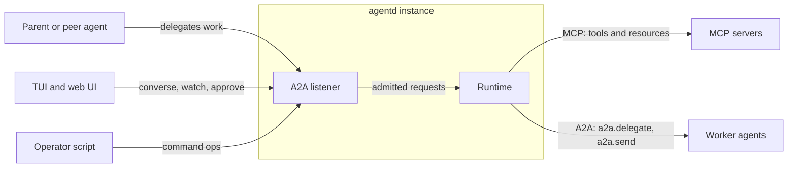
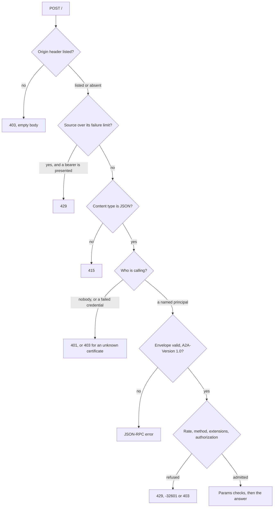
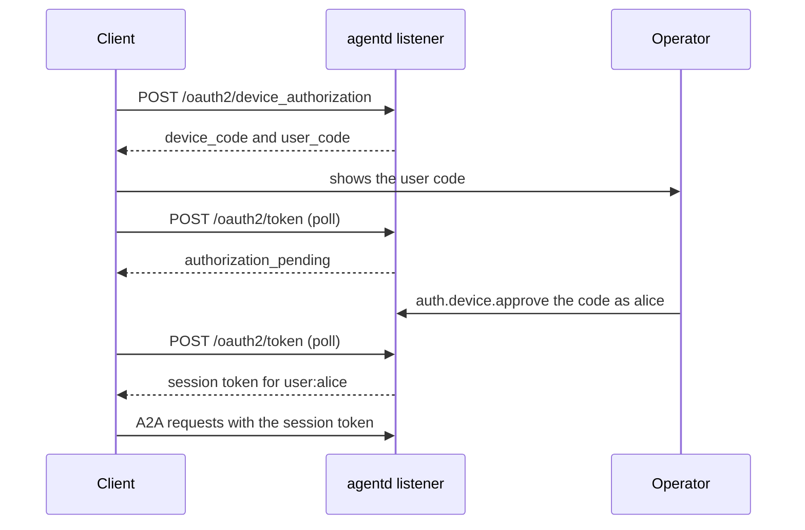
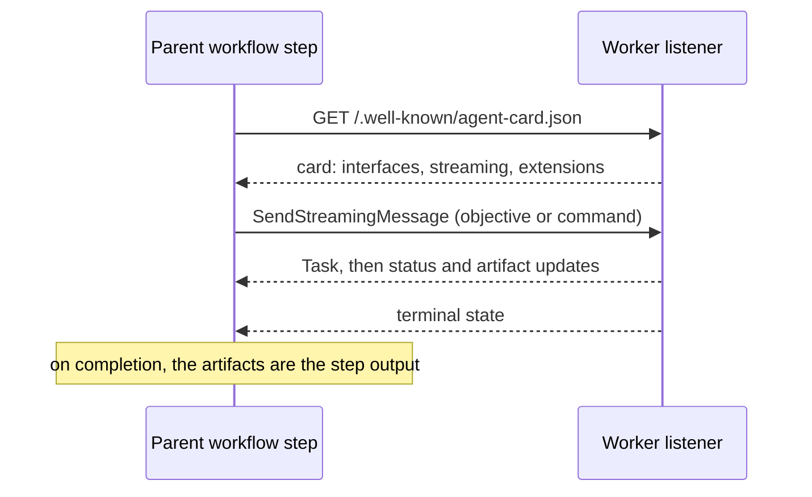

# The A2A channel

A2A (the Agent2Agent protocol) is how other agents and people talk to an
agentd instance: a parent agent delegating work, a peer in a mesh, a person at
the terminal or web UI, an operator's script. This page explains how agentd's
A2A listener decides who is calling, what each caller may see and do, and how
one agent drives another. It is for reviewers who need the trust model and for
integrators who build against the listener. The
[A2A API reference](a2a-reference.md) has every method, code and limit, and
[Connect agents over A2A](connect-agents.md) shows the configuration.

## Two protocols, two directions

agentd speaks two protocols, and the difference between them is direction.
MCP (the Model Context Protocol) is how agentd reaches *out* for capability:
every tool and resource comes from an MCP server you name. A2A is how others
reach *in*, and how agentd, in turn, hands work to other agents.

| | MCP | A2A |
|---|---|---|
| Direction | agentd calls out | callers reach in; agentd also calls peers |
| agentd's part | client | server, and a client to its peers |
| Carries | tools, resources, subscriptions | messages, tasks, commands |
| Off by default | no servers, no tools | no listener, no external access |

An instance with neither is a closed box that can still think and answer on
stdout. MCP gives it hands. A2A gives other people and other agents a door.
Inbound webhooks are a separate, narrower door: HTTP routes that start a
workflow or feed a stream ([React to changes and events](react-to-events.md)).

agentd speaks A2A 1.0 over its JSON-RPC binding. The listener is built on the
A2A project's official Rust SDK, and every task, message and card it emits is
written by that SDK's canonical encoder, so the wire shape is the protocol's
own schema rather than agentd's reading of it.

## One listener, every caller

Every caller arrives at the same listener and speaks the same protocol. The
terminal UI, the web UI, a parent agent and a `curl` command are all ordinary
A2A clients: nothing about the shipped display clients is privileged. A client
that speaks only core A2A can converse, read and list its tasks, cancel them,
follow them as a stream and register webhooks for them.

Anything agentd offers beyond core A2A is a declared extension that a client
activates per request:

- structured commands, the operator's controls among them
  ([`https://agentd.dev/a2a/ext/command`](https://agentd.dev/a2a/ext/command));
- an instance-wide observation feed
  ([`https://agentd.dev/a2a/ext/events`](https://agentd.dev/a2a/ext/events));
- agentd's own facts about a task
  ([`https://agentd.dev/a2a/ext/task-annotations`](https://agentd.dev/a2a/ext/task-annotations)).

A client that activates none of them still gets the whole core protocol.
[A2A extensions](a2a-extensions.md) describes each one.

## The card is a contract

An A2A agent describes itself in an Agent Card, a public JSON document served
at `/.well-known/agent-card.json`. agentd's public card is the same for every
reader. It names the agent, the URL to dial, whether the agent streams and
takes webhooks, which extensions it declares and which authentication schemes
it accepts. It never names a workflow and never depends on who asked.

The card promises nothing the listener does not do. Its security schemes are
computed from the same settings the listener enforces, so a card never
advertises a credential that is not checked or hides one that is. If it says
push notifications are off, registering a webhook is refused. If it declares
no authentication scheme, there is no extended card.

The extended card answers the question the public card cannot: what may
*this* caller do. An authenticated caller reads it with the
`GetExtendedAgentCard` method and sees the workflows it may run, the commands
it may send and the feed it may receive. It exists only where authentication
means something, so a listener that declares no scheme has none.

## A request, step by step

Every JSON-RPC request runs through one pipeline, in a fixed order. Each
refusal is final and is plain JSON, never an event inside a stream. Nothing
that costs the runtime anything runs before the caller is known and has asked
in the protocol this listener speaks.

The order carries the security properties:

- **The browser gate comes first.** A page the operator never authorised
  cannot drive the listener through their browser, because an unlisted
  `Origin` is refused before the body is read.
- **Identity comes before parsing.** Who is calling is decided from the
  headers and the connection alone. A caller who is nobody gets no byte of
  their body parsed.
- **The method table is the same for everyone.** An unknown method is
  `-32601` for an operator and a stranger alike, before authorization could
  make the two answers differ.
- **A refused request costs nothing.** Nothing is created, queued or charged
  for a request the pipeline refuses.

## Who is calling

Every request resolves to a **principal**: an identity, a role and optional
grants. Work is owned by principals, rates and budgets are charged to them,
and audit lines name them.

### The evidence, in order

The listener reads the evidence a request carries in a fixed order, and each
kind of evidence decides only for itself.

| Order | Evidence | Result |
|---|---|---|
| 1 | a unix-socket peer with the daemon's own uid, or root | the operator |
| 2 | a session token the listener issued | that session's principal, or `401` |
| 2 | any other bearer, on a listener that checks bearers | the operator for the operator bearer, a matching bearer rule's principal, or `401` |
| 3 | a verified client certificate | the first certificate rule it matches; the operator while no rule exists; else `403` |
| 4 | none of the above, and an `any` rule exists | that rule's principal |
| 5 | nothing, from this host, on a loopback listener with nothing configured, and no `Origin` | the operator |
| 6 | anything else | `401` |

A bearer that matches nothing is a failed request, never a fall-through to
whatever else the request carried. Otherwise "present any junk" would be as
good as presenting nothing. A listener with no bearer mechanism ignores a
bearer, as it ignores any header it did not ask for. A presented bearer is
resolved before any certificate rule, so a gateway that forwards many callers
under one client certificate and tells them apart by bearer gets each
caller's own principal.

### The implicit operator

On a listener bound to loopback, with no credential mechanism and no principal
rules, a local process that presents nothing is the operator. This is the
single-operator development posture: being on the machine is the
authorization. agentd warns about it at startup.

Two limits keep it from reaching further than the machine:

- **It needs a loopback bind, not merely a loopback peer.** On a wildcard
  bind, a same-host reverse proxy relays every remote caller from
  `127.0.0.1`, and would otherwise make each of them the operator.
- **A request that carries `Origin` is never the implicit operator**, whatever
  the value, `Origin: null` included. Any web page can make a local browser
  post to `127.0.0.1`, so a browser always signs in.

Configuring any credential mechanism ends the implicit operator: a bearer, a
principal rule, a client CA or the device grant. A configuration reload that
adds the first principal rule ends it in the same instant the new rules apply.

### Roles, grants and the floor

A principal's **role** decides what it may do by default:

- **operator** may do everything, including the instance's controls (drain,
  pause, cancel any run, change runtime settings, approve sign-ins).
- **user** may converse, run workflows and manage its own work.
- **agent** may converse, run workflows and read their status. It is the role
  for a delegating peer.
- **anonymous** may do nothing. A rule with this role names nobody.

**Grants** extend a role to further command ops, by name or pattern. Each op
also has a **floor**: the operator-only ops answer to the role alone, and no
grant reaches them, not even `grants: ["*"]`. A peer that could drain the
instance it delegates to would be an operator, and a peer is not one. A
configuration that grants an operator-only op to another role is refused at
load, because a grant that can never apply would read as a control it is not.

**Labels** are operator-declared attributes on a principal. They travel with
everything the principal causes: the run, the MCP request metadata and the
audit line.

### Ownership

What a non-operator starts belongs to it alone.

- **Tasks.** A caller sees, lists, cancels and follows only its own tasks.
  Someone else's task gets the same "task not found" answer as a task that
  does not exist, so task ids cannot be probed.
- **Runs, subagents and conversations.** Every command that names one acts
  only on the caller's own. An object nobody owns is the operator's, and the
  operator acts on anything.
- **Conversation ids are the caller's own names.** A non-operator's
  `contextId` is bound per principal to a fresh key of the runtime's. Two
  callers who pick the same name hold two conversations, and neither can join,
  read or charge the other's.
- **The model acts for its caller.** When a turn runs for a non-operator, the
  model's own control tools meet the same ownership checks the commands do. A
  caller cannot reach through the model what it cannot reach through the
  listener.

Ownership is recorded by principal id, never by credential or session. A
person who signs in again under the same name finds what that name started.

## Signing in

People should not hold the daemon's operator bearer. agentd gives them two
ways to get a credential of their own: the device grant, and the launch grant
that `agentd tui` and `agentd ui` use.

### The device authorization grant

With the device grant on, the listener's origin is also an OAuth 2.0
authorization server for the device flow (RFC 8628). A client asks for a
code, a person shows that code to an operator, the operator approves it under
a name, and the client's next poll returns a session token.

**An approval names the person.** Every session approved under one name is
one principal, `user:<name>`. Those sessions share what the name owns, its
status scope and its rate limit, so a person's history survives signing in
again and token expiry. Reusing a name for a different person hands them the
name's history, and the approval says so when the name was approved before.

**A session is a user unless the operator says otherwise.** An operator
session needs both the configuration to allow it and the approver to grant
it. An approver may narrow a request, never widen it. The `agent` role is
never granted this way: an agent authenticates with its own credential.

**Sessions live in memory.** A session token is opaque, 256 random bits, held
only as its hash. A restart ends every session, and there are no refresh
tokens: a client signs in again when its session expires.

### The launch grant

`agentd tui` and `agentd ui` start the daemon and a display client together,
and sign the client in without any credential of the daemon's reaching it.
The launcher mints a single-use code in the daemon's own process, hands it to
its client, and the client redeems it for an operator session. Nothing outside
the launcher's process can mint a code, so the grant is not declared on the
card. [Use the terminal and web UI](interface.md#launcher) describes the
launcher.

### Sessions and revocation

Every session has a session id (`ds_…` for a device, `ls_…` for a launch)
that every audit line of its caller carries. An operator lists sessions and
revokes one session, every session of a name, or all of them. Revocation
reaches what the session already opened: its streams close and its waiting
requests are refused within a tenth of a second. Revoking never deletes what
the principal owns.

### Failed credentials and the source limiter

A presented credential that fails counts against its source: an IPv4
address, or an IPv6 /64. Once a source has failed too often, every request
from it that presents a bearer is refused `429` before the bearer is checked.
A limiter that still checked each guess would slow nobody down. It would only
turn a wrong guess's `401` into a `429` while a right guess sailed through.

The limiter is shaped so an attacker cannot use it against you:

- **What is never counted:** an origin refusal, a request that presents
  nothing, and the refusal of a caller who did authenticate. Otherwise any
  web page could lock the local console out.
- **What is never refused by it:** a request that presents nothing, a client
  certificate (proven in the handshake, so it cannot be guessed), and a live
  session token (256 bits agentd minted, so "valid, or 429" tells a guesser
  nothing).

The one residual: a client presenting a configured bearer from the same
source as a guesser, behind one NAT or on `127.0.0.1`, waits until the source
drains.

## Conversations and tasks

A2A's unit of work is the **task**. Every message a caller sends either
starts a task or continues one; the one exception is a read command, which
answers with a message. agentd keeps its tasks in its durable store, so a
restart does not lose them. A listener therefore makes an instance
long-lived, and a long-lived instance keeps a durable store.

A task tracks one of three things: a conversation turn, a workflow run or a
subagent. A caller can wait for it in three ways:

- **Block.** A unary send waits for the task to settle, up to a bound, then
  answers with the task as it stands. A task still working is the truth, and
  its id is what to follow.
- **Stream.** A streaming send, or a subscription to an existing task,
  delivers each transition until the task ends. A reconnecting client
  subscribes again and receives the task as it stands; past transitions are
  not replayed.
- **Be told.** A caller that cannot hold a connection open registers a
  webhook, and agentd posts each update to it. The URL comes from the caller,
  which makes every delivery an outbound request a peer chose, so push is off
  until the operator turns it on, and private addresses need a second,
  separate decision.

**When the agent needs a person**, the task moves to `input-required` with
the question as its status message. That is core A2A: a blocking send returns
on it, a stream or a webhook delivers it, and a message naming that task
answers it. A gate addressed to a particular principal accepts an answer only
from that principal. An operator may override, and the override is recorded
as one. [Human in the loop](human-in-the-loop.md) covers asking and answering.

## One agent driving another

Composition needs no new protocol. The channel a parent dials is the channel
a worker serves. A worker is an ordinary agentd: its own instruction, its own
tools, its own budget and its own fence. A parent names it as a **peer** and
hands it work from a workflow, either by delegating (send, then wait for the
result) or by notifying (send, and carry on).

A delegation reads the worker's card first, and takes the card's terms or
refuses them. agentd selects an A2A 1.0 JSON-RPC interface, and refuses a
peer that offers none or that requires an extension agentd does not
implement. It streams when the peer streams, and otherwise sends and polls the
task until it settles.

**The dial always goes to the URL you configured.** The card decides whether
the peer speaks this protocol and under which tenant, never where agentd
connects. A card that names another host cannot redirect a delegation or the
credentials it carries.

**One trace across both agents.** Every request of a delegation or a send —
the card read, the send, each poll — carries the W3C `traceparent` and
`tracestate` of a span of the parent's run, logged as the `span_id` of its
`a2a.delegate` or `a2a.send` line. The worker's listener reads them: the task
and the run or turn the message becomes continue the parent's trace, under
that line's span, and so does every MCP and model call the worker makes for
it. A caller that cannot set headers may put `traceparent` in the message's
`metadata`. The worker's answer names the task's span in a `traceparent`
response header. A reply that wakes the parent's `a2a.wait` leaves the
waiting run in its own trace and names the reply's span as `link` on its
`wait.resolved` line; a message that continues a task does the same on an
`a2a.task.continued` line in the task's trace. [Observability](observability.md#correlate-with-other-services)
lists every surface that adopts or sends a trace.

**A peer agent's request is outside input.** A message from a principal
with the `agent` role is another agent's output, and agentd treats it like
text from a webhook. The run it starts, signals or messages records that it
carries the peer's text, and so does a conversation the peer holds. No
automatic judge answers an ask on the operator's behalf for such a run, and
its result is withheld from a context that holds both sensitive data and
egress. A workflow with an `a2a` start is outside input whoever sends to it,
and a stream it feeds carries that taint into the load-time trifecta check.
[Security model](security.md) explains the trifecta checks.

## Co-located agents: the unix binding

Two instances on one host, or in one pod, can skip TCP and TLS. One listens
on a unix domain socket, and the other names that socket as its peer. The
protocol is the JSON-RPC binding unchanged, carried over the socket. Because
no `https://` URL can name a socket, the card declares agentd's own binding,
[`https://agentd.dev/a2a/binding/jsonrpc-unix`](https://agentd.dev/a2a/binding/jsonrpc-unix),
and a client that cannot dial a socket never selects it.

The kernel is the authenticator. The socket file is mode `0600`, and every
connection's peer uid must be the daemon's own, or root. A connection from
another local user is dropped before HTTP. Every connection that passes is
the operator. That is stronger than loopback TCP, which any local user can
dial. A unix listener declares no authentication scheme, takes no TLS and
issues no sessions. Two instances can hold sockets in both directions, so
either can delegate to the other, and the filesystem's permissions are the
contract.

## Why it is built this way

- **Extensions, not custom methods.** A2A provides extensions for anything an
  agent speaks beyond the core. agentd uses them, so a stock A2A client can
  talk to any agentd, and an agentd client falls back to core A2A against any
  other agent.
- **Errors that mean one thing.** "Who are you" and "you may not" use their
  own codes outside JSON-RPC's reserved range, so a client that branches on a
  specification code is never told the wrong thing.
- **No implicit trust beyond the machine.** Plaintext is loopback only, a
  non-loopback listener requires client authentication, and a wildcard bind
  requires the public URL to be stated. The load refuses a listener that
  would be served on terms nobody chose.
- **Identifiers that never change meaning.** agentd's extension URIs carry no
  version. An incompatible change takes a new URI with a new name, so a peer
  that speaks one is never surprised by it.

## Next steps

- [Connect agents over A2A](connect-agents.md): expose an agent, sign
  people in and delegate, with complete configurations.
- [A2A API reference](a2a-reference.md): methods, the pipeline, errors,
  limits and the command ops.
- [A2A extensions](a2a-extensions.md): what agentd adds on top of core A2A.
- [Security model](security.md): the threat model the listener is part of.
