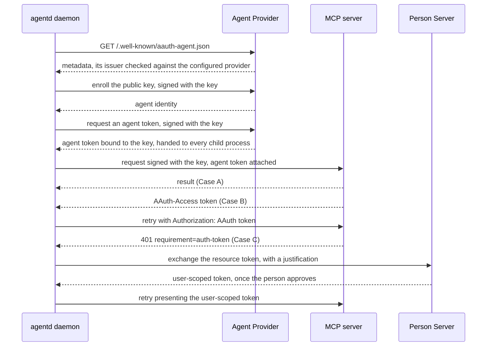

# AAuth agent identity

AAuth gives an agent its own signed identity, so a server can tell exactly
which agent is calling without a shared API key and without a person on each
request. This guide explains what AAuth is, when to use it, how to turn it on
in agentd, what agentd signs and checks, and the limits of the support. It is
for operators connecting agentd to MCP servers, gateways or peers that ask
for AAuth.

## What AAuth is

AAuth is a draft IETF protocol, described in
[draft-hardt-oauth-aauth-protocol](https://datatracker.ietf.org/doc/draft-hardt-oauth-aauth-protocol/)
and
[draft-hardt-aauth-bootstrap](https://datatracker.ietf.org/doc/draft-hardt-aauth-bootstrap/).
agentd implements the agent (client) side. Four parties take part:

| Party | Role |
|---|---|
| the agent | holds an Ed25519 key and signs its requests with it (RFC 9421 HTTP Message Signatures) |
| the Agent Provider | enrolls the agent's public key and issues short-lived *agent tokens* bound to that key |
| the resource | an MCP server, gateway or peer that verifies the signature and the token |
| the Person Server | where a person approves when a resource wants that person's authority |

A resource asks for one of three levels of access:

- **Case A, identity-based.** The resource wants to know which agent is
  calling. agentd signs every request; this is the common case.
- **Case B, resource-managed.** The resource returns its own access token
  (`AAuth-Access`). agentd adopts it and presents `Authorization: AAuth <token>`
  on the retry and later calls to that resource.
- **Case C, user-scoped.** The resource wants a person's authority and answers
  `401` with `requirement=auth-token` and a resource token. agentd exchanges
  the resource token at the Person Server, where the person consents, and
  presents the user-scoped token on the retry.

## When to use it

Use AAuth when a server asks for it, or when you want a server or gateway to
attribute each request to an individual agent by signature rather than by a
shared key or a source address. For an ordinary API key, OAuth or cloud
identity, use an `auth:` block instead
([Outbound credentials](authentication.md)). The two are not combined on one
MCP server: a server with `auth:` or `oauth:` is not AAuth-signed.

## Turn it on

AAuth is configured under `security.aauth`. Setting `provider` turns it on.

```yaml
agent:
  instruction: "Answer questions from the secure knowledge base."

intelligence:
  endpoints: https://api.openai.com/v1/chat/completions
  model: gpt-5.1
  token: "{{secret:OPENAI_API_KEY}}"

mcp:
  servers:
    # AAuth-protected: no auth block, so the daemon signs its requests.
    - name: kb
      endpoint: https://mcp.kb.example.com/mcp
      tags: { "*": [sensitive] }
    # Public docs: no identity needed, so do not present one.
    - name: docs
      endpoint: https://mcp.docs.example.com/mcp
      aauth: false

security:
  aauth:
    provider: https://apd.example.com
    key_file: /var/lib/agentd/aauth-key
    enroll_token: "{{secret:AAUTH_ENROLL_TOKEN}}"
```

With `OPENAI_API_KEY` and `AAUTH_ENROLL_TOKEN` set, check it with
`agentd --validate-config --config agentd.yaml`. The same settings work as
flags:

```sh
agentd --instruction "Answer questions from the knowledge base." --intelligence https://api.openai.com/v1/chat/completions --model gpt-5.1 --intelligence-token '{{secret:OPENAI_API_KEY}}' --mcp kb=https://mcp.kb.example.com/mcp --aauth-provider https://apd.example.com --aauth-key-file /var/lib/agentd/aauth-key --aauth-enroll-token '{{secret:AAUTH_ENROLL_TOKEN}}'
```

| Setting | Flag | Meaning |
|---|---|---|
| `security.aauth.provider` | `--aauth-provider` | the Agent Provider's URL; required, and setting it turns AAuth on |
| `security.aauth.key_file` | `--aauth-key-file` | the durable Ed25519 key, created with mode `0600` when absent; default `/var/lib/agentd/aauth-key` |
| `security.aauth.enroll_token` | `--aauth-enroll-token` | a one-time enrollment token for a provider in token mode; in a config file it must be a secret reference |
| `security.aauth.enroll_assertion_file` | `--aauth-enroll-assertion-file` | a file holding an enrollment assertion, such as a Kubernetes projected service-account token whose audience is the provider |
| `security.aauth.person_server` | `--aauth-person-server` | the Person Server for user-scoped access (Case C) |
| `mcp.servers[].aauth` | — | `false` stops signing requests to that server |

Each setting is also an environment variable: `AGENTD_SECURITY_AAUTH_PROVIDER`
and so on.

At startup, before it dials anything else, agentd loads the key or creates
it, checks the Agent Provider's metadata (see
[What agentd checks](#what-agentd-checks)), enrolls the key and fetches the
first agent token. The start is refused, exit 2:

- for a key file that cannot be read or created, or an enrollment-token
  reference that does not resolve, before any network call;
- for provider metadata that names another issuer or does not parse, before
  the key is enrolled.

A provider that does not answer does not stop the start. `auth.unavailable`
(target `aauth`) is logged, and every request that needs the identity fails
without being sent: an MCP server's connect, which is dialed again in the
background, a tool call, a model call, an A2A call. Each later request asks
the provider again, its metadata first, and the daemon asks it in the
background every 30 seconds; `auth.recovered` is logged when it answers. A
provider that answers but will not enroll the key or issue a token is
handled the same way. This is how agentd treats an MCP server that is down
at boot, and an OAuth issuer that does not answer.

The release binaries and the container image include the `aauth` feature. A
binary built without it refuses `security.aauth` at load, exit `2`.

## Choose an enrollment mode

The Agent Provider decides how a new key is admitted.

| Mode | Configure | Use when |
|---|---|---|
| open | nothing beyond `provider` | a self-hosted provider that admits any key |
| token | `enroll_token`, a one-time secret an operator hands over | a provider that admits keys an operator vouched for |
| federated | `enroll_assertion_file`, a platform-issued assertion | a fleet: each pod presents its own projected identity token, so there is no shared enrollment secret |

An assertion file is read again on every enrollment, so a rotated projected
token is always current, and the assertion never enters configuration or
logs. Put the key file on storage that survives restarts, or each restart
enrolls a new identity.

## What agentd signs

The agent has one identity for its whole process tree. Every process agentd
starts signs with the daemon's key, and turn workers and subagents present
the daemon's agent token too:

| Request | Signed |
|---|---|
| MCP requests: connecting, listing tools, resource reads and subscriptions, workflow `mcp.tool` steps, and the tool calls of turns and subagents | yes, unless the server has `auth:`, `oauth:` or `aauth: false` |
| outbound A2A peer requests | yes, beside any peer credential, except between a parent and its instance child |
| model calls: the agent's turns, subagents, the approval judge, the goal check | yes, beside the connection's own credential |

A turn worker or a subagent is handed the identity with its spawn payload,
on its private stdin pipe, never in its environment or arguments: the key
file's path, the agent token the daemon holds now and when it stops being
good, whether the daemon has verified the provider, and what the tree knows
of each server it signs for — the access token a server issued (Case B),
the user-scoped token the Person Server issued for it (Case C), and whether
the server wants a `Content-Digest`. The child reads the key from the file
and refuses one that no longer holds the daemon's key; it never creates a
key of its own. It asks the provider for nothing until the token it was
handed is due a refresh, and then refreshes it itself, through the same
provider, once that provider's metadata is verified. It reads no discovery
document the daemon read, and presents the tokens it was handed without
earning them again; a user-scoped token that expires within a minute is not
handed, so the child earns a fresh one.

The daemon refreshes its agent token in the background five minutes before
it is due, or half-way through the life of a token that lives less than ten
minutes, even while it signs nothing. A child is therefore handed a token
with time left on it, and refreshes it itself only if it outlives that, so
one enrollment and one agent token at a time serve every turn. A background
refresh that fails is tried again 30 seconds later; requests that find no
token at once share one fetch, and its failure.

A Case B or Case C token a child earns is handed up to the daemon, which
presents it too and hands it to the children spawned after; a child already
running keeps the tokens it was handed. A durable subagent record keeps none
of this, and a restored subagent is handed the running daemon's identity.

An instance-tier child is a daemon of its own: its parent composes its
`security.aauth` with the same provider and key file, so it signs with the
same key. It loads that key and never creates one, so a child whose key
file is gone refuses to start, and the parent refuses to spawn a child when
the file no longer holds its key. Like any daemon the child checks the
provider and fetches its own agent token when it starts, since an agent
token is never written into a file, and keeps it fresh. Its enrollment
token is written only when it is a `{{secret:…}}` reference. A restored
instance child is composed the running daemon's identity again.

The links between a parent and its instance child are not signed: the
child's reports to its `parent` peer, and the parent's `subagent.send` and
`a2a.send` to the child. agentd's A2A listener checks no AAuth signature,
and on these links the caller is named by the unix socket's peer credential
or the bearer the parent composed, so the tree's own links do not wait on
the Agent Provider.

The daemon's key always has a file. An embedder that installs an
`AAuthClient` whose key it holds only in memory hands turn workers and
subagents the key itself, on the same pipe, and writes it to `aauth-key`
(mode `0600`) in an instance child's own state directory (mode `0700`), since
a daemon reads its identity from files and never from its environment. The
copy is removed when the child exits or fails to start, and written again
when the child is respawned; one left by a daemon that crashed stays until
that instance is respawned and exits.

## On the wire

Each signed request carries three RFC 9421 headers:

```text
Signature-Input: sig=("@method" "@authority" "@path" "signature-key");created=<unix time>
Signature: sig=:<base64 Ed25519 signature over the signature base>:
Signature-Key: sig=jwt;jwt="<agent token>"
```

When a server's discovery document (`/.well-known/aauth-resource.json`,
fetched when agentd connects, and not again by a child of a daemon that
read it) says it requires body integrity, the signature also covers a
`Content-Digest` of the body. The agent token is fetched and cached; it is
due a minute before it expires, by its own `exp` claim when it carries one,
and is refreshed ahead of that. There is nothing to rotate by hand.



A Case B or Case C reaction is one retry inside the same request, bounded so
a requirement agentd cannot satisfy surfaces as the server's `401` instead of
a loop. A second `auth-token` requirement from a resource agentd already holds
a user-scoped token for is a real refusal.

## What agentd checks

Before it enrolls the key, fetches a token or presents one, agentd reads the
Agent Provider's metadata document (`/.well-known/aauth-agent.json`, on the
configured provider) and checks that the `issuer` it names is the configured
provider, so a host serving another provider's metadata is never enrolled
with. A provider that publishes no document (any status other than a success
or a server error) is used as configured. A document that names another
issuer, or that does not parse, refuses the start. A provider that does not
answer, or answers with a server error (`5xx`, `429`), is not verified, so
nothing is enrolled with it or signed under it until it answers.

agentd also acts on the agent token rather than treating it as opaque. Each
time it fetches a token that is a JWT, it checks that its `iss` is the
configured provider, its `ps` is the configured Person Server, and its
`cnf.jwk` is agentd's own signing key, for each of those claims the token
carries. A mismatch fails the token fetch, so a misconfigured provider shows
up as that error rather than as a wall of `401`s from every server.

The Person Server dial is protected against server-side request forgery: the
URL the Person Server returns is vetted before agentd connects to it. The
configured `person_server` URL is dialled by name, so a loopback Person
Server works in development.

## Where the person sits

For identity-based servers (Case A) a person acts once, at setup: enabling the
agent and, if the provider needs one, handing over an enrollment token. After
that the agent signs its calls with no per-request consent.

For user-scoped servers (Case C) the person approves at their Person Server,
which shows them the justification agentd sends ("agent … requests access to
…"). agentd never renders a consent screen and never caches a decision on a
person's behalf; it carries the token the Person Server hands back.

## Limits

- **The agent token goes to every signed destination.** `Signature-Key`
  carries the agent token to every MCP server agentd signs for, every A2A
  peer, and every model endpoint. A2A peers and model calls have no
  per-destination opt-out; MCP servers have `aauth: false`. Set it on
  servers that do not need the identity.
- **Every signed request needs the provider.** No request goes out without
  the identity it is configured to present, so while the Agent Provider does
  not answer and no agent token is held, model calls and A2A calls fail with
  the MCP requests, unsent. A model call that fails this way is not failed
  over to another endpoint or model. The links between a parent and its
  instance child are not signed, and do not fail this way.
- **A token a child earns reaches only the children after it.** A Case B or
  Case C token a turn worker or subagent earns is handed up to the daemon,
  so the children spawned after it present it, but children already running
  earn their own. An instance child keeps the tokens it earns.
- **Discovery is not signed.** The two metadata documents agentd reads, the
  provider's and each MCP server's `/.well-known/aauth-resource.json`, are
  public, and are fetched with plain `GET`s.
- **Outbound only.** agentd signs what it sends and verifies no AAuth
  signature on what it receives. Its A2A listener names callers by bearer,
  session, client certificate or connection
  ([The A2A channel](a2a.md)); no principal rule matches an AAuth identity.
- **Two parts of the draft are not implemented**: a server's
  `202 requirement=interaction` (asking the person mid-request) and AAuth
  events (`/inbox`) for asynchronous results. A server that needs either does
  not work with agentd.

## Embedding

An embedder building on the `agentd-core` crate with its `aauth` feature can
drive AAuth directly through `agentd::aauth`: build an `AgentKey` and an
`ApdConfig`, construct an `AAuthClient`, optionally call `prime()` to
validate the provider's metadata, enroll and fetch the first token up front,
and `install` it. Every MCP connection the process makes then signs, and so
does every child process it starts. Name the key's file with
`with_key_file` when it has one, so children are handed the path rather than
the key. The signer is the `RequestSigner` trait, and `verify_ed25519` is
exposed for the server side of a test. [Embed agentd in Rust](embedding.md)
covers the crates.

## Next steps

- [Outbound credentials](authentication.md): static, OAuth, AWS and SPIFFE
  credentials for the same endpoints.
- [Connect MCP servers](connect-mcp.md): declare the servers you sign for.
- [Security model](security.md): where signing sits among agentd's other
  controls.
