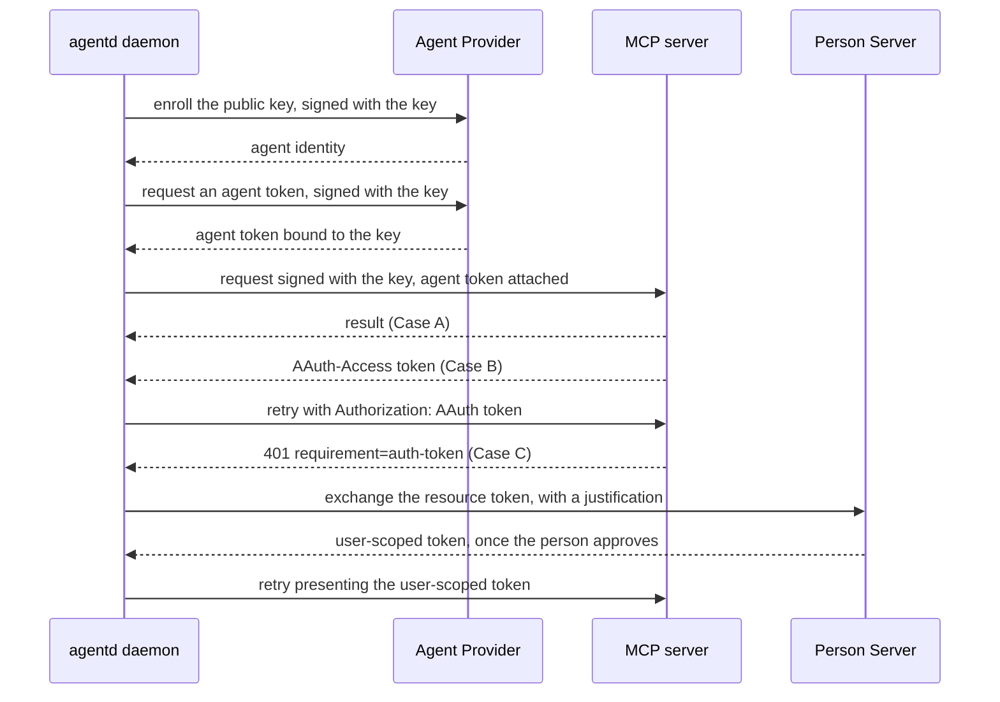

# AAuth agent identity

AAuth gives an agent its own signed identity, so a server can tell exactly
which agent is calling without a shared API key and without a person on each
request. This guide explains what AAuth is, when to use it, how to turn it on
in agentd, what agentd signs and checks, and the limits of the support. It is
for operators connecting agentd to MCP servers, gateways or peers that ask
for AAuth.

## What AAuth is

AAuth is a draft IETF protocol, described in
[draft-hardt-oauth-aauth-protocol](https://datatracker.ietf.org/doc/draft-hardt-oauth-aauth-protocol/)
and
[draft-hardt-aauth-bootstrap](https://datatracker.ietf.org/doc/draft-hardt-aauth-bootstrap/).
agentd implements the agent (client) side. Four parties take part:

| Party | Role |
|---|---|
| the agent | holds an Ed25519 key and signs its requests with it (RFC 9421 HTTP Message Signatures) |
| the Agent Provider | enrolls the agent's public key and issues short-lived *agent tokens* bound to that key |
| the resource | an MCP server, gateway or peer that verifies the signature and the token |
| the Person Server | where a person approves when a resource wants that person's authority |

A resource asks for one of three levels of access:

- **Case A, identity-based.** The resource wants to know which agent is
  calling. agentd signs every request; this is the common case.
- **Case B, resource-managed.** The resource returns its own access token
  (`AAuth-Access`). agentd adopts it and presents `Authorization: AAuth <token>`
  on the retry and later calls to that resource.
- **Case C, user-scoped.** The resource wants a person's authority and answers
  `401` with `requirement=auth-token` and a resource token. agentd exchanges
  the resource token at the Person Server, where the person consents, and
  presents the user-scoped token on the retry.

## When to use it

Use AAuth when a server asks for it, or when you want a server or gateway to
attribute each request to an individual agent by signature rather than by a
shared key or a source address. For an ordinary API key, OAuth or cloud
identity, use an `auth:` block instead
([Outbound credentials](authentication.md)). The two are not combined on one
MCP server: a server with `auth:` or `oauth:` is not AAuth-signed.

## Turn it on

AAuth is configured under `security.aauth`. Setting `provider` turns it on.

```yaml
agent:
  instruction: "Answer questions from the secure knowledge base."

intelligence:
  endpoints: https://api.openai.com/v1/chat/completions
  model: gpt-5.1
  token: "{{secret:OPENAI_API_KEY}}"

mcp:
  servers:
    # AAuth-protected: no auth block, so the daemon signs its requests.
    - name: kb
      endpoint: https://mcp.kb.example.com/mcp
      tags: { "*": [sensitive] }
    # Public docs: no identity needed, so do not present one.
    - name: docs
      endpoint: https://mcp.docs.example.com/mcp
      aauth: false

security:
  aauth:
    provider: https://apd.example.com
    key_file: /var/lib/agentd/aauth-key
    enroll_token: "{{secret:AAUTH_ENROLL_TOKEN}}"
```

With `OPENAI_API_KEY` and `AAUTH_ENROLL_TOKEN` set, check it with
`agentd --validate-config --config agentd.yaml`. The same settings work as
flags:

```sh
agentd --instruction "Answer questions from the knowledge base." --intelligence https://api.openai.com/v1/chat/completions --model gpt-5.1 --intelligence-token '{{secret:OPENAI_API_KEY}}' --mcp kb=https://mcp.kb.example.com/mcp --aauth-provider https://apd.example.com --aauth-key-file /var/lib/agentd/aauth-key --aauth-enroll-token '{{secret:AAUTH_ENROLL_TOKEN}}'
```

| Setting | Flag | Meaning |
|---|---|---|
| `security.aauth.provider` | `--aauth-provider` | the Agent Provider's URL; required, and setting it turns AAuth on |
| `security.aauth.key_file` | `--aauth-key-file` | the durable Ed25519 key, created with mode `0600` when absent; default `/var/lib/agentd/aauth-key` |
| `security.aauth.enroll_token` | `--aauth-enroll-token` | a one-time enrollment token for a provider in token mode; in a config file it must be a secret reference |
| `security.aauth.enroll_assertion_file` | `--aauth-enroll-assertion-file` | a file holding an enrollment assertion, such as a Kubernetes projected service-account token whose audience is the provider |
| `security.aauth.person_server` | `--aauth-person-server` | the Person Server for user-scoped access (Case C) |
| `mcp.servers[].aauth` | — | `false` stops signing requests to that server |

Each setting is also an environment variable: `AGENTD_SECURITY_AAUTH_PROVIDER`
and so on.

At startup agentd loads the key, or creates it, and installs the identity in
the daemon process. A key file that cannot be read or created, or an
enrollment-token reference that does not resolve, exits 2 before any network
call. Enrollment and the first agent token happen on the first signed request.

The release binaries and the container image include the `aauth` feature. A
binary built without it refuses `security.aauth` at load, exit `2`.

## Choose an enrollment mode

The Agent Provider decides how a new key is admitted.

| Mode | Configure | Use when |
|---|---|---|
| open | nothing beyond `provider` | a self-hosted provider that admits any key |
| token | `enroll_token`, a one-time secret an operator hands over | a provider that admits keys an operator vouched for |
| federated | `enroll_assertion_file`, a platform-issued assertion | a fleet: each pod presents its own projected identity token, so there is no shared enrollment secret |

An assertion file is read again on every enrollment, so a rotated projected
token is always current, and the assertion never enters configuration or
logs. Put the key file on storage that survives restarts, or each restart
enrolls a new identity.

## What agentd signs

The identity is installed in the daemon process, and agentd signs the
requests that process makes:

| Request | Signed |
|---|---|
| MCP requests the daemon makes: connecting, listing tools, resource reads and subscriptions, workflow `mcp.tool` steps, tools a `security.policies` rule may match | yes, unless the server has `auth:`, `oauth:` or `aauth: false` |
| outbound A2A peer requests | yes, always, beside any peer credential |
| model calls the daemon makes itself: the approval judge and the goal check | yes, beside the connection's own credential |
| the agent's turns: model calls and MCP tool calls from turn worker processes | **no** |
| subagents and instance children | **no** |

> **Limit.** The agent's turns run in turn worker processes and subagents in
> their own processes, and neither inherits the identity. Their model calls
> and their own MCP tool calls go out unsigned, so an AAuth-protected server
> that a model calls during a turn refuses the call. A tool the daemon serves
> itself is signed: a workflow `mcp.tool` step, or a tool that a
> `security.policies` rule matches, which the turn hands to the daemon to run.

## On the wire

Each signed request carries three RFC 9421 headers:

```text
Signature-Input: sig=("@method" "@authority" "@path" "signature-key");created=<unix time>
Signature: sig=:<base64 Ed25519 signature over the signature base>:
Signature-Key: sig=jwt;jwt="<agent token>"
```

When a server's discovery document (`/.well-known/aauth-resource.json`,
fetched when agentd connects) says it requires body integrity, the signature
also covers a `Content-Digest` of the body. The agent token is fetched and
cached, and refreshed a minute before it expires, by its own `exp` claim when
it carries one. There is nothing to rotate by hand.



A Case B or Case C reaction is one retry inside the same request, bounded so
a requirement agentd cannot satisfy surfaces as the server's `401` instead of
a loop. A second `auth-token` requirement from a resource agentd already holds
a user-scoped token for is a real refusal.

## What agentd checks

agentd acts on the agent token rather than treating it as opaque. Each time
it fetches a token that is a JWT, it checks that its `iss` is the configured
provider, its `ps` is the configured Person Server, and its `cnf.jwk` is
agentd's own signing key, for each of those claims the token carries. A
mismatch fails the token fetch, so a misconfigured provider shows up as that
error rather than as a wall of `401`s from every server.

The Person Server dial is protected against server-side request forgery: the
URL the Person Server returns is vetted before agentd connects to it. The
configured `person_server` URL is dialled by name, so a loopback Person
Server works in development.

> **Limit.** The daemon does not fetch the Agent Provider's metadata document
> (`/.well-known/aauth-agent.json`) or compare its `issuer` with the
> configured provider before enrolling. That check exists in the client API
> (`AAuthClient::prime`), which an embedder can call, and the `iss` check on
> every agent token still applies.

## Where the person sits

For identity-based servers (Case A) a person acts once, at setup: enabling the
agent and, if the provider needs one, handing over an enrollment token. After
that the agent signs its calls with no per-request consent.

For user-scoped servers (Case C) the person approves at their Person Server,
which shows them the justification agentd sends ("agent … requests access to
…"). agentd never renders a consent screen and never caches a decision on a
person's behalf; it carries the token the Person Server hands back.

## Limits

- **Child processes do not sign**, as described in
  [What agentd signs](#what-agentd-signs).
- **The agent token goes to every signed destination.** `Signature-Key`
  carries the agent token to every MCP server the daemon signs for, every A2A
  peer, and the model endpoint the daemon's own model calls use. A2A peers and
  model calls have no per-destination opt-out; MCP servers have
  `aauth: false`. Set it on servers that do not need the identity.
- **Outbound only.** agentd signs what it sends and verifies no AAuth
  signature on what it receives. Its A2A listener names callers by bearer,
  session, client certificate or connection
  ([The A2A channel](a2a.md)); no principal rule matches an AAuth identity.
- **Two parts of the draft are not implemented**: a server's
  `202 requirement=interaction` (asking the person mid-request) and AAuth
  events (`/inbox`) for asynchronous results. A server that needs either does
  not work with agentd.

## Embedding

An embedder building on the `agentd-core` crate with its `aauth` feature can
drive AAuth directly through `agentd::aauth`: build an `AgentKey` and an
`ApdConfig`, construct an `AAuthClient`, optionally call `prime()` to enroll,
validate the provider's metadata and fetch the first token up front, and
`install` it. Every MCP connection the process makes then signs. The signer
is the `RequestSigner` trait, and `verify_ed25519` is exposed for the server
side of a test. [Embed agentd in Rust](embedding.md) covers the crates.

## Next steps

- [Outbound credentials](authentication.md): static, OAuth, AWS and SPIFFE
  credentials for the same endpoints.
- [Connect MCP servers](connect-mcp.md): declare the servers you sign for.
- [Security model](security.md): where signing sits among agentd's other
  controls.
