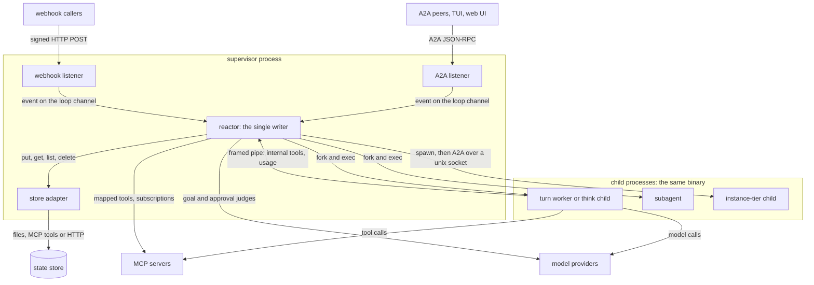
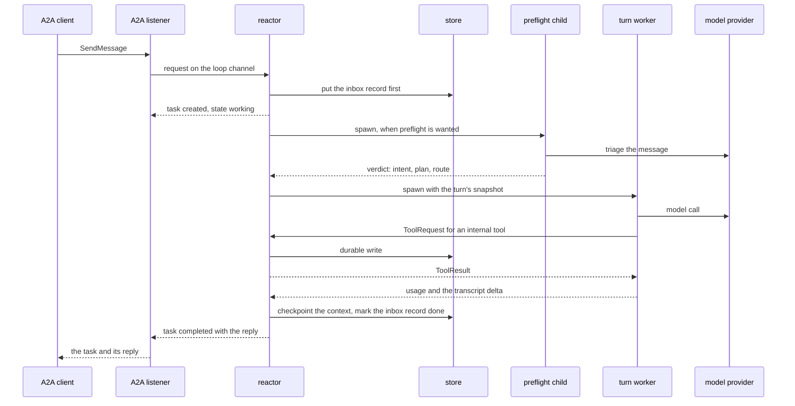

# Architecture

agentd is one binary that runs as a supervisor process and a set of
short-lived child processes. The supervisor holds the state and the
credentials and runs no agent loop; the agent loop runs in the children,
which the supervisor can kill at any moment. This page is for evaluators,
security reviewers and integrators who need to predict where a piece of work
runs, what survives a crash and which network connections a deployment opens.

## The shape of the system

A running agentd is **one supervisor** that owns every piece of durable
state, **child processes** it spawns for each unit of reasoning, and a small
set of **network edges**: model providers and MCP servers outbound, A2A and
webhooks inbound, and a store that may be local files or a remote service.



Three ideas shape every part of it:

- **The unit of concurrency is an OS process, not an async task.** A model
  call that wedges is ended by killing a process group, which needs no
  cooperation from the code being stopped.
- **One thread writes state.** Listeners, readers and executor threads only
  post events; the reactor decides and records every transition.
- **The protocols that talk to other people's software come from their
  official SDKs.** MCP is `rmcp` and A2A is the A2A project's `a2a-rs`, both
  running over agentd's own transport. The small, stable layers (HTTP/1.1,
  cron, a YAML subset) are written by hand.
  [Engineering choices](why-rust.md) explains why.

The code ships as five crates — `agentd-net`, `agentd-mcp`,
`agentd-instruction`, `agentd-core` and the `agentd-cli` binary — described
with their cargo features in [Build features and crates](features.md).

## Two loops

The "agent" is split across two loops that never share a thread.

| | Supervisor loop | Agentic loop |
|---|---|---|
| Lives in | the main process, one thread | a child process per unit of work |
| Calls the model | not for agent work | always: it is the reasoning |
| Owns | lifecycle, config, triggers, the inbox, durable state, budgets, the process tree, liveness | think, call a tool, observe, repeat |
| Shape | a reactor blocking on one channel | a straight-line loop over a snapshot |
| Stopped by | a signal, then its own drain | `killpg` from the supervisor |

The supervisor decides *when* work runs and *that* it stays inside its
limits; it never decides what the work should be. Two supervisor-side model
calls are the exception, and both are narrow: the goal watchdog's check runs
on `intelligence.roles.goal`, and the judge that answers an ask on the
operator's behalf runs on `intelligence.roles.approve`. Each runs on a
detached thread, returns a verdict as an event, cannot call a tool and
cannot change state. Their tokens are charged to the instance budget.

## The process tree

Every child is a **direct child of the supervisor**, however deep the
logical agent tree goes. The tree is flat: one table keyed by node id. A
child is the same binary re-executed, and it receives its whole
configuration in the first frame on its stdin, so one artifact ships with no
second code path. The children come in four kinds:

| Child | Runs | Lifetime |
|---|---|---|
| Turn worker | one turn of a conversation, or one `agent`, `think` or deciding workflow step | until the turn ends |
| Think child | preflight, compaction, the `think` and `decide` tools: a worker with no tools | one call, a few rounds at most |
| Subagent | a nested agent loop started by `subagent.run` | until its objective ends or it is retired |
| Instance-tier child | a whole agentd daemon composed from a subagent template | until its `ttl`, `until` signal or retirement; drains like any daemon |

A child creates children only by calling the supervisor-owned `subagent`
tool, which is where depth, breadth, lifetime total and spawn rate are
enforced. Depth and `agent_path` are minted by the supervisor from its own
records, never read from a request, so a child cannot claim to be shallower
than it is. A burst of spawns comes back as a refused tool result, not a
crash: the limiter is a token bucket sized by `limits.subagents.rate`
(default `8/2s`).

The kernel enforces the boundary at three points. Each child gets its own
process group, so one `killpg` ends a subtree. Each child asks the kernel to
kill it when the supervisor dies (`PR_SET_PDEATHSIG`: `SIGKILL` for workers
and subagents, `SIGTERM` for an instance-tier daemon so it drains). And the
supervisor marks itself a subreaper, so orphaned grandchildren reparent to
agentd rather than to the host's init.
[Supervision and containment](harness.md) covers spawning, liveness, the kill
ladder and recovery in depth.

## The single-writer loop

The reactor is one thread that drains every source, decides, checkpoints and
then blocks on exactly one wait. Each iteration runs the same phases in the
same order:

1. Stamp the health heartbeat that `/healthz` reads; log a change in
   resource pressure.
2. Reap exited children. A reap is requeued once behind its child's
   already-written frames, so "exited without a result" cannot be a race.
3. Drain events: child frames, executor results, listener requests.
4. Retire workflows whose drain deadline passed; sweep expired webhook
   idempotency markers.
5. Fire due durable timers.
6. Turn the daemon's own runtime events into stream appends, so this pass's
   consumers see them.
7. Process the durable inbox.
8. Poll start nodes, stream and correlate consumers, and suspended waits;
   schedule runs. Scheduling repeats to a fixpoint while inline data steps
   complete, and again for streams appended in this pass.
9. Dispatch queued turns.
10. Poll pending tool waits, MCP notifications, MCP Events and joins.
11. Ping children, classify their liveness and tear down the unhealthy;
    tick instance-tier children.
12. Checkpoint dirty state; publish gauges and the display clients' feed.
13. Handle signals and run the lifecycle step, which may exit.
14. Wait on the event channel until the nearest deadline, at most 200 ms.

The order is the contract. Reaping precedes the inbox, so a child's exit is
visible before its work is reconsidered. Timers fire before start nodes, so
a durable sleep resolves in the pass that could re-arm it. Checkpointing
precedes the lifecycle step, so nothing exits with unflushed state.

The wait is bounded by the nearest armed deadline — a timer, a schedule, a
wait's timeout — with a 5 ms floor and a 50 ms ceiling while work is pending.
A timer due in 3 ms fires in about 3 ms; the 200 ms tick caps how long an
idle loop sleeps, it is not a scheduling granularity. Child frames ride the
same channel the loop waits on, so a worker's tool request wakes the loop
instead of waiting out the tick. The scheduling fixpoint means a pipeline of
inline data steps (`assign`, `map`, `template`, `switch`) advances at
execution speed rather than one step per tick.

**Single writer does not mean single thread.** These threads exist beside
the reactor, and none of them mutates durable state — each posts events onto
the channel the reactor drains:

- one reader thread per child, for its frames;
- executor threads for the blocking MCP and HTTP calls the supervisor makes,
  and for the goal and approval judges;
- the A2A listener: axum on its own two-worker tokio runtime;
- each MCP connection: a one-worker tokio runtime that the official SDK runs
  on, in the supervisor and in every worker that dials MCP;
- the webhook listener: a blocking thread per connection;
- four MCP Events poll threads, the metrics server and the OTLP log exporter,
  when those are configured.

An idle daemon with no MCP server and no listener runs on one thread; the
numbers are in [Engineering choices](why-rust.md#the-numbers).

The async runtimes sit at the protocol edges because the SDKs need them.
The reactor never awaits, for a correctness reason: the thing that must be
cancelled when a turn goes wrong is a child process, and dropping a future
cannot end a process. The reactor also never blocks on an untrusted source.
It reaches every pipe through the channel it waits on, and it unblocks a
parked reader only by making the producer go away — closing its pipe,
killing its group. Pipes carry no read timeout; the deadline lives in one
place.

## Where state lives

When an instance has a store, every unit of progress is written to it before
it counts: an accepted message, a fired trigger, a workflow step, a
conversation's transcript, a subagent record, a memory write, a timer, a
stream event, an audit record, a cached credential. The store is a
key-value service behind one small contract:

```text
put(key, seq, envelope)  -> Ok | Conflict{latest_seq} | Err
get(key[, seq])          -> Some(envelope) | None | Err
list(prefix)             -> [{key, seq}] | Unsupported | Err
delete(key)              -> Ok | Unsupported | Err
```

Keys are `<prefix>/<instance>/<kind>/<id>` across thirteen entity kinds:
`manifest`, `inbox`, `context`, `run`, `subagent`, `task`, `memory`,
`artifact`, `timer`, `event`, `audit`, `cred` and `identity`. Values are
versioned envelopes that carry a sequence number, a timestamp, the writing
instance and, for a run, the hash of the definition it started under.

**`put` is a compare-and-set on the sequence number, and a conflict on a key
this instance owns is fatal.** A second writer exists, and the instance
stops rather than interleave with it. That is the split-brain guard that
makes several replicas over one namespace safe.

**Accept means durable.** An inbound message or a fired trigger is written to
the inbox before it is acted on, and an A2A `SendMessage` is acknowledged
only after that write. On restart, undone inbox records are re-delivered
with their original event id. You get exactly-once state transitions and
at-least-once effects. agentd cannot make a remote tool call idempotent for
you; it sends an idempotency key in every MCP call's `_meta` so a server can
collapse a replay.

agentd links no database client. Four adapters implement the contract:

| Adapter | Where state goes | Default for |
|---|---|---|
| `file` | one file per key under a local directory it locks | a long-lived instance that names no store |
| `mcp` | any MCP server's tools, through argument and result mappings | — |
| `http` | a plain HTTP key-value endpoint | — |
| `memory` | this process only | tests |

A one-shot job that names no store keeps none (`none`): a crash re-runs it.
No adapter keeps a local write-ahead log. One envelope per key is the whole
record, which is why a remote store is the right choice the moment the
process is disposable: a container's filesystem is not a durability
boundary. Restore reads the manifest, fetches every indexed entity,
reconciles against `list`, re-arms timers from absolute deadlines and
re-delivers undone inbox events; [Supervision and
containment](harness.md#checkpoints-and-crash-recovery) has the full
sequence.

## The edges

Every edge is HTTP(S) or a unix socket, and every one goes through agentd's
own transport, so the credentials only agentd knows — AAuth signatures,
SigV4, mTLS identities, refreshed OAuth tokens — apply under both SDKs.

| Edge | Direction | Wire |
|---|---|---|
| Model providers | out | HTTPS: OpenAI-compatible chat completions, Anthropic Messages, Bedrock Converse, or a decisions resource (`dialect: decisions`). Each provider is its own connection with ordered endpoint failover and breakers |
| MCP servers | out | Streamable HTTP through `rmcp`. A connection starts with `server/discover` (revision 2026-07-28) and falls back to the 2025-11-25 `initialize` handshake; it holds a `subscriptions/listen` stream and allows up to 16 requests in flight. The supervisor and every worker dial their own |
| MCP Events | out, or in | occurrences polled on four threads, or POSTed by the server to the webhook listener under `/hooks/_mcp/`. A draft extension |
| State store | out | an MCP server's tools or HTTP; or local files with no network at all |
| A2A, inbound | in | JSON-RPC over `https://`, loopback `http://`, or `unix://`. Peers, the TUI, the web UI and operator commands all arrive here |
| A2A, outbound | out | to declared peers over `https://` or `unix://` |
| Webhooks | in | HTTPS (loopback `http://`), one route per `webhook` start or wait, authenticated per route |
| Probes | in | `/metrics`, `/healthz`, `/readyz` on `observability.metrics_addr`; read-only and off by default |
| OTLP | out | HTTP/JSON spans, and logs under `observability.otel.logs`, to `observability.otel.endpoint` (else `OTEL_EXPORTER_OTLP_ENDPOINT`); each worker exports its own spans |

There is no database protocol and no message-bus client. The operator edge
is the same listener as the peer edge: the TUI and web UI are thin display
clients that hold no truth of their own, subscribe to a feed and send your
intent back. What a caller may see and do is decided by the principal its
credential maps to — see [The A2A channel](a2a.md).

TLS is `rustls` with bundled root certificates, so a `scratch` container has
trust anchors without a system CA bundle. The inbound TLS listeners re-read
their certificate files when they change, checked at most once a second,
and keep serving the last good identity if a reload fails. Under mutual TLS
agentd reads the subject and subject alternative names from the verified
client certificate, so a SPIFFE ID reaches principal matching. Outbound dials
whose target a caller can influence — `http` steps, push-notification URLs —
pass an SSRF classifier that refuses private addresses unless the operator
allows them.

## Where each intelligence role runs

Every job that needs a model runs on the model its **role** names, and each
role defaults to the turn's model. The role decides the model; the job
decides the process.

| Role | The job | Runs in |
|---|---|---|
| `turn` | conversation turns; `agent`, `extract` and `summarize` steps | a turn worker |
| `think` | the `think` tool and `think` steps | a think child, or the step's worker |
| `decide` | the `decide` tool; `decide`, `classify`, `route` and `judge` steps; decision guards on a step's `when` | a worker, as a decision call |
| `preflight` | triage of an incoming message, and the choice of route | a think child, before the turn |
| `compaction` | summarising a transcript that outgrew its window | a think child, after the turn |
| `goal` | the goal watchdog's check | a judge thread in the supervisor |
| `approve` | answering an ask on the operator's behalf | a judge thread in the supervisor |

A role names a declared model of one of three kinds — chat, reasoning or
decision — on a named provider. A decision model serves only the roles and
steps that decide. [Models, providers and roles](intelligence.md) explains
the kinds, resolution and fallback.

## A message, end to end

This is the path of one A2A message that becomes a conversation turn.



A blocking `SendMessage` waits up to 25 seconds for the task to settle and
otherwise answers with the task as it stands, still `working`, to follow by
its id; a streaming send or one with `returnImmediately` sees each transition
as an update.

MCP tool calls do not appear: the worker makes them itself, on its own
connections, with an idempotency key per call. Only internal tools — memory,
plans, artifacts, workflows, subagents — round-trip to the supervisor,
because they change state the supervisor owns. [How a turn
runs](agent-loop.md) follows the turn itself.

## What this design will not do

These limits follow from the design. They are stated so you can decide
whether agentd fits before you deploy it.

- **Scale one instance to thousands of connections.** One instance is a
  supervisor plus tens of children and threads. You scale out by running
  more instances, partitioning work at its source ([Scale out](scaling.md)).
- **Run work measured in milliseconds.** Every turn is a fork and exec of the
  binary. That is the cost of a cancel that always works.
- **Give you exactly-once effects.** It gives exactly-once state transitions
  and an idempotency key; collapsing a replayed call is the remote server's
  job.
- **Survive a restart without a store.** The `memory` adapter is for tests,
  and nothing keeps a local log behind your back.
- **Sandbox anything.** The container, VM or enclave around agentd is the
  sandbox. Capability scoping is the granted tool set, which narrows down the
  agent tree and never widens ([Security model](security.md)).
- **Run a local command from a shipped binary.** The `exec` runner exists
  only in a build with the `exec` feature, and even then only with
  `security.exec.enabled`.

## Next steps

- [Supervision and containment](harness.md) — spawning, liveness, the kill
  ladder, cgroups and crash recovery.
- [How a turn runs](agent-loop.md) — what a worker does between a message and
  its reply.
- [Engineering choices](why-rust.md) — the language, the dependency
  discipline and the measured footprint.
- [Build features and crates](features.md) — what each cargo feature adds.
