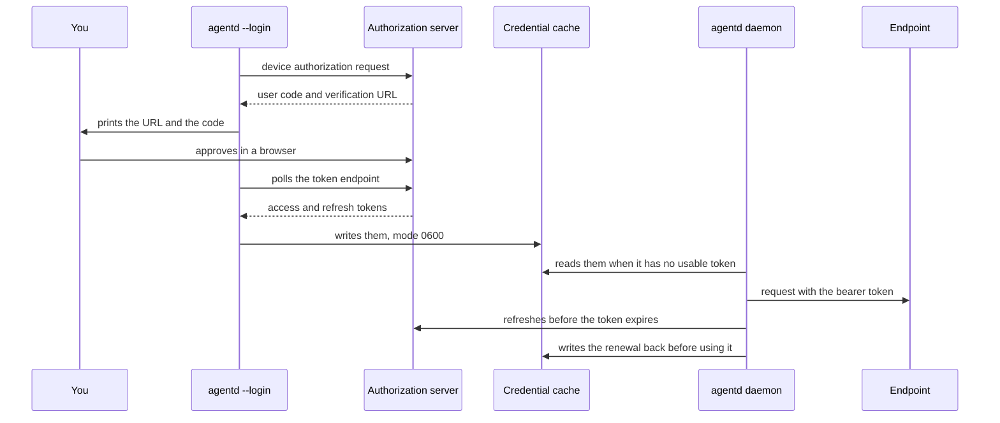

# Outbound credentials

agentd dials three kinds of endpoint that may need a credential: model
providers, MCP servers and A2A peers. Each takes one `auth:` block with the
same shape, so a static token, an OAuth login, AWS SigV4 or a SPIFFE workload
identity is configured the same way wherever it is used. This guide is for
operators: it shows how to choose a credential, configure it, log in once
when a person is needed, and what happens when a credential is missing.
Signing callers *in* to agentd's own listener is a different task, covered in
[Connect agents over A2A](connect-agents.md).

## Choose a credential

| Where agentd runs | Use | Interactive? |
|---|---|---|
| anywhere, the endpoint takes an API key | `static`, from a secret reference | never |
| a server, machine-to-machine OAuth | `oauth2` with `grant: client_credentials` | never |
| a developer's or operator's machine, a person's OAuth identity | `oauth2` with `grant: device` (or `authorization_code` for a browser) and one `agentd --login` | once |
| EC2 or EKS, an endpoint behind AWS IAM | `aws` with `source: imds` or `source: irsa` | never |
| a workstation, AWS IAM Identity Center | `aws` with `source: sso` and one `agentd --login` | once |
| Kubernetes or a cloud with SPIRE | `spiffe`, a JWT-SVID as a bearer or an X.509-SVID for mutual TLS | never |

A daemon never stops to wait for a person. Interactive credentials are
obtained ahead of time with `agentd --login`, cached, and refreshed by the
daemon.

## A complete example

This agent calls a corporate model gateway with a machine credential, reads
an issue tracker as the operator who logged in, and hands work to a partner
agent with a static token:

```yaml
agent:
  instruction: "Triage new tracker issues and hand billing questions to the partner desk."

intelligence:
  endpoints: https://llm.corp.example.com/v1/chat/completions
  model: gpt-5.1
  auth:
    kind: oauth2
    grant: client_credentials
    issuer: https://sso.corp.example.com
    client_id: agentd-triage
    client_secret: "{{secret:SSO_CLIENT_SECRET}}"
    scopes: [llm.invoke]

mcp:
  servers:
    - name: tracker
      endpoint: https://mcp.tracker.example.com/mcp
      tags: { "*": [untrusted_input] }
      auth:
        kind: oauth2
        grant: device
        issuer: https://sso.corp.example.com
        client_id: agentd-cli
        scopes: [tracker.read, offline_access]

a2a:
  peers:
    - name: partner
      endpoint: https://a2a.partner.example.com
      auth: { kind: static, token: "{{secret:PARTNER_TOKEN}}" }
```

With `SSO_CLIENT_SECRET` and `PARTNER_TOKEN` set, validate it, then log in to
the tracker once:

```sh
agentd --validate-config --config agentd.yaml
agentd --login mcp:tracker --config agentd.yaml
```

The client-credentials grant needs no login: the daemon fetches and refreshes
that token itself.

## Where a credential goes

| Endpoint | `auth:` block | Other ways to set a credential |
|---|---|---|
| the model connection | `intelligence.auth` | `intelligence.token` or `token_file` (a bearer), `intelligence.headers` |
| a named model provider | `intelligence.providers.<name>.auth` | that provider's `token`, `token_file`, `headers` |
| an MCP server | `mcp.servers[].auth` | `headers`; `oauth: {token_url, client_id, client_secret, scope}`, a client-credentials shortcut |
| a service catalog entry | `services.<name>.auth` | `headers` |
| an A2A peer | `a2a.peers[].auth` | `headers`; `client_cert` and `client_key` for mutual TLS |

On a model connection, a credential from `auth:` takes precedence over
`token`. The `AGENTD_INTELLIGENCE_TOKEN` and `AGENTD_INTELLIGENCE_TOKEN_FILE`
environment overrides apply to the top-level connection only, never to a
named provider.
On an MCP server, `auth:` wins over `oauth:`, and either one turns off AAuth
signing for that server; static `headers` are sent alongside.

**One credential for many consumers.** A service catalog entry holds the
credential every server or peer that references it uses, cached once under
`service:<name>`:

```yaml
agent:
  instruction: "Answer account questions from the CRM."

intelligence:
  endpoints: https://api.openai.com/v1/chat/completions
  model: gpt-5.1
  token: "{{secret:OPENAI_API_KEY}}"

services:
  crm:
    endpoint: https://mcp.crm.example.com/mcp
    tags: { "*": [sensitive] }
    auth:
      kind: oauth2
      grant: device
      issuer: https://sso.corp.example.com
      client_id: agentd-cli
      scopes: [crm.read]
mcp:
  servers:
    - { name: crm, service: crm }
```

A server that references an entry may not restate its endpoint, `auth` or
`headers`. `agentd --login mcp:crm` and `agentd --login service:crm` log into
the same cached credential.

## Static credentials

A fixed bearer token, or a fixed value in a header of your choosing, always
from a secret reference:

```yaml
# fragment: under mcp.servers[]:
auth: { kind: static, token: "{{secret:KB_TOKEN}}" }
```

```yaml
# fragment: under mcp.servers[]:
auth: { kind: static, header: X-API-Key, value: "{{secret:KB_API_KEY}}" }
```

`token` is sent as `Authorization: Bearer <token>`. A `{{secret-file:PATH}}`
reference is read again on every request, so a rotated file takes effect
without a restart.

On a model connection, a `static` block takes `token`; a `header` + `value`
pair is refused at load there. Use `intelligence.headers` for a custom header
on a model connection.

## OAuth 2.0

```yaml
# fragment: under mcp.servers[]:
auth:
  kind: oauth2
  issuer: https://sso.corp.example.com      # or pin token_url, device_authorization_url
  client_id: agentd-cli
  client_secret: "{{secret:SSO_CLIENT_SECRET}}"   # omit for a public client
  grant: device                             # device | authorization_code | client_credentials
  scopes: [tracker.read, offline_access]
  audience: https://tracker.example.com     # sent with the device authorization request
  resource: auto                            # RFC 8707: auto | omit | a URI
```

| Grant | When | How the token arrives |
|---|---|---|
| `device` (the default) | a person authorizes once, from any terminal, over SSH included | `agentd --login` prints a URL and a short code and polls until the person approves |
| `authorization_code` | a person with a desktop browser | `agentd --login` prints the authorization URL, catches the redirect on a one-time `127.0.0.1` listener, checks `state` and `iss`, and exchanges the code with PKCE |
| `client_credentials` | machine to machine | the daemon fetches the token with the client's authentication — its `client_secret`, or a `private_key_jwt` assertion — and fetches a new one a minute before it expires, or halfway through a lifetime shorter than two minutes; no login |

**Endpoints.** With `issuer`, agentd discovers the token, device,
authorization and revocation endpoints from the server's metadata. It asks
for the RFC 8414 document first, then the OpenID Connect one, in the order
MCP's authorization spec gives: for `https://sso.example/tenant`,
`https://sso.example/.well-known/oauth-authorization-server/tenant`, then
`https://sso.example/.well-known/openid-configuration/tenant`, then
`https://sso.example/tenant/.well-known/openid-configuration`; for an issuer
with no path, the first two at the root. The first document that answers is
used only if its `issuer` is the configured `issuer`, byte for byte: one that
names another issuer, or none, is refused (`oauth: discovery: … names the
issuer …`), because metadata that does not match is how a mix-up attack
points a client at another server's endpoints. Write `issuer` exactly as the
server's metadata does, trailing slash included or not. Pin `token_url`,
`device_authorization_url` or `authorization_url` to skip discovery. An
`oauth2` block needs `client_id` — or, without one,
[agentd's Client ID Metadata Document](#client-id-metadata-document) — and
either `issuer` or `token_url`; the device grant also needs `issuer` or
`device_authorization_url`, and the browser grant `issuer` or
`authorization_url`. An MCP server's block, or an MCP catalog entry's, may
name none of them: the server names its authorization server. The load
checks each of these.

**An MCP server names its authorization server.** With no `issuer` and no
`token_url`, `agentd --login` and the daemon — at the first request that
needs a token — ask the MCP server itself (RFC 9728): the
`resource_metadata` URL its `401` challenge names, when it is on the
server's own origin, else the protected-resource metadata with the
well-known suffix inserted before the server's path
(`https://mcp.example/.well-known/oauth-protected-resource/mcp`), else the
one at the root. The document is used only when its `resource` is the
server's `endpoint`, byte for byte (RFC 9728 §3.3); metadata describing
another resource is refused (`… describes the resource …, not … (RFC 9728
§3.3)`). Its first `authorization_servers` entry is the issuer, and a login
is kept with it: a server whose metadata names another issuer later finds
the login is not presented there. That issuer is a URL the server chose:
on the server's own origin it is reached as the server is; anywhere else
only over HTTPS and through the SSRF guard — no loopback, private or
link-local address — and, under `security.egress: closed`, only when a
`services` entry covers it. Its metadata must keep the token, device and
revocation endpoints on its own origin; pin `issuer` to use one that does
not. Metadata of an issuer you pinned is trusted for the endpoints it
names, wherever they are (Google's `https://accounts.google.com` names
`https://oauth2.googleapis.com/token`).

**The resource (RFC 8707).** Every authorization, token, refresh and
client-credentials request names the endpoint the token is for as
`resource`: on an MCP server or an MCP catalog entry, the server's
`endpoint` in canonical form — scheme and host lowercased, no fragment, no
trailing `/` — which is what MCP's authorization spec requires whether the
authorization server supports the parameter or not. `resource: omit` sends
none, for a server that refuses parameters it does not know; a URI sends
that URI. A model connection's and an A2A peer's blocks send none unless
told to (`resource: auto` sends the endpoint), because Microsoft Entra
refuses the parameter (`AADSTS901002`). The `mcp.servers[].oauth` shortcut
always sends the server's endpoint.

**The browser grant's checks.** Before any URL is printed, the server's
metadata must list `S256` in `code_challenge_methods_supported`: a server
that cannot be held to PKCE is refused (MCP 2026-07-28). With every endpoint
pinned no metadata is read, and nothing is judged. The redirect's `state`
must be the one the login sent, and its `iss` (RFC 9207) the issuer the
request went to, byte for byte; a redirect without `iss` is refused when the
server's metadata declares `authorization_response_iss_parameter_supported`.
With endpoints pinned and no `issuer` there is nothing to compare `iss`
with, and it is not checked. A login that asks for `openid` sends a
`nonce`, and an ID token in the answer must carry it, name the issuer and
have this `client_id` in its `aud`, or the login is refused. The `state`,
the PKCE verifier and the nonce are drawn from the kernel's random source
with no fallback: a host that cannot read it fails the login.

**Step-up.** An MCP server that answers a call `403` with `WWW-Authenticate:
Bearer error="insufficient_scope", scope="…"` names scopes the token lacks.
For a login (`device` or `authorization_code`), the daemon renews the token
with the union of the scopes it holds and those the server named, and sends
the call again with the new one — at most twice for one union in the life
of the process. When the authorization server will not grant the union by
a renewal, the call fails with the server's challenge, and the union is
kept with the login: the next `agentd --login` asks for it. A challenge for
scopes the token already holds is the server's inconsistency, and asks
nothing. A `client_credentials` grant asks for nothing more: the call fails
with the challenge, as MCP permits a client acting for itself.

**Client authentication.** At the token and revocation endpoints a
confidential client sends its `client_secret` in the form body. Set
`client_auth` to change how:

```yaml
# fragment: under mcp.servers[].auth (kind: oauth2):
client_auth:
  method: private_key_jwt          # private_key_jwt (default) | client_secret_basic | client_secret_post
  key: "{{secret-file:/run/secrets/agentd-client.pem}}"   # PKCS#8 P-256 key; private_key_jwt only
  kid: agentd-2026-10              # optional; default the key's RFC 7638 thumbprint
  assertion_aud: token_endpoint    # token_endpoint (default) | issuer
```

`private_key_jwt` (RFC 7523) sends no secret: each token request carries a
fresh ES256 assertion signed with `key`, good for 60 seconds, with `iss` and
`sub` the `client_id`, `aud` the token endpoint (or the `issuer`), and a
random `jti`. Register the key's public half with the authorization server.
`client_secret_basic` sends the `client_secret` in an `Authorization: Basic`
header instead of the body. `client_auth` applies to every grant: a
`client_credentials` grant with `private_key_jwt` needs no `client_secret`.
A confidential client authenticates at the device authorization endpoint
too, as at the token endpoint (RFC 8628 §3.1).

The daemon discovers them at the first request that needs them — the first
token fetch of a `client_credentials` grant, the first refresh of a login —
not when the connection is built, and again at each later request until
discovery succeeds. While the issuer does not answer, those requests fail
without being sent; an issuer that is down at startup does not stop the
start. Pin the endpoints to depend on no discovery at all.

**The MCP shortcut.** `mcp.servers[].oauth` is a client-credentials grant
with a pinned token endpoint, and nothing else; its token request names the
server as its `resource`:

```yaml
# fragment: under mcp.servers[]:
oauth:
  token_url: https://sso.corp.example.com/oauth2/token
  client_id: agentd-search
  client_secret: "{{secret:SEARCH_CLIENT_SECRET}}"
  scope: search.read
```

> **Limit.** agentd reads OAuth responses as JSON, which is what RFC 6749
> and RFC 8628 specify, and does not send `Accept: application/json`. An
> authorization server that answers form-encoded unless asked for JSON, such
> as GitHub's OAuth endpoints, fails with `oauth: bad device-auth response`.

## Client ID Metadata Document

An authorization server agentd has no registration at can still know it, by
a [Client ID Metadata Document](https://datatracker.ietf.org/doc/draft-ietf-oauth-client-id-metadata-document/)
(draft -02): agentd's `client_id` is an HTTPS URL, and the JSON document at
that URL says who the client is and where its public keys are. MCP's
2026-07-28 client registration prefers it to dynamic registration, which it
deprecates. Configure the identity once, under `security.client`:

```yaml
# fragment: under security:
client:
  id: https://agent.example.com/oauth/client.json   # the client_id, and where the document is published
  name: Example operations agent                     # client_name, on consent pages
  key_file: /var/lib/agentd/client-key               # the ES256 key, created 0600 when absent
  grants: [device, client_credentials]               # what the document lets a server issue tokens by
```

An `oauth2` block that names no `client_id` then uses it: the document's URL
is the `client_id`, and every token request — and the device authorization
request — carries a `private_key_jwt` assertion signed with `key_file`. The
block needs `issuer`, no `client_secret`, and a `grant` the document lists;
`client_auth` may set `assertion_aud` and nothing else. A block that names a
`client_id` keeps its own registration.

```yaml
# fragment: under mcp.servers[]:
auth:
  kind: oauth2
  issuer: https://auth.tracker.example.com   # its metadata says whether it takes the document
  grant: device
  scopes: [tracker.read]
```

**Publish it.** The authorization server fetches the document from its URL,
so the URL must answer it over HTTPS. Write the two files for a static host:

```sh
agentd --config agentd.yaml --print-client-metadata ./published
```

```text
./published/client.json
./published/jwks.json
```

Host `client.json` at `id` and `jwks.json` at `jwks_uri`, `jwks.json`
beside the document unless `jwks_uri` names another URL. Or set
`security.client.serve: true` and the A2A listener serves both at their
URLs' paths, when `a2a.url` is the `client_id`'s origin. The document
carries `client_id`, `client_name`, `logo_uri` when set, `jwks_uri`,
`redirect_uris`, `grant_types`, `response_types` and
`token_endpoint_auth_method: private_key_jwt`; never a secret or a private
key. The key set lists the signing key and every `published_key_files` key
— the next one before a rotation, the previous one after — by their public
halves only. A server may refuse the document's tokens once its keys
change, so publish a new key before signing with it.

**Where agentd uses it.** In the order MCP's client registration gives: a
configured `client_id` first; else the document, where the authorization
server's metadata advertises `client_id_metadata_document_supported`. agentd
does not register itself dynamically (RFC 7591). Where the metadata does not
advertise the document, `agentd --login` and the daemon's first token
request fail before anything else is sent, saying what to register:

```text
agentd: oauth: the authorization server https://auth.tracker.example.com does not advertise client_id_metadata_document_supported, so it would not fetch agentd's Client ID Metadata Document (https://agent.example.com/oauth/client.json); register agentd there — a client authenticating by private_key_jwt with the key set at its jwks_uri, or by a client secret — and set the block's `client_id` (and its `client_auth` or `client_secret`). agentd does not register dynamically (RFC 7591, which MCP 2026-07-28 deprecates)
```

A server that refuses the document with `invalid_client` is named with the
document's URL: check that it serves what `--print-client-metadata` writes,
and that its key set holds the signing key.

**Grants.** `device` and `client_credentials` need no redirect URI. The
document lists the grant types of `grants`, with `refresh_token` beside
`device` and `authorization_code`, whose tokens agentd renews. For
`authorization_code`, list a loopback redirect URI, where the login waits
for the browser:

```yaml
# fragment: under security.client:
grants: [authorization_code]
redirect_uris: ["http://127.0.0.1:8765/callback"]
```

With a port, `agentd --login` listens on that port and sends the URI
exactly, so it matches the document under the draft's exact comparison.
Without one (`http://127.0.0.1/callback`), it listens on a free port and
sends the URI with that port, for a server that allows any port on a
loopback address, as RFC 8252 §7.3 and OAuth 2.1 have it. A redirect URI is
`http://127.0.0.1` or `http://[::1]`, never `localhost`. A login uses the
first one listed.

**Every endpoint.** The document is the client of any `oauth2` block with no
`client_id`: an MCP server's, a service entry's, a model connection's or an
A2A peer's.

The [Personal Agent Protocol preview](act-at-companies.md) keeps a document
of its own, `security.companies.client`: that protocol holds every redirect
URI to an HTTPS URL on the `client_id`'s domain, where this one lists
loopback URIs, and adds an `extensions` member.

## Log in with agentd --login

When a credential needs a person (an `oauth2` device or authorization-code
grant, or `aws` with `source: sso`), complete it once with `agentd --login`.
The release binaries and the container image include the `oauth` feature it
needs.

```sh
agentd --login mcp:tracker --config agentd.yaml
```

```text
┌─ authorize agentd ──────────────────────────────
│  target   mcp:tracker
│  visit    https://sso.corp.example.com/device
│  code     WDJB-MJHT
│  waiting… (expires in 900s · Ctrl-C to cancel)
└──────────────────────────────────────────────────
logged in to mcp:tracker — token cached in /home/you/.local/state/agentd/creds
```

The prompt goes to stderr and the one-line result to stdout. The token is
never printed.

| Target | Logs into |
|---|---|
| `intelligence` | the top-level model connection's `auth` |
| `intelligence:<provider>` | `intelligence.providers.<provider>.auth` |
| `mcp:<name>` | that MCP server's `auth`; a server that references a service logs into `service:<entry>` |
| `service:<name>` | a service catalog entry's `auth`, shared by every consumer |

An A2A peer can be logged into only through a service entry: give the peer
`service: <entry>` with a `kind: peer` catalog entry, and log into
`service:<entry>`. `--login` takes no target for a peer's own `auth` block,
so an oauth2 `device` or `authorization_code` grant there, or one with no
`grant`, is refused at load.

`agentd --logout <target>` deletes the cached credential from the cache,
then revokes it at the authorization server that issued it, when that
server's metadata lists a `revocation_endpoint` (RFC 7009) — the refresh
token when there is one, which at most servers ends the access tokens it
issued too. The delete comes first, so a logout cut short — a server that
does not answer, a Ctrl-C — has still removed it. The server is the
block's `issuer`, or the one RFC 9728 finds for the resource; with neither,
or no revocation endpoint, the logout is local only. A revocation that
fails is reported, and the logout exits 2 saying the token stays good at
the server until it expires. A build without the `oauth` feature only
deletes. A daemon running at the time serves the access token it holds
until it is due, then finds no login: it fails its requests, naming the
`--login` that fixes it, and does not renew.

The device grant, from login to the daemon's refresh:



**The cache** is one file per target, mode `0600`, in `$AGENTD_CRED_DIR`, else
`$XDG_STATE_HOME/agentd/creds`, else `~/.local/state/agentd/creds`. Log in as
the user the daemon runs as, or point both at the same `AGENTD_CRED_DIR`. The
daemon refreshes a token a minute before it expires, using the refresh
token, and writes the result back to the cache before it uses it: a server
that rotates refresh tokens has its new one kept, and a refresh response
that carries none keeps the old one. Every process of the daemon renews from
the refresh token the cache holds, so a restart, or a turn worker, renews
with the token the server last issued. A renewal holds a lock on the
target's entry — an advisory `flock` on a `.lock` file beside it — so the
processes and connections that find the token due at once renew it once:
the first renews, and the rest wait and take what it wrote back. Each
presenting the same refresh token would have a server that rotates refuse
all but one, or end the grant as stolen. `--login` and `--logout` take the
same lock, so a renewal in flight neither overwrites a new login nor brings
back one a logout removed. Each write replaces the file whole, through a
`0600` temp file renamed over it, so a process reading it never sees part
of one, and a crash mid-write leaves the old. A write that fails leaves the
refresh unused, and each request fails, naming the cause, until the write
succeeds. Whenever the daemon holds no usable token it reads the cache
again, so a login made while it runs is used by the next request, with no
reload or restart. A login is kept with the authorization server it was
made at: the block's `issuer`, the one RFC 9728 found, or, where the block
names no issuer, its `token_url`. Under a block whose server is another —
an `issuer` changed, or added to a block that only pinned `token_url` — the
login is not presented, renewed or revoked, and requests fail naming the
`--login` that fixes it.

**Waits the server asks for.** A token endpoint that answers `429` or `503`
with `Retry-After` (seconds or an HTTP date) is not asked again before the
wait is over, five minutes at most: a refresh in that time fails at once,
naming the wait, and a device-login poll waits it out.

## Enterprise-managed authorization

**A preview, not in the release binaries**: build with `--features xaa,a2a`,
and set `security.experimental.id_jag: true`. ID-JAG is an IETF draft
(draft-ietf-oauth-identity-assertion-authz-grant-04) and MCP's
Enterprise-Managed Authorization extension is young; agentd follows both as
they stand ([RFC 0044](../rfcs/0044-enterprise-managed-authorization.md)).

With it, agentd acts **for one enrolled person** at an MCP server, with a
token whose subject is that person, issued because their enterprise IdP —
Okta's Cross App Access, or any IdP that issues ID-JAGs — says agentd may.
agentd's own credential is never used at such a server, and nothing falls
back to it.

How a call is made:

1. The person enrols once: `agentd --login idp:<name>` signs them in at the
   IdP. The daemon runs the sign-in, verifies the ID token with the IdP's
   keys, requires its `iss` and `sub` to be the person's exact pin, and keeps
   the refresh token sealed (AES-256-GCM, `identity.delegation.seal_key`).
   Then it lists each allowed server's tools, with one delegated token per
   server.
2. At a call, the supervisor exchanges the grant at the IdP for an ID-JAG
   (RFC 8693): `audience` is the server's authorization server and
   `resource` the server, both pinned in the configuration. It checks the
   ID-JAG — `typ`, `aud`, `client_id`, `iss`, `sub`, `exp`, the `resource` it
   names and the scope it grants — and redeems it at the authorization server
   (RFC 7523, the JWT bearer grant) for an access token for that server.
3. The call goes to the server with that token, declaring the
   `io.modelcontextprotocol/enterprise-managed-authorization` extension, and
   `agent/acting_for` set to the ID-JAG's `sub`.

```yaml
# needs: ./okta-agent-key.pem, ./linear-ras-key.pem, ./delegation-seal
agent: {name: assistant}
intelligence: {endpoints: "mock:final", model: m}
a2a:
  listen: unix:///run/agentd/a2a.sock
  principals:
    # The per-person operator: the unix listener's peer, by its uid.
    - match: {uid: 1000}
      role: operator
      id: alice
      idp_subject: {iss: https://acme.okta.com, sub: 00u1alice}
security:
  experimental: {id_jag: true}
identity:
  providers:
    okta:
      issuer: https://acme.okta.com
      profile: okta
      client_id: 0oa9agentdXAA
      client_auth:
        method: private_key_jwt
        key: "{{secret-file:./okta-agent-key.pem}}"
        kid: agentd-2026-10
      sign_in: {grants: [device], scopes: [openid, offline_access]}
  delegation:
    seal_key: "{{secret-file:./delegation-seal}}"
    templates:
      - name: eng-tools
        principals: {source: operator}
        idp: okta
        servers:
          linear: {scopes: ["issues:read", "issues:write"]}
mcp:
  servers:
    - name: linear
      endpoint: https://mcp.linear.example/mcp
      tags: {"*": [sensitive, egress]}
      auth:
        kind: oauth2
        grant: id_jag
        idp: okta
        audience: https://auth.linear.example
        resource: https://mcp.linear.example/mcp
        client_id: agentd-at-linear
        client_auth:
          method: private_key_jwt
          key: "{{secret-file:./linear-ras-key.pem}}"
          kid: agentd-ras-1
        scopes: ["issues:read"]
        tool_scopes: {create_issue: ["issues:write"]}
```

```sh
agentd --login idp:okta --config agentd.yaml
```

```text
Open https://acme.okta.com/activate and enter the code WDJB-MJHT (it expires in 600s)
operator:alice is enrolled at okta as 00u1alice (template eng-tools): agentd acts as them on linear until 2026-11-18; listed linear (12 tools)
```

**Who may delegate.** In this preview, one person: the `a2a.principals` rule
that matches the unix A2A listener's peer by `uid` and carries an exact
`idp_subject` pin. That caller is `operator:<id>`; its runs, and nobody
else's, use the grant. A run started by a schedule, a webhook, another
operator or anyone else fails `no_delegation` at a delegated server, and a
delegated server's tools are not offered at all in work for someone without
a usable grant; `identity.autonomous_as` may not name the person. A
subagent's call is `delegation_not_permitted`, and so is a call in a run a
subagent's call started — through a workflow tool, `workflow.run` or
`workflow.signal` — or in a run that one started. A reload that changes the
person's rule is refused (`restart_required`). A sign-in whose `iss` and
`sub` are not the pin keeps nothing (`binding_mismatch`). Signing in again
keeps the grant while it is the same — the same identity, unexpired, under
the template that admits the person now with the ceilings it allows now —
and otherwise replaces it, revoking the refresh token it held at the IdP:
that is how an expired grant, or one enrolled before the pin changed, is
renewed. A grant is held at every call to the ceilings its template allows
now. The IdP's device grant shows `verification_uri` and
`user_code` only; `sign_in.grants: [authorization_code]` uses PKCE, `state`,
`nonce` and RFC 9207's `iss`, through a one-time start link on a loopback
callback the daemon holds for the sign-in: the link sets a cookie bound to
the sign-in, and the callback is taken only with it, so an IdP URL forwarded
to someone else never completes.

**The person's approvals.** Until the taint engine, every unit of work that
touches a delegated server is treated as tainted and as holding delegated
data, so a delegated call to a `sensitive` or `egress` tool, and any `egress`
call from work that holds delegated data, waits for the person — a workflow
step that sends the run's data out by its own effect too: an `http` step,
`a2a.send`, `a2a.delegate`, an `emit` forwarded to a webhook or a peer, an
`mcp.tool` or `mcp.resource` step at a server tagged `egress`. The call
gates, `agentd --delegation-list` shows it — server, tool, the full
arguments, the scopes the token carries, the run — and the person answers
with `agentd --delegation-approve <gate>` or `--delegation-deny <gate>`, over
the unix listener. An answer is bound to the gate's nonce and the hash of its
arguments, and an approved step runs with the spec the person saw. No
operator answers for the person, no judge answers whatever
`agent.ask_human_fallback` says, and an unanswered gate denies after
`identity.delegation.consent_timeout` (24 hours by default).

**Pins, not discovery.** `audience` (the authorization server's issuer) and
`resource` are required, and discovery only confirms them: before anything
is minted for the server, its RFC 9728 metadata, read from the well-known
locations on its endpoint's origin, must describe the pinned `resource` byte
for byte and list the pinned `audience` (otherwise the call is `config`), and
the authorization server's metadata must list the JWT bearer grant and the
`urn:ietf:params:oauth:grant-profile:id-jag` profile (`auth.id_jag: assume`
for one that takes it unlisted). The IdP's metadata is read from its own
issuer only — both the RFC 8414 and the OpenID document, merged, since Okta
splits `jwks_uri` and the identity-chaining member between them. An IdP
whose issuer is the server's authorization server is refused (ID-JAG §9.3),
and so, under `profile: okta`, is an `/oauth2/<id>` issuer.

**Renewal.** An access token is used until `exp − 60 s`, at most
`identity.delegation.at_cache_cap` (60 minutes) whatever `expires_in` says,
and only while the grant's refresh token was proved alive within
`identity.delegation.liveness_interval` (15 minutes): a stale proof is renewed
first by a plain `refresh_token` grant, and an IdP that does not answer then
is `idp_unavailable` — never a success on an old token. A `401` on a token
that was not just minted re-presents the unexpired ID-JAG (no new mint)
unless `id_jag_reuse: never`, or the authorization server refused a
re-presented one before; a `401` right after a mint is the server's fault
(`delegation_rejected_by_resource`), backed off. A rotated refresh token is
kept, compare-and-swap on its version, before it is used — and before the
ID-JAG it came with is checked, so a refused ID-JAG never leaves the spent
token in the vault; one IdP call per
grant runs at a time, so two servers minting at once never present one
rotating token twice. `insufficient_user_authentication` is `step_up`: the
person runs `agentd --login idp:<name>` again, and the next mint presents
that fresh ID token. Mints are budgeted per day and month per server
(`templates[].budget`, 16 and 200 by default, 80% of Okta's 250 a month) and
per run (12); `delegation.quota_warn` fires at 80%.

**Revocation.** `agentd --delegation-revoke operator:alice`, or
`--delegation-revoke idp:okta#00u1alice` for every grant of that IdP
subject, revokes the refresh token at the IdP (RFC 7009, retried), writes the
tombstone, deletes the sealed record and drops every token. An
`invalid_grant` from an exchange runs the liveness probe: if the refresh
token is dead too, the grant is revoked the same way; if it is alive, the
error is that server's alone and is backed off. `agentd --delegation-lint`
prints, from the configuration alone, the Resource connections each IdP must
have — exactly those: the IdP's list, not the template, is the real ceiling.

**What a worker never holds.** Delegated servers are the supervisor's: no
worker, subagent or instance is handed one to dial, every call comes back to
the supervisor, and its answer — or its refusal, a server's error quoting the
token included — reaches the model, the log and `delegation.denied` with
every live token value — the refresh token, ID tokens, ID-JAGs and access
tokens, as they are, base64- and percent-encoded — replaced by
`[redacted]`. A secret under
`identity.*` or on a delegated server is read from a mounted file
(`{{secret-file:…}}`) or entered at the startup prompt, never from the
environment, and no child is started with the variables one names. A served
document may not declare a delegated server, set any of its pins or its
client authentication, or reference any of those secrets by any spelling —
a reference is compared by what it resolves to, and a `*_file` field's path
as a file (RFC 0042, as RFC 0044 §5.14.1 amends it). `security.exec.enabled`
is refused beside `identity.providers` or a seal key, as beside a delegated
server. Where the kernel has Landlock, no child can open the store's
directory, where the vault is, a mounted key file or the audit chain
([Security model](security.md#secrets)).

**Keys an external signer holds.** With `identity.delegation.key_custody:
external`, agentd holds none of the keys: a signer process on a unix socket
does, and agentd asks it to sign each client assertion — at the IdP and at
each delegated server's authorization server — and to wrap the data key each
grant's refresh token is sealed under. Each key is named by its
`client_auth.kid`, which is also the `kid` the assertion carries; no `key`
and no `seal_key` is given. The socket's peer must be the uid configured,
which should not be agentd's own (the load warns), and the start checks that
the signer holds every key under the algorithm configured. With the signer down, a delegated call fails
`signer_unavailable` and nothing is sent. The protocol, for a signer of your
own in front of a KMS or an HSM, is
[The external signer protocol](external-signer.md).

```yaml
# fragment: under identity:
providers:
  okta:
    issuer: https://acme.okta.com
    profile: okta
    client_id: 0oa9agentdXAA
    client_auth: {method: private_key_jwt, kid: agentd-idp-2026}
delegation:
  key_custody: external
  signer: {socket: /run/agentd-signer/signer.sock, uid: 991, seal_key: vault-kek-2026}
```

**The audit chain anchors revocation.** With `observability.audit.chain`
set, enrolments, mints, uses, refusals, revocations and the person's consent
answers are lines of a hash-chained log verified at every start, and each
revocation and refresh-token version is anchored there before the store is
written. A store restored from before a revocation then refuses the revoked
grant as it loads: the person is `not_enrolled` and enrols again, and nothing
is presented to the IdP.

**What this preview does not do yet** (RFC 0044 P2 and later): several
people, an IdP-federated display-client login, device and certificate
principals that delegate, the taint engine, CIBA, unattended runs,
same-domain token exchange (`grant: token_exchange`), and live interop
against an Okta Integrator org or xaa.dev.

### Fields

| Field | Under | Meaning |
|---|---|---|
| `issuer`, `client_id` | `identity.providers.<name>` | the IdP, pinned; agentd's client there (required) |
| `profile` | `identity.providers.<name>` | `generic` (default) or `okta`: keys at `{issuer}/oauth2/v1/keys`, subject `refresh_token`, no `/oauth2/<id>` issuer |
| `client_auth`, `client_secret` | `identity.providers.<name>` | `private_key_jwt` with an ES256 or RS256 (`alg`) PKCS#8 key, or a secret; a public client is refused |
| `sign_in` | `identity.providers.<name>` | `grants` (`device`, `authorization_code`), `scopes` (default `[openid, offline_access]`) |
| `subject`, `subjects`, `jwks_uri` | `identity.providers.<name>` | what the exchange presents; whether an ID-JAG's `sub` must be the person's; the key set's pin |
| `seal_key`, `seal_key_previous` | `identity.delegation` | 32 bytes, hex or base64, as a secret reference (`key_custody: local`) |
| `key_custody`, `signer` | `identity.delegation` | `local` (default) or `external`; the signer's `{socket, uid, timeout, seal_key, seal_key_previous}` |
| `at_cache_cap`, `liveness_interval`, `consent_timeout` | `identity.delegation` | `60m`, `15m`, `24h` |
| `templates` | `identity.delegation` | `{name, principals: {source: operator}, idp, servers: {<name>: {scopes}}, ttl, budget}` |
| `grant: id_jag`, `idp`, `audience`, `resource`, `client_id` | `mcp.servers[].auth` | the delegated server's IdP, its authorization server, itself, and agentd's client there (all required) |
| `client_auth`, `client_secret` | `mcp.servers[].auth` | agentd's authentication at the authorization server; never the IdP's key |
| `scopes`, `tool_scopes`, `scope_mode` | `mcp.servers[].auth` | baseline and per-tool scopes; one token per server with their union (`server`, default) or per scope set (`per_tool`) |
| `tools_from`, `tools_file` | `mcp.servers[].auth` | `first_grant` (default) or `file` |
| `id_jag`, `id_jag_reuse`, `allow_unbound_at`, `attribution`, `max_at_age` | `mcp.servers[].auth` | `discover`/`assume`; `auto`/`never`; accept an ID-JAG that names no resource; `sub`/`none`; a stricter cap |
| `uid`, `idp_subject` | `a2a.principals[]` | the per-person operator: the unix peer's uid, and their exact IdP identity |

## AWS SigV4

An endpoint behind AWS IAM, such as an API Gateway in front of an MCP server
or Amazon Bedrock, takes a `kind: aws` block. Every request is signed over
its method, path and body; a session token is signed as
`x-amz-security-token`.

```yaml
# fragment: under mcp.servers[]:
auth:
  kind: aws
  region: us-east-1
  service: execute-api
  source: irsa
```

| `source` | Credentials | Login |
|---|---|---|
| `env` (the default) | `AWS_ACCESS_KEY_ID`, `AWS_SECRET_ACCESS_KEY`, `AWS_SESSION_TOKEN`, read at each request | none |
| `static` | the same as `env` | none |
| `imds` | the EC2 instance role, through IMDSv2, refreshed a minute before expiry | none |
| `irsa` | the EKS pod's web identity (`AWS_WEB_IDENTITY_TOKEN_FILE`, `AWS_ROLE_ARN`) exchanged with STS, refreshed a minute before expiry | none |
| `sso` | IAM Identity Center; needs `sso_start_url`, `account_id`, `role_name` | `agentd --login`, which caches temporary credentials; the signer re-reads them on every request |

```yaml
# fragment: under mcp.servers[]:
auth:
  kind: aws
  region: us-east-1
  service: execute-api
  source: sso
  sso_start_url: https://my-org.awsapps.com/start
  account_id: "123456789012"
  role_name: AgentdLedger
```

For Amazon Bedrock's own API, set `intelligence.dialect: bedrock` with a
`kind: aws` block and `service: bedrock`; the load refuses the Bedrock
dialect without one. [Connect model providers](connect-models.md) has
complete configurations for Bedrock, Azure OpenAI with Microsoft Entra ID, and
Google Vertex AI.

## SPIFFE workload identity

With SPIRE writing SVIDs to files, an agent needs no stored secret at all.

```yaml
# fragment: under mcp.servers[]:
auth: { kind: spiffe, svid: jwt, jwt_svid_file: /run/spire/jwt.svid }
```

```yaml
# fragment: under mcp.servers[]:
auth: { kind: spiffe, svid: x509, svid_file: /run/spire/svid.pem, key_file: /run/spire/svid.key }
```

A JWT-SVID is sent as a bearer token and read again on every request, so
SPIRE's rotation needs nothing from you. An X.509-SVID is a mutual-TLS client
identity: it works on MCP servers. A model connection cannot use one, and the
load refuses it there. For an A2A peer, an `x509` block applies nothing; set
the peer's `client_cert` and `client_key` to the SVID files instead.

## Mutual TLS and private CAs

An A2A peer that requires a client certificate takes `client_cert` and
`client_key`, PEM files read when the peer is dialled:

```yaml
# fragment: under a2a.peers[]:
name: billing
endpoint: https://a2a.billing.example.com
client_cert: /run/spire/svid.pem
client_key: /run/spire/svid.key
```

To trust an endpoint whose certificate a private CA signed, set
`security.tls_ca` to a PEM bundle. agentd adds it to the bundled trust roots
for every outbound TLS dial, in the daemon and its child processes.

## Which kinds each endpoint accepts

| | `static` token | `static` header | `oauth2` | `aws` | `spiffe` jwt | `spiffe` x509 |
|---|---|---|---|---|---|---|
| model connection or provider | yes | refused at load | yes | yes | yes | refused at load |
| MCP server or service | yes | yes | yes | yes | yes | yes (mutual TLS) |
| A2A peer | yes | yes | yes, login through a service entry | yes | yes | use `client_cert` and `client_key` |

## When a credential is missing or refused

The load catches what it can see, and exits 2 before any side effect:

- a `{{secret:…}}` or `{{secret-file:…}}` reference that does not resolve;
- an `auth:` block missing the fields its kind and grant need;
- an inline `token`, `value`, `client_secret` or `client_auth.key` in any `auth:` block, and an
  inline `intelligence.token`, provider `token` or `oauth.client_secret` in a
  config file;
- an `auth:` block on a model connection, an MCP server or an A2A peer in a
  binary built without the `oauth` feature, which could not present it.

What depends on the world is not caught at load: an interactive credential
that was never logged in, or has expired with no refresh token; an `issuer`
or a token endpoint that does not answer; an `aws` source with no
credentials; a `{{secret-file:…}}` or `token_file` that cannot be read when a
request needs it; an AAuth Agent Provider that does not answer, or will not
enroll the key or issue an agent token (target `aauth`; see
[AAuth agent identity](aauth.md#turn-it-on)). agentd never sends a request
without the credential it is configured to present. The request is not sent,
and it fails with an error that names the target and the cause:

- an MCP server's connect fails (`mcp.connect.fail`) and is dialed again in
  the background, or, on a live connection, the tool call fails;
- a model call fails as an authentication error: it is not failed over to
  another endpoint or model, and it fails the turn, step or run;
- an A2A peer call fails.

The log says so once, not once a call: `auth.unavailable` (warn) names the
target and the cause when its requests start failing, and again at most
once a minute while they keep failing; `auth.recovered` (info) says when one
succeeds again. The supervisor writes them for the whole process tree: a
turn worker or subagent hands what its credentials do up to it, so a
credential every turn fails on is one line a minute, not one a turn. Every
later request tries again, so logging
in with `agentd --login <target>`, as the user the daemon runs as, takes
effect on the next request. In a one-shot job, the run's `run.done` line
carries the error:

```text
{…,"err":"step \"work\" failed: turn failed: intel: intelligence request not sent: intelligence: no cached credential — run `agentd --login intelligence`","event":"run.done",…,"status":"failed",…}
```

The job then exits 4. A `401` from an endpoint means the credential was sent
and refused: a token that is wrong or revoked. A `403` means it was accepted
and the request is beyond it. An MCP server's challenge says which: a `401`
or `403` with `WWW-Authenticate: Bearer error="…"` fails the call as
`HTTP 403: insufficient_scope (needs scope "…")`, `sign_in_required` or
`invalid_token`, after the credential's signer has been shown it and had
nothing to retry with. An MCP server that answers `429` or `503` with
`Retry-After` is sent nothing more — no call, no handshake, no notification
stream — until the wait is over, five minutes at most; a request in that
time fails at once, unsent. A model endpoint's `Retry-After` of up to 30
seconds is waited out before the retry, and a longer one takes the endpoint
out of rotation for it, so another endpoint serves meanwhile. The
[CLI reference](cli.md) has every exit code.

## Field reference

| Field | Kinds | Meaning |
|---|---|---|
| `kind` | all | `static`, `oauth2`, `aws` or `spiffe` (required) |
| `token` | `static` | bearer token; must be a secret reference |
| `header`, `value` | `static` | a custom header and its value; `value` must be a secret reference |
| `issuer` | `oauth2` | authorization server for endpoint discovery |
| `token_url` | `oauth2` | token endpoint; pins discovery |
| `device_authorization_url` | `oauth2` | device authorization endpoint |
| `authorization_url` | `oauth2` | authorization endpoint for `grant: authorization_code` |
| `client_id` | `oauth2` | the registered client; without one, [agentd's Client ID Metadata Document](#client-id-metadata-document) (`security.client`) |
| `client_secret` | `oauth2` | client secret; must be a secret reference; required for `client_credentials` unless `client_auth` signs |
| `client_auth` | `oauth2` | `{method, key, kid, assertion_aud}`: `private_key_jwt` (default) with a PKCS#8 P-256 `key` (a secret reference), `client_secret_basic` or `client_secret_post`; with no `client_id`, only `assertion_aud` |
| `grant` | `oauth2` | `device` (default), `authorization_code` or `client_credentials` |
| `scopes` | `oauth2` | requested scopes |
| `audience` | `oauth2` | `audience` parameter sent with the device authorization request and the client-credentials grant, for authorization servers that want one |
| `resource` | `oauth2` | RFC 8707 `resource` on every authorization, token, refresh and client-credentials request: `auto` (the endpoint, canonical), `omit` or a URI; unset, `auto` on an MCP server or MCP catalog entry and `omit` elsewhere |
| `region` | `aws` | AWS region (required) |
| `service` | `aws` | signing service name, such as `bedrock` or `execute-api` (required) |
| `source` | `aws` | `env` (default), `static`, `imds`, `irsa` or `sso` |
| `sso_start_url`, `account_id`, `role_name` | `aws` | IAM Identity Center portal, account and permission set; required for `source: sso` |
| `svid` | `spiffe` | `jwt` (default) or `x509` |
| `jwt_svid_file` | `spiffe` | JWT-SVID file; required for `svid: jwt` |
| `svid_file`, `key_file` | `spiffe` | X.509-SVID certificate and key; required for `svid: x509` |

## Next steps

- [Connect model providers](connect-models.md): complete configurations for
  each provider, credentials included.
- [Connect MCP servers](connect-mcp.md): declare servers, tags and tool
  ceilings.
- [AAuth agent identity](aauth.md): a signed agent identity for servers that
  ask for one.
- [Harden a deployment](harden.md): secrets, egress and the rest of the
  checklist.
