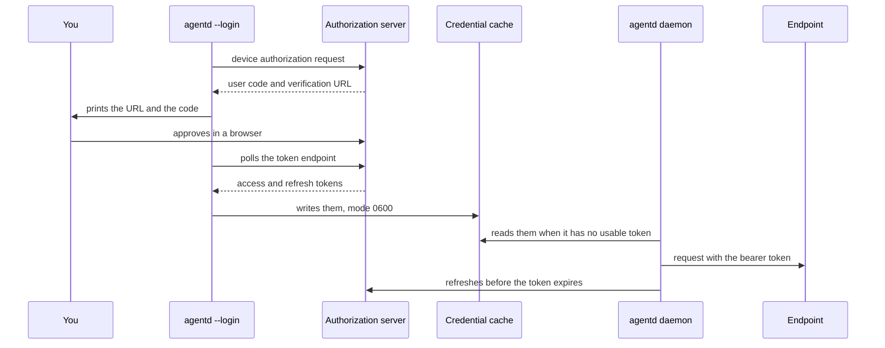

# Outbound credentials

agentd dials three kinds of endpoint that may need a credential: model
providers, MCP servers and A2A peers. Each takes one `auth:` block with the
same shape, so a static token, an OAuth login, AWS SigV4 or a SPIFFE workload
identity is configured the same way wherever it is used. This guide is for
operators: it shows how to choose a credential, configure it, log in once
when a person is needed, and what happens when a credential is missing.
Signing callers *in* to agentd's own listener is a different task, covered in
[Connect agents over A2A](connect-agents.md).

## Choose a credential

| Where agentd runs | Use | Interactive? |
|---|---|---|
| anywhere, the endpoint takes an API key | `static`, from a secret reference | never |
| a server, machine-to-machine OAuth | `oauth2` with `grant: client_credentials` | never |
| a developer's or operator's machine, a person's OAuth identity | `oauth2` with `grant: device` (or `authorization_code` for a browser) and one `agentd --login` | once |
| EC2 or EKS, an endpoint behind AWS IAM | `aws` with `source: imds` or `source: irsa` | never |
| a workstation, AWS IAM Identity Center | `aws` with `source: sso` and one `agentd --login` | once |
| Kubernetes or a cloud with SPIRE | `spiffe`, a JWT-SVID as a bearer or an X.509-SVID for mutual TLS | never |

A daemon never stops to wait for a person. Interactive credentials are
obtained ahead of time with `agentd --login`, cached, and refreshed by the
daemon.

## A complete example

This agent calls a corporate model gateway with a machine credential, reads
an issue tracker as the operator who logged in, and hands work to a partner
agent with a static token:

```yaml
agent:
  instruction: "Triage new tracker issues and hand billing questions to the partner desk."

intelligence:
  endpoints: https://llm.corp.example.com/v1/chat/completions
  model: gpt-5.1
  auth:
    kind: oauth2
    grant: client_credentials
    issuer: https://sso.corp.example.com
    client_id: agentd-triage
    client_secret: "{{secret:SSO_CLIENT_SECRET}}"
    scopes: [llm.invoke]

mcp:
  servers:
    - name: tracker
      endpoint: https://mcp.tracker.example.com/mcp
      tags: { "*": [untrusted_input] }
      auth:
        kind: oauth2
        grant: device
        issuer: https://sso.corp.example.com
        client_id: agentd-cli
        scopes: [tracker.read, offline_access]

a2a:
  peers:
    - name: partner
      endpoint: https://a2a.partner.example.com
      auth: { kind: static, token: "{{secret:PARTNER_TOKEN}}" }
```

With `SSO_CLIENT_SECRET` and `PARTNER_TOKEN` set, validate it, then log in to
the tracker once:

```sh
agentd --validate-config --config agentd.yaml
agentd --login mcp:tracker --config agentd.yaml
```

The client-credentials grant needs no login: the daemon fetches and refreshes
that token itself.

## Where a credential goes

| Endpoint | `auth:` block | Other ways to set a credential |
|---|---|---|
| the model connection | `intelligence.auth` | `intelligence.token` or `token_file` (a bearer), `intelligence.headers` |
| a named model provider | `intelligence.providers.<name>.auth` | that provider's `token`, `token_file`, `headers` |
| an MCP server | `mcp.servers[].auth` | `headers`; `oauth: {token_url, client_id, client_secret, scope}`, a client-credentials shortcut |
| a service catalog entry | `services.<name>.auth` | `headers` |
| an A2A peer | `a2a.peers[].auth` | `headers`; `client_cert` and `client_key` for mutual TLS |

On a model connection, a credential from `auth:` takes precedence over
`token`. The `AGENTD_INTELLIGENCE_TOKEN` and `AGENTD_INTELLIGENCE_TOKEN_FILE`
environment overrides apply to the top-level connection only, never to a
named provider.
On an MCP server, `auth:` wins over `oauth:`, and either one turns off AAuth
signing for that server; static `headers` are sent alongside.

**One credential for many consumers.** A service catalog entry holds the
credential every server or peer that references it uses, cached once under
`service:<name>`:

```yaml
agent:
  instruction: "Answer account questions from the CRM."

intelligence:
  endpoints: https://api.openai.com/v1/chat/completions
  model: gpt-5.1
  token: "{{secret:OPENAI_API_KEY}}"

services:
  crm:
    endpoint: https://mcp.crm.example.com/mcp
    tags: { "*": [sensitive] }
    auth:
      kind: oauth2
      grant: device
      issuer: https://sso.corp.example.com
      client_id: agentd-cli
      scopes: [crm.read]
mcp:
  servers:
    - { name: crm, service: crm }
```

A server that references an entry may not restate its endpoint, `auth` or
`headers`. `agentd --login mcp:crm` and `agentd --login service:crm` log into
the same cached credential.

## Static credentials

A fixed bearer token, or a fixed value in a header of your choosing, always
from a secret reference:

```yaml
# fragment: under mcp.servers[]:
auth: { kind: static, token: "{{secret:KB_TOKEN}}" }
```

```yaml
# fragment: under mcp.servers[]:
auth: { kind: static, header: X-API-Key, value: "{{secret:KB_API_KEY}}" }
```

`token` is sent as `Authorization: Bearer <token>`. A `{{secret-file:PATH}}`
reference is read again on every request, so a rotated file takes effect
without a restart.

On a model connection, a `static` block takes `token`; a `header` + `value`
pair is refused at load there. Use `intelligence.headers` for a custom header
on a model connection.

## OAuth 2.0

```yaml
# fragment: under mcp.servers[]:
auth:
  kind: oauth2
  issuer: https://sso.corp.example.com      # or pin token_url, device_authorization_url
  client_id: agentd-cli
  client_secret: "{{secret:SSO_CLIENT_SECRET}}"   # omit for a public client
  grant: device                             # device | authorization_code | client_credentials
  scopes: [tracker.read, offline_access]
  audience: https://tracker.example.com     # sent with the device authorization request
```

| Grant | When | How the token arrives |
|---|---|---|
| `device` (the default) | a person authorizes once, from any terminal, over SSH included | `agentd --login` prints a URL and a short code and polls until the person approves |
| `authorization_code` | a person with a desktop browser | `agentd --login` prints the authorization URL, catches the redirect on a one-time `127.0.0.1` listener, checks `state`, and exchanges the code with PKCE |
| `client_credentials` | machine to machine | the daemon fetches the token with `client_secret` and refetches it before it expires; no login |

**Endpoints.** With `issuer`, agentd discovers the token, device and
authorization endpoints from `<issuer>/.well-known/openid-configuration`, or
`<issuer>/.well-known/oauth-authorization-server`. Pin `token_url`,
`device_authorization_url` or `authorization_url` to skip discovery. An
`oauth2` block needs `client_id` and either `issuer` or `token_url`; the
device grant also needs `issuer` or `device_authorization_url`, and the
browser grant `issuer` or `authorization_url`. The load checks each of these.

The daemon discovers them at the first request that needs them — the first
token fetch of a `client_credentials` grant, the first refresh of a login —
not when the connection is built, and again at each later request until
discovery succeeds. While the issuer does not answer, those requests fail
without being sent; an issuer that is down at startup does not stop the
start. Pin the endpoints to depend on no discovery at all.

**The MCP shortcut.** `mcp.servers[].oauth` is a client-credentials grant
with a pinned token endpoint, and nothing else:

```yaml
# fragment: under mcp.servers[]:
oauth:
  token_url: https://sso.corp.example.com/oauth2/token
  client_id: agentd-search
  client_secret: "{{secret:SEARCH_CLIENT_SECRET}}"
  scope: search.read
```

> **Limit.** agentd reads OAuth responses as JSON, which is what RFC 6749
> and RFC 8628 specify, and does not send `Accept: application/json`. An
> authorization server that answers form-encoded unless asked for JSON, such
> as GitHub's OAuth endpoints, fails with `oauth: bad device-auth response`.

## Log in with agentd --login

When a credential needs a person (an `oauth2` device or authorization-code
grant, or `aws` with `source: sso`), complete it once with `agentd --login`.
The release binaries and the container image include the `oauth` feature it
needs.

```sh
agentd --login mcp:tracker --config agentd.yaml
```

```text
┌─ authorize agentd ──────────────────────────────
│  target   mcp:tracker
│  visit    https://sso.corp.example.com/device
│  code     WDJB-MJHT
│  waiting… (expires in 900s · Ctrl-C to cancel)
└──────────────────────────────────────────────────
logged in to mcp:tracker — token cached in /home/you/.local/state/agentd/creds
```

The prompt goes to stderr and the one-line result to stdout. The token is
never printed.

| Target | Logs into |
|---|---|
| `intelligence` | the top-level model connection's `auth` |
| `intelligence:<provider>` | `intelligence.providers.<provider>.auth` |
| `mcp:<name>` | that MCP server's `auth`; a server that references a service logs into `service:<entry>` |
| `service:<name>` | a service catalog entry's `auth`, shared by every consumer |

An A2A peer can be logged into only through a service entry: give the peer
`service: <entry>` with a `kind: peer` catalog entry, and log into
`service:<entry>`. `--login` takes no target for a peer's own `auth` block,
so an oauth2 `device` or `authorization_code` grant there, or one with no
`grant`, is refused at load.

`agentd --logout <target>` removes a cached credential.

The device grant, from login to the daemon's refresh:



**The cache** is one file per target, mode `0600`, in `$AGENTD_CRED_DIR`, else
`$XDG_STATE_HOME/agentd/creds`, else `~/.local/state/agentd/creds`. Log in as
the user the daemon runs as, or point both at the same `AGENTD_CRED_DIR`. The
daemon refreshes a token in memory a minute before it expires, using the
refresh token; a refreshed token is not written back to the cache. Whenever
the daemon holds no usable token it reads the cache again, so a login made
while it runs is used by the next request, with no reload or restart. A
restart reads the cache again too, so after a restart the daemon refreshes
from the refresh token the login stored. If your authorization server issues
single-use refresh tokens, plan on logging in again after a restart.

## AWS SigV4

An endpoint behind AWS IAM, such as an API Gateway in front of an MCP server
or Amazon Bedrock, takes a `kind: aws` block. Every request is signed over
its method, path and body; a session token is signed as
`x-amz-security-token`.

```yaml
# fragment: under mcp.servers[]:
auth:
  kind: aws
  region: us-east-1
  service: execute-api
  source: irsa
```

| `source` | Credentials | Login |
|---|---|---|
| `env` (the default) | `AWS_ACCESS_KEY_ID`, `AWS_SECRET_ACCESS_KEY`, `AWS_SESSION_TOKEN`, read at each request | none |
| `static` | the same as `env` | none |
| `imds` | the EC2 instance role, through IMDSv2, refreshed a minute before expiry | none |
| `irsa` | the EKS pod's web identity (`AWS_WEB_IDENTITY_TOKEN_FILE`, `AWS_ROLE_ARN`) exchanged with STS, refreshed a minute before expiry | none |
| `sso` | IAM Identity Center; needs `sso_start_url`, `account_id`, `role_name` | `agentd --login`, which caches temporary credentials; the signer re-reads them on every request |

```yaml
# fragment: under mcp.servers[]:
auth:
  kind: aws
  region: us-east-1
  service: execute-api
  source: sso
  sso_start_url: https://my-org.awsapps.com/start
  account_id: "123456789012"
  role_name: AgentdLedger
```

For Amazon Bedrock's own API, set `intelligence.dialect: bedrock` with a
`kind: aws` block and `service: bedrock`; the load refuses the Bedrock
dialect without one. [Connect model providers](connect-models.md) has
complete configurations for Bedrock, Azure OpenAI with Microsoft Entra ID, and
Google Vertex AI.

## SPIFFE workload identity

With SPIRE writing SVIDs to files, an agent needs no stored secret at all.

```yaml
# fragment: under mcp.servers[]:
auth: { kind: spiffe, svid: jwt, jwt_svid_file: /run/spire/jwt.svid }
```

```yaml
# fragment: under mcp.servers[]:
auth: { kind: spiffe, svid: x509, svid_file: /run/spire/svid.pem, key_file: /run/spire/svid.key }
```

A JWT-SVID is sent as a bearer token and read again on every request, so
SPIRE's rotation needs nothing from you. An X.509-SVID is a mutual-TLS client
identity: it works on MCP servers. A model connection cannot use one, and the
load refuses it there. For an A2A peer, an `x509` block applies nothing; set
the peer's `client_cert` and `client_key` to the SVID files instead.

## Mutual TLS and private CAs

An A2A peer that requires a client certificate takes `client_cert` and
`client_key`, PEM files read when the peer is dialled:

```yaml
# fragment: under a2a.peers[]:
name: billing
endpoint: https://a2a.billing.example.com
client_cert: /run/spire/svid.pem
client_key: /run/spire/svid.key
```

To trust an endpoint whose certificate a private CA signed, set
`security.tls_ca` to a PEM bundle. agentd adds it to the bundled trust roots
for every outbound TLS dial, in the daemon and its child processes.

## Which kinds each endpoint accepts

| | `static` token | `static` header | `oauth2` | `aws` | `spiffe` jwt | `spiffe` x509 |
|---|---|---|---|---|---|---|
| model connection or provider | yes | refused at load | yes | yes | yes | refused at load |
| MCP server or service | yes | yes | yes | yes | yes | yes (mutual TLS) |
| A2A peer | yes | yes | yes, login through a service entry | yes | yes | use `client_cert` and `client_key` |

## When a credential is missing or refused

The load catches what it can see, and exits 2 before any side effect:

- a `{{secret:…}}` or `{{secret-file:…}}` reference that does not resolve;
- an `auth:` block missing the fields its kind and grant need;
- an inline `token`, `value` or `client_secret` in any `auth:` block, and an
  inline `intelligence.token`, provider `token` or `oauth.client_secret` in a
  config file;
- an `auth:` block on a model connection, an MCP server or an A2A peer in a
  binary built without the `oauth` feature, which could not present it.

What depends on the world is not caught at load: an interactive credential
that was never logged in, or has expired with no refresh token; an `issuer`
or a token endpoint that does not answer; an `aws` source with no
credentials; a `{{secret-file:…}}` or `token_file` that cannot be read when a
request needs it; an AAuth Agent Provider that does not answer, or will not
enroll the key or issue an agent token (target `aauth`; see
[AAuth agent identity](aauth.md#turn-it-on)). agentd never sends a request
without the credential it is configured to present. The request is not sent,
and it fails with an error that names the target and the cause:

- an MCP server's connect fails (`mcp.connect.fail`) and is dialed again in
  the background, or, on a live connection, the tool call fails;
- a model call fails as an authentication error: it is not failed over to
  another endpoint or model, and it fails the turn, step or run;
- an A2A peer call fails.

The log says so once, not once a call: `auth.unavailable` (warn) names the
target and the cause when its requests start failing, and again at most
once a minute while they keep failing; `auth.recovered` (info) says when one
succeeds again. The supervisor writes them for the whole process tree: a
turn worker or subagent hands what its credentials do up to it, so a
credential every turn fails on is one line a minute, not one a turn. Every
later request tries again, so logging
in with `agentd --login <target>`, as the user the daemon runs as, takes
effect on the next request. In a one-shot job, the run's `run.done` line
carries the error:

```text
{…,"err":"step \"work\" failed: turn failed: intel: intelligence request not sent: intelligence: no cached credential — run `agentd --login intelligence`","event":"run.done",…,"status":"failed",…}
```

The job then exits 4. A `401` from an endpoint means the credential was sent
and refused: a token that is wrong, revoked or short of the access the
endpoint needs. The [CLI reference](cli.md) has every exit code.

## Field reference

| Field | Kinds | Meaning |
|---|---|---|
| `kind` | all | `static`, `oauth2`, `aws` or `spiffe` (required) |
| `token` | `static` | bearer token; must be a secret reference |
| `header`, `value` | `static` | a custom header and its value; `value` must be a secret reference |
| `issuer` | `oauth2` | authorization server for endpoint discovery |
| `token_url` | `oauth2` | token endpoint; pins discovery |
| `device_authorization_url` | `oauth2` | device authorization endpoint |
| `authorization_url` | `oauth2` | authorization endpoint for `grant: authorization_code` |
| `client_id` | `oauth2` | client id (required) |
| `client_secret` | `oauth2` | client secret; must be a secret reference; required for `client_credentials` |
| `grant` | `oauth2` | `device` (default), `authorization_code` or `client_credentials` |
| `scopes` | `oauth2` | requested scopes |
| `audience` | `oauth2` | `audience` parameter sent with the device authorization request, for authorization servers that want one |
| `region` | `aws` | AWS region (required) |
| `service` | `aws` | signing service name, such as `bedrock` or `execute-api` (required) |
| `source` | `aws` | `env` (default), `static`, `imds`, `irsa` or `sso` |
| `sso_start_url`, `account_id`, `role_name` | `aws` | IAM Identity Center portal, account and permission set; required for `source: sso` |
| `svid` | `spiffe` | `jwt` (default) or `x509` |
| `jwt_svid_file` | `spiffe` | JWT-SVID file; required for `svid: jwt` |
| `svid_file`, `key_file` | `spiffe` | X.509-SVID certificate and key; required for `svid: x509` |

## Next steps

- [Connect model providers](connect-models.md): complete configurations for
  each provider, credentials included.
- [Connect MCP servers](connect-mcp.md): declare servers, tags and tool
  ceilings.
- [AAuth agent identity](aauth.md): a signed agent identity for servers that
  ask for one.
- [Harden a deployment](harden.md): secrets, egress and the rest of the
  checklist.
