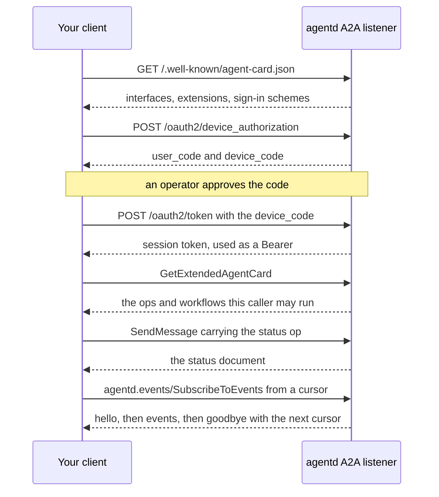

# Build a client

Everything agentd's own terminal and web UI do is A2A 1.0 plus three declared
extensions, so any program can be a client: a dashboard, a chat bridge, a
script in CI. This guide is for developers writing one. It covers the calls in
the order a client makes them (discover, sign in, converse, run commands,
watch), with samples that run against a local daemon, and then the TypeScript
library the shipped clients are built on.

## What a client speaks

A client needs nothing agentd-specific to start: a stock A2A 1.0 SDK in any
language can converse, list and cancel tasks, and follow a task as it runs.
agentd adds reach through extensions that a client activates per request,
only when the card declares them:

| To | Use | Needs |
|---|---|---|
| Discover the agent | `GET /.well-known/agent-card.json`, then `GetExtendedAgentCard` with a credential | core A2A |
| Converse | `SendMessage`, `SendStreamingMessage`, `GetTask`, `ListTasks`, `CancelTask`, `SubscribeToTask` | core A2A |
| Know a task's link, owner and answer schema | task metadata under the task-annotations URI | [task-annotations](https://agentd.dev/a2a/ext/task-annotations) |
| Run operations (status, workflows, steering, sign-in admin) | one DataPart `{"agentd": {"op": …}}` on `SendMessage` | [command](https://agentd.dev/a2a/ext/command) |
| Watch the whole instance live | `agentd.events/SubscribeToEvents` | [events](https://agentd.dev/a2a/ext/events) |
| Sign in a person | the OAuth device grant at the listener's `/oauth2/*` | listener with `a2a.device_grant` |

Every request carries `A2A-Version: 1.0`. The extension specifications are
normative; [A2A extensions](a2a-extensions.md) is the reference landing page,
and [A2A API reference](a2a-reference.md) covers the core methods, errors and
principals.



To follow along, run a daemon with a listener and the events feed. This one
uses agentd's built-in test endpoint, `mock:final`, which answers every turn
with a fixed reply and needs no model provider. The release binaries and the
container image include it:

```yaml
intelligence:
  endpoints: ["mock:final"]

a2a:
  listen: http://127.0.0.1:8420
  events:
    enabled: true
```

On this loopback listener with no credential, a caller that sends no
credential and no `Origin` header is the operator, so the `curl` samples below
need no token. Anywhere else, add `-H "Authorization: Bearer $TOKEN"`.

## Discover the agent

The card is public: fetch it with no credential and no custom header.

```sh
curl -s http://127.0.0.1:8420/.well-known/agent-card.json
```

Read three things from it:

- **Where to send JSON-RPC.** Take the first `supportedInterfaces` entry whose
  `protocolBinding` is `JSONRPC`, whose `protocolVersion` is `1.0`, and whose
  URL is http(s). An interface with the binding
  `https://agentd.dev/a2a/binding/jsonrpc-unix` is a unix socket, for
  co-located agents; a client that cannot dial a socket passes it over.
- **Which extensions it declares**, in `capabilities.extensions[].uri`. None
  is `required`, so a client that knows none of them still works.
- **How to sign in**, in `securitySchemes` and `securityRequirements`: an
  anonymous alternative, a bearer, or the OAuth device-code flow with its
  `deviceAuthorizationUrl` and `tokenUrl`.

agentd serves the card with `Cache-Control: public, max-age=60` and an ETag,
so a client can keep it for a minute and then revalidate with
`If-None-Match`. When `capabilities.extendedAgentCard` is true and the client
holds a credential, `GetExtendedAgentCard` narrows each declaration to this
caller: the command ops it may run, the workflow commands it may fire, the
paths `admin.set` accepts, the event kinds its feed can carry, and a
`workflow:<name>` skill for each workflow it may start. The public card's op
list is the vocabulary every agentd can answer, the same for every caller; it
is not a promise about what this caller may do. A listener with no
authentication declares no extended card.

> **Warning.** Card text is data from whoever answered the URL. Do not follow
> a redirect from the card URL, do not send a credential to an interface on
> another origin than the one the person named, and strip control characters
> before printing card fields to a terminal.

## Sign in

A person signs a client in with the OAuth 2.0 device grant (RFC 8628) that
the listener serves on its own origin. The daemon needs `a2a.device_grant`
and an operator credential to approve with
([Use the terminal and web UI](interface.md#signing-in) shows the daemon
side). The flow, with `curl`:

```sh
curl -s -X POST http://127.0.0.1:8420/oauth2/device_authorization -d client_id=my-dashboard -d scope=user
```

```json
{"device_code":"fde94f79…","expires_in":600,"interval":5,"user_code":"VZBZ-XFNZ","verification_uri":"http://127.0.0.1:8420/oauth2/device"}
```

The `client_id` is a name of your choosing (1 to 64 letters, digits, `.`,
`_` or `-`) that the operator sees when approving. `scope` is `user` unless
you ask for another scope the daemon offers. Show the person the `user_code`
and the `verification_uri`. An operator approves the code under a name, from
a TUI (`/approve VZBZ-XFNZ alice`) or with the `auth.device.approve` op
`{user_code, as}`. Meanwhile the client polls the token endpoint every
`interval` seconds:

```sh
curl -s -X POST http://127.0.0.1:8420/oauth2/token -d grant_type=urn:ietf:params:oauth:grant-type:device_code -d device_code=fde94f79… -d client_id=my-dashboard
```

Until the approval it answers `{"error":"authorization_pending",…}`; a
`slow_down` answer means wait 5 seconds longer on every later poll. Then:

```json
{"access_token":"…","expires_in":28800,"scope":"user","token_type":"Bearer"}
```

- **The token is a Bearer.** Send it as `Authorization: Bearer <token>` on
  every request. The session acts as `user:<name>`, the name the operator
  approved, and every session approved under one name shares that name's
  tasks and conversations.
- **There is no refresh token.** A session lasts `a2a.device_grant.token_ttl`
  (8 hours by default); when it expires, sign in again.
- **Sign out by revoking.** `POST /oauth2/revoke` with `token=<token>` (RFC
  7009) ends the session. The server's metadata at
  `/.well-known/oauth-authorization-server` names the endpoints.
- **Use https.** Send a device code or a token only to https, or to plain
  http on a loopback host, and refuse redirects on these calls.

A browser page always authenticates, even on a loopback daemon with nothing
configured, and its origin must be listed in `a2a.cors.origins`
([Host the web UI](hosting-the-ui.md)). A bearer token the operator issued
works too, for a service rather than a person; the principal rules that map
tokens to identities are in [Connect agents over A2A](connect-agents.md).

## Converse with the agent

A conversation is ordinary A2A. Send a message and ask for the task back at
once, so the client does not block for a whole turn (in A2A 1.0 an absent
`returnImmediately` means wait until the task finishes):

```sh
curl -s http://127.0.0.1:8420/ \
  -H 'content-type: application/json' \
  -H 'A2A-Version: 1.0' \
  -H 'A2A-Extensions: https://agentd.dev/a2a/ext/task-annotations' \
  -d '{"jsonrpc":"2.0","id":3,"method":"SendMessage","params":{"message":{"role":"ROLE_USER","messageId":"m-3","parts":[{"text":"Summarize the open issues."}]},"configuration":{"returnImmediately":true}}}'
```

The answer is a task in `TASK_STATE_WORKING`. Follow it with `GetTask`, or
with `SubscribeToTask` when the card sets `capabilities.streaming`. When it
completes, the reply text is in the task's status message and in its
`<taskId>.result` artifact. Because the request activated task-annotations,
the task also carries agentd's facts about it:

```json
"metadata": {
  "https://agentd.dev/a2a/ext/task-annotations": {
    "created": "2026-10-11T18:47:24.876Z",
    "link": {"id": "01a12c4a-89cc-7730-a166-2554ee4fb5eb", "kind": "turn"},
    "principal": "operator",
    "statusHistory": [
      {"state": "TASK_STATE_SUBMITTED", "ts": "2026-10-11T18:47:24.876Z"},
      {"state": "TASK_STATE_WORKING", "ts": "2026-10-11T18:47:24.877Z"},
      {"state": "TASK_STATE_COMPLETED", "ts": "2026-10-11T18:47:24.896Z"}
    ]
  }
}
```

- **Continue a conversation** by sending the next message with the task's
  `contextId`.
- **Answer a question.** A task that stops at `TASK_STATE_INPUT_REQUIRED` is
  waiting for a person. Send the answer as a message with that task's
  `taskId` (and no `contextId`). When the annotations carry `askSchema`, the
  question has a typed answer: render a control from the schema instead of a
  text box. [Human in the loop](human-in-the-loop.md) covers who may answer.
- **Cancel** with `CancelTask`.
- **List** with `ListTasks`. A caller sees its own tasks; an operator sees
  all of them.

## Run commands

Operations that are not conversation (the instance's status, starting a
workflow, pausing a run, approving a device) go through the command
extension. A command is an ordinary `SendMessage` whose single part is a
DataPart under the key `agentd`, and it is activated twice: the
`A2A-Extensions` header names the command URI, and the message lists it in
`message.extensions`. Without both, the part is refused and never run.

```sh
curl -si http://127.0.0.1:8420/ \
  -H 'content-type: application/json' \
  -H 'A2A-Version: 1.0' \
  -H 'A2A-Extensions: https://agentd.dev/a2a/ext/command, https://example.com/not-ours' \
  -d '{"jsonrpc":"2.0","id":1,"method":"SendMessage","params":{"message":{"role":"ROLE_USER","messageId":"m-1","extensions":["https://agentd.dev/a2a/ext/command"],"parts":[{"data":{"agentd":{"op":"status"}}}]}}}'
```

```
HTTP/1.1 200 OK
content-type: application/json
a2a-extensions: https://agentd.dev/a2a/ext/command

{"id":1,"jsonrpc":"2.0","result":{"message":{…,"parts":[{"data":{"activity":[],"budget":{…},…}}]}}}
```

The response echoes exactly the extensions the request activated; the URI
agentd does not know was dropped, not refused. An op answers in one of two
ways, published per op on the card as `params.ops[].reply`:

- **A read** (`status`, `config`, `workflow.status`, `plan.get`, …) answers
  with a Message whose DataPart is the result. No task is created, so a client
  that polls leaves nothing behind.
- **Work** (`workflow.run`, `admin.pause`, `auth.device.approve`, …) answers
  with a Task, and its result arrives as the task's `<taskId>.result`
  artifact.

Arguments sit beside `op` and are validated against the op's schema; an
argument the op does not take is refused, never ignored. Before sending, check
that the op is in the extended card's `params.ops` for this caller: the
operator-only ops (`admin.*`, `auth.*`, `config`, `debug.events`) are refused
to anyone else, whatever their grants say. The full op table, the reply
shapes and the error reasons are the
[command specification](https://agentd.dev/a2a/ext/command).

## Watch the instance

A2A follows one task at a time. A dashboard needs the whole instance, so the
events extension declares one method, `agentd.events/SubscribeToEvents`, that
streams every run, conversation, subagent and task change the caller may see:

```sh
curl -sN http://127.0.0.1:8420/ \
  -H 'content-type: application/json' \
  -H 'A2A-Version: 1.0' \
  -H 'A2A-Extensions: https://agentd.dev/a2a/ext/events' \
  -d '{"jsonrpc":"2.0","id":7,"method":"agentd.events/SubscribeToEvents","params":{"fromSeq":0}}'
```

```
data: {"id":7,"jsonrpc":"2.0","result":{"hello":{"introspection":false,"resume":0,"resync":false,"seq":22,"version":"1.18.0"}}}

data: {"id":7,"jsonrpc":"2.0","result":{"event":{"data":{…},"kind":"run","seq":1,"ts":1791744042168}}}
```

The stream is server-sent events, one JSON-RPC response per event:

1. **`hello`** opens it. `seq` is the newest sequence number, and `resync:
   true` says your cursor could not be honoured (after a daemon restart, or
   when you fell more than the 1024-event replay window behind).
2. **`event`** frames follow: the events past `fromSeq`, then live ones. Each
   is `{seq, ts, kind, data}`, and `kind` is one of a closed list (`task`,
   `run`, `step`, `conversation`, `subagent`, `child`, `activity`, `status`,
   `lifecycle`, `config`, `audit`, `auth`, and the `*.removed` departures).
   A caller is sent only the events its principal may see, so the `seq`
   values it reads have gaps.
3. **`goodbye`** closes it with `{seq, reason}`. Reconnect with
   `fromSeq: seq`; the reconnect is a continuation. The reason is `deadline`
   when the listener's stream deadline elapsed, and `revoked` when the
   caller's session was revoked.

The robust pattern is the one the shipped clients use: bootstrap with the
`status` read and `ListTasks`, then hold the feed and apply events on top;
when `hello.resync` is true, bootstrap again instead of applying the replay.
When the card declares no events extension, fall back to core A2A: list tasks
every second or two and follow the moving ones with `SubscribeToTask`. The
frames and every kind's schema are the
[events specification](https://agentd.dev/a2a/ext/events).

## Use the TypeScript library

The npm package `@agentd-dev/cli` is the shipped TUI, the shipped web UI, and
the client core they share, exported as the package's library entry point. Use
it from Node 20 or later, or bundle it for a browser:

```sh
npm install @agentd-dev/cli
```

Its main pieces:

| Export | Does |
|---|---|
| `openSession`, `fetchCard`, `selectInterface`, `capabilitiesOf`, `CardCache` | discovery: the card with its cache, the interface, the extended card, and what the agent offers this caller |
| `A2aClient` | the core A2A methods over one endpoint |
| `AgentdClient` | the core methods plus the extensions, each refused locally when the card does not declare it: `send`, `command`, `status`, `workflowRun`, `pause`, `subscribeEvents`, `authDeviceApprove`, … |
| `Observation`, `Mirror` | the observation driver (events feed with resume and resync, or core-mode polling) and the state it keeps converged |
| `deviceLogin`, `loginOptions`, `revocationEndpointOf`, `revokeToken` | sign-in with the device grant, and sign-out |
| `classify`, `describe` | sort any failure into what to do next: stop, wait, or retry |
| `call`, `rpc`, `rpcStream`, `sseParser` | the JSON-RPC and SSE wire, for a call the classes do not cover |

Ask one question and wait for the answer:

```js
import { AgentdClient, openSession } from '@agentd-dev/cli';

const endpoint = process.argv[2] ?? 'http://127.0.0.1:8420';

// Discovery: read the card, pick the interface, learn what it declares.
const session = await openSession(endpoint);
const client = new AgentdClient(session.ep, session.caps);
console.log('agent:', session.card.name, '· events:', session.caps.events !== null);

// A read op (command extension): answered with a Message, no task created.
if (client.offers('status')) {
  const status = await client.status();
  console.log('instance:', status.instance);
}

// A natural-language turn: the reply is a task; follow it to the end.
const { task } = await client.send('Say hello in five words.');
let t = task;
while (t && ['TASK_STATE_SUBMITTED', 'TASK_STATE_WORKING'].includes(t.state)) {
  await new Promise((r) => setTimeout(r, 500));
  t = await client.getTask(t.id);
}
console.log(t?.state, '→', t?.artifacts.join('\n'));
```

Save it as `ask.mjs` and run it against the daemon above:

```sh
node ask.mjs http://127.0.0.1:8420
```

```
agent: agentd · events: true
instance: agentd
TASK_STATE_COMPLETED → mock-llm done
```

Follow everything the agent does, the way the shipped clients do. The
`Observation` picks events mode or core mode from the card, reconnects with
backoff, and stops for good on a failure retrying cannot fix:

```js
import { Mirror, Observation } from '@agentd-dev/cli';

const endpoint = process.argv[2] ?? 'http://127.0.0.1:8420';
const mirror = new Mirror();
const obs = new Observation(
  {
    configured: endpoint,
    onSession: (session) => console.log('connected to', session.card.name),
    onTerminal: (f) => console.error('stopped:', f.kind, f.message),
  },
  mirror,
);

let shown = 0;
mirror.subscribe(() => {
  const s = mirror.getState();
  for (const e of s.transcript.slice(shown)) console.log(`[${s.conn}] ${e.kind}: ${e.text}`);
  shown = s.transcript.length;
});

obs.start();
process.on('SIGINT', () => {
  obs.stop();
  process.exit(0);
});
```

The mirror's state holds the tasks, runs with their steps, conversations,
subagents, live activity and a rendered transcript, and `conn` says whether
the client is on the feed (`ready`) or polling (`polling`). Sign a person in
with the device grant:

```js
import { AgentdClient, cardUrlOf, deviceLogin, fetchCard, loginOptions, openSession } from '@agentd-dev/cli';

const endpoint = process.argv[2] ?? 'http://127.0.0.1:8420';

// The card says how to sign in; take its device grant.
const card = await fetchCard(cardUrlOf(endpoint));
const device = loginOptions(card).find((o) => o.method === 'device');
if (!device) throw new Error('this agent offers no device sign-in');

const credential = await deviceLogin({
  flow: device.flow,
  clientId: 'my-dashboard',
  onCode: (c) => console.log(`open ${c.verificationUri} and enter ${c.userCode}`),
});

// Open the session with the credential: the client reads the extended card.
const session = await openSession(endpoint, { credential });
const client = new AgentdClient(session.ep, session.caps);
console.log('signed in until', new Date(credential.expiresAt).toISOString());
console.log('ops I may run:', [...session.caps.command.ops].join(', '));
```

Against a daemon with the device grant on, once an operator approves the code
as `alice`, it prints what a `user` principal may run:

```
open http://127.0.0.1:8420/oauth2/device and enter RKQK-VBDP
signed in until 2026-10-12T02:48:03.164Z
ops I may run: status, workflow.run, workflow.status, workflow.cancel, subagent.send, subagent.status, plan.get
```

> **Note.** `@agentd-dev/cli` is licensed AGPL-3.0-only, like agentd. Check
> what that means for your distribution before you bundle it; a client
> written against the wire alone carries no such obligation.

## Rules a well-behaved client follows

The shipped clients hold themselves to these, and a client of your own should
too:

- **Activate only what the card declares**, and read the echo. If the
  response's `A2A-Extensions` header leaves out an extension your call depends
  on, do not trust the answer as that extension's.
- **Send a command only if the card lists its op for you.** It saves a round
  trip, and nobody learns an op is refused by trying it.
- **Keep credentials out of argv, URLs and logs.** A token on a command line
  is readable by every local user; a token in a query string ends up in
  history and access logs.
- **One credential at a time.** Two sources given together should be an
  error, not a guess about which wins.
- **Stop on what retrying cannot fix.** `401` (sign in again), `403` (ask an
  operator) and an incompatible agent are final. Back off on `429` (honour
  `Retry-After`), on a 5xx and on a draining daemon.

## Check your client against the contract

The schemas a peer validates against ship with the binary:

```sh
agentd --extensions
```

```sh
agentd --extension-schema events
```

The first lists every extension and binding URI agentd publishes, with its
schema URL. The second prints one extension's JSON Schema bundle (`command`,
`events` or `task-annotations`): the command envelopes and results, the feed's
frames and kinds, the annotations object. agentd.dev serves the same bundles
at `https://agentd.dev/a2a/ext/<name>/schema.json`, and validating your
client's fixtures against them catches a drift before a user does.

## Next steps

- [A2A extensions](a2a-extensions.md) for activation, the extended card and
  every error reason.
- [A2A API reference](a2a-reference.md) for the core methods, principals and
  errors.
- [Use the terminal and web UI](interface.md) to see a complete client at
  work.
- [Embed agentd in Rust](embedding.md) to run the agent inside your own
  program instead.
