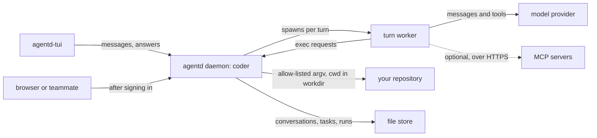

# Build a coding agent

This tutorial sets up a pair-programming agent on one repository: a daemon
you talk to from a terminal, that reads the code and runs allow-listed
commands, asks before risky steps, and keeps working when you close the
client. It is for developers who have done the [Quickstart](getting-started.md).
At the end you have a running coding agent, you know where its fences are,
and you can add chores that run on a schedule.

> **Note.** agentd ships no file-editing tools. It is a runtime you assemble
> a coding agent on, not a coding agent in a box: you choose its powers, and
> a configuration that grants none is an agent that can only talk. The
> assembly is about forty lines of YAML, and step 2 is a complete one.

## Before you start

- **Rust 1.96 or newer** and a C compiler, to build agentd with the command
  runner. The release binaries leave it out on purpose.
- **An OpenAI API key** in `OPENAI_API_KEY`.
- **Node.js 20 or newer** and the clients: `npm install -g @agentd-dev/cli`.
- **A git repository** to work on.

## What you will build

The daemon owns the session. Clients attach to it over A2A and render it;
quitting one leaves the agent working. Each model turn runs in a child
process; the commands it asks for run through agentd's guarded runner,
inside the repository.



## Step 1: Build agentd with the command runner

The `exec` feature compiles in the local command runner. This build adds it
to the A2A listener the clients need, cron schedules, reload on `SIGHUP`,
and CEL expressions:

```bash
cargo install agentd-cli --locked --features "a2a,exec,cron,hot-reload,cel"
```

The binary lands in `~/.cargo/bin/agentd`. If you also installed a release
binary, make sure this one comes first:

```bash
command -v agentd
agentd --version
```

```text
/home/you/.cargo/bin/agentd
agentd 1.18.0
```

> **Warning.** A release binary accepts the `security.exec` settings below
> and then offers the agent no command runner, without a warning. Run this
> tutorial on the binary you built in step 1.

## Step 2: Write the configuration

Save this as `~/coding.yaml`, outside the repository:

```yaml
agent:
  name: coder
  # Standing policy: how to work, not today's task.
  instruction: |
    You are a careful engineer working in one git repository. The exec
    tool runs commands in it.

    Explore before you edit: read the relevant files, run the tests, and
    say what you found. Prefer the smallest change that fixes the cause.

    Ask before you act destructively: anything that rewrites history,
    force pushes, deletes files or touches credentials. Use ask_human for
    that and wait for the answer.

    When you finish, state what changed and how you verified it.
  preflight: never           # your messages go straight to the turn
  ask_human_unowned: gate    # background work may ask you too

intelligence:
  endpoints: https://api.openai.com/v1/chat/completions
  model: gpt-5.1
  token: "{{secret:OPENAI_API_KEY}}"
  budget:
    windows: [{ per: day, tokens: 2000000 }]
    on_exhausted: refuse

store:
  kind: file
  file: { path: "${HOME}/.local/state/agentd/coder" }

a2a:
  listen: http://127.0.0.1:8420
  events: { enabled: true }

security:
  exec:
    enabled: true
    workdir: "${REPO}"
    allow: [git, rg, ls, cat]
    timeout: 120s
    max_output: 262144
    env: [PATH, HOME, LANG]

limits:
  run: { steps: 60, tokens: 400000, deadline: 30m }

lifecycle:
  run_until: drained
```

What each block does:

| Block | What it does here |
|---|---|
| `agent.instruction` | The standing policy, sent with every turn. Your equivalent of a `CLAUDE.md`: how to work, what to ask about, what "done" means. Today's task goes in your message. |
| `agent.preflight: never` | Skips the triage step before each turn: you are the intent. |
| `agent.ask_human_unowned: gate` | Lets work you did not start (subagents, scheduled runs) ask you questions too. |
| `intelligence` | The model, and a daily token window: once 2,000,000 tokens are spent, new turns are refused until the window resets at 00:00 UTC. |
| `store` | Keeps conversations, tasks and runs on disk, outside the repository, so a restart resumes them. |
| `a2a` | The loopback listener the clients attach to, with the live feed they watch. |
| `security.exec` | The command runner: on, confined to the repository, read-only commands to start. |
| `limits.run` | Bounds each turn: 60 steps, 400,000 tokens, 30 minutes. |
| `lifecycle.run_until: drained` | Keeps the daemon up until you stop it. |

`${HOME}` and `${REPO}` are filled in from the environment when agentd
loads the file; an unset variable stops it with a message naming it.

## Step 3: Start it and talk to it

From the repository, export its path and start the daemon with the terminal
UI:

```bash
cd /path/to/your/repository
export REPO="$PWD"
agentd tui --config ~/coding.yaml
```

Ask something that needs the code, such as "What does this repository do,
and how do I run its tests?" The agent calls `exec` with commands like `ls`,
`cat` and `git log`, and answers. While it works, the status row shows the
current phase and tool, the time spent and the tokens used.

> **Note.** This configuration declares no workflow, so agentd also runs the
> instruction once, as a task, the first time the daemon starts: expect one
> orientation run in the log before your first message. With the file store
> it never runs again. Adding any workflow, as in
> [step 7](#step-7-add-a-chore-that-runs-on-its-own), turns it off.

To keep the agent working when you close the UI, run the daemon and the
client apart, in two terminals:

```bash
agentd --config ~/coding.yaml
```

```bash
agentd-tui --endpoint http://127.0.0.1:8420
```

## Step 4: Answer its questions

When the agent calls `ask_human`, the task that your message started
switches to *input-required*, and the question appears in every attached
client. Reply in the conversation and the agent continues with your answer.
Typing `#<task-id> your answer` answers a specific task.

Two cases behave differently:

- **A restart while a question is open.** The conversation and the task
  survive in the store, but the turn that asked does not. Your answer
  arrives as a new message, and the agent continues the conversation from
  it. A `human` step in a workflow, as in step 7, is rebuilt exactly and
  waits on.
- **A question from work nobody started.** Subagents and scheduled runs
  belong to no conversation. With `ask_human_unowned: gate`, their questions
  open a task of their own, which you answer from the Tasks screen or with
  `#<task-id>`. Without it, `agent.ask_human_fallback` decides: `fail`
  (the default) returns an error to the asker at once, `wait` parks the
  question until its timeout, and `auto` lets a model judge on
  `intelligence.roles.approve` answer, marked as automatic. The judge never
  answers for a run that carries outside input.

[Human in the loop](human-in-the-loop.md) covers addressed gates, timeouts
and approvals in full.

## Step 5: Widen what it can do

The allow-list matches `argv[0]` exactly; an empty list denies everything.
Widen it as the agent earns your trust:

| `allow` | The agent can |
|---|---|
| `[git, rg, ls, cat]` | Read the repository and its history |
| `[git, rg, ls, cat, cargo, npm, pytest]` | Also build and run the tests |
| `[git, rg, ls, cat, sed, tee, cargo]` | Also edit files in place |
| `[bash]` | Run anything a shell can. A deliberate decision, never a default. |

The runner's guards hold for every call:

- **No shell.** `argv` goes straight to the program, so there is no
  globbing, `$( … )`, pipe or command injection. To give the agent a shell,
  allow `bash` and let it call `bash -c` explicitly.
- **A working directory inside `workdir`.** A requested `cwd` is resolved,
  symlinks included, and must land inside the repository.
- **A timeout and an output cap.** `timeout` (30 seconds when unset) kills
  the command; `max_output` (1 MiB when unset) truncates what comes back.
- **A minimal environment.** The command sees only the variables in `env`.
  Your API key and the rest of the agent's environment never reach it.

> **Limit.** `workdir` confines where a command runs, not which paths its
> arguments name: with `cat` allowed, `cat /etc/hosts` reads `/etc/hosts`.
> The fences that hold are the allow-list and the operating system. For more
> than a laptop, run the daemon as a user that can read only the repository,
> or in a container that mounts only the repository.

The other way to give the agent hands is an MCP server, reached over HTTPS:
structured edit tools rather than `sed`, or work done in someone else's
sandbox. agentd has no stdio transport, so a stdio-only server needs a
bridge you run:

```yaml
# fragment: under the top level, beside the blocks above
mcp:
  servers:
    - name: fs
      endpoint: https://mcp-fs.example.com/mcp
      tags: { "*": [sensitive] }
```

Tag every server you add beside `exec`. The trifecta check below counts a
server with no tags as untrusted input, so an untagged server next to
`exec` stops the daemon from starting.

A useful mix is `exec` for reading and running the tests, and an MCP server
for writes. You can also keep the `exec` tool and move where it runs:
`tools.overrides` maps it to a tool on an MCP server, so the command runs in
that server's sandbox. [Connect MCP servers](connect-mcp.md) covers
credentials and trust tags.

`exec` carries the `sensitive` and `egress` tags. Add a server tagged
`untrusted_input`, such as an issue tracker or a web fetcher:

```yaml
# fragment: under the top level, beside the blocks above
mcp:
  servers:
    - name: issues
      endpoint: https://mcp-issues.example.com/mcp
      tags: { "*": [untrusted_input] }
```

and agentd refuses to start:

```text
{"event":"config.invalid","msg":"lethal-trifecta refused: the root grant wires untrusted_input + sensitive + egress into one agent; narrow the tags or set security.allow_trifecta (audited)"}
```

Untrusted input, sensitive powers and a way out together are the shape of
an exfiltration. The refusal is the feature; think before you set
`--allow-trifecta`. [Security model](security.md) explains the rule.

## Step 6: Keep it bounded

- **Spend.** The `intelligence.budget` window stops a runaway loop from
  spending the month. `/status` shows the totals. [Control spend with
  budgets](budgets.md) covers windows, degrading to a cheaper model, and
  per-conversation allowances.
- **Each turn.** `limits.run` ends a turn that runs past its steps, tokens
  or deadline.
- **Context.** A long session compacts itself: the conversation keeps a
  summary instead of being cut off blindly. [How a turn runs](agent-loop.md)
  explains when.
- **State.** The file store keeps the session through a restart. Point
  `store` at an MCP or HTTP store when the machine the agent runs on is not
  the one you trust to keep its state ([Configuration
  reference](configuration.md)).

## Working practices

- **One instance per repository.** `workdir` and the allow-list are set for
  one tree; two repositories in one instance share one set of fences.
- **The instruction is policy, the message is the task.** Reusable
  playbooks belong in skills; `@` in the composer pulls one in.
- **Start read-only.** `[git, rg, ls, cat]` for a day. Widen when the agent
  has earned it.
- **Open the internals when you need them.** `/set
  a2a.introspection.enabled true` serves transcripts, per-step run detail
  and the daemon's log to every attached client. Set it back to `false`
  after; a reload of the configuration (`SIGHUP`) also restores the file's
  value.
- **`/pause` before you edit the tree yourself.** It holds the agent's work
  at a safe point, so the two of you do not write the same file. `/resume`
  continues it; nothing is lost.
- **Cancel early.** If the status row shows the agent on the wrong path,
  `/cancel` stops the task instead of paying for the whole turn.
- **Delegate exploration.** "Find every caller of this function" is a
  subagent's job: it works in its own process and context and reports a
  summary, so a wide search does not flood your conversation
  ([Delegate to subagents](delegate-subagents.md)).
- **Watch from a second surface.** Every attached client shows the same
  session live. Another terminal on this machine is one more
  `agentd-tui --endpoint http://127.0.0.1:8420`. A browser or a teammate
  signs in instead: configure a credential and the device grant, and approve
  their code from your terminal with `/approve <code> <name>`
  ([Signing in](interface.md#signing-in)).

## Step 7: Add a chore that runs on its own

The same daemon can run engineering chores without you. A workflow on a
schedule runs a dependency audit every night and waits for your decision
before changing anything. Save this as `~/nightly.yaml`:

```yaml
# fragment: under the top level; load it after coding.yaml
workflows:
  - name: nightly-audit
    steps:
      at_three:
        kind: schedule
        cron: "0 3 * * *"
      audit:
        kind: agent
        depends_on: [at_three]
        instruction: |
          Run `cargo audit` and `cargo outdated` in the repository and
          summarize what needs attention.
      gate:
        kind: human
        depends_on: [audit]
        question: |
          {{steps.audit.output}}

          Which of these upgrades should I apply? Reply "none" to skip.
        timeout: 12h
      apply:
        kind: agent
        depends_on: [gate]
        instruction: |
          Apply only the upgrades the operator approved, then run the
          tests. If the answer is "none", change nothing.
          The answer: {{steps.gate.output}}
      done:
        kind: finish
        depends_on: [apply]
```

The agent steps run the commands through the same `exec` runner, so add
`cargo` to `allow`; the `cargo-audit` and `cargo-outdated` subcommands
must be installed too. Start the daemon
with both files:

```bash
agentd tui --config ~/coding.yaml --config ~/nightly.yaml
```

At 03:00 UTC the audit runs, and the `gate` step opens a question in the
Tasks screen. It waits up to twelve hours, and the wait is durable: a
restart in the meantime rebuilds the gate exactly. Answer it with
`#<task-id> apply the patch releases only`, and the run continues. You wake
up to a question, not a stale report.

Without `ask_human_unowned: gate` in `coding.yaml`, nobody could answer:
the scheduled run belongs to no conversation, and under the default
fallback the `gate` step fails at once. [Author workflows](author-workflows.md)
covers schedules, webhooks and signals.

## Limits

- **No token streaming.** The clients show live activity (phase, current
  tool, elapsed time, spend) and then the finished answer. The daemon sends
  one event per change of phase rather than per token, so any number of
  attached clients costs the same.
- **No built-in editing tools.** Step 5 is not a formality.
- **`exec` is never in a release binary**, and a release binary does not
  say so when you enable it.
- **MCP servers must speak HTTP.** A stdio-only server needs a bridge.
- **Loopback means operator.** With no credential configured, any local
  process on this machine that presents none is the operator: right for a
  laptop, wrong for a shared host. A browser never is. Bind anything but
  loopback and agentd requires client authentication.

## Next steps

- [Use the terminal and web UI](interface.md): screens, commands, approvals
  and signing in.
- [Human in the loop](human-in-the-loop.md): gates, addressees, timeouts
  and automatic answers.
- [Security model](security.md): the runner's fences and the trifecta rule.
- [Why agentd](why-agentd.md): how a hosted agent compares with a coding
  CLI.
