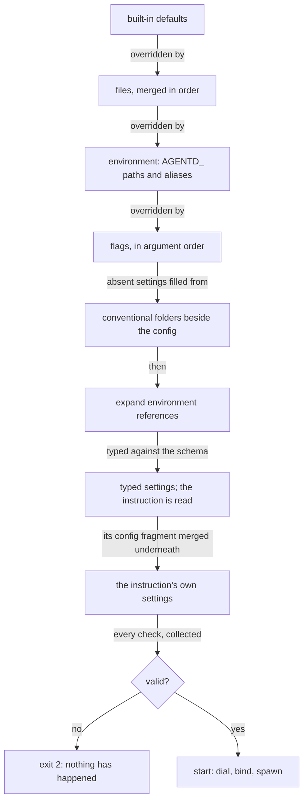
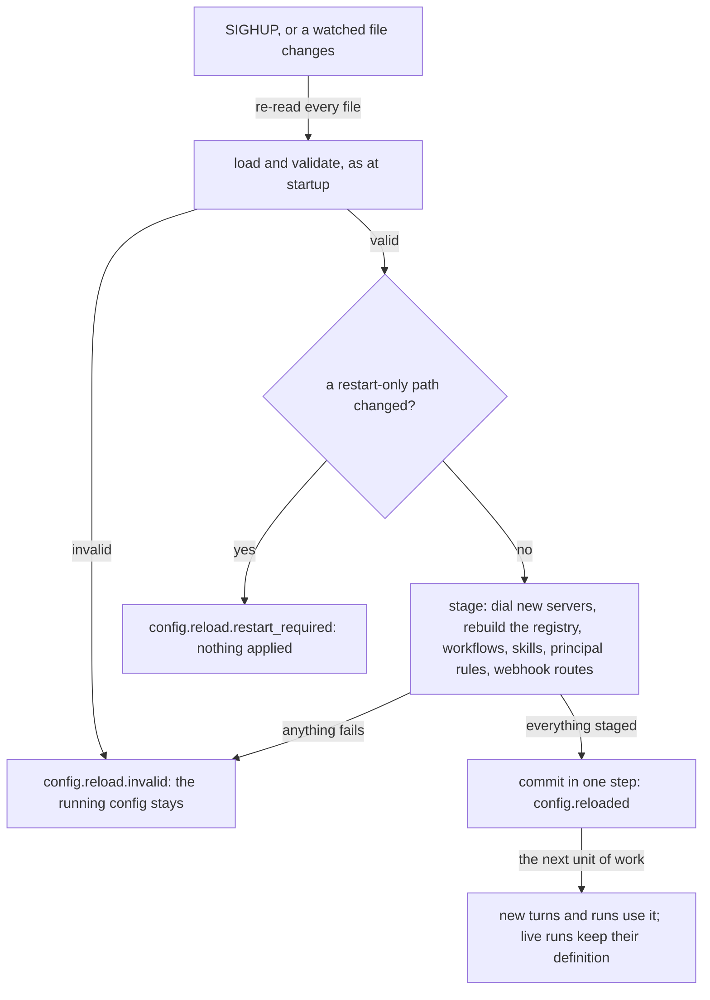

# How configuration works

agentd's configuration is one nested document assembled from layers —
built-in defaults, files, environment variables and flags — and checked
whole before anything runs. This page explains how the layers combine, where
files are found, what an instruction document may add, how secrets stay out
of files, and how a running daemon takes a new configuration. It is for
operators and authors who want to predict which value is in effect and why.
Every key is listed in the [Configuration reference](configuration.md).

## One document, three spellings

There is one document of truth, and everything you can type is a **path**
into it. Every path has three spellings, derived from the schema rather than
wired by hand, so a new setting gets all three at once:

| Source | The path `limits.run.steps` |
|---|---|
| a file (YAML or JSON) | `limits: {run: {steps: 40}}` |
| the environment | `AGENTD_LIMITS_RUN_STEPS=40` |
| a flag | `--limits.run.steps 40`; `.`, `_` and `-` are interchangeable, so `--limits-run-steps 40` is the same flag |

Values are typed by the schema: numbers and booleans parse, an enum is
checked against its set, a list takes `[a, b]` or `a, b`, an object takes a
`{k: v}` literal. A short set of named aliases — `--instruction`,
`--intelligence`, `--model`, `--mcp`, `--deadline` and others — spell common
paths more briefly; `agentd --help` lists them all, and `agentd
--config-schema` prints the schema itself.

## Layers and precedence

The layers apply in a fixed order, each overriding the one before it **key
by key**: a layer touches only the keys it sets, so an unset variable never
clobbers a file's value.

```text
built-in defaults  <  files  <  environment  <  flags
```



Three details of the order matter in practice:

- **Inside the environment layer, a path name beats an alias.**
  `AGENTD_INTELLIGENCE_MODEL` wins over `AGENTD_MODEL` for the same field,
  because it names the field exactly. A stale variable can therefore look
  ignored; check there first when a value surprises you.
- **A flag that names a path sets it; a repeatable alias adds to it.**
  `--mcp-servers '[…]'` or `AGENTD_TOOLS_DISABLED=a,b` replace the whole list
  the files declared. The three repeatable aliases — `--mcp`, `--a2a-peer`
  and `--workflow` — each append one entry instead.
- **A flag reaches only where the schema reaches.** It can set one entry of a
  free-form map, keeping the key's exact spelling
  (`--intelligence.headers.x-team ops`), but addressing an array element is
  a named error, not a guess.

`agentd --effective-config` prints the assembled document with the layer
that set each value, so "who said so?" is a command rather than a search.
It runs on a broken configuration too, reports errors beside the document,
and redacts credentials.

## Where files come from

A file you **name** — `-c`/`--config` (repeatable) or `AGENTD_CONFIG`
(a `:`-separated list) — is a decision you made, and only those files load.
When you name none, agentd walks a **discovery chain** the way a linter
finds its dotfile, and loads every rung that has a file:

| Rung | Looked for | For |
|---|---|---|
| user | `$XDG_CONFIG_HOME/agentd/config.yml` (or `.yaml`), else `~/.config/agentd/config.yml` | defaults that follow the person |
| project | `./agentd.yml` (or `agentd.yaml`, `.agentd.yml`, `.agentd.yaml`) | the config a repository checks in |
| local | `./agentd.local.yml` (or `.yaml`) | one machine's overrides, kept out of version control |

They merge in that order, with the environment and flags still on top. A
checked-in project file makes `agentd` work with no flags at all, and
pointing one checkout at a development endpoint never means editing a
tracked file. Four rules keep discovery from surprising you:

- **It is only a fallback.** Naming a config by flag or environment
  switches it off entirely.
- **It looks in the working directory only**, never in a parent or `/etc`.
- **Two spellings of one rung is an error** (exit 2). `agentd.yml` beside
  `agentd.local.yml` is the design; `agentd.yml` beside `agentd.yaml` is a
  coin toss agentd refuses to make.
- **A discovered file may not relax a security control.** One that sets
  `security.allow_trifecta` or `security.exec.enabled` is refused, naming the
  file; pass it with `--config` if you meant it. A discovered file that sets
  where credentials go or who may connect — model endpoints, providers,
  tokens, MCP servers, the store, listeners, peers, `security` — is named in a
  `config.warning` at startup, so adopting a dotfile is never silent.

```text
{"event":"config.warning","msg":"adopted the discovered config ./agentd.yml, ./agentd.local.yml (no --config given); it sets intelligence.endpoints"}
```

`--help`, `--version` and the schema dumps never discover a file, so a broken
one cannot stop you reading the help.

**Conventional folders** beside the config fill in settings you did not
write, so a project can be a directory rather than one long file:
`workflows/` (one workflow per file), `skills/` (one skill per Markdown file
or `<name>/SKILL.md`), `subagents/` (one template per file) and `context/`
(named system-prompt templates). They are looked for beside each loaded
config file, the last one first, or in the working directory when none was
loaded. They apply only when the setting is absent — writing `workflows: []`
is a decision, and the folder does not argue with it — and only when the
folder yields something.

## Several files compose

Several files merge into **one document** with JSON Merge Patch semantics
(RFC 7396): objects merge key by key, scalars and lists are replaced by the
later file, and an explicit `null` removes a key. Each file is type-checked
on its own first, so an unknown key names the file it is in.

```yaml
# base.yaml
agent:
  name: triage
  instruction: You triage incoming issues and summarise what changed.

intelligence:
  endpoints: https://api.openai.com/v1/chat/completions
  model: gpt-5.1
  token: "{{secret:OPENAI_API_KEY}}"

limits:
  run: {steps: 50}
  subagents: {depth: 4}

tools:
  disabled: [memory.delete]

observability:
  log_level: debug
```

```yaml
# site.yaml, loaded after base.yaml
intelligence:
  model: gpt-5-mini         # a scalar: replaced
limits:
  subagents: {depth: 3}     # an object: merged, so run.steps stays 50
tools:
  disabled: [workflow.delete]   # a list: replaced whole
observability:
  log_level: null           # null: cleared, back to the built-in default
```

```sh
agentd -c base.yaml -c site.yaml --effective-config
```

The result runs `gpt-5-mini` with 50 steps, a delegation depth of 3,
`workflow.delete` disabled (and `memory.delete` enabled again) and the
default log level, and `--effective-config` credits each value to the file
that set it.

## What the instruction may configure

An instruction document can carry configuration of its own, in a
`:::!config` block, alongside the machinery blocks that declare workflows,
MCP servers, streams and skills ([Instruction documents](directives.md)
explains them). That fragment is applied after the document is read, and it
**merges underneath** the operator's configuration: at every key, a file,
an environment variable or a flag beats the document.

```markdown
You are the order desk. Every paid order is fulfilled the same day.

:::!config
limits: { run: { steps: 40 }, max_runs: 20 }
context: { keep_last: 16 }
:::
```

```yaml
# needs: ./desk.md
agent:
  name: order-desk
  instruction: { file: ./desk.md }

intelligence:
  endpoints: https://api.openai.com/v1/chat/completions
  model: gpt-5.1
  token: "{{secret:OPENAI_API_KEY}}"

limits:
  run: { steps: 20 }    # beats the document's 40: the operator's file wins
```

The boundary is an **allow-list**: a document configures what the agent *is*
and never the deployment it runs *in*. It may write its workflows, streams,
MCP servers and vars; how it thinks and bounds itself (`context`, `memory`,
`limits`, `goal`); which models it uses and how much (`intelligence.models`,
the roles except `approve`, the budget); the shape of its loop
(`agent.preflight`, `agent.wake_on` and similar); and its durability class
(`store.kind`, never the store's location). Everything else is the
operator's: where the instruction comes from and who may sign it, the tool
grant, `security`, identities, listeners and their principals, model
endpoints, providers and credentials, `intelligence.routes`, subagent
templates, where state lives and where audit records go, and telemetry
destinations.

Three rules make the boundary hold:

- **A path in neither list is refused.** The check walks the document's
  fragment path by path, so a setting nobody has classified belongs to the
  operator.
- **A refusal names the paths.** A document that writes
  `intelligence.endpoints` or `security.allow_trifecta` stops the load with
  exit 2 and a message listing both.
- **A document can add, never re-point.** Its MCP servers join the
  operator's list, and one that reuses the name of a server the operator
  declared is refused as a duplicate; MCP Events bindings and grants on a
  server stay the operator's. A model it declares cannot name a provider, so
  it can choose *which* model but never where the conversation goes.

The full allow-list is in the [Directive reference](directives-reference.md).
Note that the short form `agent.instruction: <uri>` names an MCP resource;
to fetch a document over HTTPS, write `agent.instruction: {url: …}` (or
`--instruction.url`).

## Validate before any side effect

Loading is free of side effects by design. The document is merged,
substituted, typed and validated before agentd opens a store, dials a
server, binds a socket or spends a token. A wrong document exits 2 and leaves
the world untouched; exit 2 is the code a scheduler should treat as
"retrying will not help".

**Every check runs, and every error is reported.** `--validate-config`
prints each problem as a `config.invalid` line and exits 2 (or 0 with a
`config.valid` line), and a normal start reports the same full list in one
message before exiting 2. One restart fixes the list, not one line per
restart.

Validation covers more than shape. Among the things refused at load:

- an unknown key or flag;
- an endpoint that is not `https://` (loopback `http://` aside);
- a reference to an undeclared MCP server or model;
- an inline credential in a file;
- an inbound listener on a non-loopback address with no client
  authentication;
- a principal rule that matches a client certificate (`san`, `sub`) without
  `a2a.tls.client_ca` (an `any` rule needs none);
- `a2a.listen`, `webhooks.listen` or `a2a.peers` in a binary built without
  the `a2a` feature;
- a model connection, other than the `mock:` endpoint, that names no model;
- a model connection `auth` that cannot send a bearer: a static credential
  under its own header (set it in `intelligence.headers` instead) or a
  SPIFFE X.509 SVID;
- a workflow with no start node or no `finish`;
- a lethal trifecta — untrusted input, sensitive data and egress reachable by
  one agent — unless `security.allow_trifecta` is set.

What validation cannot see is the world. It does not know whether an MCP
server is up or a model endpoint answers; startup finds that out. It does
read what the configuration points at: an instruction named as a file,
folder, URL or OCI artifact is fetched, because its `:::!config` can only be
judged once read.

## Secrets are references

A configuration file never holds a credential, only a **reference** to one:

- `{{secret:NAME}}` resolves from the environment variable `NAME`;
- `{{secret-file:PATH}}` resolves by reading the file at `PATH`, such as a
  mounted Kubernetes Secret.

A literal value in a file is refused at load for `intelligence.token`, every
`intelligence.providers.<name>.token`, `a2a.bearer`,
`security.aauth.enroll_token` and an MCP server's `oauth.client_secret`.
Those may be passed inline from the environment or a flag, where they never
touch disk. A credential-shaped header (`Authorization` and the like) and an
`auth` block's `token`, `client_secret` and `value` must be references
wherever they are set.

References are checked by `--validate-config` and again at startup, in one
scan of the whole document and every inline workflow, so the two cannot
disagree: an unset variable or a missing file is reported, with every other
miss, before the first dial. The value is read at startup, held in memory,
and never written to the settings, a log line or the audit stream; logs
carry header names only. `--prompt-missing` asks for each missing secret
on the terminal instead, keeping the values in memory only.

Two other substitutions share the document, and they are different things.
`${VAR}` and `${VAR:-default}` expand a process environment variable into any
string at load (an unset variable with no default is an error), except in
the instruction, where `${name}` is the document's own parameter.
`{{config.NAME}}` expands a value from `vars:` — plain deployment constants,
substituted before a workflow is hashed, never secrets.

## Hot reload

A running daemon re-reads its configuration on `SIGHUP`, or when a watched
file changes (`lifecycle.watch_config`, which watches each config file's
directory so a Kubernetes ConfigMap swap is seen). A reload is **applied
whole or not at all**.



The candidate goes through the same load and validation as a start. If any
**restart-only** path differs, the whole reload is refused with
`restart_required`, naming the paths. Restart-only paths are the ones built
into the process at startup — among them the instance's name, the store's
kind and location, the listeners' addresses, TLS identities and origins,
the run shape and drain timeout, the document capability grant and trust
pins, telemetry sockets, and all of `security`. Roll the process to change
them; the [Configuration reference](configuration.md) marks each path.

Otherwise the reload is **staged** before anything goes live: new and
changed MCP servers are dialed beside the running ones, and the tool
registry, workflows, skills catalogue, instruction, principal rules and
webhook routes are rebuilt and checked against the servers the reload would
run on. If any piece fails, the reload is refused, the connections it dialed
are closed, and nothing the daemon was running changes. Only when every
piece is staged is it committed, in one step that cannot fail.

The flat process tree does most of the rest. Every turn worker is spawned
from the live settings, so the next unit of work picks up a new model,
instruction or limit. When a reload moves a model, running subagents are
handed it again and switch at their next turn boundary. Live workflow runs
stay pinned to the definition they started with, by hash. Each reload is
logged, audited as a `config.reload` action, and bumps the configuration
generation in the durable manifest. Every configuration path is classified
as reloadable or restart-only, and a test over the schema fails if one is
not, because an unclassified field is how a reload reports success and
changes nothing.

## Next steps

- [Configuration reference](configuration.md) — every path, its default,
  its environment variable and flag, and whether it reloads.
- [Instruction documents](directives.md) — what a document carries and the
  trust rule behind the allow-list.
- [Operate a running daemon](operations.md) — reloading and draining in
  practice.
- [Troubleshooting](troubleshooting.md) — reading `config.invalid` and
  fixing what it names.
