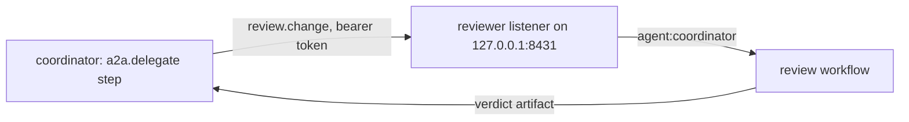

# Connect agents over A2A

This guide puts an agent on the network so other agents and people can use
it, signs people in without handing them the operator's token, and has one
agent delegate work to another. You start with two agents on one machine that
talk to each other, then harden the listener for production. It is for
builders wiring agents together and operators exposing them. The
[A2A API reference](a2a-reference.md) has every key and limit used here.

## Before you start

- An agentd binary with the `a2a` build feature. The release binaries and
  the container image include it; a build from source needs it enabled
  ([Build features and crates](features.md)).
- `curl` and `jq`, for the checks.
- For the production sections: a TLS certificate and key for the listener,
  and the secrets named in each sample in the environment.

## Run two agents that talk to each other

Two agents: a **reviewer** that serves A2A and offers one typed command, and
a **coordinator** that delegates a review to it and prints the verdict.



Save the worker as `reviewer.yaml`:

```yaml
# reviewer.yaml — the worker: serves A2A and one typed command.
agent:
  name: reviewer
  description: Reviews a change description and returns a verdict.
  instruction: You review change descriptions for release risk.

intelligence:
  endpoints: "mock:final"   # the built-in test endpoint; it answers every turn

a2a:
  listen: http://127.0.0.1:8431
  principals:
    # The coordinator presents this bearer and acts as agent:coordinator.
    - id: coordinator
      match: { bearer_ref: "{{secret:REVIEWER_TOKEN}}" }
      role: agent
      grants: [review.change]

workflows:
  - name: review
    steps:
      ask:
        kind: a2a
        command: review.change
        roles: [agent]
        schema:
          type: object
          required: [change]
          properties:
            change: { type: string }
      judge:
        kind: agent
        depends_on: ask
        instruction: |
          Review this change and answer with a verdict and one reason:
          {{ steps.ask.output.args.change }}
      done:
        kind: finish
        depends_on: [judge]
        status: completed
        output: "{{ steps.judge.output }}"
```

Save the parent as `coordinator.yaml`:

```yaml
# coordinator.yaml — the parent: a job that delegates one review and exits.
agent:
  name: coordinator
  instruction: You coordinate release checks.

intelligence:
  endpoints: "mock:final"   # the built-in test endpoint

a2a:
  peers:
    - name: reviewer
      endpoint: http://127.0.0.1:8431
      auth: { kind: static, token: "{{secret:REVIEWER_TOKEN}}" }

workflows:
  - name: release-check
    steps:
      begin: { kind: once }
      review:
        kind: a2a.delegate
        depends_on: begin
        peer: reviewer
        command: review.change
        args:
          change: Rename the config loader and update its callers.
        timeout: 2m
      done:
        kind: finish
        depends_on: [review]
        status: completed
        output: "{{ steps.review.output }}"
```

Start the reviewer in one terminal:

```sh
export REVIEWER_TOKEN=demo-token-not-for-production
agentd --config reviewer.yaml
```

Run the coordinator in a second terminal:

```sh
export REVIEWER_TOKEN=demo-token-not-for-production
agentd --config coordinator.yaml
```

The coordinator prints the reviewer's answer and exits `0`. The mock
endpoint answers every turn with the same fixed text:

```text
mock-llm done
```

What happened, in order:

1. The coordinator read the reviewer's Agent Card at
   `http://127.0.0.1:8431/.well-known/agent-card.json`, and found an A2A 1.0
   JSON-RPC interface that streams.
2. It sent the typed command `review.change` with the token as a bearer.
3. The reviewer resolved the token to the principal `agent:coordinator`,
   checked that its grants name `review.change`, that the start's `roles`
   admit `agent`, and that the arguments match the `schema`.
4. The reviewer ran the `review` workflow and completed the task with the
   verdict as its result artifact.
5. The `review` step returned that artifact as its output, and the
   coordinator's run finished with it.

Because the reviewer has a principal rule, a local process that presents no
credential is not the operator. Look at the reviewer from the outside as the
coordinator does:

```sh
curl -s http://127.0.0.1:8431/.well-known/agent-card.json | jq '.capabilities.extensions[].uri'
curl -s http://127.0.0.1:8431/ \
  -H 'content-type: application/json' \
  -H 'A2A-Version: 1.0' \
  -H "Authorization: Bearer $REVIEWER_TOKEN" \
  -d '{"jsonrpc":"2.0","id":1,"method":"GetExtendedAgentCard","params":{}}' \
  | jq '.result.capabilities.extensions[0].params.commands'
```

The extended card lists `review.change` with its workflow and schema: what
this caller may send.

To use a real model, replace the `intelligence` section of both files:

```yaml
# fragment: replaces intelligence: in reviewer.yaml and coordinator.yaml
intelligence:
  endpoints: https://api.anthropic.com
  dialect: anthropic
  token: "{{secret:ANTHROPIC_API_KEY}}"
  models:
    smart: { model: claude-sonnet-5 }
  roles:
    turn: smart
```

## Expose an agent to the network

A listener on anything but loopback must use TLS and must require a
credential, and a listener on a wildcard address must state the URL callers
dial. This is the reviewer, ready for other hosts:

```yaml
# /etc/agentd/reviewer.yaml — the reviewer, exposed to the network.
agent:
  name: reviewer
  description: Reviews a change description and returns a verdict.
  instruction: You review change descriptions for release risk.

intelligence:
  endpoints: https://api.anthropic.com
  dialect: anthropic
  token: "{{secret:ANTHROPIC_API_KEY}}"
  models:
    smart: { model: claude-sonnet-5 }
  roles:
    turn: smart

a2a:
  listen: https://0.0.0.0:8443
  url: https://reviewer.example.com:8443
  bearer: "{{secret:AGENTD_OPERATOR_TOKEN}}"
  tls:
    cert: /etc/agentd/tls/server.crt
    key: /etc/agentd/tls/server.key
  principals:
    - id: coordinator
      match: { bearer_ref: "{{secret:COORDINATOR_TOKEN}}" }
      role: agent
      grants: [review.change]
      labels: { team: release }
      quotas: { rate: "30/1m" }
  cors:
    origins: [https://console.example.com]
  push:
    enabled: true

store:
  retention:
    tasks: { ttl: 7d }

workflows:
  - name: review
    steps:
      ask:
        kind: a2a
        command: review.change
        roles: [agent]
        schema:
          type: object
          required: [change]
          properties:
            change: { type: string }
      judge:
        kind: agent
        depends_on: ask
        instruction: |
          Review this change and answer with a verdict and one reason:
          {{ steps.ask.output.args.change }}
      done:
        kind: finish
        depends_on: [judge]
        status: completed
        output: "{{ steps.judge.output }}"
```

Validate it before you start it. Validation reads every secret reference, so
set them first:

```sh
agentd --validate-config --config /etc/agentd/reviewer.yaml
```

```text
{"event":"config.valid","files":["/etc/agentd/reviewer.yaml"]}
```

The load refuses a listener served on terms nobody chose, with exit code 2:
an `https://` bind without a certificate, a non-loopback bind without a
bearer or client CA, plaintext on a non-loopback address, or a wildcard bind
without `a2a.url`. The [load-time refusals](a2a-reference.md#load-time-refusals)
table lists every case.

Use this checklist for a production listener:

| Concern | Do this | Why |
|---|---|---|
| Transport | `https://` with `a2a.tls.cert` and `a2a.tls.key` | plaintext is loopback only; certificate files are re-read on change, so a renewal needs no restart |
| Address | set `a2a.url` to the origin callers dial | the card and the OAuth issuer publish it; a wildcard bind is no address |
| Operator credential | `a2a.bearer` from a secret, held by your tooling only | the bearer's presenter is the operator |
| Callers | one principal rule per caller, each with an `id` and the fewest grants | work is owned and rate-limited per principal; ids appear in the audit trail |
| Rate | `quotas.rate` on rules for automated callers | a refusal is `429` and reaches nothing; operators are exempt |
| Browsers | list only your console's origin in `a2a.cors.origins` | an unlisted origin is refused before its body is read |
| Webhooks | `a2a.push.enabled` only if callers need it; keep `allow_private` off | the webhook URL comes from the caller |
| Introspection | leave `a2a.introspection.enabled` off | transcripts and logs are operator-grade exposure |
| Retention | `store.retention.tasks.ttl` on a shared listener | finished tasks are otherwise kept for ever |
| Durability | the default file store for one instance; `store.kind: mcp` or `http` for a fleet | a listener makes the instance long-lived, and its tasks survive a restart |

## Choose how callers authenticate

Pick a mechanism per kind of caller. They combine, except where noted.

| Mechanism | Configure | Use it for |
|---|---|---|
| Operator bearer | `a2a.bearer` | your own tooling acting as the operator |
| Bearer rules | `a2a.principals[]` with `match.bearer_ref` and `id` | peers and scripts, one secret and one principal each |
| Mutual TLS | `a2a.tls.client_ca`, plus `san` or `sub` rules | a service mesh or SPIFFE workloads |
| Device grant | `a2a.device_grant` | people at a terminal or a browser |
| Enterprise access tokens | `a2a.inbound_tokens` and `a2a.resource` | people a front end already signs in at your identity provider |
| Unix socket | `a2a.listen: unix:///path` | another instance on the same host, as the operator |

Mutual TLS is all or nothing. With `a2a.tls.client_ca` set, every caller
must present a certificate the CA signed, bearer-only callers included, and
the device grant cannot be enabled beside it. Certificate rules are
first-match-wins, so put the narrow rule first:

```yaml
# fragment: under a2a: — mutual TLS, with principals matched by certificate
a2a:
  listen: https://0.0.0.0:8443
  url: https://reviewer.internal:8443
  tls:
    cert: /etc/agentd/tls/server.crt
    key: /etc/agentd/tls/server.key
    client_ca: /etc/agentd/tls/clients-ca.crt
  principals:
    # Narrow first: certificate rules are first-match-wins.
    - { match: { san: "spiffe://acme/ns/ops/sa/deployer" }, role: operator }
    - id: acme-services
      match: { san: "spiffe://acme/*" }
      role: agent
      grants: [review.change]
```

Swap the two rules and the deployer silently becomes an agent. A certificate
rule (`san` or `sub`) without `a2a.tls.client_ca` is refused at load, because
the listener would never ask for a certificate.

> **Warning.** A loopback listener with no credential configured treats every
> local process that presents nothing as the operator, and says so at
> startup. That is right for a laptop and wrong for a shared host. Any
> credential mechanism ends it.

## Sign people in with the device grant

The device grant lets a person sign a terminal or a browser in with a short
code that an operator approves, so nobody copies the operator's bearer. It
needs an operator credential to approve with: `a2a.bearer`, or an operator
rule matched by `bearer_ref`.

```yaml
# fragment: under a2a: — sign people in with the device grant
a2a:
  listen: https://0.0.0.0:8443
  url: https://helpdesk.example.com:8443
  bearer: "{{secret:AGENTD_OPERATOR_TOKEN}}"   # the operator who approves codes
  tls:
    cert: /etc/agentd/tls/server.crt
    key: /etc/agentd/tls/server.key
  events:
    enabled: true
  device_grant:
    enabled: true
    scopes: [user, operator]   # user is the default; operator is opt-in
    token_ttl: 8h
    code_ttl: 10m
    rate: "60/1m"              # per signed-in name
```

The shipped clients run the flow for you: `agentd-tui --login` prints the
code and waits, and an operator approves it with `/approve <code> <name>`
([Use the terminal and web UI](interface.md)). The same flow by hand:

1. The client asks for a code:

   ```sh
   curl -s https://helpdesk.example.com:8443/oauth2/device_authorization -d client_id=my-cli
   ```

   ```text
   {"device_code":"3f9d…6c14","expires_in":600,"interval":5,"user_code":"WJLG-DRVQ","verification_uri":"https://helpdesk.example.com:8443/oauth2/device"}
   ```

2. An operator approves the code under the person's name:

   ```sh
   curl -s https://helpdesk.example.com:8443/ \
     -H 'content-type: application/json' \
     -H 'A2A-Version: 1.0' \
     -H 'A2A-Extensions: https://agentd.dev/a2a/ext/command' \
     -H "Authorization: Bearer $AGENTD_OPERATOR_TOKEN" \
     -d '{"jsonrpc":"2.0","id":1,"method":"SendMessage","params":{"message":{"role":"ROLE_USER","messageId":"m-1","extensions":["https://agentd.dev/a2a/ext/command"],"parts":[{"data":{"agentd":{"op":"auth.device.approve","user_code":"WJLG-DRVQ","as":"alice"}}}]}}}'
   ```

3. The client's next poll returns its session token:

   ```sh
   curl -s https://helpdesk.example.com:8443/oauth2/token \
     -d grant_type=urn:ietf:params:oauth:grant-type:device_code \
     -d device_code="$DEVICE_CODE" \
     -d client_id=my-cli
   ```

   ```text
   {"access_token":"agentd_at_25f1…aa90","expires_in":28800,"scope":"user","token_type":"Bearer"}
   ```

The session acts as `user:alice`. Every session approved as `alice` is the
same principal and shares what that name owns, so choose one name per person
and never reuse a name for someone else. The approval's `existing: true`
tells you the name was approved before.

To see and end sessions, send the `auth.sessions` and `auth.sessions.revoke`
ops the same way as the approval, with `{"op": "auth.sessions"}` or
`{"op": "auth.sessions.revoke", "sid": "ds_…"}` (or `"name": "alice"`, or
`"all": true`) under the `agentd` key. Revocation closes the session's open
streams within 100 ms and never deletes what the person owns. A restart ends
every session, and there are no refresh tokens.

## Take your organization's access tokens

A front end that already signs people in at your identity provider — a
chat app, a portal — can call the agent as each person, with the access
token it gets for them. The listener checks the token and the caller is the
person it names, `user:oidc:<iss>#<subject>`.

```yaml
# fragment: under a2a: — take an Okta custom authorization server's tokens
a2a:
  listen: https://0.0.0.0:8443
  url: https://helpdesk.example.com:8443
  bearer: "{{secret:AGENTD_OPERATOR_TOKEN}}"
  tls:
    cert: /etc/agentd/tls/server.crt
    key: /etc/agentd/tls/server.key
  resource: https://helpdesk.example.com:8443   # the token's aud
  inbound_tokens:
    - issuer: https://acme.okta.com/oauth2/aus1helpdesk
      profile: okta                 # no typ; uid, cid and scp
      clients: [0oa1chatfrontend]   # the front ends that may call
      scopes_to_skills:
        helpdesk.chat: [conversation]
        helpdesk.run: ["workflow:triage-*"]
```

1. Register the agent at the authorization server as a resource whose
   audience is `a2a.resource`, with the scopes `scopes_to_skills` names,
   and let the front end's client ask for them.
2. The front end presents the person's token as `Authorization: Bearer`.
   A request with none is answered `401` naming the agent's protected-resource
   metadata (`/.well-known/oauth-protected-resource`), where a client finds
   the issuer; the card declares it as an `oauth2` scheme.
3. A token the issuer did not sign for this agent and this front end is a
   `401` (`invalid_token`); one whose scopes do not reach what it asks for is
   a `403` (`insufficient_scope`) naming the scope that would. The answer to
   a question a person's own run asks them, sent on the run's task, needs
   only the scope that started the run.

With `profile: generic` (the default) the issuer's tokens are RFC 9068 ones:
`typ: at+jwt`, the person in `sub`, the client in `client_id`, the scopes in
`scope`. A rule `match: {token_iss: <issuer>}` gives an issuer's callers the
`agent` role instead of `user`, or narrows them by `sub`. The operator lists
these callers with `auth.sessions`; the token itself is never kept beyond
its life, never logged and never forwarded.

## Delegate work to another agent

A parent names each agent it dials under `a2a.peers`, then hands work to it
from a workflow step. Each peer takes the credential its listener expects:

```yaml
# coordinator.yaml — one peer per credential style.
agent:
  name: coordinator
  instruction: You coordinate release checks.

intelligence:
  endpoints: "mock:final"   # the built-in test endpoint

services:
  research:
    kind: peer
    endpoint: https://research.example.com:8443
    auth: { kind: static, token: "{{secret:RESEARCH_TOKEN}}" }

a2a:
  peers:
    # A bearer token the peer's operator gave you.
    - name: reviewer
      endpoint: https://reviewer.example.com:8443
      auth: { kind: static, token: "{{secret:REVIEWER_TOKEN}}" }

    # A machine-to-machine OAuth 2.0 token from your identity provider.
    - name: billing
      endpoint: https://billing-agent.internal:8443
      auth:
        kind: oauth2
        issuer: https://sso.example.com
        client_id: agentd-coordinator
        client_secret: "{{secret:OIDC_CLIENT_SECRET}}"
        grant: client_credentials
        scopes: [a2a]

    # A client certificate, such as a SPIFFE X.509-SVID.
    - name: deployer
      endpoint: https://deployer.internal:8443
      client_cert: /run/spire/svid.pem
      client_key: /run/spire/key.pem

    # Endpoint, credential and tags from the service catalog.
    - name: research
      service: research
```

A peer that references a catalog entry inherits its endpoint and credential
and does not restate them. [Outbound credentials](authentication.md) covers
every `auth` kind; `kind: aws` is not accepted for peers. A credential a
person logs in for, an oauth2 `device` or `authorization_code` grant, goes
on a `kind: peer` service entry, logged into with
`agentd --login service:<entry>`: on the peer itself it is refused at load.
For a one-off run,
`--a2a-peer reviewer=https://reviewer.example.com:8443` adds a peer from the
command line.

Then choose the step that fits the conversation:

| You need | Step | Behaviour |
|---|---|---|
| the peer to do something, and its answer | `a2a.delegate` | sends an objective or a typed command and blocks until the peer's task finishes; the step output is the result |
| the peer to know something, and you carry on | `a2a.send` | completes when the peer accepts the message |
| a reply to something you sent | `a2a.wait` | suspends until a message from the named sender arrives on a conversation |

Send a typed command (`command` and `args`) when the peer declares one: the
peer validates the arguments against its schema and starts its workflow
deterministically. Send an `objective` when the peer should treat the text
as a conversation turn. `idempotency: true` keeps the message id stable
across retries so the peer can deduplicate, and `breaker` and `rate` protect
a peer that is failing. [Workflow node reference](node-registry.md) lists
every field.

Things to know about delegation:

- **The dial always goes to the configured endpoint.** The peer's card
  decides the protocol and the tenant, never the host, so a card cannot
  redirect a delegation or its credentials.
- **The peer must speak A2A 1.0 JSON-RPC.** A peer whose card offers no such
  interface, or that requires an extension agentd does not implement, is
  refused before anything is sent.
- **Plaintext is loopback only.** A peer endpoint `http://` to a non-loopback
  host fails every delegation; use `https://`. Add a private CA with
  `security.tls_ca`.
- **Delegation is egress.** An `a2a.send` or `a2a.delegate` step reaches
  outside the instance, and the trifecta checks count it as the egress leg.
  On the worker's side, the request it receives is outside input
  ([The A2A channel](a2a.md#one-agent-driving-another)).

## Connect agents on one host over a unix socket

Two instances on one host, or in one pod, can skip TCP and TLS. The kernel
authenticates the caller: only the daemon's own uid, or root, can connect,
and every connection is the operator.

```yaml
# bee.yaml — the worker, listening on a unix socket.
agent:
  name: bee
  instruction: You summarize the documents you are sent.

intelligence:
  endpoints: "mock:final"   # the built-in test endpoint

a2a:
  listen: unix:///run/agentd/bee.sock
```

```yaml
# hive.yaml — the delegator, dialing the worker's socket.
agent:
  name: hive
  instruction: You coordinate summaries.

intelligence:
  endpoints: "mock:final"   # the built-in test endpoint

a2a:
  peers:
    - name: bee
      endpoint: unix:///run/agentd/bee.sock

workflows:
  - name: summarize
    steps:
      begin: { kind: once }
      ask:
        kind: a2a.delegate
        depends_on: begin
        peer: bee
        objective: Summarize the release notes in three bullet points.
        timeout: 2m
      done:
        kind: finish
        depends_on: [ask]
        status: completed
        output: "{{ steps.ask.output }}"
```

Run both as the same user. The directory must exist and be writable by that
user, and the socket path must fit the platform's limit for a socket address
(108 bytes on Linux); a path that does not fit fails at startup. A unix
listener takes no TLS, declares no authentication scheme and issues no
sessions. Two instances can each listen and each name the other, so either
can delegate.

## Let callers be notified instead of watching

A caller that cannot hold a stream open, such as a serverless function,
registers a webhook for its task and agentd posts each update to it. Push is
off by default because the URL comes from the caller:

```yaml
# fragment: under a2a:
a2a:
  push:
    enabled: true          # accept webhook registrations
    allow_private: false   # refuse private and loopback targets
```

The caller registers with the task id it was given:

```sh
curl -s https://reviewer.example.com:8443/ \
  -H 'content-type: application/json' \
  -H 'A2A-Version: 1.0' \
  -H "Authorization: Bearer $COORDINATOR_TOKEN" \
  -d '{"jsonrpc":"2.0","id":2,"method":"CreateTaskPushNotificationConfig","params":{"taskId":"'"$TASK_ID"'","url":"https://hooks.example.com/agentd","token":"t-123"}}'
```

A URL that is not `https`, or that resolves to a private or loopback address
while `allow_private` is off, is refused with `-32602` and the reason. Each
delivery carries the task's status and artifacts, never its history, and a
failed delivery is logged as `a2a.push.failed` and dropped.

## Troubleshooting

| Symptom | Cause | Fix |
|---|---|---|
| `415`, empty body | the request is not `application/json` | send `content-type: application/json` |
| `403`, empty body | the request carries an `Origin` that is not listed | add the console's origin to `a2a.cors.origins` |
| `-32009` | no `A2A-Version: 1.0` header | send it on every `POST /` |
| `401`, `invalid_token` | the bearer matches no credential, or the session expired or was revoked | check the secret, or sign in again |
| `401` "browser requests must authenticate" | a browser on a loopback listener with no credential | sign in with the device grant, or open the UI with `agentd ui` |
| `403`, `insufficient_scope` | the principal's role and grants do not reach the method or op | add the op to the rule's `grants`, or use another principal |
| `-32602`, `EXTENSION_NOT_MARKED` | a command without the URI in `message.extensions` | list the command URI in the message too |
| `-32601`, `EXTENSION_NOT_ACTIVATED` | the feed method without the events URI in `A2A-Extensions` | name the URI in the header |
| `429` | the principal's rate quota, or too many failed credentials from the source | wait for `Retry-After` |
| the delegation step fails at once | the peer's card offers no A2A 1.0 JSON-RPC interface, or a plaintext non-loopback endpoint | check the peer's card; use `https://` |

## Next steps

- [The A2A channel](a2a.md): how identity, ownership and delegation work.
- [A2A API reference](a2a-reference.md): every method, error, setting and
  limit.
- [Harden a deployment](harden.md): the rest of a production checklist.
- [Delegate to subagents](delegate-subagents.md): hand work to supervised
  child processes instead of remote agents.
