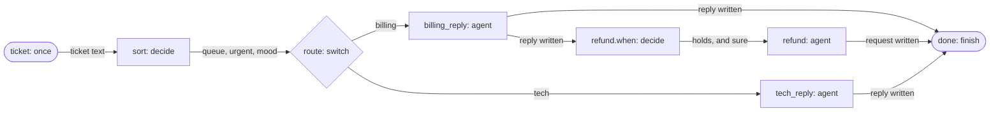

# Triage with a decision model

This tutorial builds a support-ticket triage workflow that makes typed
decisions: which queue a ticket belongs to, whether it is urgent, how upset
the customer is, and whether to start a refund. You run it three ways: with
your chat model answering the decisions, with a decision model that answers
them natively and escalates when it is unsure, and with each conversation
turn routed to a fast or a deep model. It builds on [Your first
workflow](first-workflow.md) and takes about twenty minutes.

## Before you start

- **agentd** on your `PATH` and an **OpenAI API key** in `OPENAI_API_KEY`.
  That is enough for part 1.
- **For parts 2 and 3, a decision model.** This tutorial stands one in with
  agentd's mock model endpoint, which the release binary carries and which
  answers from a script. If you have an OpenRouter account, use its decisions
  URL instead, as [Connect model
  providers](connect-models.md#a-decision-model) shows.
- **For part 3, an Anthropic API key** in `ANTHROPIC_API_KEY`, for the
  reasoning model.
- **[`jq`](https://jqlang.org)**, to read the log.
- No keys? Every part also runs
  [offline](#run-it-without-a-model-account).

Work in an empty directory.

## What you will build

A decision is a set of typed questions about one state, the ticket here.
Each answer carries a confidence, so the workflow can act only on answers
that are sure enough. A *chat model* answers a decision with one structured
call. A *decision model* answers it natively, writes no text, and reports
calibrated probabilities.



The switch prunes the branch it does not take, and the guard prunes
`refund` when its statement does not hold. `done` waits for whatever was
not pruned.

## Part 1: Decide with your chat model

Save this as `triage.yaml`:

```yaml
intelligence:
  endpoints: https://api.openai.com/v1/chat/completions
  model: gpt-5.1
  token: "{{secret:OPENAI_API_KEY}}"

workflows:
  - name: triage
    steps:
      ticket:
        kind: once
        inputs:
          text: >-
            I was charged twice for my March invoice. Please refund the
            second charge. Everything else works fine.

      sort:
        kind: decide
        depends_on: [ticket]
        state: "{{inputs.text}}"
        questions:
          queue:
            choice:
              billing: payment problems, invoices and refunds
              tech: bugs, errors and outages
          urgent:
            noul: The customer cannot work at all.
          mood:
            score: [calm, annoyed, angry]

      route:
        kind: switch
        depends_on: [sort]
        on: "{{steps.sort.output.queue.choice}}"
        cases:
          billing: billing_reply
          tech: tech_reply

      billing_reply:
        kind: agent
        depends_on: [route]
        instruction: |
          Draft a two-sentence reply to this billing ticket:
          {{inputs.text}}

      refund:
        kind: agent
        depends_on: [billing_reply]
        when:
          noul: The customer explicitly asks for their money back.
          state: "{{inputs.text}}"
        instruction: |
          Write a one-line refund request for the finance team about:
          {{inputs.text}}

      tech_reply:
        kind: agent
        depends_on: [route]
        instruction: |
          Draft a two-sentence reply to this technical ticket:
          {{inputs.text}}

      done:
        kind: finish
        depends_on: [billing_reply, refund, tech_reply]
        output: "{{steps.sort.output}}"
```

The ticket arrives as the `once` start's `inputs`, so steps read it as
`{{inputs.text}}`. In production the same workflow would start on a webhook
or a message instead.

### The decide step

`sort` asks three questions about one state. Each question has a type:

| Type | Asks | Answered with |
|---|---|---|
| `choice` | Which of these options? Options are a list, or option → criterion. | `choice`, and a `confidence` |
| `noul` | Is this statement true? | `noul`, the probability that it is true, and a `confidence` |
| `score` | Where on this scale? Levels are listed lowest first. | `score` (a position, possibly between levels), `level`, and a `confidence` |

A decision has at most 16 questions, and a choice or a scale 2 to 32
options. The step's output has one entry per question, plus `model` (what
answered) and `escalated`. Later steps read it like any output:
`{{steps.sort.output.queue.choice}}`.

### The decision guard

`refund` has a `when:` that is a decision instead of a CEL expression. At
load, agentd turns it into a decide step of its own, `refund.when`, with one
question: does the statement hold? `refund` then runs only when the answer
is true (a `noul` of 0.5 or more) and sure. Otherwise `refund` is pruned,
like a step whose CEL guard is false, and the run carries on without it.

Without `state:`, a guard decides about the outputs of its step's
dependencies, which here would be the reply draft. This guard sets `state`
to the ticket, because the question is about what the customer asked.

`done` depends on all three branches. A pruned dependency does not hold a
step back, so `done` runs whichever way the run went.

### Run it

```bash
agentd --config triage.yaml 2> run.log
```

stdout carries the run's output, the decision. With the [offline
script](#run-it-without-a-model-account) it is exactly this; a real model's
numbers are its own:

```json
{
  "escalated": false,
  "model": "gpt-5.1",
  "mood": {
    "calibrated": false,
    "confidence": 0.8,
    "level": "annoyed",
    "score": 1.0
  },
  "queue": {
    "calibrated": false,
    "choice": "billing",
    "confidence": 0.9
  },
  "urgent": {
    "calibrated": false,
    "confidence": 0.8,
    "noul": 0.1
  }
}
```

No decision model is configured, so the decision ran on `roles.decide`,
which defaults to the turn model, `gpt-5.1`. agentd asked every question in
one call and held the model to a JSON Schema of the answer through the
provider's structured output. `calibrated: false` marks each confidence as
the model's own report. For a `noul`, `confidence` is how far the
probability is from a coin flip, doubled: 0.1 gives 0.8.

The log shows which steps ran and every decision:

```bash
jq -r 'select(.event | test("^step\\.start$|^intel\\.decision")) | [.event, .step, .model] | map(select(.)) | join(" ")' run.log
```

```text
step.start sort
intel.decision gpt-5.1
step.start route
step.start billing_reply
step.start refund.when
intel.decision gpt-5.1
step.start refund
step.start done
```

`intel.decision` lines carry each decision's answers, never the state it
was asked about. `step.start refund` appears only because the guard held.

With a real model, try the other paths. Change the ticket to "The app
crashes every time I open the settings page." and run again: `sort` picks
`tech`, the billing branch is pruned, and `refund.when` is never asked.
Change it to "My March invoice shows the wrong company address." and the
billing branch runs, but the guard does not hold, so `refund` never starts.

## Part 2: Add a decision model

A decision model lives on a provider with `dialect: decisions`. Save this
overlay as `decision-model.yaml`; agentd merges it over `triage.yaml`:

```yaml
# fragment: under the top level; load it after triage.yaml
intelligence:
  providers:
    openrouter:
      endpoints: "mock:file:decisions.json"   # the mock model endpoint
      dialect: decisions
  models:
    smart: { model: gpt-5.1 }
    jev:
      kind: decision
      provider: openrouter
      model: typesafe/jev-1.13
      escalate: smart
  roles:
    decide: { model: jev, confidence: 0.7 }
```

- **`providers.openrouter`** is a second model connection. Here its endpoint
  is the mock, reading `decisions.json`; against OpenRouter it is
  `https://openrouter.ai/api/alpha/decisions`, with a `token`.
- **`models`** names the models: `jev` is a decision model on that
  provider, and `smart` is the chat model it escalates to.
- **`roles.decide`** moves every deciding step to `jev`, with a threshold:
  an answer under 0.7 confidence is unsure.

Save the script the mock answers from as `decisions.json`. It also holds
the answers part 3 uses:

```json
{
  "decisions": [
    {"when_contains": "What does HTTP status 429 mean",
     "answers": {
       "intent":     {"type": "choice", "choice": "question", "confidence": 0.95},
       "needs_plan": {"type": "noul", "noul": 0.04},
       "risk":       {"type": "choice", "choice": "low", "confidence": 0.97},
       "route":      {"type": "choice", "choice": "fast", "confidence": 0.92}}},
    {"when_contains": "Compare three ways",
     "answers": {
       "intent":     {"type": "choice", "choice": "task", "confidence": 0.9},
       "needs_plan": {"type": "noul", "noul": 0.2},
       "risk":       {"type": "choice", "choice": "low", "confidence": 0.9},
       "route":      {"type": "choice", "choice": "deep", "confidence": 0.88}}},
    {"when_contains": "money back",
     "answers": {
       "holds":      {"type": "noul", "noul": 0.97}}},
    {"answers": {
       "queue":      {"type": "choice", "choice": "billing", "confidence": 0.94,
                      "probabilities": {"billing": 0.94, "tech": 0.06}},
       "urgent":     {"type": "noul", "noul": 0.08},
       "mood":       {"type": "score", "score": 1.2, "confidence": 0.81,
                      "probabilities": {"0": 0.1, "1": 0.5, "2": 0.4}}}}
  ]
}
```

Each rule answers a request that contains its `when_contains` text; the last
rule answers everything else. The answers have the shape a decisions service
returns.

Run with both files:

```bash
agentd --config triage.yaml --config decision-model.yaml 2> run.log
```

```json
{
  "escalated": false,
  "model": "typesafe/jev-1.13",
  "mood": {
    "calibrated": true,
    "confidence": 0.81,
    "level": "annoyed",
    "probabilities": {
      "angry": 0.4,
      "annoyed": 0.5,
      "calm": 0.1
    },
    "score": 1.2
  },
  "queue": {
    "calibrated": true,
    "choice": "billing",
    "confidence": 0.94,
    "probabilities": {
      "billing": 0.94,
      "tech": 0.06
    }
  },
  "urgent": {
    "calibrated": true,
    "confidence": 0.84,
    "noul": 0.08
  }
}
```

The same workflow, unchanged, now decides on `jev`. The answers are
`calibrated: true` and carry the model's probabilities, by option and by
level. The reply and refund steps still write with `gpt-5.1`: a decision
model writes nothing, so only deciding steps move to it.

### Escalate when unsure

Raise the threshold to 0.9 for one run:

```bash
agentd --config triage.yaml --config decision-model.yaml --intelligence-roles-decide-confidence 0.9 2> run.log
jq -r 'select(.event | test("^intel\\.decision")) | [.event, .from, .to, .model, (.unsure | tostring), (.escalated | tostring)] | map(select(. and . != "null")) | join(" ")' run.log
```

```text
intel.decision.escalate typesafe/jev-1.13 gpt-5.1 ["mood","urgent"]
intel.decision gpt-5.1 [] true
intel.decision typesafe/jev-1.13 [] false
```

`mood` (0.81) and `urgent` (0.84) fell under 0.9, so agentd asked the whole
decision once more on `jev`'s `escalate` model, `smart`, and took that
answer as final: the output now says `"model": "gpt-5.1"` and
`"escalated": true`. The guard's answer (0.94) cleared the bar and stayed
on `jev`.

What an unsure answer does is the step's `on_unsure`:

| `on_unsure` | An unsure answer |
|---|---|
| `escalate` | Is asked once more on the model's `escalate` model, whose answer is final. The default when the model names one. |
| `fail` | Fails the step. The default when there is nothing to escalate to. |
| `continue` | Is handed on, marked `unsure: true`, for later steps to weigh. |

A guard never fails the run for doubt: an unsure guard that cannot escalate
prunes its step.

## Part 3: Route each turn to a model

Workflow steps choose their model by role or by a step's `model:`. A
conversation turn can be routed instead: before the turn runs, *preflight*
looks at the message and picks one of the models you list. Save this as
`assistant.yaml`:

```yaml
# needs: decisions.json
agent:
  preflight: always

intelligence:
  endpoints: https://api.openai.com/v1/chat/completions
  token: "{{secret:OPENAI_API_KEY}}"
  providers:
    anthropic:
      endpoints: https://api.anthropic.com
      dialect: anthropic
      token: "{{secret:ANTHROPIC_API_KEY}}"
    openrouter:
      endpoints: "mock:file:decisions.json"   # the mock model endpoint
      dialect: decisions
  models:
    smart: { model: gpt-5.1 }
    fast: { model: gpt-5-mini }
    deep:
      kind: reasoning
      provider: anthropic
      model: claude-opus-5-5
      reasoning: { effort: high }
    jev:
      kind: decision
      provider: openrouter
      model: typesafe/jev-1.13
      escalate: smart
  roles:
    turn: smart
    decide: { model: jev, confidence: 0.7 }
    preflight: jev
  routes:
    fast: a quick answer, a status question or one simple operation
    deep: multi-step work, analysis, or anything that needs careful reasoning
```

- **`routes`** lists the models a turn may run on, each with when to use
  it. They must be chat or reasoning models.
- **`roles.preflight: jev`** makes preflight one decision: the message's
  intent, whether it needs a plan, its risk, and which route.
- **`agent.preflight: always`** runs preflight on every message. With
  `auto`, it looks only at long messages and ones that ask for work, and a
  message it does not look at stays on the turn model.
- **`deep`** is a reasoning model on a second connection, Anthropic: it
  thinks at the effort you set before it answers.

`--prompt` sends one message into the agent's conversation, the same way a
client's message arrives, so preflight sees it. Send a quick question and a
harder one:

```bash
agentd --config assistant.yaml --prompt "What does HTTP status 429 mean?" 2> run.log
jq -r 'select(.event == "preflight.verdict" or .event == "turn.routed" or (.event == "turn.model" and .role == "turn")) | [.event, .route // .model] | join(" ")' run.log
```

```text
preflight.verdict fast
turn.routed fast
turn.model gpt-5-mini
```

```bash
agentd --config assistant.yaml --prompt "Compare three ways to rate-limit a public API, and recommend one." 2> run.log
jq -r 'select(.event == "preflight.verdict" or .event == "turn.routed" or (.event == "turn.model" and .role == "turn")) | [.event, .route // .model] | join(" ")' run.log
```

```text
preflight.verdict deep
turn.routed deep
turn.model claude-opus-5-5
```

Each answer prints on stdout. Only the turn that answers the message moves;
the next message is routed by its own preflight. A route preflight is not
sure of (under `roles.preflight`'s confidence, when it sets one) leaves the
turn on `roles.turn`.

Without a decision model, set `roles.preflight` to a chat model such as
`fast`: the chat model picks the route through structured generation. A
configuration with `routes` and `agent.preflight: never` is refused, since
nothing would pick a route.

## Run it without a model account

The mock model endpoint can stand in for the chat models too, so every part
runs with no key and no network. Save this as `chat.json`:

```json
{
  "match": [
    {"when_contains": "holds — is this statement true",
     "content": "{\"holds\": {\"noul\": 0.95}}"},
    {"when_contains": "queue — choose one",
     "content": "{\"queue\": {\"choice\": \"billing\", \"confidence\": 0.9}, \"urgent\": {\"noul\": 0.1}, \"mood\": {\"score\": 1, \"confidence\": 0.8}}"}
  ],
  "turns": [{"content": "Thanks for writing in. We are on it."}]
}
```

Save this overlay as `offline.yaml`. It points the top-level connection and
the Anthropic one at the script, which answers on the OpenAI-compatible wire,
and drops their key references:

```yaml
# fragment: under the top level; load it after the tutorial's files
intelligence:
  endpoints: "mock:file:chat.json"
  token: null
  providers:
    anthropic:
      endpoints: "mock:file:chat.json"
      dialect: openai
      token: null
```

Then add `--config offline.yaml` after the other files in every `agentd`
command in this tutorial:

```bash
agentd --config triage.yaml --config offline.yaml 2> run.log
```

The outputs and log lines shown above are the ones these scripts produce.

## Next steps

- [Models, providers and roles](intelligence.md): kinds of model, roles,
  fallback and escalation, and how they resolve.
- [Choose models for each job](models-and-roles-guide.md): roles, routes and
  decision models in a real deployment.
- [Connect model providers](connect-models.md): real decision services and
  every other vendor.
- [Workflow node reference](node-registry.md#decide): every field of
  `decide`, `classify`, `route`, `judge` and decision guards.
