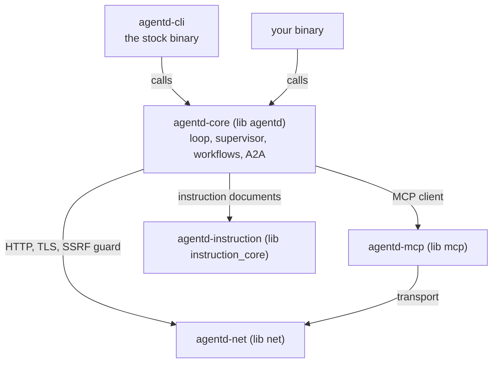

# Embed agentd in Rust

agentd is a library as well as a binary: the stock `agentd` command is a thin
shell, `agentd-cli`, over the published engine crate, `agentd-core`. This
guide is for Rust developers who want agentic logic inside their own program,
with their own native Rust functions as tools the model can call. It walks
through a minimal agent binary, the rules every embedding binary follows, the
four ways to use the engine, and what is stable to depend on.

## Choose an integration

Linking agentd is one of several ways to put it to work. Pick the lightest
that does the job:

| You want | Use |
|---|---|
| the stock agent runtime | the release binary or image ([Install](install.md)), or `cargo install agentd-cli --features …` (its default build has `tls` only) |
| your own binary with native Rust tools | depend on `agentd-core` and follow this guide |
| agentd's MCP client or its HTTP transport, without the agent | `agentd-mcp` or `agentd-net` |
| to drive a running agentd from another program | no linking: its A2A listener ([Build a client](build-a-client.md)) or the process contract of exit codes and signals ([CLI, environment and exit codes](cli.md)) |

The crates, from the top of the stack down:



| Package | Lib name | Version | License | What it is |
|---|---|---|---|---|
| `agentd-core` | `agentd` | 1.18.0 | AGPL-3.0-only | the engine: the agent loop, the supervisor, workflows, the A2A listener, code-registered tools |
| `agentd-cli` | (binary) | 1.18.0 | AGPL-3.0-only | the stock `agentd` command, including the `tui` and `ui` launcher |
| `agentd-mcp` | `mcp` | 3.0.0 | AGPL-3.0-only | a blocking MCP client over the official `rmcp` SDK, on agentd's credentialed Streamable HTTP socket, plus a raw HTTP listener for embedders that serve plain HTTP; it serves no MCP |
| `agentd-net` | `net` | 2.0.0 | AGPL-3.0-only | a blocking HTTP/1.1 and SSE client, unix-socket and TLS connects, and the SSRF egress classifier |
| `agentd-instruction` | `instruction_core` | 0.3.0 | MIT OR Apache-2.0 | the Instruction Specification's reference parser, validator and delivery pipeline |

The crates.io name `agentd` belongs to an unrelated project, which is why the
engine's package is `agentd-core` while its library name is `agentd`.

## Build a minimal agent binary

This program registers one native tool, `word_count`, and runs one agentic
turn as a function call. It runs against agentd's built-in test endpoint, so
it needs no model provider or key. You need Rust 1.96 or later and a C
compiler: the `ring` crate behind TLS compiles C.

```sh
cargo new word-agent
```

`word-agent/Cargo.toml`:

```toml
[package]
name = "word-agent"
version = "0.1.0"
edition = "2024"

[dependencies]
# The library name is `agentd`, so code reads `use agentd::…`.
agentd = { package = "agentd-core", version = "1.18" }
serde_json = "1"
```

`word-agent/playbook.json` scripts the test endpoint: the first turn calls
your tool, and the turn after the tool result answers.

```json
{
  "turns": [
    {"tool_calls": [{"name": "word_count", "arguments": {"text": "the quick brown fox jumps over the lazy dog"}}]},
    {"content": "9"}
  ]
}
```

`word-agent/src/main.rs`:

```rust
use agentd::agentloop::action::SelfHandler;
use agentd::agentloop::runner::{LoopInput, run_loop};
use agentd::intel::client::IntelClient;
use agentd::mcp::client::McpClient;
use agentd::obs::log::{Comp, Level, LogCtx, Logger};
use agentd::wire::intel::ToolDef;
use serde_json::{Value, json};
use std::time::{Duration, Instant};

/// No orchestration self-tools: the model sees your code tools only.
struct NoSelfTools;
impl SelfHandler for NoSelfTools {
    fn tools(&self) -> Vec<ToolDef> {
        Vec::new()
    }
    fn handle(&mut self, _name: &str, _args: &Value) -> Option<(String, bool)> {
        None
    }
}

fn main() {
    // 1. The re-exec dispatch, before anything else.
    if std::env::var_os(agentd::subagent::protocol::SUBAGENT_ENV).is_some() {
        std::process::exit(agentd::subagent::control::run());
    }

    // 2. Your tools, before anything runs.
    agentd::tools::register(agentd::tools::CodeTool::new(
        "word_count",
        "Count the words in a text.",
        json!({"type": "object",
               "properties": {"text": {"type": "string"}},
               "required": ["text"]}),
        |args| {
            let text = args.get("text").and_then(Value::as_str).unwrap_or("");
            Ok(json!({ "words": text.split_whitespace().count() }))
        },
    ))
    .expect("unique tool name");

    // 3. One agentic run, as a function call.
    let intel = IntelClient::from_parts("mock:file:playbook.json", None)
        .expect("intelligence endpoint");
    let servers: Vec<McpClient> = Vec::new();
    let log = Logger::new(
        LogCtx {
            run_id: "word-agent".into(),
            agent_id: "0".into(),
            agent_path: "0".into(),
            comp: Comp::Agent,
            pid: std::process::id(),
            trace_id: None,
        },
        Level::Info,
    );
    let input = LoopInput {
        instruction: "How many words are in 'the quick brown fox jumps over \
                      the lazy dog'? Use the word_count tool."
            .into(),
        output_contract: Some("Answer with a single integer.".into()),
        seed: Vec::new(),
        model: "mock".into(),
        max_steps: 10,
        max_tokens: 20_000,
        deadline: Instant::now() + Duration::from_secs(120),
        cancel: None,
    };
    match run_loop(&intel, &servers, &input, &mut NoSelfTools, &log) {
        Ok((outcome, usage)) => {
            println!("status: {:?}", outcome.status);
            println!("answer: {}", outcome.result.as_str().unwrap_or_default());
            println!("tokens: {}", usage.input_tokens + usage.output_tokens);
        }
        Err(abort) => eprintln!("infrastructure failure: {abort}"),
    }
}
```

Run it from the crate's directory, so the playbook path resolves:

```sh
cd word-agent
cargo run
```

It prints `status: Completed` and `answer: 9`, then the tokens the run used;
the loop's JSON log lines go to stderr. The model called `word_count`, your
Rust function answered, and the run stayed inside the step, token and
deadline budget you set.

To run against a real model, give `from_parts` an endpoint and a token,
written in full: `IntelClient::from_parts(
"https://api.openai.com/v1/chat/completions", Some(token))` with `model:
"gpt-5.1".into()`. The client speaks the OpenAI-compatible dialect by
default; `.with_dialect(Some("anthropic"))` on an `https://api.anthropic.com`
endpoint switches it ([Connect model providers](connect-models.md)).

> **Note.** `mock:` endpoints are agentd's built-in test endpoint.
> `agentd-core` compiles it into a debug build (`cargo run`), and into a
> release build with the `mock-models` feature, which the stock release
> binaries carry. Never ship a binary that points at it.

The repository's
[`crates/agentd/examples/embedded-agent.rs`](../crates/agentd/examples/embedded-agent.rs)
is the same program wired from environment variables, with an optional remote
MCP server; CI compiles it. Run it with
`cargo run -p agentd-core --example embedded-agent`.

## The rules of an embedding binary

**Install the re-exec dispatch first.** A subagent is a child process that
re-executes `current_exe()`, which is your binary. The child finds
`agentd::subagent::protocol::SUBAGENT_ENV` in its environment and must hand
control to `agentd::subagent::control::run()` before your program does
anything else. Without the dispatch, any spawn re-runs your program as a
confused second parent.

**Register code tools before anything runs.** The tool registry is
process-global, and a re-executed child runs your `main` again: registering
in `main`, before the dispatch returns control to agentd, is how every process
of the tree sees the same tools.

**One process, one agent runtime.** The tool registry, signal handling and
metrics are process-global by design, because the re-exec model requires it.

Descriptors your program left open without close-on-exec stay yours: every
child agentd spawns keeps only its stdio, so there is nothing to call for it.

## What a registered tool can do

Once registered, a code tool is:

- **in the model's catalogue.** The model calls it like any tool. When a
  remote MCP server publishes a tool of the same name, your code tool wins
  the slot and the call, so a server cannot take a first-party tool's calls.
- **a workflow step.** A `tool` step names it:

  ```yaml
  # fragment: under workflows[].steps:
  shout:
    kind: tool
    depends_on: [start]
    name: shout
    args: { text: "{{ steps.start.output.text }}" }
  ```

- **callable from your code** with `agentd::tools::call(name, &args)`, which
  returns `None` for a name that is not registered.
- **counted** by `agentd::tools::count()`. The stock CLI registers none, so
  its no-local-code posture holds by construction.

A handler is plain Rust, `Fn(&Value) -> Result<Value, String> + Send + Sync`.
It may run concurrently (from the loop and from parallel workflow lanes), so
keep it reentrant and hold no lock across a call into agentd. `Err(reason)` is
the normal tool-error path: the model sees a failed call, and a workflow step
applies its `on_error` and any `retry`.

**Names.** Registration refuses an empty name, a duplicate, and the name of
one of agentd's self/control primitives (`subagent.spawn`, `schedule`,
`subscribe`, `resource.read`, `workflow.run`, …). A code tool whose name
collides with another internal tool (`memory.set`, `subagent.run`, …)
registers, then is ignored with a warning when the tool registry is built.
Either way the orchestration surface cannot be shadowed. agentd lists code
tools under the reserved server name `code`, so a configuration that names an
MCP server `code` is refused at load.

**Trust.** A code tool is your compiled code, first-party like the rest of
your binary. It sits outside the tool-tag accounting that agentd applies to
MCP servers (the "Rule of Two" check in [Security model](security.md)), so a
tool that reaches the network or touches secrets is yours to account for.

## Choose how much of agentd to run

### The loop in your process

The minimal binary above is this level: `run_loop` runs one agentic turn and
returns `(Outcome, Usage)` as plain Rust values. The run is bounded by the
same budget machinery the stock CLI uses (steps, tokens, a deadline, and a
cooperative cancel flag you can flip from another thread). The trade-off: the
reasoning runs in your process, with no supervisor around it. For a kill
ladder around the model, run the full runtime.

### The full supervised runtime

To get the supervisor, resource limits, liveness checks, the durable store,
workflow triggers, the A2A listener and the exit-code contract around the
model, do what the stock CLI does: install the re-exec dispatch, load a
configuration with `agentd::config::settings::load`, and call
`agentd::runtime::run`. The reasoning then runs in killable children of your
binary, and everything in this documentation applies unchanged.

```rust
fn main() {
    if std::env::var_os(agentd::subagent::protocol::SUBAGENT_ENV).is_some() {
        std::process::exit(agentd::subagent::control::run());
    }
    // Register code tools here.

    let args: Vec<String> = std::env::args().skip(1).collect();
    let env: Vec<(String, String)> = std::env::vars().collect();
    let (loaded, ask) = match agentd::config::settings::load(&args, &env) {
        Ok(x) => x,
        Err(e) => {
            eprintln!("{e}");
            std::process::exit(agentd::exit::USAGE);
        }
    };
    if ask != agentd::config::settings::Ask::Run {
        eprintln!("this binary only runs agents");
        std::process::exit(agentd::exit::USAGE);
    }
    std::process::exit(agentd::runtime::run(&loaded, &args, &env));
}
```

Your binary then takes the same configuration files, flags and `AGENTD_*`
variables as `agentd`. Two differences from the stock command:

- **The asks.** `load` recognizes `--help`, `--version`,
  `--validate-config`, `--effective-config`, `--config-schema`,
  `--workflow-schema`, `--context-template`, `--extensions`,
  `--extension-schema`, `--capabilities`, `--login` and `--logout`, and
  returns them as an `Ask` other than `Ask::Run`. The stock CLI's
  `crates/agentd-cli/src/main.rs` answers each one; copy what you need from
  it, or refuse them as above.
- **The launcher.** `agentd tui` and `agentd ui` live in `agentd-cli`, not in
  the library. Attach the display clients to your binary's listener with
  `agentd-tui --endpoint …` ([Use the terminal and web UI](interface.md)).

Build `agentd-core` with the features your configuration uses: a
configuration that sets an `a2a.*` listener setting is refused at load by a
build without the `a2a` feature.

### The workflow engine without a runtime

A workflow is a JSON or YAML document, and `agentd::engine` validates and
schedules one without running anything. `parse_workflow` validates a document
into a `Workflow` (or returns every error at once), `workflow_schema()` returns
the JSON Schema `agentd --workflow-schema` prints, and `engine::run::schedule`
is the pure scheduler: given the durable `RunState`, it answers which steps
are ready.

```rust
use agentd::engine::{parse_workflow, run::{schedule, Next, RunState, Start}};
use serde_json::json;

fn plan() -> Result<(), String> {
    let wf = parse_workflow(&json!({
        "name": "shouty",
        "steps": {
            "start": { "kind": "once" },
            "shout": { "kind": "tool", "depends_on": ["start"], "name": "shout",
                       "args": { "text": "{{steps.start.output.text}}" } },
            "done":  { "kind": "finish", "depends_on": ["shout"],
                       "output": "{{steps.shout.output}}" }
        }
    }))
    .map_err(|errs| errs.join("; "))?;

    let mut run = RunState::new("run-1", &wf, Start::default(), json!({}));
    let data = agentd::engine::template::Data::new(); // the template view: steps, vars, env
    match schedule(&wf, &mut run, &data)? {
        Next::Ready(ids) => println!("ready: {ids:?}"),
        Next::Waiting | Next::Stalled | Next::Terminal => {}
    }
    Ok(())
}
```

Executing steps (turn workers, MCP calls, internal tools, timers,
checkpoints) is the runtime's job, not the engine's. Use the engine alone to
validate documents, serve the schema, or inspect the scheduler's decisions;
to run a workflow, hand it to the full runtime.

### Individual crates

- `agentd-mcp`: agentd's MCP client, without the agent.
- `agentd-net`: the blocking HTTP/1.1 and SSE client, unix and TLS connects,
  and the SSRF guard.
- `agentd::intel::client::IntelClient`: the model client, with endpoint-list
  failover and circuit breakers. It speaks the OpenAI-compatible, Anthropic,
  Bedrock and decision-model dialects; `from_parts` starts on the
  OpenAI-compatible one and `with_dialect` picks another.

## Depend on the crates

```toml
# fragment: under [dependencies] in Cargo.toml
agentd = { package = "agentd-core", version = "1.18", features = ["a2a", "metrics"] }
```

The default build enables `tls` only. The features are the same ones the
stock binary is built with (`a2a`, `metrics`, `cron`, `otel`, `hot-reload`,
`cel`, `oauth`, and the rest); [Build features and crates](features.md) lists
each with what it adds. API documentation for each crate is on docs.rs under
its package name.

## Licensing

`agentd-core`, `agentd-cli`, `agentd-mcp` and `agentd-net` are licensed
AGPL-3.0-only. A binary you distribute, or offer to users over a network,
that links them carries the AGPL's obligations. `agentd-instruction` is
MIT OR Apache-2.0, so other implementations of the Instruction Specification
can link it freely. Commercial licensing, for proprietary embedding or use
without the AGPL, and commercial support are available from the project:
contact agent@agentd.dev.

## What is stable

- **Frozen with the product:** the process contract (exit codes, signals),
  the wire contracts (MCP and A2A), the workflow document format and the
  capabilities manifest.
- **Semver-honoured embedding seams:** `agentd::tools::*`; the workflow engine
  (`engine::{parse_workflow, workflow_schema, Workflow, RunState}`); the
  re-exec dispatch pair (`subagent::protocol::SUBAGENT_ENV` and
  `subagent::control::run`); `config::settings::load`; `runtime::run`; and
  `exit::*`.
- **Everything else `pub`** is visible but unstable. It exists for the CLI
  and the test suites and may change in any release. Pin a version, and treat
  the two lists above as the whole of what you depend on.

## Next steps

- [Architecture](architecture.md) for how the supervisor, the loop and the
  children fit together.
- [Workflows: how runs work](workflows.md) before you embed the workflow
  engine.
- [Build features and crates](features.md) to choose the features your binary
  needs.
- [Build a client](build-a-client.md) if you only need to talk to a running
  agentd.
