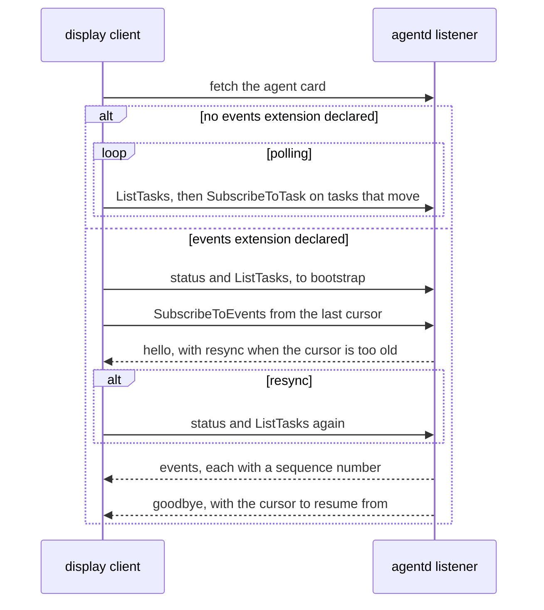

# Built to be operated

You hand an autonomous process a model endpoint, a set of tools, a budget
and permission to act, and then you walk away. Two questions decide whether
you can: *will it fail before it does anything wrong*, and *can you see what
it is doing while it runs*. This page describes the operating principles
agentd is built around — validation before any side effect, exit codes a
scheduler can act on, telemetry you can filter, and thin clients that mirror
a single source of truth — for operators and the people who build tooling
around agentd.

## Fail at the cheapest point

agentd fails in the cheapest place it can: at load, before a socket is
opened or a token spent. The configuration is merged, substituted, typed and
validated first, and only a document that passes every check starts the
runtime. [How configuration works](configuration-model.md) describes the
layers; this section is about what you see.

**Every problem is reported at once.** Validation runs every check and
collects the results. `--validate-config` prints one `config.invalid` line
per problem and exits 2; a normal start prints the same list as one message
and exits 2. Fixing a configuration is one edit, not one restart per line:

```sh
agentd -c app.yaml --validate-config
```

```text
{"event":"config.invalid","msg":"store.kind is none but the instance is long-lived (serves A2A / webhooks / a goal watchdog / has a loop|schedule|subscribe|signal|event|stream|correlate|a2a|webhook start node) — configure a durable store (store.kind: file | mcp | http), or drop store.kind to get the local file store by default"}
{"event":"config.invalid","msg":"a2a.listen is https:// but a2a.tls.cert / a2a.tls.key are not set"}
{"event":"config.invalid","msg":"a2a.listen on a non-loopback address needs client auth: a2a.bearer or a2a.tls.client_ca (mTLS — then EVERY caller needs a client certificate, bearer-only included)"}
{"event":"config.invalid","msg":"a2a.cors.origins: \"https://ops.example.com/\": an origin has no path, query or fragment (want scheme://host[:port])"}
{"event":"config.invalid","msg":"config file: intelligence.token carries an inline credential; use {{secret:NAME}} / {{secret-file:PATH}} (or set it from env/flag)"}
```

**An error names where it came from.** Each file is typed as it is read, so
a typo names its own file and lists what the object does accept:

```text
agentd: config file prod.yaml parse error: unknown field `url`, expected one of `name`, `endpoint`, `service`, `ns`, `headers`, `tags`, `allow`, `exclude`, `aauth`, `oauth`, `auth`, `timeout`, `events`, `event_grants`
```

Workflows get the same treatment. Each node kind has a closed field list,
and an unknown field comes back with the allowed set — which is how you
learn that an `agent` step takes `instruction` (a `prompt` belongs to
`think`):

```text
{"event":"config.invalid","msg":"workflow \"release\" step \"draft\": unknown field \"prompt\" for kind \"agent\" (allowed: instruction, output_contract, output_schema, tools, servers, limits, context, skills, system, model, effort)"}
{"event":"config.invalid","msg":"workflow \"release\" step \"draft\": kind \"agent\" requires field \"instruction\""}
{"event":"config.invalid","msg":"workflow \"release\" step \"start\": unknown field \"debounce\" for kind \"subscribe\" (allowed: server, uri, debounce_ms, filter, window, inputs)"}
```

A flag is checked the same way: a value is coerced by its declared type, an
enum names its set, and reaching into an array element is a named error
rather than a guess.

**Verdicts go to stderr.** The `config.valid` and `config.invalid` lines are
on stderr, so a CI step that captures stdout to assert validity gets
nothing; test the exit code. The machine-readable dumps — `--config-schema`,
`--workflow-schema`, `--capabilities`, `--effective-config` — go to stdout.
The informational asks (`--help`, `--version`, the schema dumps) work with a
broken or absent configuration.

**The same gate guards reconfiguration.** A reload re-runs the whole load and
validation and is applied whole or refused whole, so a running daemon never
ends up half on one configuration and half on another.

## Exit codes are an API

The process exit code is a frozen contract, meant to be read by a scheduler
without parsing a log. Each code carries an **intent** that a control plane
can compile into a Kubernetes `podFailurePolicy`:

- `complete` — 0: a one-shot finished, or a daemon drained cleanly;
- `retriable` — a transient environment problem: a generic failure (1), a
  model unreachable or rejecting credentials after retries (4), a required
  MCP server or the store down (6);
- `terminal` — retrying cannot help: a configuration or usage error (2), a
  task refused (5);
- `policy` — an outcome you decide how to treat: a partial result (3), a
  budget exhausted, such as the run's steps or tokens (7), the run's deadline
  passed (124);
- `infra` — killed by the OS, never set by agentd: 137 (`SIGKILL`, often out
  of memory) and 143 (`SIGTERM` without a drain).

The full table is in [CLI, environment and exit codes](cli.md). Four
properties make it safe to automate against:

- **A clean drain exits 0, not 143.** A rule keyed on 143 to mean
  "terminated" never fires on a graceful shutdown.
- **A code's meaning never changes.** A new outcome takes a new code, and a
  reader that meets a code it does not know should treat it as retriable.
- **The remap is narrow.** `--budget-exit-code` (`lifecycle.exit_code_map`)
  can remap only 3 and 7. The durable run record keeps the canonical codes
  regardless, so the record stays truthful.
- **Failures land on distinct codes.** A bad document is 2 before anything
  is dialed; a store that will not open, or an instruction resource no
  connected server serves, is 6; a job whose model endpoints never answer
  is 4. In a daemon the same failure fails the turn or step, and the daemon
  keeps running.

Here a one-shot points at a loopback port where nothing listens:

```sh
agentd --instruction "Summarise the queue" --intelligence http://127.0.0.1:9/v1/chat/completions --model gpt-5.1 2> telemetry.ndjson; echo "exit=$?"
```

```text
exit=4
```

```sh
jq -rc 'select(.event=="run.done" and .err != null) | .err' telemetry.ndjson
```

```text
step "work" failed: turn failed: intel: all intelligence endpoints down (last error: intelligence transport error: Connection refused (os error 111))
```

## Telemetry you can filter

**The streams never mix: stdout is the agent's result, stderr is
telemetry**, one JSON object per line, so you can redirect them apart
without a parser. Every line carries the same canonical fields — `ts`,
`level`, `event`, `run_id`, `trace_id`, `span_id`, `agent_id`,
`agent_path`, `comp`, `pid`, and `parent_span_id` when the span has a
parent — and then whatever the event carries.

- `run_id` is constant for the whole invocation, so it joins every process
  in the tree.
- `comp` separates the two kinds of line: `supervisor` for lifecycle and
  control, `agent` for reasoning.
- `agent_path` is a namespace. The supervisor is `0`; work is filed under
  `run/<run>/<step>`, `turn/<conversation>`, `sub/<handle>`, `preflight/…`
  and `compact/…`, so a prefix selects a subtree with no join.

```sh
jq -c 'select(.event=="proc.exit") | {code, uptime_ms, tokens_in, tokens_out}' telemetry.ndjson
jq -rc 'select(.agent_path|startswith("run/")) | [.ts,.event,.agent_path] | @tsv' telemetry.ndjson
```

`event` is a dotted name from a stable vocabulary — `proc.ready`,
`run.start`, `turn.model`, `turn.done`, `config.reloaded`,
`pressure.shed`, more than a hundred in all. Adding an event is cheap;
renaming one is a breaking change, which is what keeps dashboards working.
Verbosity is `observability.log_level`, filtered before anything is
allocated. Message content stays out of the log unless you turn on
`observability.log_content`.

Metrics follow the same discipline. The Prometheus surface carries only
bounded labels — status, model, server, tool, reason — never a run id, an
agent path or a resource URI, so its cardinality cannot grow with traffic.
[Events and metrics reference](telemetry-reference.md) lists them all;
[Monitor in production](observability.md) shows how to use them.

## One source of truth, many thin clients

A running daemon's live state is held in one place and projected to anyone
watching. The display clients — the TUI and the web UI — are A2A clients of
the same listener every peer uses. There is no second socket, and nothing
is served to them that is not served to every client of their role.

With `a2a.events.enabled`, the daemon keeps a bounded ring of observation
events (1,024) and serves it as a stream through the
[events extension](https://agentd.dev/a2a/ext/events)'s
`agentd.events/SubscribeToEvents` method. Every event carries a visibility
tag — everyone, operators only, or the owning principal — and a subscriber
receives only what its tag allows. The `status` command filters with the
same rule, so what a principal can poll and what it can watch cannot drift
apart.



Two details make the feed usable rather than merely live. Resume is by
cursor: a client whose cursor predates the ring is told to re-read `status`
instead of silently missing state. And the fallback is invisible to the
renderer: an agent that declares no feed puts the client in polling mode,
following tasks with core A2A methods alone, and only the connection
indicator changes.

Because the daemon is the truth, a client's only local write is an echo of
the prompt you typed, reconciled when the task's history carries the same
message. That is why several clients converge on one transcript.

**Attaching is one command.** `agentd tui -c app.yaml` (or `agentd ui`) runs
the daemon exactly as `agentd -c app.yaml` would — it adds no setting —
starts the client beside it, and hands the client a single-use sign-in code
rather than any credential from the configuration. Because a terminal UI and
a JSON-lines daemon cannot share a terminal, the launcher sends the
daemon's output to a log file and says where before it switches:

```text
agentd tui: endpoint http://127.0.0.1:8420 · daemon logs → /run/user/1000/agentd-tui-903989.log
```

Quitting the client drains the daemon to exit 0; the daemon exiting stops
the client. You can also attach to a running daemon, from several clients
at once. On a loopback listener with no credential configured, a local
non-browser client is the operator with no setup; a browser always signs in,
and a remote client signs in with a token, a client certificate or the
listener's device-code flow. [Use the terminal and web UI](interface.md)
has the details.

**The daemon never writes its own configuration.** Exactly two settings
change at runtime over the wire: `agent.approval` (how closely you want to
be asked, a decision made during a session) and `a2a.introspection.enabled`
(the gate on transcripts, per-step run detail, subagent detail, the live log
ring and audit records in the feed). Everything else is the configuration
file and a reload, so provenance stays with your documents.

## Approvals and steering

A human gate is not a special channel. When the agent calls `ask_human`, or
a workflow reaches a `human` step, the A2A task moves to `input-required`
with the question as its status message, and every client renders it as a
row you can answer. A reply that carries the task's id resolves it.

When nobody can answer, `agent.ask_human_fallback` decides. The default is
`fail`: an agent with no listener to ask on errors at once instead of
blocking forever. `auto` hands the question to a judge on
`intelligence.roles.approve`, and marks the answer as automatic in the task,
the log and the audit stream. No judge answers an ask that carries outside
input — a webhook body, a peer agent's text, a tainted stream — and no judge
answers a gate addressed to a named person. [Human in the
loop](human-in-the-loop.md) covers gates, addressees and judges.

Steering is a small, closed set of verbs over the same surface: fire a
workflow signal, message a running subagent, pause and resume (intake
continues, execution waits), read a plan, drain, cancel. A paused instance
never idle-exits underneath you.

## What a debugging session looks like

Each step is cheaper than the next, so take them in order.

1. `agentd -c app.yaml --validate-config`. Every configuration error at
   once, before anything is dialed.
2. Start it and read the exit code. 2 means you skipped step 1. 6 means the
   store or a required server is unreachable — an environment problem. 4 is
   the model endpoint. 7 or 124 is a limit you set.
3. Filter the telemetry: `select(.level=="error")` for the failure, an
   `agent_path` prefix for one run's subtree, `proc.exit` for token and time
   totals.
4. Attach a client and watch the working row: phase, elapsed time, tokens,
   round.
5. Turn on `a2a.introspection.enabled` from the client to read transcripts,
   per-step detail and the live log ring. Turn it off when you are done.
6. Answer whatever the agent is waiting on.

[Troubleshooting](troubleshooting.md) maps common diagnostics and symptoms
to their causes.

## What this does not do

These limits follow from the design above.

- **No token streaming.** The working row moves when the phase, the tool or
  the round changes; elapsed time ticks on the client. A long model call
  shows a clock and nothing else, which keeps the replay ring meaningful.
- **Validation checks the document, not the world.** It cannot tell you a
  server is down; startup does that.
- **Runtime reconfiguration is two settings.** Everything else is the file
  and a reload, and a change to a restart-only path refuses the whole
  reload.
- **Sign-in sessions live in memory**, so a restart signs every client out;
  and **a gate inside a turn does not survive a restart** — its answer
  continues the conversation as a fresh turn. Gates on workflow runs are
  rebuilt from the store.
- **`--validate-config` reports on stderr.** Capture the right stream, or
  test the exit code.

## Next steps

- [How configuration works](configuration-model.md) — layers, discovery,
  secrets and reload.
- [CLI, environment and exit codes](cli.md) — every flag and the exit-code
  table.
- [Monitor in production](observability.md) — logs, metrics, traces and
  probes.
- [Troubleshooting](troubleshooting.md) — from a diagnostic to a fix.
