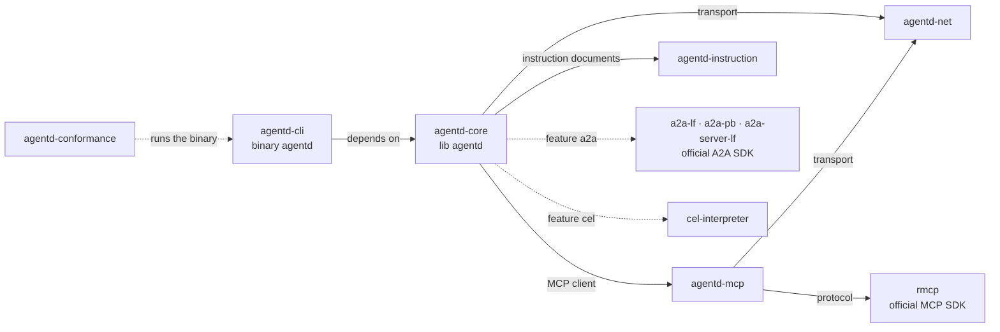

# Build features and crates

agentd decides most of its capability at compile time: each cargo feature adds
a protocol, a credential mechanism or an operator surface, and a build without
it refuses the configuration that needs it. This page lists every feature, what
the release binaries carry, which configuration needs which feature, and the
crates the workspace publishes. It is for operators choosing a binary and for
integrators building from source.

## What the release binaries carry

Every release ships static Linux binaries for `x86_64` and `aarch64` (musl,
static-PIE on `x86_64`), a `SHA256SUMS` file, and a multi-arch OCI image,
`ghcr.io/agentd-dev/agentd`, signed with cosign (keyless) and carrying an SPDX
SBOM attestation. The image is `FROM scratch` plus the binary, run as uid
65532.

All of them are built with the default feature `tls` plus this list, taken
from `.github/workflows/release.yml`:

```text
a2a,metrics,cron,otel,hot-reload,config-watch,aauth,oauth,cel,sign,oci,decrypt,mcp-events,mock-models
```

`mock-models` is the built-in mock model endpoint: `mock:final` and
`mock:file:<playbook.json>` answer from a script instead of a provider, so you
can try an agent or a workflow in the released agentd with no provider
account.

Five features are never in a release binary:

- `exec`, the local command runner. agentd's default posture is that it runs
  no local code; you opt in at build time and again at run time.
- `companies`, agentd acting at Companies for one person under the Personal
  Agent Protocol draft, a preview
  ([Act at companies for a person](act-at-companies.md),
  [RFC 0047](../rfcs/0047-acting-at-companies-for-a-person.md)).
  The draft changes without a version signal, so agentd is pinned to one
  revision of it and the feature stays out of the release set.
- `xaa`, agentd acting for one enrolled person at MCP servers through their
  enterprise IdP — ID-JAG and Enterprise-Managed Authorization, a preview
  ([Enterprise-managed authorization](authentication.md#enterprise-managed-authorization),
  [RFC 0044](../rfcs/0044-enterprise-managed-authorization.md)). ID-JAG is
  an IETF draft and the MCP extension is young, so the feature stays out of
  the release set.
- `x402`, agentd paying with x402 — for HTTP resources, MCP tool calls and
  A2A peers' tasks — within a spend policy, a preview ([Pay for things with x402](pay-with-x402.md),
  [RFC 0049](../rfcs/0049-paying-for-things.md)). No payment without an
  operator who chose to build one in
  ([ADR 0003](../rfcs/adr/0003-no-payment-without-a-spend-policy.md)), so
  the feature stays out of the release set.
- `internal-mocks`, the test scaffolding: the mock MCP servers and crash
  points the test suites drive, and, with `oauth` (and the default `tls`),
  the fake Company that `agentd-conformance` holds to the Personal Agent
  Protocol draft, with `xaa`, the mock IdP, authorization server and
  EMA MCP server its `ema` family drives, and, with `x402`, the mock x402
  resource server of its `payments` family. It includes `mock-models`.
  Debug builds carry it automatically, so `cargo run` and the test suites
  need no flag.

## Features

| Feature | Default | Release | Adds crates | Enables |
|---|---|---|---|---|
| `tls` | yes | yes | `rustls` (with the `ring` provider), `webpki-roots` | Direct `https://` to models, MCP servers and peers; an `https://` listener; mTLS client identities; `security.tls_ca`. The bundled roots mean a `scratch` image trusts public CAs with no system bundle. |
| `a2a` | no | yes | the A2A project's official Rust SDK (`a2a-lf`, `a2a-pb`, `a2a-server-lf`), `tokio`, `axum`, `hyper`, `hyper-util`, `tokio-rustls`, `tower`, `chrono`, `async-trait`, `tokio-stream`, `futures-util` | The A2A listener and everything served on it, outbound A2A peers, and the webhook listener. Implies `tls`. |
| `cron` | no | yes | none | Five-field UTC cron expressions on `schedule` start nodes. |
| `oauth` | no | yes | none new (reuses `ring`) | OAuth 2.1 credentials (device, authorization code with PKCE, client credentials, refresh, RFC 8414 and OIDC discovery, `private_key_jwt`) for models, MCP servers and peers; `security.client`, agentd's Client ID Metadata Document, and `agentd --print-client-metadata`; `agentd --login`, and RFC 7009 revocation on `agentd --logout`. |
| `metrics` | no | yes | none | `/metrics` (Prometheus text), `/healthz` and `/readyz` on `observability.metrics_addr`. |
| `otel` | no | yes | none | OTLP over HTTP/JSON: run traces with GenAI attributes, and log export. |
| `hot-reload` | no | yes | none | Reload on `SIGHUP`: validate, stage, apply whole or refuse. |
| `config-watch` | no | yes | none | An inotify watch that triggers the same reload (`lifecycle.watch_config`). Implies `hot-reload`. |
| `cel` | no | yes | `cel-interpreter` and its dependencies (22 crates) | CEL expressions: workflow `when`, `until` and `filter`, computed values, `goal.check.condition`, `security.policies[].match.args`, template expressions beyond bare paths. |
| `aauth` | no | yes | none new (reuses `ring`) | An Ed25519 agent identity that signs outbound MCP requests (RFC 9421). Implies `tls`. |
| `sign` | no | yes | none new | Signature verification for instruction documents (`agent.instruction.trust`). Implies `aauth`. |
| `oci` | no | yes | none new (reuses `ring`) | `oci://` instruction sources, including cosign verification. Implies `tls`. |
| `decrypt` | no | yes | none | Encrypted instruction envelopes: age v1 and JWE compact. Implies `sign`. |
| `mcp-events` | no | yes | none | MCP Events: bindings, grants, `wait` subscriptions, the `events.*` tools and instruction updates by event. The extension is a draft (SEP-3415). |
| `exec` | no | **no** | none | The guarded local `exec` tool, also gated by `security.exec.enabled`. |
| `companies` | no | **no** | none new (reuses `ring`) | `services` entries of `kind: company` and `security.companies`: a Session at each declared Company, its MCP tools held by the supervisor under the strict privacy profile, the User's cross-Company gate, Device and Direct Sign-In at the User's own gate with each Account Token kept sealed — up to eight accounts at a Company, each by a label and in a Session of its own — conversations with a Company's agent (followed by readers into the stream `company.<name>`) and calls of its OpenAPI APIs, each allowed operation a tool of its own, operations confirmed only with the User's approval or a standing permission (`client.extensions: [operations]`), Direct Conversations the User joins at their own gate, `company.status`, `company.sign_in`, `company.sign_out`, `company.converse`, `company.read`, `company.handoff`, `company.close`, `company.api`, `company.api.describe`, `company.operation.get`, `company.operation.confirm`, `company.operation.cancel`, `company.direct`, the `http` step's `auth: {kind: company}`, `agentd --print-company-client`, `agentd --login`/`--logout company:<name>[/<label>]` (with `a2a`). Implies `oauth` and `tls`. |
| `xaa` | no | **no** | none new (reuses `ring`) | `identity.providers`, `identity.delegation`, `security.experimental.id_jag`, `grant: id_jag` on an MCP server, and `a2a.principals[]` `match.uid` and `idp_subject`: the ID-JAG exchange at the person's IdP and its redemption at the server's authorization server, every check an ID-JAG is held to, the sealed grant vault, renewal, step-up and revocation, the person's consent gates, `agentd --login idp:<name>`, `--delegation-list`, `--delegation-approve`, `--delegation-deny`, `--delegation-revoke`, `--delegation-forget`, `--delegation-audit` (with `a2a`) and `--delegation-lint`. Implies `oauth`. |
| `x402` | no | **no** | `k256`, `sha3` and 28 crates of theirs (RustCrypto) | `security.payments` and the `payment` of the `http`, `mcp.tool`, `a2a.send` and `a2a.delegate` steps: x402 v2 as a paying client over HTTP, MCP and A2A (the a2a-x402 extension), the `exact` scheme on EVM chains with an EIP-3009 authorization (secp256k1 with RFC 6979, Keccak-256) and on Solana with an SPL transfer (Ed25519 with `ring`), signed by the supervisor alone, the spend policy's caps and allow-lists, the approver's gate (with `a2a`), the ledger, wallet keys sealed in files or held by the external signer, and `agentd --print-wallet-address`. Implies `oauth`. |
| `mock-models` | no | yes | none | The mock model endpoint: `mock:final` and `mock:file:<playbook.json>`, scripted chat and decision answers. |
| `internal-mocks` | no | **no** | none | Test scaffolding: the mock MCP servers, crash points and, with `oauth` (and the default `tls`), the fake Company. Implies `mock-models`. |

Of the twenty features, sixteen add no crate of their own: they gate code
written in this repository, or reuse `ring`, which every build already links.
Beyond the default `tls`, the dependency cost of the release set comes from
`a2a` and `cel`; see [Crate counts](#crate-counts). `x402` adds the 30
crates of `k256` and `sha3`, none of them in the release set.

## Configuration that needs a feature

A release binary carries everything in this table except `exec`,
`companies`, `xaa` and `x402`. In a build
from source, the right-hand column is what you
see when the feature is missing.

| Configuration | Feature | Without the feature |
|---|---|---|
| an `https://` endpoint, listener or peer; `security.tls_ca` | `tls` | an `https://` model endpoint passes validation and fails at the dial as unsupported; an `https://` OTLP collector is refused at load: `an https:// observability.otel.endpoint needs the tls build feature, …` |
| `a2a.listen`, `a2a.peers`, `webhooks.listen`, and so every `webhook` node and A2A start | `a2a` | refused at load: `a2a.listen needs the a2a build feature, which this binary was built without — …` |
| a `schedule` start with `cron:` | `cron` | refused at load: `cron schedules require the 'cron' build feature` |
| any CEL expression | `cel` | refused at load: `… uses an expression, which needs the 'cel' build feature (bare paths work without it)` |
| any `auth` on a model connection; any `auth` or `oauth` block on an MCP server; `security.client`; `agentd --login`, `--print-client-metadata` | `oauth` | refused at load: `mcp.servers[].auth needs the oauth build feature, which this binary was built without — …` |
| `observability.metrics_addr` | `metrics` | refused at load: `observability.metrics_addr needs the metrics build feature, …` |
| `observability.otel.endpoint`, `observability.otel.logs: true` | `otel` | refused at load: `observability.otel needs the otel build feature, …` |
| `SIGHUP` reload | `hot-reload` | `SIGHUP` keeps its default action and ends the process |
| `lifecycle.watch_config: true` | `config-watch` | refused at load: `lifecycle.watch_config needs the config-watch build feature, …` |
| `security.aauth`, `mcp.servers[].aauth: true` | `aauth` | refused at load: `security.aauth needs the aauth build feature, …` |
| `agent.instruction.trust` | `sign` | a pinned instruction refuses startup: `… this build cannot verify signatures — rebuild with --features sign` |
| an `oci` instruction, prompt or template source | `oci` | refused at load: `… an oci:// source requires building with --features oci` |
| `agent.instruction.decrypt`, or any encrypted envelope | `decrypt` | the envelope is recognised and refused; ciphertext never reaches the model |
| `mcp.servers[].events`, `event_grants`, `agent.instruction.mcp.events`, `wait {on: event, subscribe:}` | `mcp-events` | refused at load: `mcp.servers[0]: MCP Events bindings and grants require building with --features mcp-events` |
| `security.exec.enabled: true` | `exec` | refused at load: `security.exec.enabled needs the exec build feature, …` |
| a `services` entry of `kind: company`, `security.companies`, `agentd --print-company-client` | `companies` | refused at load: ``services.shop: `kind: company` needs the `companies` feature (build with --features companies)`` |
| `identity.providers`, `identity.delegation`, `security.experimental.id_jag`, `grant: id_jag`, `a2a.principals[]` `match.uid` or `idp_subject` | `xaa` | refused at load: ``identity.providers, identity.delegation, security.experimental.id_jag, `grant: id_jag` and a2a.principals idp_subject/uid need the `xaa` feature (build with --features xaa)`` |
| `security.payments`, a step's `payment`, `agentd --print-wallet-address` | `x402` | refused at load: ``security.payments needs the `x402` feature (build with --features x402)`` |
| `mock:` endpoints | `mock-models` (or a debug build) | refused at load: `mock: intelligence needs a build with --features mock-models` |

Every path and its feature is in the [Configuration reference](configuration.md).

## Building from source

The release build is `agentd-cli` with the release feature list. With a Rust
toolchain of at least 1.96 (edition 2024):

```bash
cargo build --release --locked -p agentd-cli --features "a2a,metrics,cron,otel,hot-reload,config-watch,aauth,oauth,cel,sign,oci,decrypt,mcp-events,mock-models"
```

Add `exec` for the local command runner, `companies` to
[act at Companies for a person](act-at-companies.md), `x402` to
[pay for things with x402](pay-with-x402.md), or `internal-mocks` to
keep the test scaffolding in a release-profile build. `--no-default-features` drops `tls`;
such a binary reaches `https://` only through a TLS-terminating sidecar.

The release profile is `opt-level = "z"`, `lto = true`, `codegen-units = 1`,
`strip = true` and `panic = "abort"`. The build needs a C compiler, because
`ring`, the TLS crypto provider, compiles C. It needs no CMake: CI fails the
build if the `aws-lc` provider enters the dependency tree.

## Crates

The workspace publishes five crates to crates.io. A sixth, the conformance
suite, is not published and links none of the others: it drives the binary
from outside.

| Crate | Library name | Version (v1.20.0) | Licence | Owns |
|---|---|---|---|---|
| `agentd-net` | `net` | 2.0.0 | AGPL-3.0-only | A blocking HTTP/1.1 and SSE client over any `Read + Write`, unix and TLS connects, the SSRF guard, X.509 field extraction. |
| `agentd-mcp` | `mcp` | 4.0.0 | AGPL-3.0-only | A blocking MCP client over the official `rmcp` SDK, on agentd's own credentialed Streamable-HTTP socket, plus a raw HTTP listener. |
| `agentd-instruction` | `instruction_core` | 0.3.0 | MIT OR Apache-2.0 | The reference implementation of the Instruction Specification: parser, validator, delivery, resolution manifest, signature verification. |
| `agentd-core` | `agentd` | 1.20.0 | AGPL-3.0-only | The engine: supervisor, agent loop, workflows, tool registry, configuration, durable state, A2A server. |
| `agentd-cli` | binary `agentd` | 1.20.0 | AGPL-3.0-only | The binary: argument handling, exit codes, and the `tui` and `ui` launchers. |
| `agentd-conformance` | `agentd_conformance` | 1.7.0 | AGPL-3.0-only | A black-box conformance suite. Not published. |

Each crate's features map onto `agentd-core`'s: `agentd-cli`'s `a2a` turns on
`agentd-core/a2a`, and so on. `agentd-mcp` and `agentd-net` have one feature
each, `tls`; `agentd-instruction` has `sign`.

The package and library names differ on purpose. `agentd` on crates.io belongs
to an unrelated project, so the engine is published as `agentd-core` with
`[lib] name = "agentd"`, and code still writes `use agentd::…`. The
instruction crate is `agentd-instruction` because the specification belongs to
instruction.md, not to agentd; it is the one crate under a permissive licence,
so other implementations of the specification can link it.



Embedding the engine in your own Rust program is
[Embed agentd in Rust](embedding.md).

## Crate counts

The number of distinct crates in the shipped dependency graph, counted as
unique package names from `cargo tree -p agentd-cli -e normal --prefix none`
(build and dev dependencies excluded):

| Build | Crates | Not from this repository |
|---|---|---|
| `--no-default-features` | 82 | 77 |
| default (`tls`) | 89 | 84 |
| default + `cel` | 111 | 106 |
| default + `a2a` | 146 | 141 |
| the release feature set | 163 | 158 |

The right-hand column leaves out the five workspace crates the command lists.
`a2a` and `cel` overlap in five crates; the other twelve release features add
none. Measured with cargo 1.98.0 against the committed `Cargo.lock` of the
v1.20.0 release. The same count holds for the
`x86_64-unknown-linux-musl` target that ships.

## Footprint

The binary size, download size, start-up time and idle memory of the release
binaries are measured in one place,
[Engineering choices: the numbers](why-rust.md#the-numbers). Each MCP
connection and the A2A listener add threads of their own; the
[Architecture](architecture.md) page explains where they come from.

## Next steps

- [Install](install.md) — download a release binary or the image, and verify
  it.
- [Configuration reference](configuration.md) — every path, with the feature
  it needs.
- [Embed agentd in Rust](embedding.md) — use `agentd-core` as a library.
- [Engineering choices](why-rust.md) — why the dependency graph looks like
  this.
