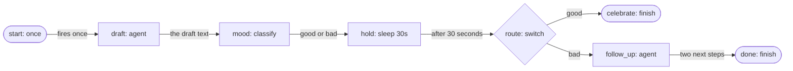

# Your first workflow

This tutorial builds a small durable workflow: a model drafts a status
update, a classify step labels it, a switch picks a branch, and a finish
step ends the run. You validate it, watch its steps in the log, stop the
process in the middle of the run, start it again and see the run continue
where it stopped. It takes about fifteen minutes and builds on the
[Quickstart](getting-started.md).

## Before you start

- **agentd** on your `PATH` ([Install](install.md)), and an **OpenAI API
  key** in `OPENAI_API_KEY`. No key? [Run it
  offline](#run-it-without-a-model-account) instead.
- **[`jq`](https://jqlang.org)**, to read the log.
- **Two terminals**, both in the same empty directory.

## What you will build

A workflow is a graph of steps. Each step has a `kind` that says what it
does, and `depends_on` that says what must finish first. A start node says
when a run begins. agentd writes the run's state to a store before every
step that has an effect, which is what lets a run survive the process.



## Step 1: Write the workflow

Save this as `first-workflow.yaml`:

```yaml
intelligence:
  endpoints: https://api.openai.com/v1/chat/completions
  model: gpt-5.1
  token: "{{secret:OPENAI_API_KEY}}"

store:
  kind: file
  file: { path: ./first-workflow-state }

workflows:
  - name: status-note
    steps:
      start: { kind: once }

      draft:
        kind: agent
        depends_on: [start]
        instruction: |
          Write a two-sentence status update for a team whose nightly
          build failed twice this week but whose release shipped on time.

      mood:
        kind: classify
        depends_on: [draft]
        input: "{{steps.draft.output}}"
        classes:
          good: the update is mostly good news
          bad: the update is mostly bad news

      hold:
        kind: sleep
        depends_on: [mood]
        duration: 30s

      route:
        kind: switch
        depends_on: [hold]
        on: "{{steps.mood.output.class}}"
        cases:
          good: celebrate
          bad: follow_up

      celebrate:
        kind: finish
        depends_on: [route]
        output: "{{steps.draft.output}}"

      follow_up:
        kind: agent
        depends_on: [route]
        instruction: |
          Suggest two concrete next steps for this status update:
          {{steps.draft.output}}

      done:
        kind: finish
        depends_on: [follow_up]
        output: "{{steps.follow_up.output}}"
```

What each step does:

| Step | Kind | What it does |
|---|---|---|
| `start` | `once` | A start node that fires once for this store. Other start kinds fire on a schedule, a webhook, a message or a change upstream. |
| `draft` | `agent` | A full model turn. Its output is the model's answer. |
| `mood` | `classify` | Asks the model to put its input in one of the named classes. Its output is `{class, confidence, reason}`. |
| `hold` | `sleep` | Waits 30 seconds on a durable timer. It stands in for any long wait, and gives you time to stop the process. |
| `route` | `switch` | Reads `mood`'s class and runs the matching case. The case it does not take is *pruned*: it never runs, and neither does anything behind it. |
| `celebrate`, `done` | `finish` | End the run as `completed`, with an output. A workflow needs at least one. |
| `follow_up` | `agent` | A second model turn, on the bad-news branch. |

`{{steps.draft.output}}` is a template: before a step runs, agentd fills in
the output of the step it names, and `{{steps.mood.output.class}}` reads one
field of it. [Workflow language reference](workflow-language.md) has the
full syntax.

The `store` block makes the run durable: agentd keeps the run's state in
`./first-workflow-state`. Without it, a one-shot job keeps nothing, and a
stopped run would be lost.

## Step 2: Validate it

Check the file before you run anything:

```bash
agentd --validate-config --config first-workflow.yaml
```

```text
{"event":"config.valid","files":["first-workflow.yaml"]}
```

Validation is strict: each step's fields, every `depends_on` edge, cycles,
and the start and finish nodes are checked before anything runs. To see it
catch a mistake, change `instruction:` under `draft` to `prompt:` and
validate again:

```text
{"event":"config.invalid","msg":"workflow \"status-note\" step \"draft\": unknown field \"prompt\" for kind \"agent\" (allowed: instruction, output_contract, output_schema, tools, servers, limits, context, skills, system, model, effort)"}
{"event":"config.invalid","msg":"workflow \"status-note\" step \"draft\": kind \"agent\" requires field \"instruction\""}
```

The exit code is `2`. Change it back before you go on.

> **Note.** Validation checks that a template path names a step the
> workflow has, so `{{steps.moood.output.class}}` is refused. What follows
> the step id is read at run time: `{{steps.mood.output.clas}}` passes, and
> the step that renders it fails when the run reaches it.

## Step 3: Watch it run

In the first terminal, run the workflow and send the log to a file:

```bash
agentd --config first-workflow.yaml 2> run.log
```

In the second terminal, follow the log and print each step as it starts and
finishes:

```bash
tail -F run.log | jq -r 'select(.event | test("^(run|step)\\.(start|done)$|^restore\\.")) | [.event, .step, .status] | map(select(.)) | join(" ")'
```

As the run goes, the second terminal shows:

```text
restore.fresh
run.start
step.start draft
step.done draft done
step.start mood
step.done mood done
step.start hold
```

`restore.fresh` says the store was empty. The run started at `start`, ran
the two model steps, and is now in `hold`.

## Step 4: Stop it mid-run

While `hold` waits, press `Ctrl-C` in the first terminal. You have 30
seconds from `step.start hold`.

agentd drains: it stops taking new work, lets in-flight work reach a safe
point, and exits `0`. Nothing prints on stdout, because the run has not
finished. The run itself is not lost: its record, with `draft` and `mood`
done and `hold` waiting, is in `./first-workflow-state`.

A crash keeps it too. Delete `./first-workflow-state`, start the workflow
again, and this time stop it from a third shell, during `hold`, with a kill
the process cannot catch:

```bash
pkill -9 -f 'agentd --config first-workflow.yaml'
```

The next step works the same way.

## Step 5: Start it again

Run the same command in the first terminal:

```bash
agentd --config first-workflow.yaml 2> run.log
```

The second terminal picks up the new log:

```text
restore.done
restore.adopted
step.done hold done
step.start route
step.done route done
step.start follow_up
step.done follow_up done
step.start done
run.done completed
```

The first terminal prints the run's output, the `follow_up` answer, and the
process exits `0`. With the [offline script](#run-it-without-a-model-account)
the output is exactly this line; a real model writes its own:

```text
1. Find why the nightly build fails. 2. Add an alert for the next failure.
```

Three things happened:

- **The run was adopted, not restarted.** `restore.adopted` brought back the
  run from the store. `draft` and `mood` did not run again, so their model
  calls were not paid for twice.
- **The timer kept its deadline.** `hold` finished when its 30 seconds were
  up, counted from when it started, not from the restart.
- **The start did not fire again.** A `once` start fires once per store. The
  log has a `start.once.skipped` line for it.

If your model judged the update good news, the run ended at `celebrate`
instead, with the draft as its output, and `follow_up` never started.

What agentd promises is *at least once*: a step caught in the middle of its
effect by a crash runs again on restart. [Workflows: how runs
work](workflows.md) explains checkpoints, replay and idempotency keys.

## Step 6: Run it again from the start

Run the command a third time. The `once` start has already fired for this
store, so agentd starts no new run: it prints the finished run's output and
exits `0`. To start over, pick one:

- `agentd --config first-workflow.yaml --fresh` starts a new generation of
  the store. The earlier records are kept, not deleted.
- Delete `./first-workflow-state`.
- Set `policy: always` on the start, `start: { kind: once, policy: always }`,
  to fire on every start of the process.

## Run it without a model account

The release binary carries a mock model endpoint that answers from a script
instead of a model, with no key and no network. Save this script as
`playbook.json`:

```json
{
  "match": [
    {"when_contains": "Classify the input into exactly one of these classes",
     "content": "{\"class\": \"bad\", \"confidence\": 0.8, \"reason\": \"two failed builds\"}"},
    {"when_contains": "Suggest two concrete next steps",
     "content": "1. Find why the nightly build fails. 2. Add an alert for the next failure."}
  ],
  "turns": [
    {"content": "The nightly build failed twice this week. The release still shipped on time."}
  ]
}
```

Each `match` rule answers a request that contains its text; anything else
gets the first `turn`. Then run every command in this tutorial with two more
flags, which point the model at the script and drop the key reference:

```bash
agentd --config first-workflow.yaml --intelligence "mock:file:playbook.json" --intelligence-token "" 2> run.log
```

The steps, the log lines, the stop and the resume are the same.

## Next steps

- [Triage with a decision model](decision-triage.md): typed decisions,
  guards and per-turn routing.
- [Author workflows](author-workflows.md): triggers, fan-out, waits and
  retries for real work.
- [Workflows: how runs work](workflows.md): what durability does and does
  not promise.
- [Workflow node reference](node-registry.md): every step kind and its
  fields.
