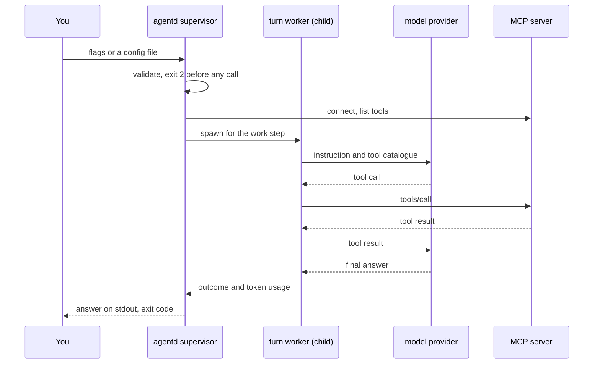

# Quickstart

In about ten minutes you run a first agent against a real model, give it a
tool from a public MCP server, read its result and exit code, and then run
the same instruction as a long-lived daemon you talk to from a terminal UI.
This tutorial is for developers trying agentd for the first time. You need
agentd installed and an API key for OpenAI or Anthropic.

## Before you start

- **agentd 1.19 or later** on your `PATH`. [Install](install.md) covers the
  options; `agentd --version` checks it.
- **An API key** for OpenAI or for Anthropic.
- **For the last step**, Node.js 20 or newer and the display clients:
  `npm install -g @agentd-dev/cli`.
- **Optionally**, [`jq`](https://jqlang.org) to read the JSON log.

Work in an empty directory; the daemon in step 5 keeps its state there.

> **Note.** No API key yet? The release binary carries a mock model endpoint
> that answers with no key and no network. Run
> `agentd --instruction "Say hello." --intelligence mock:final` to see a
> one-shot end to end; it prints `mock-llm done` and exits `0`. The rest of
> this tutorial uses a real model: `mock:final` answers every call at once
> and never calls a tool.

## Step 1: Give agentd your key

Put the key in your shell's environment:

```bash
export OPENAI_API_KEY="paste-your-key-here"
```

You never hand agentd the key itself. Commands and files name it with a
reference, `{{secret:OPENAI_API_KEY}}`, which agentd resolves from the
environment when it starts. The key stays off agentd's command line, and so
out of `ps`, out of configuration files and out of every log line. A
reference to a variable that is not set stops agentd before it does
anything:

```text
{"event":"config.invalid","msg":"{{secret:OPENAI_API_KEY}} is not set in the environment (referenced at config.intelligence.token)"}
```

## Step 2: Run a one-shot

Ask the agent to do one thing, print the answer and exit:

```bash
agentd \
  --instruction "Explain in three sentences what the Model Context Protocol is for." \
  --intelligence https://api.openai.com/v1/chat/completions \
  --model gpt-5.1 \
  --intelligence-token '{{secret:OPENAI_API_KEY}}'
```

The agent's answer prints on your terminal: a few sentences from the model,
and nothing else. The JSON lines that scroll past go to stderr; step 3 reads
them.

The four flags are the whole configuration:

| Flag | What it says |
|---|---|
| `--instruction` | The task. agentd turns it into a one-step job, runs it to an end, and exits. |
| `--intelligence` | The model endpoint, written in full. A URL with a path is posted to exactly as written. |
| `--model` | The model to ask for. agentd has no default, and refuses to start a connection to a real provider that names none. |
| `--intelligence-token` | The credential, as a reference to the environment. |

With Anthropic, set `ANTHROPIC_API_KEY` instead and name the dialect, since
the default dialect is the OpenAI-compatible one:

```bash
agentd \
  --instruction "Explain in three sentences what the Model Context Protocol is for." \
  --intelligence https://api.anthropic.com \
  --intelligence-dialect anthropic \
  --model claude-sonnet-5 \
  --intelligence-token '{{secret:ANTHROPIC_API_KEY}}'
```

[Connect model providers](connect-models.md) covers Bedrock, Azure, Vertex
and local servers.

## Step 3: Read the result and the exit code

agentd splits its output in two, so it composes with ordinary shell tools:

- **stdout** carries the result, and only the result.
- **stderr** carries telemetry: one JSON object per line.
- **The exit code** says how the run ended.

Run the one-shot again and keep the log in a file:

```bash
agentd \
  --instruction "Explain in three sentences what the Model Context Protocol is for." \
  --intelligence https://api.openai.com/v1/chat/completions \
  --model gpt-5.1 \
  --intelligence-token '{{secret:OPENAI_API_KEY}}' \
  2> run.log
echo "exit code: $?"
```

```text
exit code: 0
```

List the events in order, with the step, tool or model each one is about:

```bash
jq -r '"\(.level) \(.event) \(.step // .tool // .model // "")"' run.log
```

```text
info proc.start
warn config.warning
warn store.none
info restore.fresh
info workflow.loaded
info inbox.accepted
info proc.ready
info run.start
info step.start work
info turn.model gpt-5.1
info step.turn.spawn work
info loop.start
info turn.start
info turn.done
info turn.done
info step.done work
info step.start done
info run.done
info child.exit
info lifecycle.idle_exit
info proc.exit
```

The two warnings say that a one-shot keeps no state, which is the point of
a one-shot. The rest is the job's life: the instruction became a workflow
with a `work` step, a child process (the turn worker) ran the model turn,
and the process exited when nothing was left to do. Every line carries the
same `run_id` and `trace_id`, plus `agent_path`, which says which part of
the process wrote it: `0` is the supervisor, `run/<run-id>/work` the worker
that ran the step. The first line, unfolded (`jq . run.log` unfolds them
all):

```json
{
  "agent_id": "sup",
  "agent_path": "0",
  "comp": "supervisor",
  "config_files": [],
  "event": "proc.start",
  "instance": "agentd",
  "level": "info",
  "pid": 1898125,
  "run_id": "01M4P4S9DGF68J6J4XN9DF2NBT",
  "trace_id": "ec8a5ca41008bc6596c89199c65d9b9c",
  "ts": "2026-10-11T18:49:43.088Z",
  "version": "1.19.0"
}
```

The last line, `proc.exit`, carries the exit code and the tokens the process
used (`tokens_in`, `tokens_out`). `turn.done` carries the same counts per
turn. Neither carries the prompt or the answer: the log records lengths and
counts, not content, unless you turn on `--log-content`.

The exit code maps how the run ended, so a script or a scheduler can branch
on it without reading the log:

| Code | Meaning |
|---|---|
| `0` | The run completed. |
| `1` | The run failed. |
| `2` | The configuration or the command line is invalid. Nothing ran. |
| `3` | A partial result: the run stalled or was flagged partial. |
| `4` | The model could not be reached, or refused the credential, after retries. |
| `5` | The task was refused or cannot be done. |
| `7` | A budget ran out: the run's steps or tokens. |
| `124` | The run's deadline passed. |

[CLI, environment and exit codes](cli.md#exit-codes) has the full table.

Every run is bounded even if you set nothing: 500 steps, 2,000,000 tokens
and one hour. Set your own with `--max-steps`, `--max-tokens` and
`--deadline`; the deadline also cuts off a model call in progress.

## Step 4: Give it a tool

A release binary gives the model no file, shell or web tools of its own.
Its built-in tools manage the agent itself (memory, plans, workflows,
subagents, asking a person). Everything else comes from MCP servers that
agentd connects to over HTTPS.

DeepWiki runs a public MCP server, with no key, that answers questions about
GitHub repositories. Name it with `--mcp name=endpoint` and ask for
something only it can provide:

```bash
agentd \
  --instruction "Use DeepWiki to list the documentation topics of the modelcontextprotocol/rust-sdk repository, then name the three a newcomer should read first." \
  --intelligence https://api.openai.com/v1/chat/completions \
  --model gpt-5.1 \
  --intelligence-token '{{secret:OPENAI_API_KEY}}' \
  --mcp deepwiki=https://mcp.deepwiki.com/mcp \
  2> run.log
```

The log now shows the connection and the tool calls:

```bash
jq -r 'select(.event | test("^(mcp|tool)\\.")) | "\(.event) \(.server // .tool) \(.protocol // "")"' run.log
```

```text
mcp.connect deepwiki 2025-11-25
mcp.connect deepwiki 2025-11-25
tool.call read_wiki_structure
tool.result read_wiki_structure
```

The supervisor connects first and lists the server's tools; the turn worker
holds its own connection for the calls. `2025-11-25` is the MCP revision the
server speaks: agentd tries MCP 2026-07-28 first and falls back for servers
that predate it. Your model may call other DeepWiki tools, or more than one.

An MCP server that is down does not stop the run. agentd logs
`mcp.connect.fail`, runs without that server's tools, and adds them when the
server comes up. [Connect MCP servers](connect-mcp.md) covers credentials,
tool filtering and trust tags.

## How the run worked

agentd runs as two kinds of process. The supervisor validates the
configuration, connects to MCP servers, keeps the durable state and the
credentials, and enforces the limits; it runs no agent loop. Each model turn
runs in a child process, the turn worker, which the supervisor can always
stop.



[Architecture](architecture.md) explains the split and what it buys.

## Step 5: Run the same instruction as a daemon

A one-shot exits when its job is done. A daemon stays up, and you work with
it: send it messages, answer its questions, watch what it does. The same
settings go in a file. Save this as `quickstart.yaml`:

```yaml
agent:
  instruction: >-
    Use DeepWiki to list the documentation topics of the
    modelcontextprotocol/rust-sdk repository, then name the three a
    newcomer should read first.

intelligence:
  endpoints: https://api.openai.com/v1/chat/completions
  model: gpt-5.1
  token: "{{secret:OPENAI_API_KEY}}"

mcp:
  servers:
    - name: deepwiki
      endpoint: https://mcp.deepwiki.com/mcp

store:
  kind: file
  file: { path: ./quickstart-state }

a2a:
  listen: http://127.0.0.1:8420
  events: { enabled: true }

lifecycle:
  run_until: drained
```

For Anthropic, replace the `intelligence` block:

```yaml
# fragment: under the top level, replacing intelligence
intelligence:
  endpoints: https://api.anthropic.com
  dialect: anthropic
  model: claude-sonnet-5
  token: "{{secret:ANTHROPIC_API_KEY}}"
```

Three blocks are new:

- **`store`** keeps conversations, tasks and runs in a directory, so a
  restart resumes them.
- **`a2a`** opens the listener the clients connect to, on loopback, with the
  live event feed the clients watch turned on.
- **`lifecycle.run_until: drained`** keeps the process up until you stop it.

Check the file before you run it:

```bash
agentd --validate-config --config quickstart.yaml
```

```text
{"event":"config.warning","msg":"a2a.listen: no credential is configured, so every local process that presents none is the operator — set a2a.bearer, an a2a.principals rule, a2a.tls.client_ca or a2a.device_grant to require one"}
{"event":"config.valid","files":["quickstart.yaml"]}
```

The warning is right for a laptop: on a loopback listener with no
credential, a local client is the operator. Anything else needs a
credential; [Use the terminal and web UI](interface.md#signing-in) shows how
clients sign in.

Start the daemon and the terminal UI together:

```bash
agentd tui --config quickstart.yaml
```

```text
agentd tui: endpoint http://127.0.0.1:8420 · daemon logs → /run/user/1000/agentd-tui-48213.log
```

The launcher signs the client in with a single-use code and sends the
daemon's log to the file it names. Type a follow-up, such as "Which of those
topics covers the Streamable HTTP transport?", and the agent answers in the
conversation. Type `/quit` to leave; the launcher stops the daemon with the
client.

Two things happen differently from step 4:

- **The instruction runs once, at the first start.** The file declares no
  workflow, so agentd makes the instruction a one-step workflow, as it did for
  the one-shot, and runs it when the daemon first starts. With the file store
  it never runs again: a restart finds the run already done. After that run,
  the instruction stays the agent's standing policy for every conversation.
- **The daemon owns the session, not the client.** To keep the agent working
  after you close the UI, run the two apart, in two terminals:

```bash
agentd --config quickstart.yaml
```

```bash
agentd-tui --endpoint http://127.0.0.1:8420
```

Quit the client and the daemon keeps going; attach again, or attach a second
client, and each shows the same live session. Stop the daemon with `Ctrl-C`:
it drains and exits `0`.

## Next steps

- [Your first workflow](first-workflow.md): a durable workflow you can kill
  mid-run and resume.
- [Build a coding agent](coding-agent.md): a daemon that works on a
  repository with guarded local commands.
- [Use the terminal and web UI](interface.md): the screens, commands and
  approvals.
- [Connect MCP servers](connect-mcp.md): give the agent the tools it needs.
