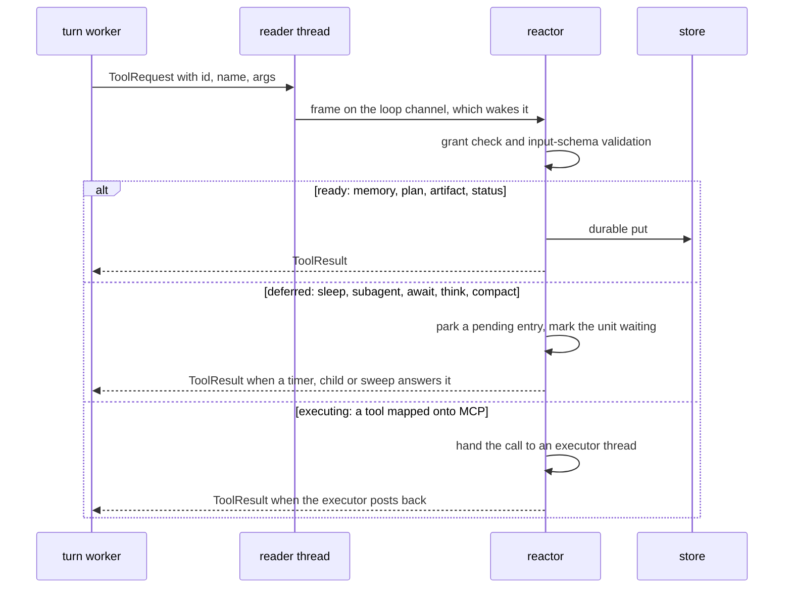
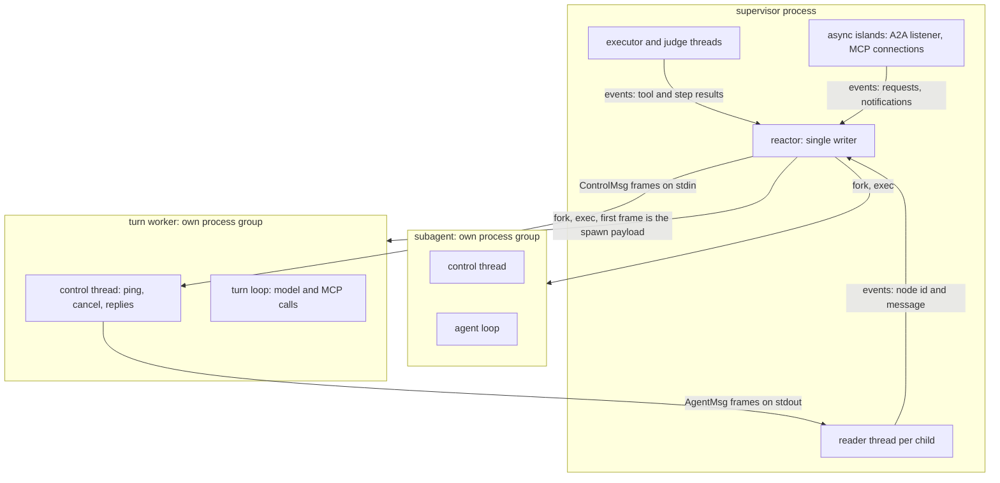
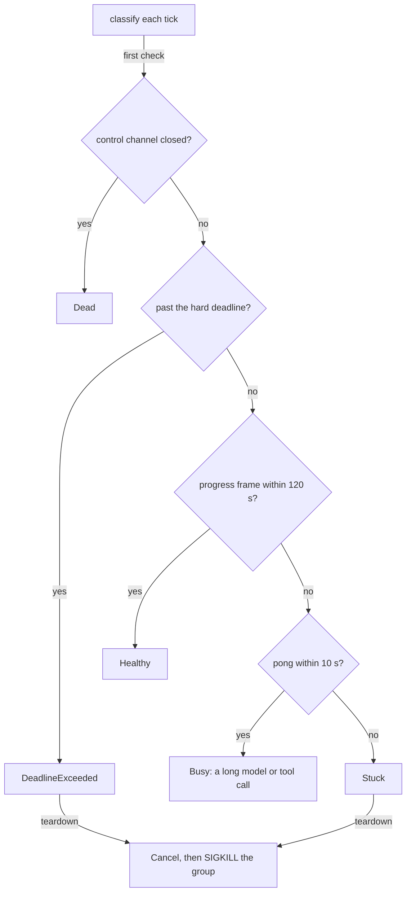
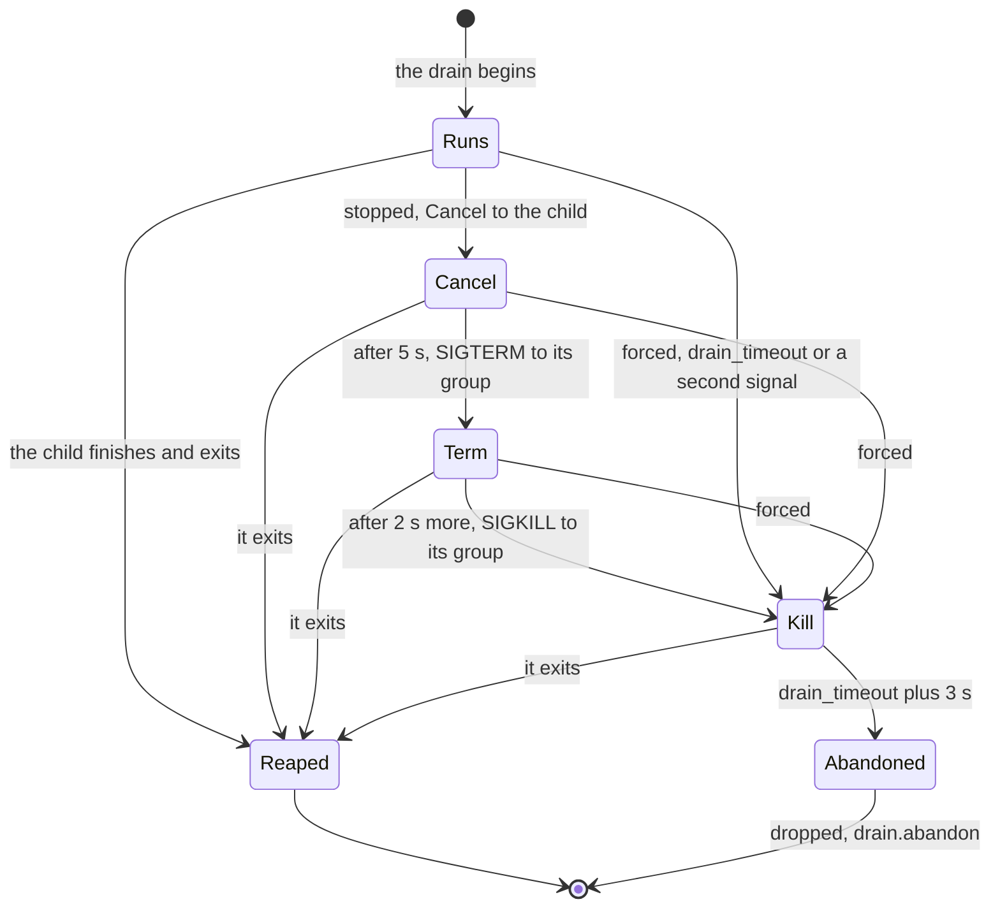
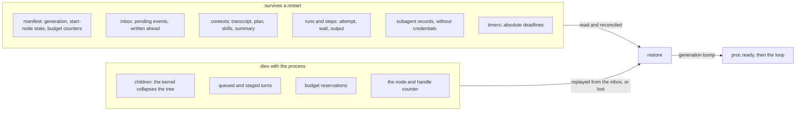

# Supervision and containment

An agent is a loop that reads text and decides what to do next, so any limit
you state *to* the model is negotiable. agentd enforces its limits in a
supervisor process that never reads the model's output as instruction, and
runs the reasoning in child processes it can watch, starve and kill. This
page is for security reviewers and operators: it explains the process tree,
how the supervisor tells a busy child from a wedged one, how it stops
children, what the kernel enforces, and what survives a crash.

## The containment problem

Four things go wrong in an agentic loop, and only one of them is a bug you
can fix in a prompt.

- **Spend.** A loop that keeps calling a model bills you until something
  stops it.
- **Non-termination.** A model that re-issues the same tool call has not
  crashed; it is working, forever.
- **Wedging.** A worker blocked in a TLS read on a dead socket has no future
  to cancel and no callback to run. Cooperative cancellation needs
  cooperation.
- **Persuasion.** Tool output is untrusted input. Anything the agent reads
  can try to talk it out of its instructions.

Each has the same shape: the component that must be stopped is the one you
would be asking to stop itself. So enforcement lives where the agent cannot
reach it — in another process, holding different capabilities, that runs
no agent loop.

## What the supervisor owns

**All mutable state lives in the reactor, and the reactor is the only
writer.** The reactor is the supervisor's single-threaded event loop
([Architecture](architecture.md#the-single-writer-loop) lists its phases).
Executor threads, listeners, judges and child readers can only send events
to it.

That divides a turn cleanly. A worker calls **MCP tools itself**, on its own
connections, with a per-call idempotency key: those are outbound effects,
not state. Every **internal** tool — memory, plans, artifacts, workflows,
`subagent.run`, `sleep`, `think`, `decide`, compaction — round-trips to the
supervisor, which checks the grant for that caller, validates the arguments
against the tool's input schema, and then mutates. A tool that a
`security.policies` rule might match also round-trips, so the policy is
judged by the supervisor rather than by the child.



The supervisor is deliberately unintelligent. It decides *when* work runs
and *that* it stays inside its limits; it never decides what the work should
be. It does dial a model in two places, both narrow: the goal watchdog's
check and the judge that answers an ask on the operator's behalf. Each runs
on its own thread, returns a verdict as an event, and can neither call a
tool nor change state.

## The process tree

Every turn worker, think child and subagent is a **direct child of the
supervisor**. The tree is flat — one table keyed by node id — however deep
the logical agent tree goes. A subagent cannot spawn its own children
in-process; it asks the supervisor through the `subagent` tool, which is the
one place depth, breadth and spawn rate are enforced. Node ids come from a
per-process counter and name a live child, never a durable entity.



An **instance-tier child** is the exception to "flat worker": a subagent
template whose instruction defines machinery spawns a whole agentd daemon,
reached as an A2A peer over a unix socket and retired through its own
graceful drain. It sits under the same reaper, with its own caps
(`limits.subagents.instances`). [Subagents and delegation](subagents.md)
covers templates and tiers.

### Why processes, not threads

A child is the same binary re-executed with `AGENTD_SUBAGENT=1`. Its `main`
checks that variable before parsing any command line and reads its whole
configuration from the first frame on stdin. One artifact ships, with no
second code path to keep in step. Threads would be cheaper; processes win
for three reasons, in order:

1. **Cancellation is `SIGKILL`.** A process group can be killed from outside
   unconditionally; a thread cannot. This is the only mechanism that works
   against a worker wedged in a system call, and it is why the reactor is a
   blocking loop rather than an async one. The async runtimes agentd does
   carry — the A2A listener's and each MCP connection's — sit at the
   protocol edges, never on the path that decides what to kill.
2. **Crash isolation.** The reasoning is the volatile part: it can panic,
   exhaust memory or run away. In a child, none of that reaches the
   supervisor.
3. **The kernel does the work.** Isolation, accounting and observability
   (`ps`, `pstree`, cgroups) come from the operating system rather than from
   code agentd would have to audit. The process tree *is* the agent tree.

### The spawn sequence

Spawning is one atomic block, held under a process-wide lock so the reaper
can never collect a child that is not yet registered:

1. Start the binary with `AGENTD_SUBAGENT=1` and the supervisor's own pid in
   `AGENTD_PARENT_PID`, stdin and stdout piped, stderr inherited: the child's
   JSON telemetry joins the parent's stream, and stdout is left for binary
   frames.
2. Before `exec`, make the child its own process-group leader, so `killpg`
   can take out its subtree.
3. Spawn, retrying a transient `EAGAIN` up to 10 times with a growing
   backoff (about 1.1 seconds in all). A wide fan-out hits a kernel that
   refuses a fork under pressure; that is retried, not surfaced.
4. If cgroups are armed, create the child's leaf cgroup and move it in.
5. Write the spawn payload as the first frame on the child's stdin.
6. Start the reader thread for the child's frames.
7. Register the pid with the reaper.

The child's first act is to ask the kernel to `SIGKILL` it when the
supervisor dies (`PR_SET_PDEATHSIG`, which `exec` clears, so it cannot be
set by the parent). If its parent is no longer the pid in
`AGENTD_PARENT_PID`, the supervisor died during the spawn and the child
exits at once. The comparison is with that pid, not with 1, so a supervisor
that is itself PID 1 — a container's entrypoint — keeps its children. An
instance-tier daemon asks for `SIGTERM` instead, so it drains.

### The wire

Supervisor and child speak a private JSON protocol — not MCP — framed with a
4-byte big-endian length prefix, so payloads with newlines survive intact.
A frame is capped at 16 MiB.

| Direction | Messages |
|---|---|
| Down, supervisor to child | `Spawn`, `Ping`, `Pause`, `Resume`, `Cancel`, `Inject`, `SwapIntel`, `ToolResult`, `BudgetGrant` |
| Up, child to supervisor | `Ready`, `Pong`, `Event` (progress), `Usage`, `ToolRequest`, `BudgetRequest`, `TurnDone`, `Turn`, `Result`, `Failed`, `Gate`, `GateClosed`, `IntelHealth`, `Credential` |

`SwapIntel` is how a reload reaches a running child: the child rebuilds its
model client at its next turn boundary under `intelligence.swap_policy`.
`IntelHealth` reports, on a transition only, that every model endpoint the
child can reach is down or has recovered; the readiness probe reads it.
`Credential` carries what one of the child's credentials did: every failure
to produce one, and a success that follows a failure or is the target's
first. The supervisor keeps one record per target for the tree and logs
`auth.unavailable` and `auth.recovered` from it.

Inside the child the control reader runs on its own thread. `Ping` and
`Cancel` keep flowing while the agent loop is blocked in a long model call,
which is exactly what lets the supervisor tell "busy" from "wedged".

## Reaping

There is exactly one `waitpid(-1, WNOHANG)` loop in the process, and it runs
only from the reactor's tick. Each reaped pid is routed to whichever
component owns it; an unowned pid — an adopted orphan, an MCP server's child
— is discarded.

There is deliberately **no reaper thread**: a continuous `waitpid(-1)` would
steal exit statuses from code that waits for its own children. `SIGCHLD` is
not load-bearing either. Signals do not queue, so the reactor discards the
flag and reaps unconditionally every tick, bounding detection to one tick.

Before a reap is acted on, the reactor joins the child's reader thread, so
every frame the child wrote is already queued, and requeues the reap behind
those frames. A child's last words are always read before its exit is
judged.

At startup the supervisor marks itself a subreaper (`PR_SET_CHILD_SUBREAPER`,
Linux only, best-effort), so grandchildren orphaned by a dying child
reparent to agentd rather than escaping to init.

## Liveness: telling busy from wedged

Each child carries a liveness tracker with an absolute deadline: its spawn
time, plus its own deadline, plus 60 seconds. On every ping interval the
supervisor sends `Ping` to every child. Only the arrival of a `Pong` matters,
and any other frame counts as progress and refreshes both clocks.



| Setting | Default | Override |
|---|---|---|
| progress timeout | 120 s | `AGENTD_PROGRESS_TIMEOUT_MS` |
| pong timeout | 10 s | `AGENTD_PONG_TIMEOUT_MS` |
| ping interval | a third of the pong timeout, clamped to 50 ms–5 s | derived |
| hard deadline | spawn + the child's deadline + 60 s | the turn's or step's deadline |

An unhealthy child gets no graceful wind-down: on `Stuck` or
`DeadlineExceeded` the reactor sends `Cancel` and kills the process group in
the same tick. In practice `Dead` comes from the reaper, not the classifier.

## The kill ladder

A drain — `SIGTERM`, `SIGINT`, `admin.drain`, a `finish` with `exit: true`,
or another reason to stop — spawns nothing new and lets the children already
running finish: a turn worker, a think, a subagent. The kill ladder is for
the children it stops, each on a clock of its own:

- a warm subagent, which never ends on its own, as the drain begins;
- every child, when an exit is asked for: a `finish` with `exit: true`,
  `lifetime_exhausted: exit`, a store that cannot write — every child but
  those working for a `lifecycle.shutdown` run, which the drain still waits
  for;
- every child still running when `lifecycle.drain_timeout` passes or a
  second signal arrives, straight to `SIGKILL`.

`subagent.kill` puts one subagent on the same ladder outside a drain:
`Cancel` when it is killed, `SIGTERM` 5 seconds later, `SIGKILL` 2 seconds
after that, each signal logged as `subagent.kill.escalated`. A child that
exits inside the grace is never signalled. The child is recorded
`cancelled`, never `parked`. A drain that begins while it climbs leaves it
on its own ladder until the drain is forced, which sends it `SIGKILL` at
once, also logged as `subagent.kill.escalated`.

The signalling refuses any process group of 1 or less, so the supervisor can
never signal init or itself.



| Stage | When | Action |
|---|---|---|
| Runs | t = 0 | no new spawns; the running children run on |
| Cancel | when the drain stops a child | `Cancel` to that child |
| Term | 5 s after its `Cancel` | `SIGTERM` to its group |
| Kill | 7 s after its `Cancel` | `SIGKILL` to its group |
| Force | `lifecycle.drain_timeout` (default 25 s), or a second signal | straight to `SIGKILL` for every child left, once |
| Abandon | drain timeout + 3 s | drop the remaining children, checkpoint, exit |

Nothing a drain stops is failed. A step whose turn worker it stopped stays
`running` in the final checkpoint and is replayed by the next start; a
conversation turn it stopped leaves its message in the inbox; a gate such a
turn had open puts its task back to `working`, and the replay asks on it
again; a subagent it stopped is recorded `parked` and spawned again. A
`sync` subagent a stopped turn was waiting on is recorded `cancelled`
instead, because the turn's replay asks for it again, and a parked one
would run twice. A child that ends on its own with a real failure during
the drain fails as it would at any other time. One `drain.interrupted` line
names what the drain left. When its timeout, a second signal or an exit
stopped work, `agent_drains_total` counts the drain `forced` rather than
`completed`.

The worst case with the default drain timeout is 28 seconds. Keep it below
your orchestrator's grace period (`terminationGracePeriodSeconds` in
Kubernetes), or the orchestrator's `SIGKILL` lands first and you lose the
final checkpoint. Nothing can validate that for you, because agentd cannot
see the orchestrator's number. A daemon's drain exits 0, not 143, and a
job's exits with its work's code; the exit codes are listed in [CLI,
environment and exit codes](cli.md).

Besides its children, the drain waits for any workflow run started by an
`event {on: lifecycle.shutdown}` start node — the deinit hook described in
[Jobs, daemons and triggers](modes-and-triggers.md#init-and-deinit) — for
the calls out on executor threads, and for instance-tier children, which it
sends `SIGTERM` as it begins so each drains itself, all within the same
`drain_timeout`. A drain an exit asked for waits for the deinit runs and
the instance-tier children, not for the other calls out. A deinit run a
forced drain cuts short is cancelled rather than left, so the next start
does not run the last one's shutdown at its boot.

## Admission and pressure

Nothing is forked before it passes an ordered set of gates. A `subagent.run`
checks, in order: live breadth, the lifetime total, delegation depth (from
the requester's stored record, never from the request), the spawn-rate token
bucket, resource pressure, then the lethal-trifecta tag check over the
child's narrowed tool set. A refusal is a tool result the model can read.

Turn dispatch has its own gate. A conversation is busy while a turn worker
or a think child is bound to it, which serialises its turns, and live
conversation turns are capped by `agent.max_parallel_turns` (default 4).
[How a turn runs](agent-loop.md#the-dispatch-gate) has the detail.

**Under pressure the daemon sheds new work and drains what is in flight.**
Two signals drive it. Disk: with the `file` store, free space below
`store.file.min_free` (default 256 MB) sheds, and below twice that warns.
Memory: with cgroups armed, usage at 95% or more of the cgroup's
`memory.high` sheds. While shedding, every admission point refuses the
same way — schedules skip with `start.shed`, webhooks answer `429` with
`Retry-After`, queued turns stay queued, `subagent.run` is refused — and
work already running finishes normally. Work marked `priority: low` is
refused one level early, at the warning. Transitions are logged once
(`pressure.warn`, `pressure.shed`, `pressure.cleared`) and exported as
metrics.

```yaml
agent:
  name: builder
  instruction: You build and test the repository on request.
  max_parallel_turns: 4

intelligence:
  endpoints: https://api.openai.com/v1/chat/completions
  model: gpt-5.1
  token: "{{secret:OPENAI_API_KEY}}"

a2a:
  listen: http://127.0.0.1:8420

limits:
  subagents:
    depth: 3          # delegation depth
    breadth: 8        # children alive at once
    total: 64         # children over the instance's lifetime
    rate: "8/2s"      # a burst of 8, refilling 4 a second
  run: {steps: 500, tokens: 2000000, deadline: 1h}

lifecycle:
  drain_timeout: 25s

security:
  cgroup:
    spec: auto
    memory_max: 2G
    pids_max: "512"   # counts threads, not only processes

store:
  file:
    min_free: 256MB
```

## cgroup limits

cgroup containment is opt-in and best-effort at every layer. At startup
`security.cgroup` resolves a parent: `auto` is the process's own cgroup plus
`/agentd`, and an absolute path must sit under `/sys/fs/cgroup` with no
`..`. The supervisor probes that it can write there, removes leaves left by
crashed earlier lives (only those whose owning process is dead), and
delegates the controllers the limits need, one at a time, so a partly
capable parent still gets what it can.

Every spawn creates a leaf named `run-<supervisor pid>-<counter>`, applies
`memory_max` and `pids_max`, and moves the child in. Membership is inherited
across every fork the child makes, so it cannot leave its leaf by forking.
Teardown writes `cgroup.kill`, which kills the whole subtree atomically,
then removes the leaf. That is the backstop for a process that escaped its
process group with `setsid()`.

> **Limit.** No `security.cgroup` means no leaf. An unwritable tree
> disarms the feature silently, and undelegated controllers make the
> `memory.max` and `pids.max` writes no-ops while `cgroup.kill` still works.
> The `limits_unavailable` field of the `cgroup.armed` log line is the only
> signal that a requested limit is not in force.

## Spend

Budgets are enforced by the supervisor at dispatch, against durable
counters, not inside the model client. Before a turn is spawned its tokens
are estimated and reserved against every budget window that applies; the
reservation is settled with the child's reported usage when the turn ends,
or released untouched if the child dies without reporting. Because the
counters live in the durable manifest, a restart cannot reopen a spent
daily window. The think, preflight, compaction and decide workers are
charged to the instance and to the conversation they ran for, and the goal
and approval judges to the instance. [Control spend with
budgets](budgets.md) covers windows and what happens when a budget runs
out.

## Checkpoints and crash recovery

A checkpoint runs every tick and writes only what changed: runs, contexts
and subagent records. The manifest write is debounced (250 ms by default)
and forced at drain and at idle exit.

Every durable write is a compare-and-set on the sequence number. A conflict
on a key this instance already owns is **fatal**: a second writer exists,
and the supervisor would rather stop than interleave. A conflict on a key
touched for the first time adopts the stored sequence once and retries —
the normal gap after a restore. A failed checkpoint halts the instance
unless `store.on_error: degrade` is set, in which case it retries with
backoff and reports itself degraded. Store I/O is synchronous on the reactor
thread, with up to three retries at a growing 50 ms backoff, so a slow store
slows timers, liveness and reaping alike.



Restore reads the manifest, fetches every indexed entity, then reconciles
against `list` to pick up entities written after the last manifest flush.
Entities are written before the manifest, which is what makes that order
safe. The generation is bumped and flushed. Then the runtime adopts what it
read:

- a step left `Running` is reset to `Pending` and its run continues;
- a subagent that had not finished, and was not detached, is spawned again
  from its stored payload with `attempt + 1`, and its model and credential
  are resolved afresh — the stored record carries neither a token nor
  resolved headers, so it cannot reproduce a run offline;
- detached and finished subagents are not spawned again;
- turn workers are never spawned again: their inbox event replays instead;
- timers are re-armed from absolute deadlines, and undone inbox events are
  re-delivered with their original ids.

## Failure modes

These are accepted by design:

- **Signal latency.** The signal pipe is drained, not waited on, so a
  `SIGTERM` is noticed on the next iteration — up to one tick later.
- **A stalled store stalls everything.** No second thread ticks while the
  reactor retries a write.
- **A replayed step presents a new idempotency key.** Replay bumps the
  step's attempt, which is part of the MCP `_meta` key, so a server cannot
  collapse the retry. Make workflow steps idempotent on their own terms.
- **A schedule can fire twice across a crash.** The firing's inbox event is
  written at once; the start node's bookkeeping goes into the debounced
  manifest.
- **cgroup limits may silently not apply** (above).

And this is a known gap, stated here rather than discovered later:

- **A child that dies during setup is found by the reaper**, on the next
  tick, rather than the moment it fails. The reaper does fail its unit:
  a worker reaped while its step is still running fails the step and logs
  `turn.failed` with "worker exited without a result".

## What it costs, and what it buys

The costs are real. Every turn is a fork and an exec of the full binary,
plus a reader thread, plus a cgroup leaf when armed; under pressure a fork
can take a second of retries. This is not the design for units of work a
few milliseconds long. The two sides share no memory, so every internal tool
call is a serialized round trip through a pipe, and state changes are
bounded by one thread that also does its own store I/O.

What you get in return is the property that matters when an agent
misbehaves: **the limits are outside the thing being limited.** A runaway
loop is stopped by `killpg`, not by asking it to stop. A process that
escaped its group is stopped by `cgroup.kill`. A wedged worker is caught by
a control thread that answers pings while the loop is blocked. A budget is
enforced against durable counters at a dispatch point, so a restart cannot
reopen a spent window. Every event is durable before it is acted on, and a
crash recovers from the store, not from memory. And the enforcement code has
no model in it: admission, budgets, liveness and the kill ladder act on
counters and clocks, so no prompt can change what they do.

## Next steps

- [Architecture](architecture.md) — the reactor's phases, the edges, and
  where state lives.
- [Subagents and delegation](subagents.md) — templates, tiers and the spawn
  payload.
- [Control spend with budgets](budgets.md) — windows and `on_exhausted`.
- [Deploy](deployment.md) — drain timing and probes under an orchestrator.
