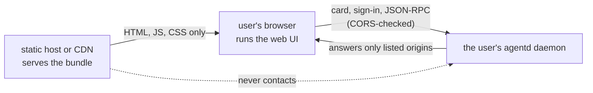

# Host the web UI

The agentd web UI is a static bundle: a page, a script and a stylesheet. You
can serve it from your own domain so people reach their agents from a browser
without installing anything. This guide is for two readers: whoever serves the
bundle, and whoever runs a daemon the page connects to. After it you can
deploy the bundle safely and configure a daemon to accept it.

## How a hosted UI works

The page runs in the user's browser and connects directly to that user's own
daemon. It remembers the endpoint in `localStorage` and keeps its sign-in
session in `sessionStorage` (one tab, one visit), and nowhere else. The host
that served the page never sees a request to an agent, never holds a token,
and cannot reach a private network. Compromising the host yields static
assets.



**Do not add a backend.** A proxy or a session store would turn a page that
cannot leak anything into one that holds everyone's credentials and can reach
every user's daemon. The project's build asserts that the bundle stays a thin
client.

## Get the bundle

`.github/workflows/hosted-ui.yml` builds two artifacts on every push to `main`
that touches the clients, and on release tags:

- **`agentd-ui-static.tar.gz`** with `SHA256SUMS.ui`, attached to the workflow
  run. Extract it onto any static host or CDN.
- **`ghcr.io/agentd-dev/agentd-ui`**, for `linux/amd64` and `linux/arm64`:
  nginx serving the bundle as an unprivileged user on port 8080, with a
  `/healthz` probe. Images are tagged by branch, by tag and by short commit
  SHA, and `latest` follows `main`.

The job typechecks and tests the clients, fails if a secret-shaped
environment reference reaches the bundle, and smoke-tests the built image,
including that the Content-Security-Policy header is present.

To build the bundle yourself, run `npm run build` in `interface/`; the bundle
is `interface/dist/web/`. To run the image:

```sh
docker run --rm -p 8080:8080 ghcr.io/agentd-dev/agentd-ui:latest
```

> **Note.** The repository builds these artifacts; it does not operate a
> public host for them. Where you serve the bundle is your choice.

## Serve it

`interface/deploy/nginx.conf` is the reference server configuration, and the
image uses it. Four things in it matter wherever you serve the bundle.

**The Content-Security-Policy.** `connect-src` is deliberately wide, because
the page connects to a daemon at an address only the user knows. Everything
else is closed to compensate: `default-src 'none'`, `script-src 'self'` with
no `unsafe-inline`, `base-uri 'none'`, `form-action 'none'` and
`frame-ancestors 'none'`. No third-party script can run, which is what makes
the wide `connect-src` acceptable.

**Header inheritance.** nginx inherits `add_header` only into blocks that
declare none of their own. Setting cache headers with `add_header` in a
`location` silently drops every security header, which is how a site ships
without the policy it appears to configure. The reference configuration uses
`expires` for caching, which leaves inheritance alone, and the image's smoke
test checks the policy is served.

**Caching.** The shell must not be cached (`expires -1`) or a deploy strands
users on an old bundle. The JavaScript and CSS may be (`expires 7d`).

**Routing.** Unknown paths fall back to `index.html`, because they are the
app's own routes.

A hosted copy serves no `bootstrap.json`, so the page names no endpoint of its
own. It starts at the connect form, filled in from `?endpoint=…` or from the
endpoint this browser remembers. A link like
`https://ui.example.com/?endpoint=https://agent.example.com:8443` fills in the
form and waits for the person to connect; a link names an endpoint, never the
decision to trust it.

### Deploy checklist

- **TLS at the edge**, with HSTS there too. The container speaks plain HTTP
  on 8080.
- **No cookies, no accounts, no logs worth keeping.** The page is anonymous.
  Access logs show which addresses loaded a static page and nothing about
  anyone's agent.
- **Scale is a CDN question.** The payload is a few hundred kilobytes and
  every request except the shell is cacheable.
- **Rollback is a tag change**, since images are tagged per commit.
- A `security.txt` and a CSP report endpoint are optional extras if you want
  violation telemetry.

## Allow a hosted UI to reach your daemon

This section is for the person whose daemon the page connects to. The daemon
must grant three things: the page's origin, Private Network Access when the
daemon is on a private address, and a way for a browser to sign in.

**The origin.** The daemon answers a web page only from an origin listed in
`a2a.cors.origins`, compared exactly (scheme, host and port). A request from
any other origin, `Origin: null` included, is refused with `403` before its
body is read. Loopback earns no implicit trust: a UI served from
`http://127.0.0.1:4173` is listed like any other. The one origin admitted
unlisted is the page `agentd ui` launches, by that launcher's daemon, while it
runs ([Use the terminal and web UI](interface.md#launcher)).

**Private Network Access.** A page on a public origin reaching a daemon on
loopback or a LAN address is the shape browsers gate. A browser that sends
the `Access-Control-Request-Private-Network: true` preflight drops the real
request unless the answer carries `Access-Control-Allow-Private-Network:
true`. agentd answers it, narrowly: only to an origin already listed in
`a2a.cors.origins`, and only when the browser asked. The Agent Card is the one
document any origin may read, because it is public, but even there Private
Network Access is granted only to a listed origin.

**A way to sign in.** A browser is never the daemon's implicit operator: a
request carrying `Origin` always authenticates, even on a loopback daemon with
nothing configured. A hosted page signs in with the device grant, so the
daemon needs `a2a.device_grant`, which in turn needs an operator credential to
approve codes with (`a2a.bearer`, or an `a2a.principals` rule with
`role: operator` and `match.bearer_ref`). A daemon with no credential at all
issues browser sessions only to the tab `agentd ui` opens, and the hosted page
says so.

A daemon on the user's own machine, for Chrome, Edge and Firefox:

```yaml
intelligence:
  endpoints: ["https://api.openai.com/v1/chat/completions"]
  token: "{{secret:OPENAI_API_KEY}}"
  models:
    smart: { model: gpt-5.1 }
  model: smart

a2a:
  listen: http://127.0.0.1:8420
  bearer: "{{secret:AGENTD_OPERATOR_TOKEN}}"
  events:
    enabled: true
  cors:
    origins: ["https://ui.example.com"]
  device_grant:
    enabled: true
```

A daemon behind TLS, which every browser can reach from an https page,
Safari included:

```yaml
intelligence:
  endpoints: ["https://api.openai.com/v1/chat/completions"]
  token: "{{secret:OPENAI_API_KEY}}"
  models:
    smart: { model: gpt-5.1 }
  model: smart

a2a:
  listen: https://0.0.0.0:8443
  url: https://agent.example.com:8443
  tls:
    cert: /etc/agentd/tls/fullchain.pem
    key: /etc/agentd/tls/privkey.pem
  bearer: "{{secret:AGENTD_OPERATOR_TOKEN}}"
  events:
    enabled: true
  cors:
    origins: ["https://ui.example.com"]
  device_grant:
    enabled: true
```

List every origin a UI is served from: your hosted copy, an `agentd-ui` you
run by hand (`http://127.0.0.1:4173`), a second domain. `a2a.cors.origins` is
reloadable; the device grant takes a restart. `*` and paths are refused. The
listener settings themselves (TLS, `a2a.url`, principals) are in
[Connect agents over A2A](connect-agents.md) and the
[Configuration reference](configuration.md).

## Browser support

Browsers restrict a public https page talking to a loopback or private
address, and those rules differ between browsers and their releases. Test
with the browsers your users run. What the web UI supports:

| Browser | A loopback `http://` daemon | A daemon behind TLS |
|---|---|---|
| Chrome, Edge | works when the daemon answers Private Network Access (agentd does, for listed origins); the browser may also ask the user to allow access to the local network | works |
| Firefox | works | works |
| Safari | does not work: Safari blocks an https page from reaching `http://localhost` | works |

The page cannot work around Safari's block. The answers are to run the daemon
behind TLS so the connection is https to https, or to use `agentd ui` locally,
which serves the same interface next to the daemon. The connect screen says
so on a hosted copy.

## How people sign in

A person opens the page and connects to their endpoint. The page reads the
card, offers **sign in**, and shows a code. An operator approves it under a
name, with `/approve <code> <name>` from a TUI or another signed-in tab. The
session lives in that tab's `sessionStorage`, bound to the endpoint it was
issued for, until it expires or the person runs `/disconnect`, which revokes
it. `localStorage` keeps only the endpoint and the layout, and no credential
is ever read from or put in a URL.

A CORS failure is otherwise impossible to diagnose from the page, so the
connect screen shows the `a2a.cors.origins` snippet with the page's real
origin filled in. The full sign-in walkthrough is in
[Use the terminal and web UI](interface.md#signing-in).

## The local server, agentd-ui

The same bundle, served next to the daemon by `agentd-ui` (and started for
you by `agentd ui`), runs under a tighter policy, because it knows exactly one
endpoint:

- It binds `127.0.0.1` only (`--port N`, default 4173, or a socket inherited
  with `--listen-fd N`). It refuses an inherited socket bound anywhere but
  `127.0.0.1`, and it answers only a `Host` of `127.0.0.1:<port>` or
  `localhost:<port>`, so a page that rebinds its own name to 127.0.0.1 cannot
  read it.
- **`/bootstrap.json`** is `{endpoint}` and nothing more, sent with
  `Cache-Control: no-store`, and only to the page's own fetch:
  `Sec-Fetch-Site` must be `same-origin` or `none`, and an `Origin`, when
  present, must be this server's.
- Every response carries `Cross-Origin-Resource-Policy: same-origin`,
  `X-Content-Type-Options: nosniff`, `Referrer-Policy: no-referrer`, and the
  policy `default-src 'self'; connect-src 'self' <the endpoint's origin>;
  frame-ancestors 'none'; base-uri 'none'; form-action 'none'`. The card, the
  sign-in and every JSON-RPC call go to the endpoint's origin and nowhere
  else.
- It holds no credential and reads none from its environment or a URL.
  `--open` opens the plain page, which signs itself in. A tab that is already
  signed in is `agentd ui`'s to open, with a single-use code in the URL
  fragment.

## What is deliberately not here

- **No accounts, no sign-in and no server-side state on the host.** Sign-in is
  between the tab and the user's own daemon. Adding any of these changes the
  threat model from "static assets" to "holds credentials for every user's
  agent", which is not worth it for a client that works without them.
- **No proxying to daemons.** For the same reason, and because a proxy would
  make the host a way into private networks it should not be able to see.

## Next steps

- [Use the terminal and web UI](interface.md) for what people do once they
  are signed in.
- [Connect agents over A2A](connect-agents.md) to put the daemon's listener
  behind TLS with principals.
- [Harden a deployment](harden.md) for the rest of the daemon's exposure.
