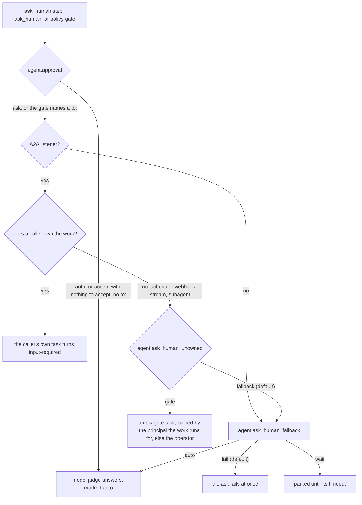

# Human in the loop

agentd can stop and ask a person: a workflow's `human` gate, the agent's
own `ask_human` tool, or a `security.policies` rule that holds a tool call
until someone approves it. This guide is for builders and operators who put
a person in charge of a decision. It shows how to add a gate, decide who may
answer it, answer it from a client, and choose what happens when nobody can,
including when a model judge may answer on the operator's behalf.

## How a question reaches a person

Every question becomes an A2A task in the `input-required` state, with the
question as its status message. That is core A2A, so every client already
shows it: the terminal and web UIs render an answerable row, and a
`SendMessage` that names the task's id answers it. Nothing is asked without
an A2A listener (`a2a.listen`).

Which task the question lands on depends on who owns the work that asked:



A run is owned when an A2A caller started it, for example with the
`workflow.run` command, or when its parent run was. Runs started by a
schedule, a webhook, a stream, a tool call or a timer are owned by nobody.

## Add a gate to a workflow

A `human` step asks a question and suspends the run until it is answered.
The run costs nothing while it waits, and the gate survives a restart.

```yaml
intelligence:
  endpoints: https://api.openai.com/v1/chat/completions
  model: gpt-5.1
  token: "{{secret:OPENAI_API_KEY}}"
a2a:
  listen: http://127.0.0.1:8420
  bearer: "{{secret:A2A_BEARER}}"
  events: {enabled: true}
workflows:
  - name: release-notes
    inputs:
      schema:
        type: object
        required: [tag]
        properties: {tag: {type: string}}
    steps:
      start: {kind: manual}
      draft:
        kind: agent
        depends_on: [start]
        instruction: "Draft release notes for {{ inputs.tag }}."
      approve:
        kind: human
        depends_on: [draft]
        question: "Publish these notes for {{ inputs.tag }}?\n\n{{ steps.draft.output }}"
        schema: {type: string, enum: [publish, revise, drop]}
        timeout: 4h
        on_error: continue
      route:
        kind: switch
        depends_on: [approve]
        on: "{{ steps.approve.output }}"
        cases: {publish: publish, revise: revise}
        default: dropped
      publish:
        kind: emit
        depends_on: [route]
        note: "Published notes for {{ inputs.tag }}."
      revise:
        kind: agent
        depends_on: [route]
        instruction: "Rewrite these notes more briefly: {{ steps.draft.output }}"
      published: {kind: finish, depends_on: [publish], output: "{{ steps.draft.output }}"}
      revised: {kind: finish, depends_on: [revise], output: "{{ steps.revise.output }}"}
      dropped: {kind: finish, depends_on: [route], status: cancelled, reason: "not approved"}
```

Start it over A2A with the `workflow.run` command. The caller owns the run,
so the question lands on the caller's task, and the blocking send returns
when the task reaches `input-required`:

```sh
curl -s http://127.0.0.1:8420/ \
  -H 'content-type: application/json' -H 'A2A-Version: 1.0' \
  -H 'A2A-Extensions: https://agentd.dev/a2a/ext/command' \
  -H "Authorization: Bearer $A2A_BEARER" \
  -d '{"jsonrpc":"2.0","id":1,"method":"SendMessage","params":{"message":{"role":"ROLE_USER","messageId":"start-1","extensions":["https://agentd.dev/a2a/ext/command"],"parts":[{"data":{"agentd":{"op":"workflow.run","workflow":"release-notes","inputs":{"tag":"v3.2.0"}}}}]}}}'
```

The reply carries the task id in `result.task.id` and the question in
`result.task.status.message`, with the state `TASK_STATE_INPUT_REQUIRED`.

The gate's `schema` is enforced. A reply that does not match is not
accepted: the question is asked again with the reason appended, such as
`(previous answer rejected: /: value is not one of the allowed values
(["publish","revise","drop"]))`.

## Route on the answer

The `human` step's output is the text the person sent, such as `"publish"`,
even when the schema describes an object. Branch on it with a `switch`, as
above, and give the answer a closed shape with an `enum`, so the `switch`
cases are exactly the answers the schema allows.

> **Note.** Because the output is text, a path into it such as
> `{{ steps.approve.output.approved }}` never resolves, and a fallback
> (`| false`) always applies. Use an `enum` and a `switch`, or a `parse`
> step on the reply when the schema is an object.

A gate that is not answered before its `timeout` (24 hours when unset)
fails the step. With `on_error: continue` it is marked done with an error
instead; its output then matches no case, so the `switch` takes its
`default`, and a lapsed gate reads as "no" rather than a failed run.

## Decide who may answer

By default, whoever may see the gate's task may answer it: the task's owner
and the operators. `to` narrows that to an operator:

| `to` | Who may answer |
|---|---|
| unset | the task's owner, or an operator |
| `{role: operator}` or `operator` | an operator |
| `{role: operator, labels: {team: finance}}` | an operator whose `a2a.principals` rule carries those labels |

```yaml
# fragment: under workflows[].steps
approve:
  kind: human
  depends_on: [draft]
  question: "Refund {{ inputs.amount }} on order {{ inputs.order_id }}?"
  schema: {type: string, enum: [approve, reject]}
  to: {role: operator, labels: {team: finance}}
  timeout: 24h
```

The rules that keep an addressee meaningful:

- **An addressee must be able to see the task.** A task is visible only to
  its owner and to operators, so a `to` naming anyone else (another
  principal's id, `role: user`, a glob starting with `*`, labels with no
  role) is refused at load and by `workflow.create`. Every operator is
  addressed as `operator`, whichever principal rule admitted it; labels are
  how a gate picks one. `to: {}`, `role: anonymous` and a channel such as
  `#ops` are refused too.
- **A reply from anyone else is refused, and the gate stays open.** The
  sender is told: `this decision is for role operator, team=finance; your
  answer was not recorded and the gate is still open`.
- **Any operator can still answer, visibly.** Refusing one would be
  theatre: an operator can rewrite the configuration. An operator outside
  the addressee is recorded as `operator_override` in the task, the log
  (`human.answer.override`) and the audit stream, with the session id when
  they signed in with one.
- **An addressed gate is never auto-answered**, whatever `agent.approval`
  or `agent.ask_human_fallback` say. A judge standing in for the finance
  team would make the record a lie.
- **The addressee and the schema are durable.** Both are in the run's wait
  record, so a restart rebuilds the gate exactly as declared.

In a workflow an instruction document declares, `to: "@human/<name>"`
addresses one of the document's `::!human` declarations. A human with a
`principal` addresses the gate to it, under the rule above; one with only a
`channel` is answered by the operators. The channel is announced on the
gate, in the `human.asked` event and the task's
[`askChannel` annotation](https://agentd.dev/a2a/ext/task-annotations), so
a workflow or a bridge can route the question to Slack, a pager or mail. It
never changes who may answer. See
[Instruction documents](directives.md).

## Gate runs that nobody owns

A run started by a schedule, a webhook, a stream or a tool call has no
caller to ask. Set `agent.ask_human_unowned: gate` to open a gate task for
it on the listener, owned by the principal the run works for, or else by
the operator:

```yaml
intelligence:
  endpoints: https://api.openai.com/v1/chat/completions
  model: gpt-5.1
  token: "{{secret:OPENAI_API_KEY}}"
agent:
  ask_human_unowned: gate
a2a:
  listen: http://127.0.0.1:8420
  events: {enabled: true}
  principals:
    - match: {bearer_ref: "{{secret:FINANCE_TOKEN}}"}
      id: finance-lead
      role: operator
      labels: {team: finance}
workflows:
  - name: monthly-writeoffs
    steps:
      tick: {kind: schedule, cron: "0 9 1 * *"}
      list:
        kind: agent
        depends_on: [tick]
        instruction: "List invoices more than 90 days overdue, with amounts."
      approve:
        kind: human
        depends_on: [list]
        question: "Write off these invoices?\n\n{{ steps.list.output }}"
        schema: {type: boolean}
        to: {role: operator, labels: {team: finance}}
        timeout: 3d
      done: {kind: finish, depends_on: [approve], output: "{{ steps.approve.output }}"}
```

The finance lead signs in with their token, sees the gate in their task
list, and answers it. `ask_human_unowned: gate` needs `a2a.listen`. A
subagent's asks are unowned even when a caller's turn spawned it, so the
same setting decides whether a subagent can ask anyone.

## When nobody can answer

`agent.ask_human_fallback` decides what an ask does when it does not gate:
there is no A2A listener, or the ask is unowned and `ask_human_unowned` is
`fallback`.

| Value | What happens |
|---|---|
| `fail` (default) | the ask fails at once, naming why: `ask_human: nobody can be asked (…) and agent.ask_human_fallback = fail` |
| `wait` | the ask parks until its timeout (24 hours by default), then fails; logged as `human.ask.parked` |
| `auto` | a model judge answers now; it also answers a gate with no `to` that times out unanswered |

`pause` and `idle` are accepted spellings of `wait`, and `finish` and
`stop` of `fail`.

The default is deliberate: an agent that asks with nobody to ask fails
fast instead of blocking forever.

## Let a model judge answer

`agent.approval` decides whether to ask a person at all, for any ask that
names no `to`:

| Value | What happens |
|---|---|
| `ask` (default) | a person is asked |
| `auto` | a model judge answers on the operator's behalf |
| `accept` | the ask's recommendation is taken: a `recommend` argument to `ask_human`, or the schema's `default`; with neither, the judge answers |

It can be changed while the daemon runs, until the next reload: from a
client with `/set agent.approval auto`, or with the `admin.set` command.

The judge runs on the model `intelligence.roles.approve` names, which only
the operator's configuration may set. On a decision model it answers only a
closed question, one whose answer is an `enum` or a boolean, as a choice
among those answers, and only above the role's `confidence`, which a
decision-model approver must set:

```yaml
intelligence:
  providers:
    anthropic:
      endpoints: https://api.anthropic.com
      dialect: anthropic
      token: "{{secret:ANTHROPIC_API_KEY}}"
    openrouter:
      endpoints: https://openrouter.ai/api/alpha/decisions
      dialect: decisions
      token: "{{secret:OPENROUTER_API_KEY}}"
  models:
    smart: {model: claude-sonnet-5, provider: anthropic}
    jev:   {kind: decision, provider: openrouter, model: typesafe/jev-1.13, escalate: smart}
  roles:
    turn: smart
    approve: {model: jev, confidence: 0.9}
agent:
  approval: auto
  ask_human_fallback: auto
a2a:
  listen: http://127.0.0.1:8420
  bearer: "{{secret:A2A_BEARER}}"
```

An open question goes to the model's `escalate` model when that model
writes text, or stays undecided. An undecided answer, an answer that does
not fit the gate's schema, and a judge that fails all fail the ask; the
judge has 10 minutes. Every judged answer is marked `auto` in the task, the
log and the audit stream, and logged as `intel.decision` with
`role: approve`.

> **Warning.** No judge answers an ask whose run, subagent or peer
> conversation carries outside input: a webhook's body, an A2A agent's text,
> a tainted stream. Text in the question can steer any model to approve, so
> the ask fails instead, logged as `human.judge.withheld`, whatever the
> model and its confidence. Gates on that kind of work need a person.

## Gate a tool call with a policy

A `security.policies` rule with `action: ask` holds a tool call until a
person approves it. The question goes on the task of the work that made the
call, under the same ownership rules, and is answered with `approve` or
`deny`.

```yaml
intelligence:
  endpoints: https://api.openai.com/v1/chat/completions
  model: gpt-5.1
  token: "{{secret:OPENAI_API_KEY}}"
mcp:
  servers:
    - name: billing
      endpoint: https://billing.example.com/mcp
      auth: {kind: static, token: "{{secret:BILLING_TOKEN}}"}
      tags: {"*": [sensitive]}
a2a:
  listen: http://127.0.0.1:8420
  bearer: "{{secret:A2A_BEARER}}"
security:
  policies:
    - match: {tool: "billing.refund*"}
      action: ask
      question: "{{caller}} wants {{tool}} with {{args}}. Allow?"
      to: {role: operator, labels: {team: finance}}
      timeout: 2h
      on_timeout: deny
```

- `approve` runs the held call and gives the caller its real result;
  `deny` returns an error naming the rule. Any other answer is refused and
  the question stays open.
- A policy gate is always addressed: to its `to`, or to `{role: operator}`
  when it names nobody. So it is never answered by a judge, and the caller
  whose call is held cannot approve it.
- A gate nobody can be asked takes its `on_timeout`, which defaults to
  `deny`, and logs `tool.policy.unanswerable`.

[Harden a deployment](harden.md) covers policies in full.

## Answer from a client

In the [terminal or web UI](interface.md), an open question shows in the
transcript as an answerable row. Type the answer: a plain reply answers
the newest open question, and a message that starts with `#task-…`, the
task as the client shows it, answers that task's question. A `#` routes
only at the start of a message. A gate that names someone else refuses your
reply with the reason, unless you are an operator, whose answer is recorded
as an override.

Over A2A, answer with a `SendMessage` that names the task:

```sh
curl -s http://127.0.0.1:8420/ \
  -H 'content-type: application/json' -H 'A2A-Version: 1.0' \
  -H "Authorization: Bearer $A2A_BEARER" \
  -d '{"jsonrpc":"2.0","id":2,"method":"SendMessage","params":{"message":{"role":"ROLE_USER","messageId":"answer-1","taskId":"<task id>","parts":[{"text":"publish"}]}}}'
```

A data part is accepted too; it reaches the gate as JSON text. Who may send
the answer is the ordinary A2A rule: the task's owner or an operator, then
narrowed by the gate's `to`.

## Escalate a question

The `human.asked` event fires whenever a gate opens, so a workflow can page
someone instead of hoping a terminal is being watched:

```yaml
intelligence:
  endpoints: https://api.openai.com/v1/chat/completions
  model: gpt-5.1
  token: "{{secret:OPENAI_API_KEY}}"
a2a:
  listen: http://127.0.0.1:8420
  bearer: "{{secret:A2A_BEARER}}"
workflows:
  - name: page-on-ask
    steps:
      asked: {kind: event, on: human.asked}
      page:
        kind: http
        depends_on: [asked]
        method: POST
        url: https://pager.example.com/api/alerts
        headers: {Authorization: "Bearer {{secret:PAGER_TOKEN}}"}
        json:
          summary: "agentd is waiting on a person: {{ steps.asked.output.payload.question }}"
          task: "{{ steps.asked.output.payload.task }}"
          channel: "{{ steps.asked.output.payload.channel }}"
      done: {kind: finish, depends_on: [page]}
```

The payload is `{task, question, deadline_ms, channel}`. `human.answered`
fires when a gate is answered, with `{task, via}`.

## Timeouts and restarts

- A gate's timeout is its `timeout`, or 24 hours. A policy rule's is its
  own `timeout`, else 24 hours.
- Gates on workflow runs survive a restart: the task and the suspended step
  are durable, and the gate is rebuilt with its addressee and schema.
- A gate inside a turn does not: the turn's process died with the restart,
  so a late answer starts a fresh turn in that conversation instead of
  resuming the call. A gate whose asking turn ended for any other reason is
  failed with that reason, so nobody answers into the void.
- The policy, timeout and addressee of a policy gate on a workflow step are
  durable too.

## Settings at a glance

| Setting | Values | Default |
|---|---|---|
| `agent.approval` | `ask`, `auto`, `accept` | `ask` |
| `agent.ask_human_fallback` | `fail`, `wait`, `auto` | `fail` |
| `agent.ask_human_unowned` | `gate`, `fallback` | `fallback` |
| `intelligence.roles.approve` | a model, or `{model, confidence}` | the turn model |
| `agent.gate_channels` | workflow → step path → channel, for configured workflows | none |

## Next steps

- [Author workflows](author-workflows.md): gates in context.
- [Use the terminal and web UI](interface.md): answering from a client.
- [Security model](security.md): why judges never see outside input.
- [Connect agents over A2A](connect-agents.md): principals, sign-in and
  ownership.
