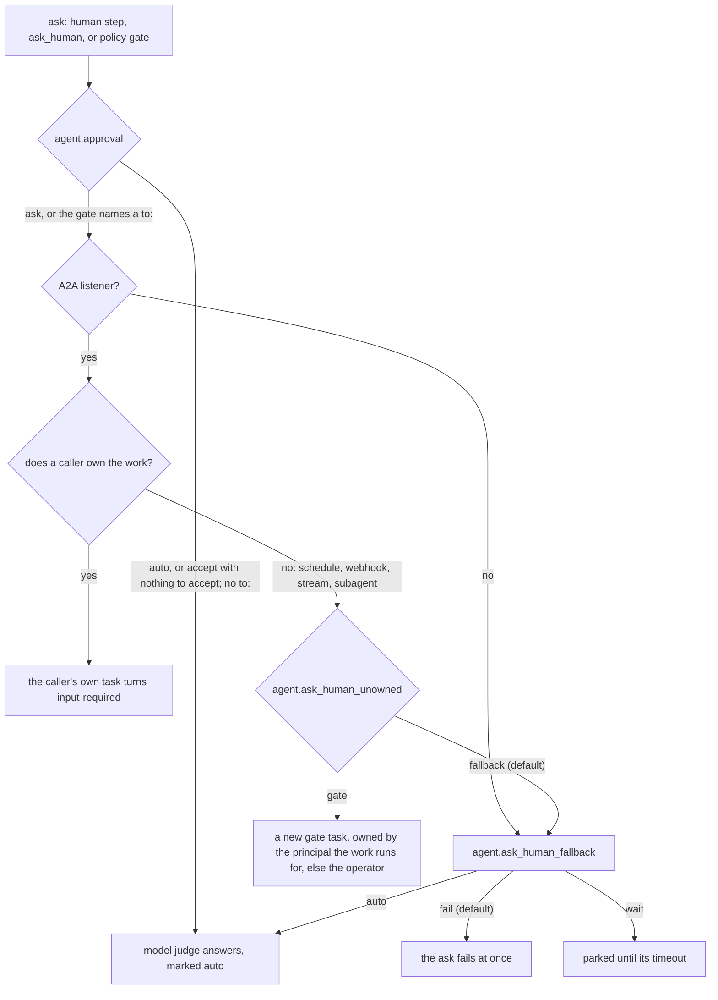

# Human in the loop

agentd can stop and ask a person: a workflow's `human` gate, the agent's
own `ask_human` tool, a `security.policies` rule that holds a tool call
until someone approves it, or a payment that waits for its approver. This guide is for builders and operators who put
a person in charge of a decision. It shows how to add a gate, decide who may
answer it, answer it from a client, and choose what happens when nobody can,
including when a model judge may answer on the operator's behalf.

## How a question reaches a person

Every question becomes an A2A task in the `input-required` state, with the
question as its status message. That is core A2A, so every client already
shows it: the terminal and web UIs render an answerable row, and a
`SendMessage` that names the task's id answers it. Nothing is asked without
an A2A listener (`a2a.listen`).

Which task the question lands on depends on who owns the work that asked:



A run is owned when an A2A caller started it, for example with the
`workflow.run` command, or when its parent run was. Runs started by a
schedule, a webhook, a stream, a tool call or a timer are owned by nobody.

A question an MCP task asks a step that sets `input` (RFC 0054) takes the
same path, but never lands on the run's task: it opens on a new task in the
run's conversation, owned as that task is, because a task holds one gate and
the task's question comes whenever the server asks it. See
[`mcp.tool`](node-registry.md#mcptool).

## Add a gate to a workflow

A `human` step asks a question and suspends the run until it is answered.
The run costs nothing while it waits, and the gate survives a restart.

```yaml
intelligence:
  endpoints: https://api.openai.com/v1/chat/completions
  model: gpt-5.1
  token: "{{secret:OPENAI_API_KEY}}"
a2a:
  listen: http://127.0.0.1:8420
  bearer: "{{secret:A2A_BEARER}}"
  events: {enabled: true}
workflows:
  - name: release-notes
    inputs:
      schema:
        type: object
        required: [tag]
        properties: {tag: {type: string}}
    steps:
      start: {kind: manual}
      draft:
        kind: agent
        depends_on: [start]
        instruction: "Draft release notes for {{ inputs.tag }}."
      approve:
        kind: human
        depends_on: [draft]
        question: "Publish these notes for {{ inputs.tag }}?\n\n{{ steps.draft.output }}"
        schema: {type: string, enum: [publish, revise, drop]}
        timeout: 4h
        on_error: continue
      route:
        kind: switch
        depends_on: [approve]
        on: "{{ steps.approve.output }}"
        cases: {publish: publish, revise: revise}
        default: dropped
      publish:
        kind: emit
        depends_on: [route]
        note: "Published notes for {{ inputs.tag }}."
      revise:
        kind: agent
        depends_on: [route]
        instruction: "Rewrite these notes more briefly: {{ steps.draft.output }}"
      published: {kind: finish, depends_on: [publish], output: "{{ steps.draft.output }}"}
      revised: {kind: finish, depends_on: [revise], output: "{{ steps.revise.output }}"}
      dropped: {kind: finish, depends_on: [route], status: cancelled, reason: "not approved"}
```

Start it over A2A with the `workflow.run` command. The caller owns the run,
so the question lands on the caller's task, and the blocking send returns
when the task reaches `input-required`:

```sh
curl -s http://127.0.0.1:8420/ \
  -H 'content-type: application/json' -H 'A2A-Version: 1.0' \
  -H 'A2A-Extensions: https://agentd.dev/a2a/ext/command' \
  -H "Authorization: Bearer $A2A_BEARER" \
  -d '{"jsonrpc":"2.0","id":1,"method":"SendMessage","params":{"message":{"role":"ROLE_USER","messageId":"start-1","extensions":["https://agentd.dev/a2a/ext/command"],"parts":[{"data":{"agentd":{"op":"workflow.run","workflow":"release-notes","inputs":{"tag":"v3.2.0"}}}}]}}}'
```

The reply carries the task id in `result.task.id` and the question in
`result.task.status.message`, with the state `TASK_STATE_INPUT_REQUIRED`.

The gate's `schema` is enforced. A reply that does not match is not
accepted: the question is asked again with the reason appended, such as
`(previous answer rejected: /: value is not one of the allowed values
(["publish","revise","drop"]))`.

## Route on the answer

The `human` step's output is the answer in its schema's shape: the string
`"publish"` here, `true` for a boolean schema, and an object for an object
schema, whose fields later steps read as `{{ steps.approve.output.approved }}`.
Without a schema it is the text the person sent. Branch on it with a
`switch`, as above, and give the answer a closed shape with an `enum`, so
the `switch` cases are exactly the answers the schema allows.

A gate that is not answered before its `timeout` (24 hours when unset)
fails the step. With `on_error: continue` it is marked done with an error
instead; its output then matches no case, so the `switch` takes its
`default`, and a lapsed gate reads as "no" rather than a failed run.

## Decide who may answer

By default, whoever may see the gate's task may answer it: the task's owner
and the operators. `to` narrows that to an operator:

| `to` | Who may answer |
|---|---|
| unset | the task's owner, or an operator |
| `{role: operator}` or `operator` | an operator |
| `{role: operator, labels: {team: finance}}` | an operator whose `a2a.principals` rule carries those labels |

```yaml
# fragment: under workflows[].steps
approve:
  kind: human
  depends_on: [draft]
  question: "Refund {{ inputs.amount }} on order {{ inputs.order_id }}?"
  schema: {type: string, enum: [approve, reject]}
  to: {role: operator, labels: {team: finance}}
  timeout: 24h
```

The rules that keep an addressee meaningful:

- **An addressee must be able to see the task.** A task is visible only to
  its owner and to operators, so a `to` naming anyone else (another
  principal's id, `role: user`, a glob starting with `*`, labels with no
  role) is refused at load and by `workflow.create`. Every operator is
  addressed as `operator`, whichever principal rule admitted it; labels are
  how a gate picks one. `to: {}`, `role: anonymous` and a channel such as
  `#ops` are refused too.
- **A reply from anyone else is refused, and the gate stays open.** The
  sender is told: `this decision is for role operator, team=finance; your
  answer was not recorded and the gate is still open`.
- **Any operator can still answer, visibly.** Refusing one would be
  theatre: an operator can rewrite the configuration. An operator outside
  the addressee is recorded as `operator_override` in the task, the log
  (`human.answer.override`) and the audit stream, with the session id when
  they signed in with one.
- **An addressed gate is never auto-answered**, whatever `agent.approval`
  or `agent.ask_human_fallback` say. A judge standing in for the finance
  team would make the record a lie.
- **The addressee and the schema are durable.** Both are in the run's wait
  record, so a restart rebuilds the gate exactly as declared.

In a workflow an instruction document declares, `to: "@human/<name>"`
addresses one of the document's `::!human` declarations. A human with a
`principal` addresses the gate to it, under the rule above; one with only a
`channel` is answered by the operators. The channel is announced on the
gate, in the `human.asked` event and the task's
[`askChannel` annotation](https://agentd.dev/a2a/ext/task-annotations), so
a workflow or a bridge can route the question to Slack, a pager or mail. It
never changes who may answer. See
[Instruction documents](directives.md).

## Gate runs that nobody owns

A run started by a schedule, a webhook, a stream or a tool call has no
caller to ask. Set `agent.ask_human_unowned: gate` to open a gate task for
it on the listener, owned by the principal the run works for, or else by
the operator:

```yaml
intelligence:
  endpoints: https://api.openai.com/v1/chat/completions
  model: gpt-5.1
  token: "{{secret:OPENAI_API_KEY}}"
agent:
  ask_human_unowned: gate
a2a:
  listen: http://127.0.0.1:8420
  events: {enabled: true}
  principals:
    - match: {bearer_ref: "{{secret:FINANCE_TOKEN}}"}
      id: finance-lead
      role: operator
      labels: {team: finance}
workflows:
  - name: monthly-writeoffs
    steps:
      tick: {kind: schedule, cron: "0 9 1 * *"}
      list:
        kind: agent
        depends_on: [tick]
        instruction: "List invoices more than 90 days overdue, with amounts."
      approve:
        kind: human
        depends_on: [list]
        question: "Write off these invoices?\n\n{{ steps.list.output }}"
        schema: {type: boolean}
        to: {role: operator, labels: {team: finance}}
        timeout: 3d
      done: {kind: finish, depends_on: [approve], output: "{{ steps.approve.output }}"}
```

The finance lead signs in with their token, sees the gate in their task
list, and answers it. `ask_human_unowned: gate` needs `a2a.listen`. A
subagent's asks are unowned even when a caller's turn spawned it, so the
same setting decides whether a subagent can ask anyone.

## When nobody can answer

`agent.ask_human_fallback` decides what an ask does when it does not gate:
there is no A2A listener, or the ask is unowned and `ask_human_unowned` is
`fallback`.

| Value | What happens |
|---|---|
| `fail` (default) | the ask fails at once, naming why: `ask_human: nobody can be asked (…) and agent.ask_human_fallback = fail` |
| `wait` | the ask parks until its timeout (24 hours by default), then fails; logged as `human.ask.parked` |
| `auto` | a model judge answers now; it also answers a gate with no `to` that times out unanswered |

`pause` and `idle` are accepted spellings of `wait`, and `finish` and
`stop` of `fail`.

The default is deliberate: an agent that asks with nobody to ask fails
fast instead of blocking forever.

## Let a model judge answer

`agent.approval` decides whether to ask a person at all, for any ask that
names no `to`:

| Value | What happens |
|---|---|
| `ask` (default) | a person is asked |
| `auto` | a model judge answers on the operator's behalf |
| `accept` | the ask's recommendation is taken: a `recommend` argument to `ask_human`, or the schema's `default`; with neither, the judge answers |

It can be changed while the daemon runs, until the next reload: from a
client with `/set agent.approval auto`, or with the `admin.set` command.

The judge runs on the model `intelligence.roles.approve` names, which only
the operator's configuration may set. On a decision model it answers only a
closed question, one whose answer is an `enum` or a boolean, as a choice
among those answers, and only above the role's `confidence`, which a
decision-model approver must set:

```yaml
intelligence:
  providers:
    anthropic:
      endpoints: https://api.anthropic.com
      dialect: anthropic
      token: "{{secret:ANTHROPIC_API_KEY}}"
    openrouter:
      endpoints: https://openrouter.ai/api/alpha/decisions
      dialect: decisions
      token: "{{secret:OPENROUTER_API_KEY}}"
  models:
    smart: {model: claude-sonnet-5, provider: anthropic}
    jev:   {kind: decision, provider: openrouter, model: typesafe/jev-1.13, escalate: smart}
  roles:
    turn: smart
    approve: {model: jev, confidence: 0.9}
agent:
  approval: auto
  ask_human_fallback: auto
a2a:
  listen: http://127.0.0.1:8420
  bearer: "{{secret:A2A_BEARER}}"
```

An open question goes to the model's `escalate` model when that model
writes text, or stays undecided. An undecided answer, an answer that does
not fit the gate's schema, and a judge that fails all fail the ask; the
judge has 10 minutes. Every judged answer is marked `auto` in the task, the
log and the audit stream, and logged as `intel.decision` with
`role: approve`.

> **Warning.** No judge answers an ask whose run, subagent or peer
> conversation carries outside input: a webhook's body, an A2A agent's text,
> a tainted stream. Text in the question can steer any model to approve, so
> the ask fails instead, logged as `human.judge.withheld`, whatever the
> model and its confidence. Gates on that kind of work need a person.

## Gate a tool call with a policy

A `security.policies` rule with `action: ask` holds a tool call until a
person approves it. The question goes on the task of the work that made the
call, under the same ownership rules, and is answered with `approve` or
`deny`.

```yaml
intelligence:
  endpoints: https://api.openai.com/v1/chat/completions
  model: gpt-5.1
  token: "{{secret:OPENAI_API_KEY}}"
mcp:
  servers:
    - name: billing
      endpoint: https://billing.example.com/mcp
      auth: {kind: static, token: "{{secret:BILLING_TOKEN}}"}
      tags: {"*": [sensitive]}
a2a:
  listen: http://127.0.0.1:8420
  bearer: "{{secret:A2A_BEARER}}"
security:
  policies:
    - match: {tool: "billing.refund*"}
      action: ask
      question: "{{caller}} wants {{tool}} with {{args}}. Allow?"
      to: {role: operator, labels: {team: finance}}
      timeout: 2h
      on_timeout: deny
```

- `approve` runs the held call and gives the caller its real result;
  `deny` returns an error naming the rule. Any other answer is refused and
  the question stays open.
- A policy gate is always addressed: to its `to`, or to `{role: operator}`
  when it names nobody. So it is never answered by a judge, and the caller
  whose call is held cannot approve it.
- A gate nobody can be asked takes its `on_timeout`, which defaults to
  `deny`, and logs `tool.policy.unanswerable`.
- The gate carries agentd's *security gate* badge, so what the call chose
  is shown escaped: `{{tool}}` quoted, and `{{args}}` as printable-ASCII
  JSON of at most 1,500 characters — a character outside it reads
  `\uXXXX`, so no argument can pass for the question's own words.

[Harden a deployment](harden.md) covers policies in full.

## A person's consent gates

Where agentd acts for an enrolled person at MCP servers through their IdP
(the `xaa` feature, [Enterprise-managed
authorization](authentication.md#enterprise-managed-authorization)), some
calls wait for that person instead of an operator: rules agentd ships — an
`egress` call from work that read outside text and holds their data, a
delegated `sensitive` or `egress` call from such work, a local command from
work holding their data, a delegated `egress` call from a workflow an
instruction document defined, and a delegated `egress` call at its first use
in a run — and any `security.policies` rule with `to: principal`:

```yaml
# fragment: under security:
policies:
  - match: {tool: "create_*", mode: delegated}
    action: ask
    to: principal
    once_per: run_tool
```

- The gate is the person's alone: they answer it from their display client
  or with `agentd --delegation-approve <gate>`, bound to its nonce and
  argument hash; an operator answers only where the person's template lists
  `approvers: [principal, operator]`. A message on the gate's task is no
  answer, no judge ever answers, and an unanswered gate denies after
  `identity.delegation.consent_timeout`.
- Its text is agentd's own, so a `to: principal` rule takes no `question`
  and no `on_timeout` but `deny`.
- `once_per: run_tool` asks at the first use per run — or conversation, or
  subagent — and tool alone; an approval passes later calls of the tool
  there until a restart.
- Gates of one shape (`delegation.list` shows each gate's `shape`) may be
  answered together: `delegation.approve {gates: [...]}`, or
  `agentd --delegation-approve <gate>,<gate>`. Each is still bound and
  recorded on its own.
- At most `identity.delegation.consent_per_minute` gates (10) open for one
  person a minute; a call past that is refused rather than asked, and
  logged as `delegation.consent.rate_limited`.
- A question a delegated server sends (an MCP elicitation) on a connection
  made with a person's grant is a gate too, of its own: owned by and
  addressed to that person, in agentd's words with the server's quoted. It
  is answered as their consent gates are, through a session that holds that
  grant — a device session under the same name that never signed in at the
  IdP is refused (`delegation.elicitation.refused`), the gate left open. No
  operator answers it for them, and unanswered within the server's wait it
  is cancelled.

Some waits are on something the person does elsewhere, and show among their
gates the same way, approve refused — they may deny one to end it:

- **A firing's approval.** A firing of an `act_for` workflow with `via:
  ciba` asks its person by OpenID CIBA, on their own device, at its first
  delegated call: the message the device shows names the instance, the
  workflow, the run and the tool. The step waits — `{kind: consent, signin:
  {how: ciba}}` — for up to the request's expiry
  (`identity.providers.<name>.ciba.request_expiry`, 300 s), and fails
  `ciba_denied` when they deny it or it expires. Another call the firing
  makes meanwhile waits on the same request. A restart ends the request,
  and the firing asks once more — a waiting step on the same wait, a new
  request — and a second restart fails the call closed
  ([Work nobody is there for](authentication.md#work-nobody-is-there-for)).
- **Signing in again.** A workflow step whose grant was revoked or expired,
  or whose run's session ended, at a server with `auth.on_revoked: ask`,
  waits — `{how: reenrol}`, on the run's task in `auth-required` — for the
  person to enrol again, or to sign in through a live session, for at most
  `identity.delegation.consent_timeout`; the step is then made again with
  no message. A step that waited before its call met any rule meets them
  then: a delegated `egress` call asks the person's consent as it would
  have.
- **Nobody there.** A firing's own work is unattended: a consent gate it
  opens goes to its person as any other does, and unanswered denies at
  `consent_timeout`; no step-up sign-in is asked for.

## Company gates

An instance that acts at Companies for a person (the `companies` feature,
[RFC 0047](../rfcs/0047-acting-at-companies-for-a-person.md)) opens gates of
its own, addressed to the configured User, `security.companies.user`. The
first is the cross-Company gate: work that has read one Company's answer —
or its error, or a message from work that had — and calls another Company's
tool, its agent (`company.converse`, `.read`, `.handoff`, `.close`) or its API
(`company.api`, `.api.describe`, an operation tool, an `http` step with `auth: {kind: company}`)
waits for the User before the call is sent.

A Company opens one gate itself: its agent's `user_requested` event, asking
to talk with the User directly, at most one per conversation at a time
([Direct Conversations](#direct-conversations)). Its `authorization` event —
the conversation needs the User's account — is answered with the Account
Token when one held covers it, and otherwise reaches the model, which may
call `company.sign_in`.

- **The addressee is the User, and only code writes it.** No workflow,
  document or tool argument can address a gate this way. With `user:
  operator` every operator principal is the User; otherwise the one
  principal id is.
- **Nobody else answers.** An operator who is not the User is refused like
  anyone else, with no override, because the answer is presented to the
  Company as the User's. `approve` sends the held call; `deny` refuses it.
- **No judge.** `agent.approval` and `agent.ask_human_fallback` change
  nothing: a Company gate is never answered by a model. A standing
  permission is the operator's own, declared in the configuration: it is the
  one thing that confirms an operation without the User.
- **Unanswered is refused.** A Company gate nobody can be asked — no
  listener, or unowned work without `agent.ask_human_unowned: gate` — or one
  that times out (24 hours) refuses its call. Each ends with a
  `company.cross_company.asked` line and audit record naming the answer.
- **The text is agentd's.** Each Company is named by its own name, quoted
  and capped, beside the domain agentd verified; the call's arguments are
  shown as one line of JSON.

### Sign-in gates

The sign-in gate asks the User to sign in at a Company themselves. It opens
when the model calls `company.sign_in`, a workflow step does, or the operator
sends the `company.sign_in` op (`agentd --login company:<name>`), and an
Account Token agentd already holds for the account asked for does not cover
the scopes asked for. Its text names the account by the label agentd keeps it
under ([Several accounts](act-at-companies.md#several-accounts)). It is a
Company gate in every rule above, and differs in what it asks:

- **The User signs in at the Company, not at the gate.** For Device Sign-In
  the gate shows a link on the Company's page and the code to check there;
  for Direct Sign-In, a link to the Company's sign-in page. agentd never
  opens either. The gate closes by itself when the Company says how the
  sign-in went, and the one answer it takes is `cancel`.
- **The model never sees it.** The tool call waits while the gate is open and
  returns how the sign-in ended: `signed_in` with the scopes granted beside
  those requested, or `cancelled`, `denied`, `expired`, `account_mismatch` or
  `interrupted`. The code, the link and every token stay in the supervisor.
- **Its links are checked.** A device authorization whose `verification_uri`
  is not an HTTPS URL with a plain host on the entry's `hosts`, in printable
  ASCII, opens no gate: the sign-in is refused, naming the field and the
  host, never the link (`company.endpoint.refused`). A plain host is a name
  or address and an optional port, with no `@` or `\` a browser could read
  another host from. agentd follows a Device Sign-In for 30 minutes at most,
  whatever its `expires_in` says.
- **It is the one gate on its task.** An ask, or a policy or Company gate,
  on a task a sign-in is on is refused, and a sign-in on a task with one
  open is too. Cancelling the task (`CancelTask`) ends the sign-in: the
  tool answers `cancelled`, and the poll stops.
- **Its task follows the work.** In unowned work with
  `agent.ask_human_unowned: gate`, a workflow step's sign-in gate is a task
  of the run, which goes back to working once the sign-in ends and is
  settled by the run; a turn's is a task of its own, which ends with the
  sign-in.
- **A restart ends it.** A sign-in pending when agentd stops ends
  `interrupted` at the next start, and its gate says so.

`company.sign_in.requested` opens one and `company.signed_in` or
`company.sign_in.failed` ends it, each an audit record (`company.sign_in`).

### Operation approvals

With the Operations extension listed (`security.companies.client.extensions:
[operations]`), an action a Company proposes is an operation, and
`company.operation.confirm` confirms it only with the User's approval of the
revision it confirms — or a standing permission the operator declared
([A Company's operations](configuration.md#a-companys-operations)). The
approval gate is a Company gate in every rule above:

- **It shows the terms.** The Company by its quoted name beside its verified
  domain, the account that proposed it by its label (`for your account
  "work" at example.com`, or the signed-out Session), the revision's
  summary as the Company wrote it, its terms
  flattened beside it (`"price_difference.amount": "70.00"`), the revision,
  when it expires, and what changed from the revision before. Every Company
  string is quoted and capped, its control characters gone.
- **`approve` or `decline`**, from the User alone. `approve` sends the confirm
  with `approved_by: user` and the revision the gate showed; `decline`
  cancels the operation at the Company. Anything else is refused, the gate
  left open. A message in a conversation — whatever it says, and whoever it
  quotes — is never an approval.
- **An answer is one message.** A message the task holds already — a client
  sending it again after a lost response — answers no later question: it is
  refused, and the gate stays open.
- **One approval, one revision, as shown.** The approval covers the revision
  the gate showed while the Company still says the same of it: when the
  Company answers `terms_changed`, or says other terms under the same
  revision, the User is asked again, on a new task, the change named;
  when it answers `user_approval_required`, the User is asked even though a
  standing permission applied. Each question is a task of its own: asked
  again, the earlier question's task closes — cancelled when it was made for
  the question, back to working when it is the work's own, saying where the
  new question is — and refuses every message while the confirm lives, so a
  second `approve` where revision 1 was shown approves nothing, and the
  records of the answer and of the confirm it sent name the task that asked.
- **The model passes nothing that approves.** The tool takes the company and
  the operation's id, and a call naming a revision or `approved_by` is
  refused by its arguments.
- **Cancelling its task, or the 24-hour timeout, while the gate is open
  confirms nothing**, and a restart ends a gate it finds open,
  `interrupted`. Once the User approved and the confirm is on its way, a
  cancel of the work that asked stops it before it is sent; if the Company
  took it, or may have, agentd cancels the operation there (Operations §7),
  and the confirm's record is kept.

The gate's question (`asked`) and answer (`approved`, `declined`), a standing
permission's use (`company.standing`), the confirm — `confirmed`,
`not_confirmed` (the Company answered and did nothing with it),
`confirm_refused`, `confirm_unknown` or `confirm_unsent`, with `approved_by`
and the state — a withdrawal (`withdrawn`) and the final state (`final`) are
audit records (`company.operation`) naming the same `operation_id` and
revision.

### Direct Conversations

When a Company asks to talk with the User (`user_requested`), or the model
asks with `company.direct {company, conversation, account?}`, the User decides whether
to talk with the Company themselves, in a Direct Conversation linked to the
one the agent is having there:

- **The question is the User's own task**, made for it and owned by them —
  for a Company's request, only when the A2A listener serves and
  `agent.ask_human_unowned` is `gate`; otherwise agentd says in the
  conversation that the User is not available. Its text is agentd's, the
  Company's reason quoted.
- **Their answer is their first message**, sent as they wrote it with
  `sender: human`, or `decline`, which agentd says in the conversation, as
  does a question unanswered for 30 minutes, cancelled, or open at a
  restart. Only the User answers it; an operator who is not the User is
  refused.
- **The task becomes the conversation.** Every message the User sends on it
  goes to the Company as they wrote it, `sender: human`, and every message
  the Company sends there comes to it, labelled as the Company's. Nothing
  else is ever sent there: the model's `company.converse` and
  `company.handoff` refuse a Direct Conversation, and a Company asking in it
  to talk with the User is asked nothing and told nothing. It ends when the
  conversation closes, and cancelling the task closes it at the Company. A
  restart keeps it.
- **While the first message is on its way** the task takes no other: one
  sent then is refused, to be sent again in a moment. A restart then sends
  the first message again under the id it was sent with, and the Company
  answers with the conversation it started.

## Payment approvals

An instance built with the `x402` feature pays for things from a workflow
step with a `payment` field, within `security.payments` ([Pay for things
with x402](pay-with-x402.md)). Before such a payment is signed, agentd asks
a person when:

- the amount is above the asset's `approve_above`;
- the step says `approve: true`;
- the work has read outside text — the result of an MCP server tagged
  `untrusted_input` or not tagged at all among it — or a model asked for
  it, and `security.payments.ask_when_tainted` is on (the default).

A payment a model asked for goes to the approver whatever its amount. A
model's own tool call never pays: it reads the payment request as the
tool's error. A model reaches a payment only by starting a paying workflow
the operator exposed as a tool, and that run's payment is asked of the
approver. Only an operator who sets `ask_when_tainted: false` lets such a
payment through within the caps unasked.

- **Who is asked.** `security.payments.approver` alone: `operator` (the
  default) is any operator principal, and `"user:alice"` is that principal
  and nobody else. Only the operator's configuration names the approver; no
  step, document or tool argument can.
- **Nobody else answers.** An answer from anyone else, an operator
  included, is refused with the approver's name, and the gate stays open:
  there is no operator override. No judge answers it, whatever
  `agent.approval` or `agent.ask_human_fallback` say.
- **What they see.** The question is a task of its own, owned by the
  approver, in `input-required`, marked as agentd's own security gate. Its
  text is fixed in agentd's code; only the values change:

  > Pay *amount asset* (*atomic* atomic units of *CAIP-19 id*) on
  > *network* to the payee *name* (*address*) for *what is paid for*, from
  > the wallet *wallet* (*address*)? The workflow "*name*" asks, in run
  > *run*, step "*step*". It asks you because *why*. The server describes
  > it as "*description*". Answer approve or decline.

  The amount is in the asset's whole units and in atomic units, the asset
  by its configured name and its CAIP-19 id, the network by its CAIP-2 id,
  the payee by its configured name and address. Each is a value the policy
  checked against its own lists before anyone is asked. What the step or
  the server chose — an HTTP request's method and URL, a tool's name, an A2A
  peer's task id, the server's description — is quoted and escaped on one
  line, so it cannot pass for agentd's words. *why* names each reason:
  `0.03 usdc is above approve_above 0.02 usdc`, `the step asks for
  approval of every payment (approve: true)`, the outside text the run
  read, `a model asked for this run`.
- **How to answer.** `approve` or `decline`, as a message on the task, from
  the [terminal or web UI](#answer-from-a-client) or over A2A. Anything else
  is refused, and the gate stays open. An approval covers the payment the
  gate showed, once: the policy is checked again when it lands, so a cap
  another payment reached meanwhile still refuses it.
- **Timeouts.** Unanswered within `security.payments.approval_timeout`
  (default `1h`, from `1s` to `7d`), the gate declines. A decline, given or
  timed out, pays nothing and fails the step. An A2A peer that asked to be
  paid is told `payment-rejected` on its task, so it ends the task.
- **No listener, no payment.** Without an A2A listener nobody can be asked,
  and such a payment is refused unsent (`no_approver`); the configuration
  load warns of it.
- **A restart ends the gate.** Unlike a workflow's `human` gate, a payment's
  gate does not survive a restart: its step fails at the next start, nothing
  paid (`interrupted`), and the step's `retry:` asks again. A gate whose run
  was cancelled closes (`withdrawn`).

Each question and answer is a `payment` record in the audit chain —
`asked`, `approved`, `declined` (`by: on_timeout` when nobody answered),
`not_addressed` for an answer from someone else, `withdrawn` and
`interrupted` — and a `payment.*` log line ([Telemetry
reference](telemetry-reference.md#payment)).

## Answer from a client

In the [terminal or web UI](interface.md), an open question shows in the
transcript as an answerable row. Type the answer: a plain reply answers
the newest open question, and a message that starts with `#task-…`, the
task as the client shows it, answers that task's question. A `#` routes
only at the start of a message. A gate that names someone else refuses your
reply with the reason, unless you are an operator, whose answer is recorded
as an override.

Over A2A, answer with a `SendMessage` that names the task:

```sh
curl -s http://127.0.0.1:8420/ \
  -H 'content-type: application/json' -H 'A2A-Version: 1.0' \
  -H "Authorization: Bearer $A2A_BEARER" \
  -d '{"jsonrpc":"2.0","id":2,"method":"SendMessage","params":{"message":{"role":"ROLE_USER","messageId":"answer-1","taskId":"<task id>","parts":[{"text":"publish"}]}}}'
```

A data part is accepted too; it reaches the gate as JSON text. Who may send
the answer is the ordinary A2A rule: the task's owner or an operator, then
narrowed by the gate's `to`.

## Escalate a question

The `human.asked` event fires whenever a gate opens, so a workflow can page
someone instead of hoping a terminal is being watched:

```yaml
intelligence:
  endpoints: https://api.openai.com/v1/chat/completions
  model: gpt-5.1
  token: "{{secret:OPENAI_API_KEY}}"
a2a:
  listen: http://127.0.0.1:8420
  bearer: "{{secret:A2A_BEARER}}"
workflows:
  - name: page-on-ask
    steps:
      asked: {kind: event, on: human.asked}
      page:
        kind: http
        depends_on: [asked]
        method: POST
        url: https://pager.example.com/api/alerts
        headers: {Authorization: "Bearer {{secret:PAGER_TOKEN}}"}
        json:
          summary: "agentd is waiting on a person: {{ steps.asked.output.payload.question }}"
          task: "{{ steps.asked.output.payload.task }}"
          channel: "{{ steps.asked.output.payload.channel }}"
      done: {kind: finish, depends_on: [page]}
```

The payload is `{task, question, deadline_ms, channel}`. `human.answered`
fires when a gate is answered, with `{task, via}`.

## Timeouts and restarts

- A gate's timeout is its `timeout`, or 24 hours. A policy rule's is its
  own `timeout`, else 24 hours.
- Gates on workflow runs survive a restart: the task and the suspended step
  are durable, and the gate is rebuilt with its addressee and schema.
- A gate inside a turn does not: the turn's process died with the restart,
  so a late answer starts a fresh turn in that conversation instead of
  resuming the call. A gate whose asking turn ended for any other reason is
  failed with that reason, so nobody answers into the void.
- A drain that stops a turn at a gate is the exception. The listener takes
  no answers while draining, so the turn holds the drain to its timeout
  and is stopped then. Its task goes back to `working` rather than
  failing, the turn runs again after the restart, and it asks on the same
  task. A gate task opened for that ask alone is cancelled instead; the
  replay opens its own.
- The policy, timeout and addressee of a policy gate on a workflow step are
  durable too.
- A payment's gate is not: a restart ends its step, nothing paid
  ([Payment approvals](#payment-approvals)).
- A firing's wait on its person's CIBA approval keeps its gate but not its
  request, which is never written down: after a restart the gate is asked
  again with a new request, once — the run's record says so — and a second
  restart fails the call `ciba_denied`. A step
  waiting for its person to sign in again (`on_revoked: ask`) does, and is
  checked again from the first pass. A device-grant step-up keeps when the
  IdP asked for it, and the sign-in a restart resumes is held to that.

## Settings at a glance

| Setting | Values | Default |
|---|---|---|
| `agent.approval` | `ask`, `auto`, `accept` | `ask` |
| `agent.ask_human_fallback` | `fail`, `wait`, `auto` | `fail` |
| `agent.ask_human_unowned` | `gate`, `fallback` | `fallback` |
| `intelligence.roles.approve` | a model, or `{model, confidence}` | the turn model |
| `agent.gate_channels` | workflow → step path → channel, for configured workflows | none |
| `identity.delegation.consent_timeout` | a duration | `24h` |
| `identity.delegation.consent_per_minute` | gates a minute per person | `10` |
| `security.payments.approver` | `operator`, or one principal id | `operator` |
| `security.payments.approval_timeout` | a duration, `1s` to `7d` | `1h` |
| `security.payments.ask_when_tainted` | `true`, `false` | `true` |

## Next steps

- [Author workflows](author-workflows.md): gates in context.
- [Use the terminal and web UI](interface.md): answering from a client.
- [Security model](security.md): why judges never see outside input.
- [Connect agents over A2A](connect-agents.md): principals, sign-in and
  ownership.
- [Pay for things with x402](pay-with-x402.md): the spend policy a
  payment's approval sits inside.
