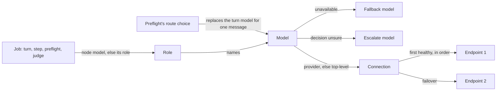
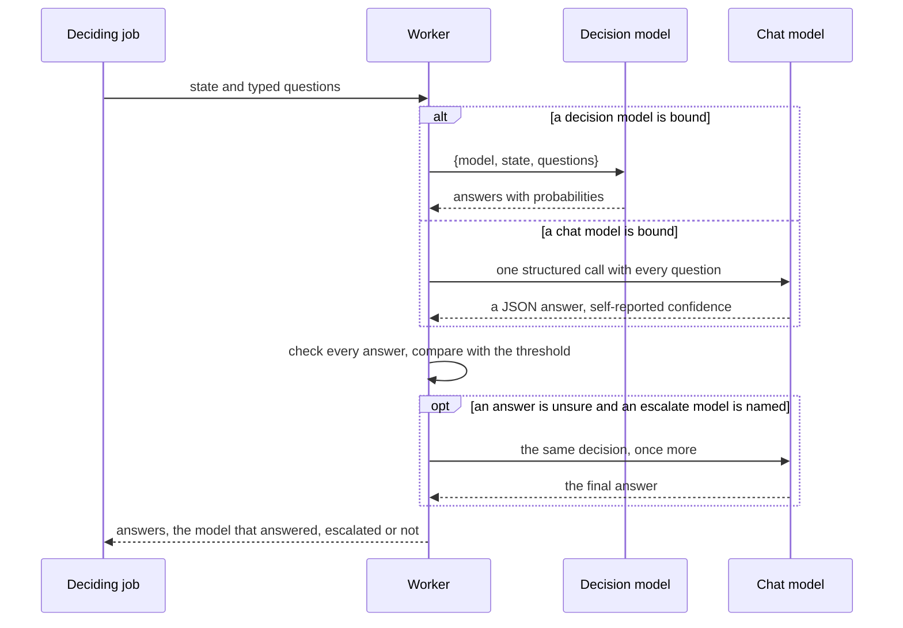
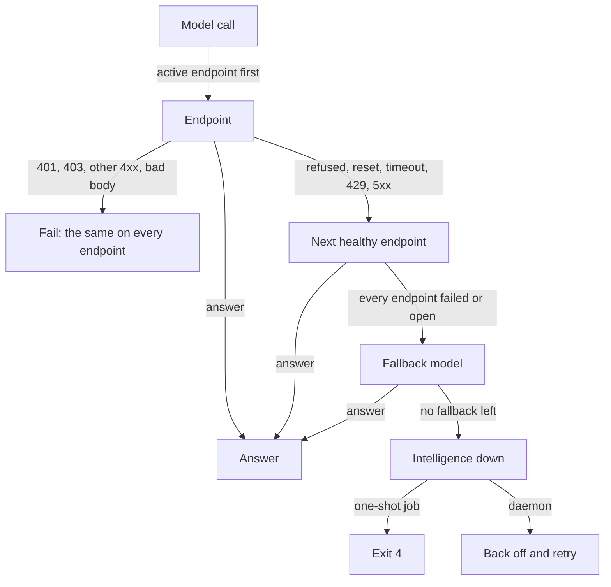

# Models, providers and roles

This page explains how agentd works with models: where a model call is made,
how agentd picks the model for each job, the three kinds of model it knows,
and what happens when a model is down or unsure. It is for reviewers who
need the design and for builders who want to know why the configuration
looks the way it does. The keys are in the
[Configuration reference](configuration.md), and the tasks in
[Connect model providers](connect-models.md) and
[Choose models for each job](models-and-roles-guide.md).

## Where model calls happen

agentd's supervisor runs no agent loop, and its single-writer loop never
waits on a model. The loop owns the state, the credentials, the budgets and
the process tree, and hands every model call to someone else:

- **Worker processes** make the calls that carry tools or a transcript: the
  agent's turns, workflow model steps, preflight triage, transcript
  compaction, and the `think` and `decide` tools. Subagents run their own
  loop in their own process.
- **A background thread** of the supervisor makes the two short judge
  calls, the goal check and the approve judge. They carry no tools, and the
  loop collects their answers as events.

A worker that crashes or hangs in a model call costs its own unit of work,
never the supervisor ([Supervision and containment](harness.md)).

The model channel is separate from tools. Tools come from MCP servers
([MCP: tools and context](mcp.md)). The model channel carries the
conversation and the tool catalogue to the model, and brings back text,
tool calls or typed answers. Each call is one request on a fresh connection,
with no streaming.

## Connections, models and roles

Three layers stand between a job and the network, and each answers one
question:

| Layer | Answers | Example |
|---|---|---|
| Role | which model does this job? | `preflight` runs on `fast` |
| Model | which wire model, of which kind, on which connection? | `fast` is `claude-haiku-4-5`, chat, top-level |
| Connection | where, how, with what credential? | `https://api.anthropic.com`, `anthropic`, a key |

A **role** is a job agentd does on its own: the agent's turns, `think`,
`decide`, `preflight`, `compaction`, `goal` and `approve`. Every role
defaults to the turn's model, and none inherits from another, so binding one
role moves that job and nothing else. A workflow node runs on its kind's role
unless it names a model of its own.

A **model** is a short name for a wire model. Configuration refers to the
name; the provider only ever receives the wire model. A model can name a
fallback for when it is unavailable and, for a decision model, an escalate
model for when it is unsure.

A **connection** is an ordered list of endpoints, a wire dialect and a
credential. There is one top-level connection, and named providers beside
it. A model reaches a provider by naming it; a model cannot describe a
connection. That keeps "use a cheaper model" from ever meaning "send the
agent's content somewhere new".

Every reference is checked at load. Once any model is declared, a role,
node or route that names a model outside the catalogue is refused; so are a
model that names an undeclared provider, a fallback cycle, and a model of
the wrong kind for its job. Nothing starts until the references hold.

## Kinds of model

agentd knows three kinds of model, and asks them for one of two things:

| Kind | What it is | Generates | Decides |
|---|---|---|---|
| chat | text, tool calls and JSON | yes | by emulation |
| reasoning | a chat model that thinks first, at an effort | yes | by emulation |
| decision | typed answers about a state, with probabilities, and no text | no | natively |

Every call is a **generate** call or a **decide** call. A generate call
returns text or tool calls. A decide call asks typed questions about a
state: a `choice` among options, a `noul` (the probability that a statement
is true), or a `score` on a scale of levels.

The kinds follow from that split. A decision model serves only the jobs that
decide, so a role or node that writes refuses one at load. A chat or
reasoning model serves both: it answers a decide call by emulation, in one
structured call that holds every question. So every decision point works
with whatever model is bound to it, and a decision model can be added
later, where it pays.

The reason to have decision models at all is cost and calibration. Most of
what an agent runtime asks a model is a decision: which intent a message
has, which route it takes, pass or fail, approve or not. A decision model
answers those in one fast call, however many questions it holds, with
probabilities a threshold can be set against. A chat model's confidence is a
number it writes, and text in the state can steer it.

## How a decision is made

Every answer is checked before anything acts on it. A question left
unanswered, an option nobody offered, or a probability outside 0 to 1 is an
error, never a decision with a hole in it.

**Confidence** is the least sureness a job acts on. For a `noul` it is the
distance from a coin flip, doubled, so a probability of 0.9 has confidence
0.8. An answer under the threshold is **unsure**, and the job's policy
decides what happens: ask the model's escalate model once more and take that
answer as final, fail, or hand the answer on marked unsure. The default
escalates where it can and fails otherwise, so a threshold someone set is
never ignored. This is a fast model first and a careful one only when the
fast one is not sure.

Answers carry a `calibrated` flag: true when a decision model computed the
probabilities, false when a chat model wrote them. agentd logs each decision
with its answers and confidence, and never the state, which is content.

## Resolved at the moment of the call

Nothing about a model is copied at startup. Each time agentd starts a turn,
a step or a judge, it resolves the role to a model, the model to a
connection, and the connection to a credential, against the settings in
force at that moment. A configuration reload that moves a role, a model or a
provider is what the next call uses.

A subagent is a long-lived process, so it is told: agentd hands each running
subagent its model, resolved again, and the subagent switches at its next
turn boundary. A model call in flight is never cut, and the conversation
carries on unbroken. The swap policy decides whether a turn caught by a model
change finishes on the model it started on or runs again on the new one.

## When a model is unavailable

Three mechanisms keep the agent answering, each at its own level:

| Mechanism | Covers | Moves to |
|---|---|---|
| retry | a blip on one endpoint: `429` or `5xx` | the same endpoint, twice, after 250 ms and 500 ms, or after its `Retry-After` when that is longer; a `Retry-After` over 30 s takes the endpoint out of rotation until it passes |
| failover | an endpoint that is down | the next endpoint of the same connection |
| fallback | a model whose every endpoint is down | the model's fallback, on its own connection |

Failover is sticky to the primary. agentd uses the first healthy endpoint in
list order, and after any success returns to the lowest healthy one, so
serving from a backup is temporary by construction. Each endpoint has a
circuit breaker: three failures in a row open it, an open endpoint is skipped
for a cooldown that starts at 5 seconds and doubles to 60, and after the
cooldown one probe decides whether it closes again. The breakers are checked
when a call needs them, with no background prober.

A fallback is asked per call, not switched to for good. The next call tries
the original model first; with its breakers open that costs no dial, and as
soon as one half-opens and answers, the original model is back. An
authentication failure is never handed down the chain, because a different
model would only hide a broken credential.

The supervisor makes no turn calls of its own, so it learns reachability
from the workers. A worker reports when its whole chain goes down and when
it comes back, and the supervisor reflects that in the `intel.health` event,
a gauge and `/readyz`, which answers `503` while no model in the chain
answers. A daemon backs off and keeps serving; a one-shot job exits `4`.

## Structured answers

When a call's answer has a JSON Schema, agentd asks the provider to hold the
model to it, rather than asking for JSON in the prompt and hoping. That
covers schema'd `think` and `agent` nodes, the deciding nodes on a chat
model, preflight, compaction, the goal check and the approve judge.

Providers that constrain generation take only part of JSON Schema, so agentd
sends a copy made sendable: each object closed, and the constraints a
provider refuses left out. Nothing depends on the provider honouring it.
agentd validates every answer against the full schema and asks again on a
miss, so a provider that ignores the format, a refusal, or an answer cut off
at its length limit are all caught the same way. A connection whose server
refuses a response format can be told to ask in the prompt alone.

## Reasoning stays inside the turn

A reasoning model thinks at an effort before it answers. Each dialect has
its own form for that, and the call's output cap is raised by the thinking
room, which budget admission counts. While a turn is still calling tools,
the model's own message goes back to it unchanged, its signed thinking
included, because some providers require it.

The reasoning goes back only to the model that wrote it. It is never stored
in the transcript the agent keeps, never logged, never shown on the
observation feed, and never survives a compaction. A fallback or degrade
model is sent the text and tool calls alone.

## Routing a turn

An agent's messages are not all alike: a status question needs a fast model,
debugging a failed deploy needs a careful one. Routing lets preflight choose the
model for each message. The operator lists the models a turn may run on,
each with a sentence saying when to use it. Preflight answers one more
question per message, which route, and the turn that answers that message
runs on the chosen model. No verdict, an unsure one, or a route removed by a
reload leaves the turn on the turn model, and the next message is routed on
its own.

Because any route may answer the next message, compaction keeps the
transcript within the smallest context window among the turn model and the
routes.

## Who chooses the model

The configuration has two authors with different powers. The **operator**
owns where the agent's content goes: endpoints, providers, credentials,
headers, routes, and the model of the approve judge. An **instruction
document**, which may be served from a registry, owns what the agent is: it
can declare models and bind every other role, but a model it declares cannot
name a provider. So a document can choose *which* model does a job, and never
*where* that model lives. See [Instruction documents](directives.md).

The approve judge answers asks on the operator's behalf, so it resolves in
the operator's own configuration: a document cannot pick the judge of its
own gates, by declaring a model under that name or by binding the turn. Only
when the operator names no model at all does the judge run on the model the
document chose. And whatever its model, no judge answers an ask whose run,
subagent or conversation carries outside input. Text from outside can steer
any model toward "approve", so those asks stay with a person
([Security model](security.md)).

## What it costs

agentd counts tokens, and attributes them: every turn and step logs the model
it ran on, and every worker reports the tokens it spent. Budgets are in
tokens and requests ([Control spend with budgets](budgets.md)).

agentd does no cost accounting. Nothing multiplies a token count by a price,
no event carries a money figure, and the configuration has no price key. A
correct money figure depends on things outside agentd: cached-token
discounts, tiers, price changes mid-run. Apply your rate card to the token
counts downstream, where those facts live.

## Limits

- **Four dialects.** agentd speaks the OpenAI-compatible chat wire,
  Anthropic Messages, Bedrock Converse, and the decisions wire. Other
  providers are reached through their OpenAI-compatible endpoints or a
  gateway.
- **Native tool calling only.** There is no prompt-embedded action
  protocol, so a model or server without tool calling cannot drive tools.
- **No streaming, no connection pool.** Each call is one complete request
  on its own connection. Live activity comes from turn progress events, not
  from token streams.
- **One credential per connection, per endpoint.** A provider's endpoints
  share its credential; the top-level connection can give each endpoint its
  own.

## Next steps

- [Connect model providers](connect-models.md): one complete configuration
  per provider.
- [Choose models for each job](models-and-roles-guide.md): roles, reasoning
  and decision models, routing.
- [Intelligence wire reference](intelligence-reference.md): exactly what
  agentd sends and how it reacts to each answer.
- [How a turn runs](agent-loop.md): preflight, the round loop and
  compaction around these calls.
