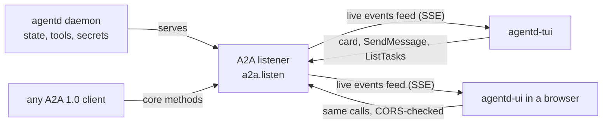

# Use the terminal and web UI

agentd ships two display clients: a terminal UI, `agentd-tui`, and a web UI,
`agentd-ui`. With either one you talk to a running agent, watch what it is
doing, answer the questions it asks and steer its runs and subagents. This
guide shows how to start a client beside the daemon with one command, attach
one to a daemon that is already running, sign in, and use the screens. It is
for anyone who talks to or operates a running agent, and it ends with the
client reference tables.

## How the clients work

The clients are thin. The daemon holds every conversation, task, run, tool and
secret; a client only renders what the daemon reports and forwards what you
type. Open the TUI, a browser tab and a colleague's browser at once and all
three show the same conversation, live, because each one watches the same
daemon. None of them holds any state of its own.

Nothing about them is privileged. Each one is an ordinary A2A 1.0 client of the
daemon's [A2A listener](a2a.md): it reads the Agent Card, uses an agentd
extension only when the card declares it, signs in the way the card says, and
falls back to core A2A when an extension is missing. The same clients drive any
A2A 1.0 agent, and any A2A client can do what they do
([Build a client](build-a-client.md)).



## Before you start

Install the clients. One npm package, `@agentd-dev/cli`, provides both
binaries and needs Node 20 or later:

```sh
npm install -g @agentd-dev/cli
```

The daemon needs an A2A listener. Two switches decide how much a client can
show: the events feed, which keeps the clients live, and introspection, which
serves transcripts, per-step run detail and the daemon's log. This
configuration is enough to follow along (save it as `desk.yaml`):

```yaml
agent:
  name: desk

intelligence:
  endpoints: ["https://api.openai.com/v1/chat/completions"]
  token: "{{secret:OPENAI_API_KEY}}"
  models:
    smart: { model: gpt-5.1 }
  model: smart

a2a:
  listen: http://127.0.0.1:8420
  events:
    enabled: true
  introspection:
    enabled: false
```

- **`a2a.events.enabled`** declares the events extension and serves the live
  feed. It takes effect on restart. Without it the clients still work, by
  [polling](#live-feed-and-polling).
- **`a2a.introspection.enabled`** serves the reads that expose content and
  internals ([Debug](#debug)). It is reloadable, and an operator can turn it
  on at runtime with `/set a2a.introspection.enabled true`.

On a loopback listener with no credential configured, any local process that
presents none (a browser excepted) is the operator, and the daemon says so at
load with a `config.warning`. That is the right posture for a laptop. For
anything else, configure a credential; [Signing in](#signing-in) shows how
each client then gets in.

> **Note.** To try the clients without a model provider, set
> `intelligence.endpoints: ["mock:final"]` and drop the `token`, `models` and
> `model` keys. `mock:final` is agentd's built-in test endpoint: it answers
> every turn with a fixed reply. The release binaries and the container image
> include it.

## Launcher

Start the daemon and one display client as a single command:

```sh
agentd tui -c desk.yaml
```

```sh
agentd ui -c desk.yaml
```

```sh
agentd ui -c desk.yaml --port 4180 --no-open
```

The first starts the daemon and the terminal UI. The second starts the daemon
and the web UI, and opens it signed in. The third serves the web UI on another
port and prints the sign-in URL instead of opening a browser. Before anything
else, the launcher prints where the client connects and where the daemon's
log goes:

```
agentd tui: endpoint http://127.0.0.1:8420 · daemon logs → /run/user/1000/agentd-tui-903989.log
```

**The daemon runs exactly as `agentd <args>` would.** The launcher adds no
configuration key, flag or environment variable, and turns nothing on: the
feed needs `a2a.events.enabled` in your configuration, and the debug screen
`a2a.introspection.enabled`, as they would without the launcher. Every
argument that is not one of the launcher's own goes to the daemon, which
refuses one it does not know the way it always does (`unknown argument:
<flag>`, exit 2). Asks such as `--help` and `--validate-config` run without
the subcommand.

The launcher's own flags:

| Flag | Subcommand | Meaning |
|---|---|---|
| `--daemon-log PATH` | both | where the daemon's output goes (default below) |
| `--port N` | `ui` | the loopback port the web UI is served on; default 4173, `0` picks a free one |
| `--no-open` | `ui` | print the sign-in URL on the terminal instead of opening a browser |

**The client.** `agentd tui` starts `agentd-tui` from `PATH`, or the binary
`AGENTD_TUI_BIN` names. `agentd ui` starts `agentd-ui`, or `AGENTD_UI_BIN`. A
client that cannot be started stops the launch (exit 1) with a message that
names the override variable and links here. The client gets exactly this argv
and never a credential:

| Subcommand | Client argv |
|---|---|
| `tui` | `--endpoint <url> --launch-fd 3`: fd 3 is a pipe holding the TUI's launch code |
| `ui` | `--endpoint <url> --listen-fd 3`: fd 3 is the socket the launcher bound on `127.0.0.1:<port>` |

**The endpoint** is `a2a.url`, or else the concrete bind: the URL the card
advertises, so an https certificate matches the name the client dials. The
launcher refuses, with exit 2 and before anything is spawned, a listener its
clients could not use. Each refusal names its cause and suggests running the
daemon with `agentd -c …` and the client with `agentd-<sub> --endpoint <url>`:

- **no `a2a.listen`, or a unix socket.** The display clients dial http(s).
- **a port of `0`.** The endpoint has to name a fixed port. The configuration
  loader already refuses `:0` in `a2a.listen`.
- **`a2a.tls.client_ca`.** The display clients present no client
  certificate, so the TLS handshake would fail before a launch code could be
  redeemed.
- **a wildcard bind without `a2a.url`.** It names no host a client can dial.
- **an endpoint whose host is not loopback** (127.0.0.0/8, `::1`,
  `localhost`). The launch code is redeemed only from a loopback peer. A
  remote daemon's console signs in with `agentd-tui --endpoint … --login`
  ([Attach to a running daemon](#attach-to-a-running-daemon)).

**The terminal and the log.** An interactive client and a daemon that writes
JSON lines cannot share a terminal, so the daemon's output goes to
`--daemon-log`, by default `$XDG_RUNTIME_DIR/agentd-<sub>-<pid>.log`, else the
same name in the temp directory. The file is created new with mode 0600 and
without following a symlink: a file or link already at that path is refused
rather than written through. `agentd-tui` gets the terminal on stdin, stdout
and stderr. `agentd-ui` gets stdout and stderr, and its stdin is `/dev/null`,
because the launcher keeps the terminal's input for
[signing browser tabs in](#a-tab-that-asks-the-terminal).

**Lifetimes are tied.** Quitting the client drains the daemon. The daemon
exiting sends the client SIGTERM, then SIGKILL after 3 seconds.

**What the client inherits.** The client's environment is the launcher's own
minus every variable the configuration loader reads (including the ones that
set `a2a.bearer`), minus every `NAME` a `{{secret:NAME}}` reference in the
loaded settings names, and minus `AGENTD_BEARER`. Nothing is added. The
promise is narrow on purpose: the client never receives `a2a.bearer` or a
resolved configuration secret. Credentials read by code other than the loader,
such as the `AWS_*` chain an endpoint's SigV4 signing uses, pass through, and
a process running as the same user can read the launcher's environment
anyway. Every descriptor the launcher opens is close-on-exec, so nothing the
daemon spawns inherits the terminal, the pipe or the UI's socket. The threat
model is in [Security model](security.md).

### How the launched client signs in

The client gets a single-use **launch code**, minted inside the daemon's own
process. No op, route or configuration key can mint one. The client redeems it
at `/oauth2/token` with the extension grant type
`https://agentd.dev/oauth/grant-type/launch` for an **operator session**: it
acts for the person who ran the command, on a daemon they started from their
own configuration. A code lives 60 seconds and is spent by its first
presentation. It is bound to its client (`client_id` `agentd-tui` or
`agentd-ui`) and, for the web UI, to the launched page's origin, and it is
redeemed only from a loopback peer. The card does not declare the grant, and
it changes nothing about who else may connect.

- **`agentd tui`** always hands its client a code on the pipe at fd 3,
  whatever the listener's posture. The TUI reads it, closes the descriptor and
  exchanges it once. The session lives only in the TUI's memory and has no
  expiry of its own, so a reload that later adds principals does not strand
  the console. It ends when it is revoked or when the launcher exits. A refused
  code stops the TUI with *"the launch code was refused (already used or
  expired): restart `agentd tui`"*.
- **`agentd ui`** binds `127.0.0.1:<port>` itself and hands the socket to
  `agentd-ui`, so no other local process can hold the port the browser is sent
  to. That page's origin, `http://127.0.0.1:<port>`, is the one origin the
  daemon admits without listing it in `a2a.cors.origins`, and only for that
  launch. The code travels only in a URL fragment (`#launch=<code>`), which a
  browser never sends over HTTP. The fragment sits in a 0600 launch file in a
  fresh 0700 directory under `$HOME` (`agentd-launch-XXXXXX`, readable by a
  snap-confined browser; `$XDG_RUNTIME_DIR` when `$HOME` is unset). The
  launcher opens that file with `xdg-open` (`open` on macOS), passing the
  file's path, never the URL. The file is deleted when the code is spent,
  after 60 seconds, and at exit. The page strips the fragment before its
  first request and keeps the session, eight hours long, in the tab's
  `sessionStorage`.
- **With `--no-open`**, or when the opener fails, the full URL is printed on
  the launcher's terminal and never in the daemon log:

  ```
  agentd ui: sign in by opening http://127.0.0.1:4173/#launch=agentd_lc_…
    (it works once, within 60s; over SSH forward the same port: ssh -L 4173:127.0.0.1:4173 …)
    after that, a tab that asks is signed in here: type the code it shows
  ```

### A tab that asks the terminal

Every later browser tab of `agentd ui` signs in through the launcher's
terminal: a sandboxed browser (snap or flatpak) that cannot read the launch
file, an SSH forward, a `--no-open` URL opened after its 60 seconds, a second
tab, or a tab whose eight hours ran out. Nothing needs a restart.

The page asks the daemon for a sign-in and shows a short code:

```
Type this code in the terminal that runs `agentd ui`: BCDF-GHJK
```

The launcher's terminal asks for it:

```
A browser tab asks to sign in to agentd: type the code it shows (Enter to skip)
```

Typing the code there (case and the dash do not matter) signs in exactly that
tab and prints `agentd ui: signed in`. Anything else approves nothing and
prints `agentd ui: no tab is showing that code`. A request lives two minutes,
and the page asks for a fresh code by itself when one lapses; at most 16 wait
at once. The terminal is the trust anchor: another web origin cannot start a
request, and another local process can start one but cannot make you type its
code. The prompt stops when the terminal's input ends.

**Over SSH**, forward the same port on both ends,
`ssh -L 4173:127.0.0.1:4173 host`, because the code is bound to the page's
origin, port included. The forwarded connection arrives from the remote
host's loopback, where it may be redeemed.

> **Limit.** A daemon with no operator credential (no `a2a.bearer` and no
> operator `bearer_ref` rule) cannot offer the device grant, because nobody
> could approve a code. On such a daemon a browser signs in only through
> `agentd ui`.

## Attach to a running daemon

Run the daemon on its own and attach clients whenever you like, several at
once. On a loopback daemon with no credential, the TUI attaches as the
operator with no sign-in:

```sh
agentd -c desk.yaml
```

```sh
agentd-tui --endpoint http://127.0.0.1:8420
```

`--endpoint` names where the agent's card is, not where JSON-RPC goes: a base
URL finds the card at its origin's `/.well-known/agent-card.json`, and the
card says which interface to call. A card the client can never use (no
JSON-RPC A2A 1.0 interface over http(s), a `required` extension it does not
know, or only sign-in methods it cannot perform) stops it with the reason.

**A local web UI started by hand** is a page like any other to the daemon.
`agentd-ui` serves the web app on `127.0.0.1:4173` and names the endpoint to
the page. It holds no credential and reads none from its environment or a URL,
so the tab signs itself in, which needs two things from the daemon: the page's
origin listed in `a2a.cors.origins`, and the device grant, which in turn needs
an operator credential to approve with. A daemon configured for it:

```yaml
intelligence:
  endpoints: ["https://api.openai.com/v1/chat/completions"]
  token: "{{secret:OPENAI_API_KEY}}"
  models:
    smart: { model: gpt-5.1 }
  model: smart

a2a:
  listen: http://127.0.0.1:8420
  bearer: "{{secret:AGENTD_OPERATOR_TOKEN}}"
  events:
    enabled: true
  cors:
    origins: ["http://127.0.0.1:4173"]
  device_grant:
    enabled: true
```

```sh
agentd-ui --endpoint http://127.0.0.1:8420 --open
```

The page shows a code. An operator approves it with `/approve <code> <name>`
from a TUI signed in as the operator, for example one started with
`agentd-tui --endpoint http://127.0.0.1:8420 --bearer-file <path>` where the
file holds the operator token ([Signing in](#signing-in)). The page also
takes `?endpoint=…`, which fills in the connect form and waits for you to
connect, and it remembers the last endpoint.

**A remote daemon** is the same `--endpoint https://…` plus a sign-in:

```sh
agentd-tui --endpoint https://agent.example.com:8443 --login
```

What a client may see or do is decided by the daemon's principal rules, never
by the client. To reach a daemon that listens only on the remote host's
loopback, forward its port over SSH and point the client at the forwarded
port. Serving the web UI from your own domain is
[Host the web UI](hosting-the-ui.md).

**Fullscreen or inline.** The TUI takes over the terminal (the alternate
screen, like `vim`), so the layout is stable and your shell comes back
untouched when you quit. The alternate screen has no scrollback, so the TUI
keeps its own: PgUp and PgDn scroll the conversation, a hint shows how many
messages are above, and new messages follow the live end unless you scrolled
up. `agentd-tui --inline` (or `AGENTD_TUI_INLINE=1`) renders into the normal
buffer instead, so settled messages stay in your terminal's real scrollback
after you quit. A non-interactive run (a pipe, CI) is inline automatically.

## Signing in

The card's security declarations say how a client gets in, and the clients
follow them:

| The daemon offers | `agentd-tui` | `agentd-ui` |
|---|---|---|
| Nothing (a loopback listener, http or https, with no credential) | connects with no credential and is the implicit operator; it never sends an `Origin` header | signs in anyway: a request carrying `Origin` always authenticates, so a browser is never the implicit operator |
| The device grant (`a2a.device_grant`) | `--login` (or plain `agentd-tui` on a terminal when the card offers no anonymous way in) prints a URL and a code and waits; `/login [user\|operator]` does the same from inside | the connect screen's **sign in** button, with the scope to ask for when the grant offers more than one |
| A bearer token | `--bearer-file PATH`, or `AGENTD_BEARER` | not supported: the web UI takes no bearer |
| The launcher | the launch code on fd 3 | the launch code in the URL fragment, or a code typed at the launcher's terminal |

The TUI's device prompt reads:

```
To sign in, open http://127.0.0.1:8420/oauth2/device and enter BCDF-GHJK,
or ask an operator to run: /approve BCDF-GHJK <name>
waiting for approval…
```

The TUI takes one credential at a time: two sources given together are
refused rather than ranked, and `--launch-fd` combines with none. A token is
never a command-line argument, since every local user can read argv through
`ps`.

**Approve a device.** An operator runs `/devices` to see what waits, then
`/approve <code> <name>` and confirms it (`y` in the TUI), or `/deny <code>`
(`/deny all`). Append `operator` to approve an operator session, which
`a2a.device_grant.scopes` must allow. The **name** (lowercase letters, digits,
`.`, `_`, `-`) is who the device signs in as: the session acts as
`user:<name>`, and every session approved under one name is one principal.
Those sessions share the name's tasks, runs, subagents and conversations, its
status scope and its rate limit, so a person keeps their work across signing
in again and token expiry. Reusing a name for a different person hands them
that name's history; the approval says so, and the client adds `<name> signed
in before: this device shares every task, run and conversation that name
owns`. Reserved names (`operator`, …) and configured principal ids are
refused.

**Sessions and revocation.** `/sessions` lists the signed-in sessions by id
(`ds_…` for a device, `ls_…` for a launch). `/revoke <sid>` ends one,
`/revoke name <name>` every session of a name, and `/revoke all` all of them.
Revoking one session leaves the name's other sessions working and never
deletes what the principal owns. A revoked client's streams close within a
tenth of a second.

**Where a credential lives.**

- **The TUI** keeps it in memory only. A device session lasts
  `a2a.device_grant.token_ttl` (8 hours by default). There are no refresh
  tokens, so the TUI warns a minute before expiry and then asks you to
  `/login` again. `/logout` revokes the session at the daemon and forgets it.
- **The browser** keeps it in `sessionStorage` only (`agentd-ui.cred`), bound
  to the endpoint it was issued for: one tab, one visit, gone when the tab
  closes. `localStorage` holds only the last endpoint (`agentd-ui`) and your
  layout (`agentd.layout`). No credential is ever read from or written to a
  URL's query string. An expired or revoked session sends the tab back to
  sign in, and `/disconnect` revokes the session and clears it.

The listener side of all this (principals, scopes, the device grant's
settings) is [The A2A channel](a2a.md); the threat model is
[Security model](security.md).

## Talk to the agent

Four screens cycle with `Tab`: chat, tasks, subagents and debug. `/chat`,
`/tasks`, `/subagents` and `/debug` jump straight to one. The debug screen is
there only while the daemon offers introspection. The web UI has the same
four as tabs.

The frames below are the shipped TUI, rendered against daemon-shaped events
and captured by `interface/tools/frames.mjs`. They regenerate from the code,
so they show what the client draws.

```tui
# agentd tui — chat
agentd 1.19.0 triage-1 debug
▌  Triage the newest issue
⠋ working
╭──────────────────────────────────────────────────────────────────────────────────────────────────╮
│ ›                                                                                                │
╰──────────────────────────────────────────────────────────────────────────────────────────────────╯
● live http://127.0.0.1:8420 1 active [chat] tab:screens esc:cancel /:cmd ^c:quit
```

The transcript shows every attached client's prompts (labelled by principal
when they are not yours), command invocations and replies, so two people
watching one agent see the same conversation. Your prompt appears at once and
is reconciled with the daemon's copy when the task's history carries it.
`Esc` cancels the newest working task.

**The working row** under the transcript says what the daemon is doing:
`⣾ thinking · 12s · 1.2k tok · round 2`, `⣾ read_file · 3s · 1.2k tok`,
`⣾ waiting · subagent · 40s`. The daemon reports a change of phase, tool,
round or tokens; the elapsed time ticks in the client, so a long think costs
no traffic. This is deliberately not token-by-token streaming: one small event
per change keeps every attached client in sync at a fixed cost, where a token
stream would multiply the daemon's outbound traffic by the number of
watchers.

**The composer** reads four prefixes, with suggestions as you type (`Tab`
accepts one):

- `/` runs a [slash command](#slash-commands), and every workflow is a
  shortcut too: `/deploy` runs the `deploy` workflow (built-in names win). A
  command that sends an op is offered only while the card lists that op for
  you, so `/help` shows what this agent lets you do.
- `@` completes a **skill** from the daemon's catalogue, such as
  `@skill:release-notes`. The completion inserts the full reference
  (`skills.reference_prefix`, default `@skill:`, published in the `status`
  document) because that is what the daemon preloads on. A bare `@name` is
  ordinary text.
- `#` at the start of a message **targets** a task or a conversation:
  `#task-…` answers or continues that task, and `#<id>` addresses that
  conversation. A `#` later in the text is plain text.
- `$` interpolates a **live value**: `$name $model $instance $version $turns
  $tokens $tasks`. `$$` is a literal dollar.

## Answer questions and approvals

When the agent, or a workflow's `human` step, needs a person, the task stops
at input-required and the transcript shows the question as an answerable row
marked `⏎ reply to continue`. Type your answer; it goes to the newest open
question. An older open question is marked `⏎ answer with #<task> <reply>`:
start your message with that `#<task>` to answer it. When the question
declares an answer schema with a fixed set of choices, both clients offer the
choices: in the TUI, with an empty composer, a number key picks an option
and `Enter` sends it.

- **Gates survive restarts.** A gate on a workflow run keeps its addressee and
  answer schema across a daemon restart.
- **An addressed gate is for one decider.** A gate that names someone in
  `to:` refuses a reply from anyone else, says why, and stays open. An
  operator who answers it is recorded as an override, not as the addressee.
- **When nobody can answer** is a daemon policy, not a client setting:
  `agent.ask_human_fallback` (`fail` by default, `wait`, or `auto`). With
  `auto`, a judge running on the model bound to `roles.approve` answers on the
  operator's behalf, and the answer is marked as automatic. The judge never
  answers an ask that carries outside input (the daemon logs
  `human.judge.withheld`), and never an addressed gate. The details are in
  [Human in the loop](human-in-the-loop.md) and
  [Choose models for each job](models-and-roles-guide.md).

## Watch tasks and subagents

The **tasks** screen lists every task your principal may see, with live
states. `↑` and `↓` select, `Enter` shows one in the chat, and `c` cancels it.

A **subagent** is a real child process the supervisor owns. The subagents
screen lists them live:

```tui
# agentd tui — subagents
agentd 1.19.0 triage-1 debug
  handle               mode        status      tokens   updated
▸ sa-review            supervised  running     4120     0s
  sa-lint              detached    failed      260      0s
↑/↓ select · enter details · tab next screen
● live http://127.0.0.1:8420 [subagents] tab:screens esc:cancel /:cmd ^c:quit
```

`↑` and `↓` select, `Enter` opens one. The detail view is where the controls
are:

```tui
# agentd tui — subagent detail
agentd 1.19.0 triage-1 debug
subagent sa-review
status        running
mode          supervised
attempt       1
tokens        4120
instruction   Review the diff for correctness regressions and report findings.
requested_by  operator
m message · k stop · esc/backspace back · tab next screen
● live http://127.0.0.1:8420 [subagents] tab:screens esc:cancel /:cmd ^c:quit
```

- **`m` messages it.** The composer opens addressed to this subagent
  (`/send <handle> `), so you do not retype the handle. Only a warm subagent
  can take a message; the view says so when it cannot.
- **`k` stops it.** The supervisor owns the process group, so this is a real
  kill rather than a request the child can decline. It asks first, because a
  stop cannot be undone:

```tui
# agentd tui — confirming a stop
agentd 1.19.0 triage-1 debug
subagent sa-review
status        running
mode          supervised
attempt       1
tokens        4120
instruction   Review the diff for correctness regressions and report findings.
requested_by  operator
stop sa-review? y to confirm, any other key to cancel
● live http://127.0.0.1:8420 [subagents] tab:screens esc:cancel /:cmd ^c:quit
```

`instruction` and `result` need introspection. Without it the view shows the
summary the feed carries and says which fields are missing and why. The web
UI shows the same with a list-and-detail split, so the siblings stay in view
while you read one child.

## Steer runs and the daemon

These commands act on the running daemon. Each one that sends an op is
offered only while the card lists that op for you
([Slash commands](#slash-commands) names them):

- `/workflow <name>` starts a workflow; `/cancel [task]` cancels a task (the
  newest when none is named).
- `/signal <name> [run]` fires a workflow signal, which resumes a step waiting
  on it.
- `/send <handle> <text>` messages a warm subagent.
- `/pause [run]` and `/resume [run]` hold and release one run, or the whole
  instance. A pause is reversible: intake continues and execution parks at a
  safe boundary, and the status bar shows **PAUSED**.
- `/plan` reads a conversation's working plan.
- `/drain` drains the daemon gracefully; it then exits 0.

### Change a setting at runtime

`/set <path> <value>` sends `admin.set`, an operator op. It changes exactly
the paths the card lists as settable, in the running daemon, until the next
reload:

- `/set a2a.introspection.enabled true` opens the debug surface (and `false`
  closes it).
- `/set agent.approval ask|auto|accept` sets how closely you are asked: `ask`
  asks a person; `auto` lets the `roles.approve` judge decide, with the same
  limits as above; `accept` takes the answer the question recommends, and
  falls through to the judge when it recommends none.

Any other path is refused with the list of settable ones. Everything else
belongs in the configuration file and a reload
([How configuration works](configuration-model.md)); the daemon never writes
its configuration. `/config` prints the effective configuration with
credentials redacted, and `/config a2a.listen` prints one value.

## Debug

Introspection is a daemon-side switch:

```yaml
# fragment: under a2a:
introspection:
  enabled: true
```

The clients learn it from the extended card or from the feed's opening frame,
and only then show the debug screen and the `debug` badge. It serves:

- the **feed tail**, with `audit` records among the events;
- **runs** with per-step detail: status, attempts, timings, errors, waits and
  outputs;
- **conversation transcripts** with message bodies, the read that exposes
  content, which is why it rides this switch;
- **subagent detail**: the instruction and the result;
- the **live log ring**: the daemon's own JSON-lines telemetry, tailed in the
  client.

```tui
# agentd tui — debug
agentd 1.19.0 triage-1 debug
feed
    1 run           {"id":"pipeline-01M0C0","workflow":"pipeline","status":"running","steps":"3/7"}
    2 step          {"run":"pipeline-01M0C0","step":"fetch","kind":"mcp.tool","phase":"start"}
    3 step          {"run":"pipeline-01M0C0","step":"triage","kind":"extract","phase":"start","atte…
    4 step          {"run":"pipeline-01M0C0","step":"notify","kind":"a2a.send","phase":"start"}
    5 step          {"run":"pipeline-01M0C0","step":"fetch","phase":"done","status":"done","tokens"…
    6 step          {"run":"pipeline-01M0C0","step":"triage","phase":"done","status":"done","tokens…
    7 subagent      {"handle":"sa-review","mode":"supervised","status":"running","tokens":4120,"upd…
    8 subagent      {"handle":"sa-lint","mode":"detached","status":"failed","tokens":260,"updated":…
runs
pipeline-01M0C0        running    3/7
  ◐ notify            a2a.send      running
  ● triage            extract       done      1.0s
  ● fetch             mcp.tool      done      140ms
subagents / children
sub sa-review          running    4120 tok
sub sa-lint            failed     260 tok
log (debug.events)
—
● live http://127.0.0.1:8420 [debug] tab:screens esc:cancel /:cmd ^c:quit
```

Under `runs`, each run lists its steps: `◐` running, `●` done, `○` pruned (a
branch nobody took), `◌` waiting, `✗` failed. A stuck run shows the step it
is stuck on. A caller reads the conversations, runs and subagents it owns (an
operator reads all of them); the log ring and the audit records are the
operator's alone.

> **Warning.** Introspection exposes conversation content and internals to
> every caller that may read them. Leave it off in production unless you need
> it, and turn it on for a session with `/set`.

## Customize the status line

The header and the status bar belong to the client: half of what they show
(the connection, the endpoint, the screen, the keys, the clock) is client
state no daemon knows. Each client has a default, and you reshape it locally:

- **TUI:** `--top` and `--bottom` (or `AGENTD_TUI_TOP` and
  `AGENTD_TUI_BOTTOM`) take comma-separated [items](#status-line-items):
  `agentd-tui --bottom conn,model,tokens,clock`. An unknown item is refused
  with the list of known ones.
- **Both:** `/layout` shows the current edges and every item.
  `/layout top|bottom <items,…>` reshapes one edge and `/layout reset`
  restores the default. The TUI's change lasts for the session; the web UI
  remembers its layout in `localStorage`.

### Show values a workflow maintains

A `memory:<key>` item shows whatever a workflow wrote to that memory key,
which makes the status line extensible without the daemon computing anything
new. The operator chooses which keys the daemon publishes with
`observability.status_values`, and the `status` document carries them. This
daemon publishes the current branch and pull request, read every 30 seconds
from a git MCP server:

```yaml
intelligence:
  endpoints: ["https://api.openai.com/v1/chat/completions"]
  token: "{{secret:OPENAI_API_KEY}}"
  models:
    smart: { model: gpt-5.1 }
  model: smart

mcp:
  servers:
    - name: git
      endpoint: https://mcp-git.example.com/mcp

a2a:
  listen: http://127.0.0.1:8420
  events:
    enabled: true

observability:
  status_values: [git.branch, git.pr]

workflows:
  - name: repo-status
    steps:
      tick:   { kind: schedule, every: 30s }
      read:   { kind: mcp.tool, depends_on: [tick], server: git, tool: status }
      branch: { kind: memory.set, depends_on: [read], key: git.branch,
                value: "{{ steps.read.output.branch }}", ttl: 2m }
      pr:     { kind: memory.set, depends_on: [read], key: git.pr,
                value: "{{ steps.read.output.pr }}", ttl: 2m }
      fin:    { kind: finish, depends_on: [branch, pr], status: completed }
```

```sh
agentd-tui --endpoint http://127.0.0.1:8420 --top name,model,memory:git.branch,memory:git.pr
```

agentd runs no local commands by default, so it cannot ask `git` for your
branch. It does not need to: a workflow reads the value from wherever it lives
(an MCP server, an HTTP endpoint, a webhook) and writes it to a published key.
Two behaviours are deliberate:

- **An unset key shows nothing**, not an empty slot. A blank reads as broken;
  an absent item reads as not yet filled.
- **TTL is honoured.** Give the key a TTL a little longer than the schedule
  that refreshes it, and the item empties when the workflow stops. A branch
  name that outlived its producer looks current, which is worse than no
  branch name.

## Live feed and polling

The `conn` item says how the client is following the daemon:

- **`● live`**: the card declares the events extension. The client
  bootstraps (the `status` read when the card offers it, and every task it may
  see), then holds the feed. After a daemon restart, or when the client fell
  further behind than the feed's replay window of 1024 events, the feed says
  so and the client bootstraps again rather than applying a partial replay.
- **`◐ polling`**: the card declares no events extension, you asked for core
  A2A (`agentd-tui --no-extensions`, or `?extensions=off` in the web UI's
  URL), or the agent does not serve the feed it declared. The client uses A2A
  core methods only: it lists tasks every 1.5 seconds and follows the moving
  ones with a task stream. This means the daemon serves no feed, not a bad
  network. With `--no-extensions` the client also sends no command, so only
  its own slash commands remain.

Both modes fold into the same state, so the screens look the same either way.

## When something is wrong

The `conn` item names the connection's state, and a stop says what would fix
it:

| `conn` | Meaning | The client |
|---|---|---|
| `○ connecting` | discovery or a reconnect in progress | waits |
| `● live` | holding the events feed | — |
| `◐ polling` | core mode | polls |
| `✗ unauthenticated` | the credential is missing, refused, expired or revoked | stops and names the fix (`/login`, `--bearer-file`, restart `agentd tui`) |
| `✗ forbidden` | this principal may not observe this agent | stops; an operator can grant it |
| `✗ incompatible` | the agent speaks nothing this client can use: not A2A 1.0, no usable interface, or a required extension it does not know | stops; check `--endpoint` |
| `✗ <error>` | a network failure, a 5xx, a rate limit, a draining daemon | retries, after `Retry-After` when the agent sends one, else with backoff |
| `○ closed` | the client stopped observing (you signed out) | — |

The three stops are never retried: signing in again, or pointing the client at
another agent, is what fixes them. A slash command the card does not list for
you is not sent; the client says the agent does not offer it. A command the
agent refuses shows the agent's words and code in the transcript.

A browser cannot tell a CORS refusal from a dead network, so the web UI names
the likelier fix: list its origin in `a2a.cors.origins`. Its connect screen
shows the snippet with the page's real origin filled in.

## Reference

### `agentd-tui`

| Flag | Environment | Meaning |
|---|---|---|
| `--endpoint`, `-e URL` | `AGENTD_ENDPOINT` | the agent: its base URL or its card's URL |
| `--bearer-file PATH` | `AGENTD_BEARER` | a bearer token, read from a file (the variable is read, then deleted from the process's environment) |
| `--login [--scope user\|operator]` | | sign in with the device grant the card offers |
| `--launch-fd N` | | the launcher's sign-in; not for hand use |
| `--no-extensions` | | speak core A2A only |
| `--top`, `--bottom items` | `AGENTD_TUI_TOP`, `AGENTD_TUI_BOTTOM` | the status line items |
| `--debug` | | open on the debug screen (shown only while the daemon offers introspection) |
| `--inline` | `AGENTD_TUI_INLINE=1` | render into the scrollback instead of fullscreen |
| `--insecure` | `AGENTD_INSECURE=1` | skip TLS verification (a self-signed development daemon only) |

An unknown option exits 2 with `unknown option "<flag>" — see --help`,
echoing only what comes before an `=`, so a value typed by mistake is not
printed back.

### `agentd-ui`

| Flag | Environment | Meaning |
|---|---|---|
| `--endpoint URL` | `AGENTD_ENDPOINT` | the daemon the page connects to |
| `--port N` | | the loopback port to serve on; default 4173 |
| `--listen-fd N` | | serve on an inherited listening socket (the launcher's); exclusive with `--port` |
| `--open` | | open the page in a browser |

The web UI's URL takes `?endpoint=…` (fills in the connect form) and
`?extensions=off` (core A2A only). What the local server sends and refuses is
in [Host the web UI](hosting-the-ui.md).

### Slash commands

| Command | Does | Needs the op |
|---|---|---|
| `/help` | list the commands this agent offers you | |
| `/new` | start a fresh conversation | |
| `/chat`, `/tasks`, `/subagents`, `/debug` | switch screens | |
| `/status` | daemon status summary | `status` |
| `/config [path]` | the effective configuration, or one path | `config` |
| `/set <path> <value>` | set a runtime-settable path | `admin.set` |
| `/workflow <name>` | run a workflow | `workflow.run` |
| `/cancel [task]` | cancel a task (newest if none given) | |
| `/signal <name> [run]` | fire a workflow signal | `workflow.signal` |
| `/send <handle> <text>` | message a warm subagent | `subagent.send` |
| `/pause [run]`, `/resume [run]` | hold or release a run, or the instance | `admin.pause`, `admin.resume` |
| `/plan` | a conversation's working plan | `plan.get` |
| `/conversations` | list conversations (`#<id>` addresses one) | |
| `/devices` | device sign-ins waiting for approval | `auth.device.pending` |
| `/approve <code> <name> [operator]` | approve a device sign-in | `auth.device.approve` |
| `/deny <code>`, `/deny all` | refuse device sign-ins | `auth.device.deny` |
| `/sessions` | the signed-in sessions | `auth.sessions` |
| `/revoke <sid>`, `/revoke name <name>`, `/revoke all` | end sessions | `auth.sessions.revoke` |
| `/drain` | graceful drain | `admin.drain` |
| `/layout [top\|bottom <items>\|reset]` | the status line | |
| `/login [user\|operator]`, `/logout` | sign in, sign out | |
| `/disconnect` | sign out and clear the session (web UI) | |
| `/quit` | leave the client (TUI) | |
| `/<workflow>` | run that workflow | `workflow.run` |

The ops are the [command extension's](a2a-extensions.md); which of them a
caller may run is the daemon's decision.

### TUI keys

| Key | Where | Does |
|---|---|---|
| `Tab` | anywhere | next screen; accepts a suggestion while one is shown |
| `Esc` | chat | cancel the newest working task |
| `Esc`, `Backspace` | subagent detail | back to the list |
| `PgUp`, `PgDn` | chat, fullscreen | scroll the conversation |
| `↑`, `↓` | lists, suggestions | move the selection |
| `Enter` | lists | open the selection |
| `1`–`9` | chat, empty composer, a question with choices | pick a choice |
| `c` | tasks | cancel the selected task |
| `m`, `k` | subagent detail | message, stop |
| `y` | a confirmation | confirm; any other key cancels |
| `Ctrl-C` | anywhere | quit |

### Status line items

| Item | Shows |
|---|---|
| `name` | the agent's name, from its card |
| `version` | the daemon's build version |
| `instance` | the instance id |
| `model` | the model in use |
| `endpoint` | the endpoint this client talks to |
| `conn` | the connection state |
| `debug` | a badge while the daemon offers introspection |
| `draining` | **DRAINING** or **PAUSED** while the daemon is |
| `active` | how many units are working |
| `turns`, `tokens`, `tool_calls` | counters so far; in the operator's status only, and for anyone else they take no slot |
| `runs`, `subagents`, `conversations` | how many this client can see |
| `clock` | the local time |
| `screen`, `keys` | the current screen and the key hints (TUI only) |
| `memory:<key>` | a value a workflow keeps, when the operator publishes the key |

The TUI's default is `name,version,instance,debug` on top and
`conn,endpoint,draining,active,turns,tokens,screen,keys` at the bottom. The
web UI's is the same without `screen` and `keys`.

## Build the clients from source

```sh
cd interface
npm install
npm run build
npm test
npm run frames
```

`npm run build` builds the client core and the TUI, then the web bundle.
`npm test` runs the unit and render tests. `npm run frames` captures the frames
on this page from the shipped TUI again. The clients are not part of the Rust
workspace or its release binaries; the daemon has no Node dependency.

## Next steps

- [Host the web UI](hosting-the-ui.md) to serve the web UI from your own
  domain.
- [Human in the loop](human-in-the-loop.md) for the questions and approvals
  the clients answer.
- [Operate a running daemon](operations.md) for drain, pause and reload.
- [Build a client](build-a-client.md) to write your own client on the same
  calls.
