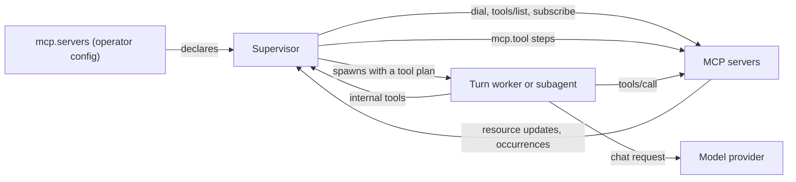
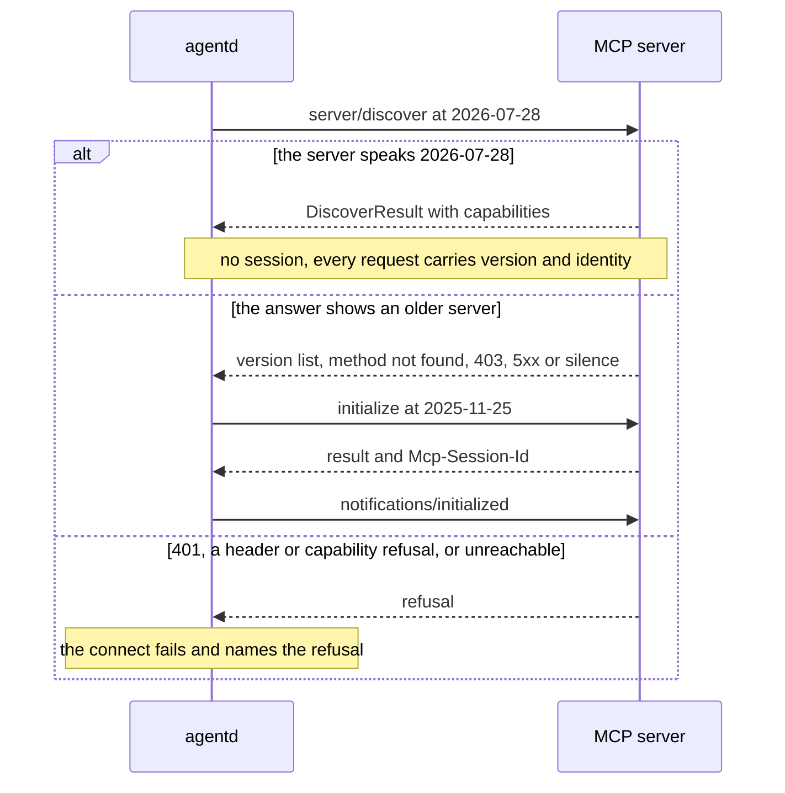
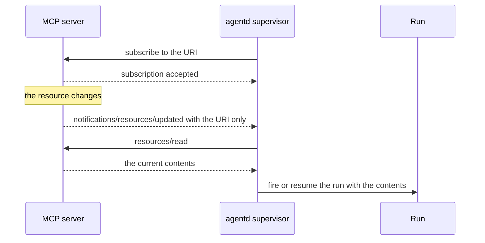
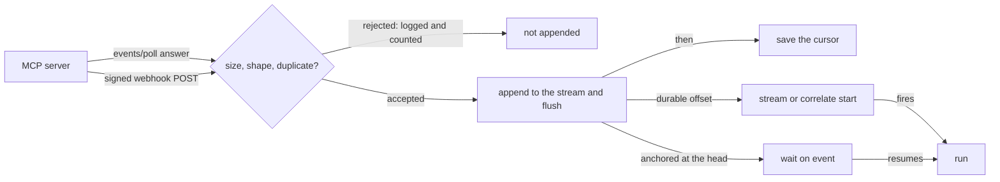

# MCP: tools and context

This page explains how agentd uses the Model Context Protocol (MCP): where an
agent's tools and context come from, how a connection is made, how tool
results and failures reach the model, and how agentd wakes when something
upstream changes. It is for reviewers and integrators who need the model
behind the configuration, and for builders who want to know why it behaves
as it does. The task guide is [Connect MCP servers](connect-mcp.md); the
exact revisions, limits and log events are in
[MCP support reference](mcp-reference.md).

## The action space is configuration

agentd ships no task tools. Reading a file, querying an API, searching the
web: each is a tool on an MCP server that you declare, reached over
Streamable HTTP. agentd starts no process for a server and runs no local code
for it. With no servers declared, the model has no tool that reaches outside
the instance. Workflow steps such as `http` and A2A delegation are separate
paths, written by the operator, not chosen by the model.

The tools agentd does ship act on the agent, never on the world:

| Family | Tools | Acts on |
|---|---|---|
| Work | `workflow.*`, `subagent.*`, `plan.*`, `message.send` | the instance's own runs, children, plan and conversations |
| State | `memory.*`, `artifact.*` | the instance's durable memory and the artifacts it delivers |
| Reasoning | `think`, `decide`, `context.compact`, `skills.*` | the agent's own model calls and context |
| Control | `ask_human`, `sleep`, `await`, `finish`, `status`, `instruction.*` | the agent's lifecycle and its operator |
| Events | `events.*` | subscriptions inside an operator's grant (offered only where a grant allows it) |
| Tasks | `mcp.task.get`, `mcp.task.cancel` | an MCP task one of the conversation's own tool calls became, still running when the call's time ran out |

Four families are contracts with no built-in implementation:
`knowledge.*`, `search.*` and `code.run` resolve only when you map them to a
server's tools, and `exec` runs a local command only in a build with the
`exec` feature and with `security.exec.enabled` set. The full list, with who
gets each tool, is in [MCP support reference](mcp-reference.md).

This is deliberate. Changing what an agent can do never means rebuilding
agentd, and a reviewer reads the agent's whole reach from its configuration:
the servers, their `allow` lists, and the tags that say what each can do.

## Where tools and context come from

Two kinds of process hold MCP connections, and only one of them runs an
agent loop.

The **supervisor** dials every declared server when it starts, lists its
tools, and builds the tool catalogue that every turn is planned from. It
holds the subscriptions and event bindings, so a wake reaches the process
that owns the durable state. It also runs a workflow's `mcp.tool` and
`mcp.resource` steps. It runs no agent loop, so no model chooses what it
calls.

A **turn worker** (one conversation turn or one `agent` step) and a
**subagent** are child processes. Each dials the servers its tools route to,
calls the model, and calls those tools itself. A tool of agentd's own, such
as `memory.set`, is sent back to the supervisor, which owns the state it
changes. [Architecture](architecture.md) shows the whole process tree.

Each tool a server advertises is registered under its own name, or under
`<server>.<tool>` when another tool already has that name, or `<ns>.<tool>`
when the server sets a namespace. Every call carries agentd's correlation
data in `_meta`: the run id, the instance and, where a retry may repeat the
call, an idempotency key. A backing service uses it to attribute a call and
to drop a duplicate. Every request, a call or any other, carries the W3C
trace context of the unit of work it is made for in `_meta.traceparent`,
under a span of its own. What a connection asks for itself — its handshake,
the lists that keep the catalogue, subscriptions — carries the process
trace.

## How a connection starts

Every connection starts with `server/discover`, the first request of MCP
2026-07-28. That revision has no handshake and no session: each request
carries the protocol version, the client's identity and its capabilities in
`_meta`. A server that predates it is reached through the `initialize`
handshake of 2025-11-25.

The fallback is broad on purpose: every server that answers `initialize`
must keep being reached. Only a few answers end the attempt: one that
proves the server is modern but unwilling, a version list with nothing
agentd can offer, a `401` challenge (which an operator answers with
`agentd --login`), or no answer from a server that was never reached. A
re-dial, and a worker's dial, start the way the server was reached last
time, so an older server costs one extra request only on the first dial.

The server's capabilities belong to the connection, exactly as the server
sent them. agentd uses them to refuse calls whose silence would look like
success: it never subscribes on a server that did not advertise resource
subscriptions, and says so loudly instead of leaving a watch that never
fires.

A server that fails to connect is logged and left out of the catalogue; the
rest of the instance runs without its tools, and agentd dials it again in
the background until it joins. Two servers are the exception, because
agentd cannot start correctly without them: the one backing an MCP store,
and the one serving the instruction. If either does not answer at startup,
agentd exits.

## What a server may ask of agentd

A client declares a capability only when it intends to serve it. agentd
serves one: **elicitation**, a server asking a person for a value before it
can continue.

- A connection held by a turn worker or a subagent declares elicitation.
  The supervisor's own connections declare nothing.
- A server's question becomes an `ask_human` gate, shown in every attached
  terminal and web client.
- The answer is shaped to the schema the server asked for. One that cannot
  be made to conform, or that nobody gives within 300 seconds, goes back to
  the server as `cancel`.
- At 2026-07-28 the question arrives inside the tool call's answer, and
  agentd calls the tool again with the person's answer.

agentd offers no `roots` or `sampling`. A server request with no declared
capability behind it is dropped, not answered. There is no `roots/list` to
reveal a filesystem layout, and no `sampling/createMessage` that would turn
the agent's model into someone else's. Apart from elicitation, agentd only
reads notifications from a server.

A server may also answer a long tool call with an MCP task, which agentd
follows until the work ends: a workflow step waits for it durably, and a
model follows one still running with `mcp.task.get`. A task's questions are
the same questions an elicitation asks, put to a person the same way, and
only where an elicitation could be. [Connect MCP servers](connect-mcp.md#long-running-tool-calls)
has the details.

## Results and errors

MCP has two ways for a tool call to go wrong, and agentd keeps them apart:

| Wire shape | Meaning | In a turn or a subagent | In an `mcp.tool` step |
|---|---|---|---|
| `result.isError: true` | The tool ran and reported a failure; the JSON-RPC response itself succeeded | The tool's own content goes to the model as the result, marked as an error | The step fails, with the content as its output |
| a JSON-RPC `error` | A protocol or transport fault: an unknown tool, bad parameters, a crashed server | The model gets `tool transport error:` and the fault, marked as an error | The step fails as a transport error |

The model can therefore tell "the tool said the file does not exist" from
"the call never reached a tool". The first is information to reason about.
The second is a fault in the wiring that no change of arguments fixes, and
an agent that confuses the two invents workarounds for problems only an
operator can solve. A failed step follows its `retry` and `on_error`
policy either way.

In a turn, a tool result is kept structured when the server gives one:
`structuredContent` first, then text that parses as JSON, then text. A slow
or silent server cannot hang a run. The call fails at its bound, the failure
becomes an observation, and the run carries on.

## Context: awareness and attention

Resources are the context a server offers, as opposed to the actions it
offers. agentd separates knowing that a resource exists from reading it:

- **Awareness** is `resources/list`: URIs and short labels, never bodies.
  In a subagent's loop agentd lists its servers' resources, at most 50
  URIs with the first server to list a URI winning, as a note in the prompt.
- **Attention** is `resources/read`: the body, fetched only when wanted.
  The subagent gets a `resource.read` tool when there is something to read,
  and a workflow reads with an `mcp.resource` step.

A large resource therefore enters the context only when the model or the
workflow asks for it. Prompts are used the same way: for a server named
under `skills.sources`, agentd reads its prompts, and its resources marked
as skills, into a catalogue of names and descriptions, and loads a body only
when it is referenced.

## Notify-then-read

agentd wakes on external change through resource subscriptions. The
property that shapes everything is that **the update notification carries
no content**: it says only that a URI changed.

So agentd reads the resource again on every wake. The read can race a
second update, and an update can be delivered twice. The contract is
**at-least-once delivery, and convergence by reading the current state**: a
run acts on the resource's current contents, so a repeated wake is harmless.

Subscriptions are owned by what wants them, not by the connection: a
`subscribe` start, a parked `wait {on: resource}`, the instruction. agentd
restores them from those owners whenever the connection changes:

- after a restart of agentd, after a reload, and when a server that was
  down at startup joins;
- after the server restarts and forgets its session (on a 2025-11-25
  connection agentd re-dials and logs `mcp.disconnect` with
  `reason: session_lost`);
- after a 2026-07-28 listen stream ends: agentd listens again and reads
  every URI it holds, so a URI that changed in the gap gets one update.
  Changes inside one gap are coalesced, and a change reverted inside the
  gap is not delivered.

The two revisions carry subscriptions differently, and agentd hides the
difference:

| | 2025-11-25 | 2026-07-28 |
|---|---|---|
| Subscribe to one item | `resources/subscribe` per URI | the URI in the connection's one `subscriptions/listen` filter |
| Learn that the tool or resource list changed | a notification on the session's event stream | a flag in the listen, held from connect |
| A restarted server | the session is lost; agentd re-dials | the listen ends; agentd listens again |

A tool-list change is recorded (`mcp.tools_changed`), and the supervisor's
catalogue is rebuilt from fresh lists at the next reload. A long-lived
subagent session re-lists at its next turn boundary, and the refresh never
widens what it was granted.

## MCP Events: occurrences into streams

Resource subscriptions answer "did this item change?". MCP Events answers
"did something happen?": an incident opened, a payment failed, a pull
request merged. A server lists the event types it offers, agentd subscribes
with fixed arguments, and each occurrence is appended to a declared stream.
From there it is an ordinary stream event, so `stream` and `correlate`
starts, event waits, batching, rate limits and retention all apply.

The design follows from four decisions:

- **The cursor follows the stream.** agentd saves the upstream cursor only
  after the occurrences before it are durably appended. A crash, pressure
  or a failing store holds the binding where it is; it never skips ahead.
- **The payload is data, not routing.** The server's data sits under
  `data.payload` with a deterministic event id. A payload cannot pick a
  run's owner or conversation, and a repeated occurrence carries the same
  id, so it fires one run.
- **Requests stay inside the server's trust.** Every `events/*` request
  is signed with the server's own credential and goes only to the endpoint
  the server is configured with. Requests run on worker threads, so a slow
  server never holds the supervisor's loop.
- **Subscribing is the operator's decision.** A binding names one event type
  with fixed arguments. Where a run or the model must choose what to watch,
  an operator's grant fixes the type, the arguments it may not change, the
  stream, and how many subscriptions may be live. An instruction document
  can declare neither.

MCP Events tracks a draft extension (SEP-3415) defined only for
MCP 2026-07-28, and agentd says so at load whenever a binding is declared.
A binding the server cannot honour is refused once, loudly, with a reason,
and nothing is sent where nothing may be.
[React to changes and events](react-to-events.md) shows the configuration.

## Trust

An MCP server is a dependency you chose. An A2A caller is a stranger you
authenticate. agentd treats the two differently, and keeps the boundary
inside MCP equally clear:

- **Endpoints are trusted configuration.** agentd dials only what the
  operator declared. An endpoint is never built from model output or server
  text, so the network guard against server-side request forgery is kept
  for addresses a peer or the model supplies.
- **Everything a server writes is untrusted.** Tool descriptions,
  annotations, results, resource bodies and event payloads are text a
  server controls; tool poisoning lives here. agentd shows and logs them for
  audit and never treats them as instructions to itself. An operator can
  append a note to a tool's description; nothing can widen what a tool may
  reach.
- **Tags make the risk checkable.** Each server is tagged with what its
  tools can do: take in untrusted text, reach sensitive data, send data
  out. agentd refuses at load an agent that holds all three.
  [Security model](security.md) explains the rule.
- **Credentials stay with the connection.** A credential in a
  configuration file is a reference, resolved when the connection is dialed
  or a request is signed, and never logged.

## Who implements the protocol

The MCP wire is [`rmcp`](https://crates.io/crates/rmcp), the official Rust
SDK maintained beside the specification. It owns the message types,
capability negotiation, the streaming rules and the error mapping. agentd
tracks the protocol by upgrading a dependency rather than by re-reading a
specification. A protocol implemented from one team's reading fails quietly
in the other party, and tests written from the same reading cannot catch
it.

The socket stays agentd's. The SDK's transport is a trait, and agentd
implements it over its own HTTP connection, so every server keeps the
credentials only agentd knows how to present: AAuth request signatures,
OAuth tokens refreshed in place, AWS SigV4 computed per request, and SPIFFE
X.509 mutual TLS.

agentd also owns three behaviours on top of the SDK:

- **The revision fallback.** The probe is bounded by the connection's own
  timeout, and an answer listing only older revisions falls back to
  `initialize`, where the SDK's built-in mode would give up.
- **No response cache.** Every read and list is a request on the wire, and
  a failure is an error, never an earlier answer. agentd reads because it
  needs the current answer, and a cached copy reported as a read is a
  success that did nothing.
- **The wake path.** A server's update notification becomes a workflow
  wake through the SDK's notification hooks. A client that accepted that
  notification and dropped it would leave the agent idle with nothing in
  any log.

## MCP out, A2A in

MCP is how agentd reaches out for capability. Something reaching in, such as
a peer agent, an operator or a terminal UI, uses A2A on a separate listener.
[The A2A channel](a2a.md) covers that direction.

## Next steps

- [Connect MCP servers](connect-mcp.md) — declare, authenticate and verify
  a server.
- [React to changes and events](react-to-events.md) — subscriptions, MCP
  Events and webhooks as triggers.
- [MCP support reference](mcp-reference.md) — revisions, capabilities, log
  events and known limits.
- [Security model](security.md) — the trifecta gate and how untrusted text
  is contained.
