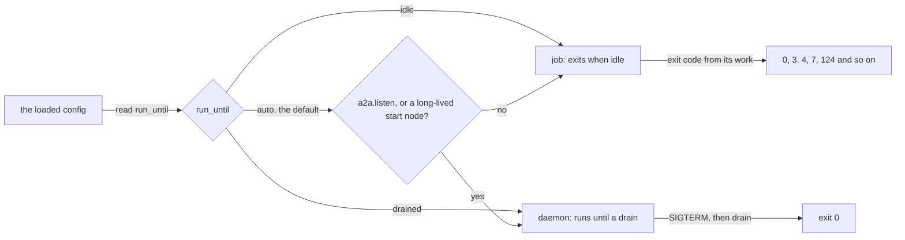

# Jobs, daemons and triggers

agentd has one runtime and no modes. A one-shot job and a long-lived daemon
run the same loop over the same durable state; they differ only in what
wakes the agent and when the process exits. This page explains how that
shape is decided, which start nodes fire runs, how a daemon runs work when
it starts and stops, and where A2A fits. Read it before you choose between
running agentd from a scheduler and running it as a service.

## One runtime, two shapes

| | Job | Daemon |
|---|---|---|
| Exits | when nothing is left to do | only when told to: a signal, a `finish` with `exit: true`, or another stop condition |
| Exit code | the outcome of its work | 0 after a clean drain |
| Woken by | its startup work: a `once` start, `--instruction`, `--prompt` | triggers that keep firing, an A2A listener, and `agent.prompt` at startup |
| The instruction | the task, when no workflow or prompt is given | the policy each message is answered under |
| Durable state | none unless you set a store: a crash re-runs it | the local `file` store unless you set one |

Both shapes share the reactor, the turn workers, the tool registry and the
inbox. A job is a daemon that has run out of reasons to stay up.

## How the shape is decided

`lifecycle.run_until` decides when the process stops.



| `run_until` | Shape | Exits when |
|---|---|---|
| `auto` (default) | a job, unless the instance has an A2A listener (`a2a.listen`) or a long-lived start node — then a daemon | as for the shape it resolves to |
| `idle` | a job | nothing is left: no runs, turns, queued or waiting work, timers or children |
| `drained` | a daemon | never on its own; a drain finishes in-flight work, then exits 0 |

Every start kind is long-lived except `once` and `manual`. Under `auto` the
question is asked of the **live** workflow set, not only the configured one:
a job whose prompt tells the agent to create a schedule (`workflow.create`)
becomes a daemon, rather than idling out from under the work it was asked to
set up.

A webhook listener or a `goal` gets an instance the durable store by default,
but does not make it a daemon: under `auto` it stays a job, and a goal
watches the job's own work.

A job with no long-lived start exits as soon as it is idle. When an
instance is forced to `idle` while it still has long-lived starts,
`lifecycle.idle_grace` (default 5 seconds) is how long it waits with
nothing to do before it exits.

A job's exit code comes from the outcome of the workflows its `once` starts
ran; with several, the worst outcome wins, so a partial success is never
reported as clean. The table of codes is in [CLI, environment and exit
codes](cli.md).

A daemon ends with a **drain**. These begin one:

- `SIGTERM` or `SIGINT`; a second signal forces the kill ladder;
- a `finish` with `exit: true`;
- the signal named in `lifecycle.until_signal`, when the operator or the
  runtime sends it (another principal's signal of that name is refused);
- the goal watchdog's `finish` action, a spent lifetime token budget under
  `lifetime_exhausted: drain` (or `exit`, which exits 7), or an instruction
  source that is unavailable under `unavailable: drain`;
- an operator's drain command over A2A.

A drain stops intake, lets in-flight work finish within
`lifecycle.drain_timeout` (default 25 seconds), checkpoints and exits: 0
after a signal or an operator's drain, or the code a `finish` or a failure
set. Work still running at the timeout is stopped and left for the next
start rather than failed: its step runs again, its message is answered
again, its subagent is spawned again. An exit the agent asks for — a
`finish` with `exit: true`, `lifetime_exhausted: exit`, a store that cannot
write — stops in-flight work at once and leaves it the same way, but still
runs the deinit workflows below. A job drained before its work finished
exits with its work's code — 3 for a run left unfinished — not 0.
[Supervision and containment](harness.md#the-kill-ladder) describes how
children are stopped.

## A job's task, a daemon's policy

The shape also decides what the instruction is when nothing else gives the
agent work: no workflow and no prompt.

- **In a job, the instruction is the task.** `agentd --instruction "…"`
  expands to a workflow named `main` — a `once` start, one `agent` step, a
  `finish` — that runs one turn and exits with that run's code.
  `--effective-config` shows the workflow, attributed to `generated (the
  one-shot sugar workflow)`.
- **In a daemon, the instruction is the policy.** A daemon with no workflow
  runs nothing when it starts. It waits for messages and answers each one
  under the instruction, which every conversation turn is given.

A daemon with work to do as soon as it starts says so:

- `agent.prompt` (`--prompt`) delivers a message into the root conversation
  at every start, where the agent has its full tool surface: it can answer,
  or set up recurring work with `workflow.create`. In a job, the prompt is
  the job.
- A workflow with a `once` start runs at boot: once per state with
  `policy: ensure`, the default, or on every boot with `policy: always`.

`lifecycle.run_until: drained` on an instance that nothing can give work to
— no `a2a.listen`, no workflow and no `agent.prompt` — is refused at load,
exit 2: it would wait for ever. A webhook listener or a `goal` does not count
on its own, since each only starts workflows, and nor does a workflow the
agent created at runtime and the store restores: the load cannot see it, so
declare in `workflows` the work such an instance waits for.

The shape is settled when the process starts. A reload that changes
`lifecycle.run_until`, from the configuration or from the instruction's own
`:::!config`, is refused with `config.reload.restart_required`.

## Triggers

A workflow's **start node** decides when a run begins. A workflow may have
several. These are the eleven start kinds; [Workflow node
reference](node-registry.md) lists every field.

| Start kind | Fires a run |
|---|---|
| `once` | at startup. `policy: ensure` (the default) fires unless a run it started is still on record, live or finished; `policy: always` fires on every boot |
| `manual` | only when asked: the `workflow.run` tool, an A2A `workflow.run` command, or a `workflow` step |
| `loop` | again after each run ends, paced by `interval`, until a condition or `max_iterations` |
| `schedule` | on a clock: a five-field UTC `cron`, an `every` interval, or an `at` delay |
| `subscribe` | when an MCP resource it subscribes to changes; the runtime reads the new contents |
| `signal` | when a named signal arrives: `workflow.signal`, an A2A command, a webhook's `signal:` |
| `event` | on a runtime event: `workflow.finished`, `workflow.failed`, `human.asked`, `human.answered`, `lifecycle.shutdown` |
| `stream` | on each event appended to a declared stream, or on each batch of them |
| `correlate` | when a set of related stream events has arrived within a window: a join over events |
| `a2a` | when an A2A message, or a command the start node declares, arrives for it |
| `webhook` | on an inbound HTTP request to its path on the webhook listener |

> **Limit.** `ensure` looks at the run records the instance holds. A
> finished run that `store.retention.runs` has evicted does not count, so a
> `once` start with `ensure` fires again on the next boot. Keep retention
> off for an instance whose `once` work must happen exactly once, or make
> that work idempotent.

**Every firing is an inbox event first.** A trigger's firing is written to
the durable inbox before the run starts, so a crash between the two
replays the firing rather than losing it. Delivery is at least once — a
schedule, for one, can fire twice across a crash — so make a run's effects
idempotent. Start-node state — last fired, next deadline, loop iteration,
debounce window, stream offset — is durable in the manifest, so a restart
resumes schedules and loops where they were.

**Schedules collapse missed occurrences.** A schedule that came due while
the process was down fires once on restart, then arms its next occurrence;
it does not replay every one it missed. `at: 8h` is a one-shot delay that
consumes itself when it fires, not a wall-clock time. `cron` needs the
`cron` build feature, which the release binaries include; `every` needs
none. For time-driven work across a fleet, an external scheduler firing a
job per tick is usually the better tool; the built-in schedule is for a
standalone daemon.

**Under pressure, a firing is refused, not lost.** While the daemon sheds
work for low disk or memory, a due schedule is skipped (`start.shed`) and
its next occurrence armed, a webhook answers `429`, and a stream consumer
holds its offset until the event can be accepted.

A daemon that runs a nightly report:

```yaml
agent:
  name: reporter
  instruction: You write short operational reports.

intelligence:
  endpoints: https://api.openai.com/v1/chat/completions
  model: gpt-5.1
  token: "{{secret:OPENAI_API_KEY}}"

workflows:
  - name: nightly-report
    concurrency: {max_runs: 1, on_overflow: drop}
    steps:
      tick:  {kind: schedule, cron: "0 2 * * *"}    # 02:00 UTC every day
      write: {kind: agent, depends_on: [tick], instruction: "Summarise yesterday's incidents in five lines."}
      done:  {kind: finish, depends_on: [write], output: "{{steps.write.output}}"}

lifecycle:
  run_until: auto       # a schedule start makes this a daemon
  drain_timeout: 25s
```

## Concurrency

Each workflow bounds its own live runs with `concurrency`. `max_runs` is the
cap, and `on_overflow` says what happens to a firing past it: `queue` (the
default) holds it in the inbox, `drop` discards it, `replace` cancels the
oldest live run. `scope: key` counts runs per value of the workflow's `key`
instead of per workflow, which turns the cap into a per-entity lock: one run
per order, per ticket, per customer. Across all workflows, `limits.max_runs`
(default 8) caps the live runs of the whole instance, with the same
overflow handling. [Author workflows](author-workflows.md) has worked
examples.

## Init and deinit

Two start kinds let a daemon run work at the edges of its own life.

- **Init.** A `once` start with `policy: always` fires on every boot. Use it
  for self-registration: tell a third party where to reach you as soon as
  the process can take calls.
- **Deinit.** An `event` start with `on: lifecycle.shutdown` fires when a
  drain begins, and the drain **waits** for that run, within
  `drain_timeout`, before the process exits — a drain an exit asked for
  too. Use it to deregister, so the third party stops calling a process
  that is going away. Its payload says why: `{"reason": "signal"}` or
  `{"reason": "exit"}`, among others.

```yaml
agent:
  name: orders
  instruction: You process paid orders.

intelligence:
  endpoints: https://api.openai.com/v1/chat/completions
  model: gpt-5.1
  token: "{{secret:OPENAI_API_KEY}}"

vars:
  registry: https://hooks.example.com
  my_hook: https://orders-agent.example.com/hooks/orders

workflows:
  - name: init
    steps:
      boot:     {kind: once, policy: always}       # every boot, not once per state
      register: {kind: http, depends_on: [boot], method: POST,
                 url: "{{config.registry}}/webhooks", json: {url: "{{config.my_hook}}"}}
      done:     {kind: finish, depends_on: [register]}
  - name: deinit
    steps:
      bye:        {kind: event, on: lifecycle.shutdown}   # fires when the drain begins
      deregister: {kind: http, depends_on: [bye], method: DELETE,
                   url: "{{config.registry}}/webhooks", query: {url: "{{config.my_hook}}"}}
      done:       {kind: finish, depends_on: [deregister]}
```

Keep deinit workflows to fast steps that need no model — `http`,
`mcp.tool`, data steps. They share `drain_timeout` with the work in flight,
and once the timeout passes, or a second signal forces the drain, it stops
everything, deinit runs included, so an `agent` step there competes with
the shutdown it belongs to. A deinit run cut short this way is cancelled,
not resumed: the next start does not run the last one's shutdown at its
boot. Only `lifecycle.shutdown` runs are admitted during a drain; every
other queued firing stays in the durable inbox for the next start.

## A2A as a trigger

A daemon's external channel is A2A, and it is a trigger like any other. Set
`a2a.listen` and the instance becomes a daemon under `run_until: auto`. A
plain message from a caller becomes a durable conversation turn, answered as
the A2A task's result. A command — a structured data part sent with the
[command extension](https://agentd.dev/a2a/ext/command) — runs a registered
action with no model in the path, and an `a2a` start node can declare its
own command so that a matching message fires a run instead of a turn. Every
caller is resolved to a principal and held to what that principal may do. [The A2A channel](a2a.md) explains the
listener and its principals; [Connect agents over A2A](connect-agents.md)
shows the configuration.

## Next steps

- [Your first workflow](first-workflow.md) — a trigger, a step and a finish,
  end to end.
- [Workflows: how runs work](workflows.md) — what happens once a run has
  started.
- [React to changes and events](react-to-events.md) — subscriptions,
  streams, webhooks and MCP Events as triggers.
- [Deploy](deployment.md) — running a job or a daemon under an orchestrator.
