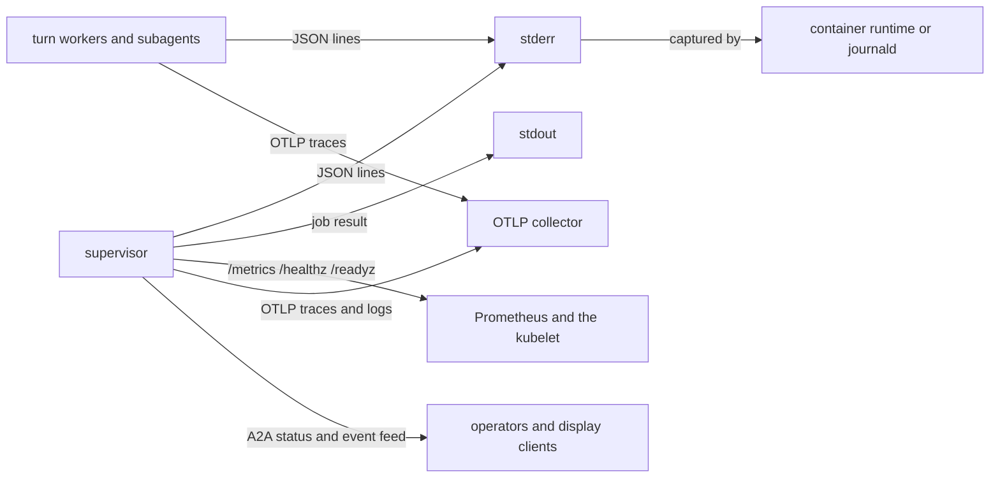
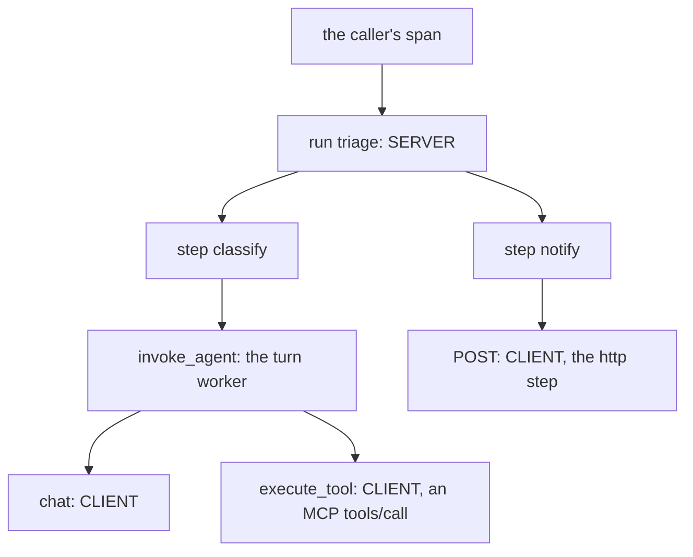

# Monitor in production

This guide shows how to watch a running agentd: read its log stream, probe
its health, scrape its metrics, export traces, alert on the signals that
matter and keep an audit trail. It is for operators wiring agentd into an
existing logging and monitoring stack. Every event and metric it mentions is
listed in the [Events and metrics reference](telemetry-reference.md).

## Where telemetry goes

agentd writes everything about itself to **stderr**, one JSON object per
line. **stdout** carries only a job's result, so the two separate with an
ordinary redirect and never need a parser to tell them apart. Child
processes (turn workers and subagents) inherit stderr, so one capture holds
the whole tree.

The other channels are opt-in.



| Channel | Turn it on with | Use it for |
|---|---|---|
| stderr JSON lines | always on | The full record: ship it to your log store |
| `/healthz`, `/readyz`, `/metrics` | `observability.metrics_addr` | Probes, dashboards, alerts, autoscaling |
| Health file | `observability.health_file` | Liveness where you cannot open a port |
| OTLP traces and logs | `observability.otel` | Distributed tracing in your collector |
| A2A status and event feed | `a2a.listen` | Live state for operators and the UI ([Operate a running daemon](operations.md)) |
| Audit trail | `observability.audit.sink` | Who did what, on whose authority |

agentd does no log rotation or shipping of its own. The container runtime,
journald or your collector owns capture.

## See the stream locally

You can produce a real stream without a model key. The `mock:` model
endpoint, in the release binaries and the container image, answers from a
script instead of a provider: `mock:file:<playbook.json>` plays the turns
the file lists. This script makes the agent call one tool and then finish.

Save the script as `playbook.json`:

```json
{
  "turns": [
    {"tool_calls": [{"name": "memory.set", "arguments": {"key": "greeting", "value": "hello"}}]},
    {"content": "Stored the greeting.", "usage": {"prompt_tokens": 120, "completion_tokens": 8}}
  ]
}
```

Run a one-shot job against it, result to one file and telemetry to another:

```bash
agentd --instruction "Remember a greeting." --intelligence mock:file:playbook.json > result.txt 2> telemetry.ndjson
```

`result.txt` holds the agent's answer, and the exit code is 0:

```text
Stored the greeting.
```

`telemetry.ndjson` holds about two dozen lines, from `proc.start` to
`proc.exit`. The recipes below run against it as written, and against any
production capture.

## Read a log line

Every line carries the same envelope: `ts`, `level`, `event`, `run_id`,
`agent_id`, `agent_path`, `comp`, `pid`, `trace_id` and `span_id`, and
`parent_span_id` when the span has a parent. The event's own fields sit
beside them. Keys are in alphabetical order, so parse by name.

```json
{"agent_id":"run/main-01M4P4004VPT9M256ZXBGDGV3C/work","agent_path":"run/main-01M4P4004VPT9M256ZXBGDGV3C/work","comp":"agent","event":"turn.done","level":"info","parent_span_id":"5e3cf0a1d2b4c697","pid":1845136,"rounds":1,"run_id":"01M4P4004MMJKM81HAZA0JFGP4","span_id":"a1b2c3d4e5f60718","status":"completed","tokens_in":11,"tokens_out":5,"tool_calls":0,"trace_id":"f281fdc06f4dd1374e53be619f96e1fe","ts":"2026-10-11T18:35:54.412Z","turn":"main-01M4P4004VPT9M256ZXBGDGV3C/work#1"}
```

Four fields do the correlation:

- **`run_id`** is constant for the whole process tree: every line of one
  invocation shares it. Pin it with `--run-id` to make it meaningful across
  retries.
- **`trace_id`** names the unit of work the line is about: a workflow run, a
  conversation turn, and every worker and subagent they start share theirs
  (see [Correlate with other services](#correlate-with-other-services)).
  `span_id` is the span within it, and `parent_span_id` that span's
  parent.
- **`agent_path`** says which unit of work wrote the line, as a namespace. The
  supervisor is `0`; a workflow step's worker is `run/<run>/<step>`; a
  conversation turn is `turn/<ctx>`; a subagent is `sub/<handle>`. A prefix
  selects everything under it with no join. The reference lists
  [every value](telemetry-reference.md#agent_path-values).
- **`pid`** joins a line to the OS process tree: `ps` and `pstree` show the
  same processes.

`comp` is `supervisor` for the supervisor's lifecycle and control lines and
`agent` for the reasoning in turn workers and subagents.

Set the verbosity with `observability.log_level` (`--log-level`): `trace`,
`debug`, `info` (the default), `warn` or `error`. It reloads without a
restart. `debug` adds each model round (`turn.round`) and the subagent loop's
model calls.

## Filter with jq

Every line is one JSON object, so `jq` answers most questions about a run
without a log backend.

Warnings and errors:

```bash
jq -c 'select(.level=="error" or .level=="warn") | {ts, event, err}' telemetry.ndjson
```

The totals a process reports as it exits:

```bash
jq -c 'select(.event=="proc.exit") | {code, uptime_ms, runs, turns, tool_calls, tokens_in, tokens_out}' telemetry.ndjson
```

```json
{"code":0,"uptime_ms":232,"runs":1,"turns":0,"tool_calls":1,"tokens_in":131,"tokens_out":15}
```

Tokens per turn, from the worker's own line:

```bash
jq -r 'select(.event=="turn.done" and .comp=="agent") | [.agent_path, .status, .tokens_in, .tokens_out] | @tsv' telemetry.ndjson
```

Tool calls by tool and outcome, then the slowest calls in milliseconds:

```bash
jq -r 'select(.event=="tool.result") | "\(.tool)\t\(.is_error)"' telemetry.ndjson | sort | uniq -c
jq -r 'select(.event=="tool.result") | [.ms, .tool] | @tsv' telemetry.ndjson | sort -rn | head
```

Runs that did not complete, with their error:

```bash
jq -c 'select(.event=="run.done" and .status!="completed") | {run, workflow, status, err}' telemetry.ndjson
```

Everything about one run: the supervisor's lines name it in `run`, its
workers' lines in `agent_path`.

```bash
RUN=$(jq -r 'select(.event=="run.start") | .run' telemetry.ndjson | head -1)
jq -c --arg run "$RUN" 'select(.run==$run or (.agent_path|startswith("run/"+$run+"/"))) | [.ts, .event, .agent_path]' telemetry.ndjson
```

Reload outcomes on a daemon:

```bash
jq -c 'select(.event|startswith("config.reload")) | {ts, event, trigger, changed, paths, error}' telemetry.ndjson
```

## Probe health

Health is measured at the supervisor's event loop, never inferred from
traffic. An agent waiting for its next trigger is idle by design and stays
healthy for as long as it waits. A stuck child does not fail liveness either:
the supervisor is the one that detects and kills it, and it keeps ticking
while it does.

With `observability.metrics_addr` set (`--metrics-addr`), agentd serves three
paths over plain HTTP:

| Path | Returns 200 when | Returns 503 when | Use as |
|---|---|---|---|
| `/healthz` | the event loop ticked in the last 5 s | the loop is stuck, or a drain is under way | liveness probe |
| `/readyz` | the runtime is up and accepting work | draining, or a child reported every model endpoint down | readiness probe |
| `/metrics` | always | | Prometheus scrape |

```bash
curl -s http://127.0.0.1:9090/healthz
curl -s http://127.0.0.1:9090/readyz
```

```text
ok tick_age_ms=12
ready
```

The probe surface binds once startup has finished, so a pod is never routed
to before `proc.ready`. During a drain `/readyz` turns 503 first, so the pod
leaves rotation while the drain completes. A model outage turns
`/readyz` 503 too, so a load balancer stops sending conversations to a pod
that cannot answer them; it recovers when a model call succeeds.

> **Warning.** The probe surface is unauthenticated. `:9090` binds every IPv4
> interface and logs `metrics.bound_all_interfaces`; restrict it with a
> NetworkPolicy or firewall, or bind `127.0.0.1:9090` where only a local
> agent scrapes it.

Where you cannot open a port, `observability.health_file` (`--health-file`)
names a file the supervisor rewrites every second:

```json
{"alive":true,"draining":false,"mode":"1","run_id":"01M4P42Z69EJ2J6XDTWTFHP0GR","supervisor_tick_age_ms":128,"ts":"2026-10-11T18:37:32.731Z"}
```

`alive` is the same verdict `/healthz` gives. The file stays behind when the
process exits, so a checker must also confirm that `ts` is recent. Reading it
needs a shell or a sidecar, which the published `scratch` image does not have:
on Kubernetes, use the HTTP probes.
[Deploy](deployment.md#probes-that-work-on-a-scratch-image) has the probe
manifests.

For a one-shot job, the exit code is the health signal.
[CLI, environment and exit codes](cli.md#exit-codes) has the table. The
probe listener and the health file still run for a job when you configure
them, which is useful for a long batch job under a liveness probe.

## Scrape Prometheus metrics

`/metrics` serves Prometheus text format. A static scrape job:

```yaml
# prometheus.yml
scrape_configs:
  - job_name: agentd
    static_configs:
      - targets: ["agent-triage.internal:9090"]
```

The metrics are the supervisor's. Model calls and agent loops run in child
processes, which report what they count (tokens, model calls and their
errors, loop steps) up to the supervisor as they go, so its scrape covers
the whole instance. A few series are reserved markers with no sample; the
reference marks each one. The ones worth a dashboard:

| Question | Series |
|---|---|
| Is it up and taking work? | `agent_up`, `agent_ready`, `agent_paused` |
| Is it falling behind? | `agent_inbox_pending`, `agent_turns_queued`, `agent_runs_active`, `agent_stream_lag` |
| How much work is it doing? | `rate(agent_runs_started_total[5m])`, `rate(agent_steps_total[5m])` |
| How is the work ending? | `agent_runs_total` by `status`, `agent_limit_exceeded_total` by `limit`, `agent_refusals_total` by `reason` |
| What does it cost? | `rate(agent_tokens_total[1h])` by `type`, `agent_budget_tokens_remaining` |
| Can it reach its model? | `agent_intel_up`, `agent_intel_all_down`, `rate(agent_intel_errors_total[5m])` by `reason` |
| Is the disk safe? | `agent_pressure_level`, `agent_disk_free_bytes` |
| Is the store healthy? | `agent_store_ops_total` by `result` |
| Did my change land? | `agent_config_generation`, `agent_config_reload_total` |
| Are MCP servers reachable? | `agent_mcp_connect_failures_total` by `server` |

## Alert on what matters

A starting rule set, built on series that move:

```yaml
# agentd-rules.yml, a Prometheus rule file
groups:
  - name: agentd
    rules:
      - alert: AgentdNotReady
        expr: agent_ready == 0
        for: 5m
        annotations:
          summary: "{{ $labels.instance }} is draining or every model endpoint is down"
      - alert: AgentdBacklogGrowing
        expr: agent_inbox_pending > 100
        for: 10m
        annotations:
          summary: "{{ $labels.instance }} has {{ $value }} events waiting"
      - alert: AgentdUnderPressure
        expr: agent_pressure_level >= 1
        for: 2m
        annotations:
          summary: "{{ $labels.instance }} is low on disk or memory; level 2 sheds new work"
      - alert: AgentdStoreConflict
        expr: increase(agent_store_ops_total{result="conflict"}[5m]) > 0
        annotations:
          summary: "two processes share the instance identity of {{ $labels.instance }}"
      - alert: AgentdStoreErrors
        expr: increase(agent_store_ops_total{result="error"}[5m]) > 0
        annotations:
          summary: "durable store writes are failing on {{ $labels.instance }}"
      - alert: AgentdRunsFailing
        expr: increase(agent_runs_failed_total[15m]) > 3
        annotations:
          summary: "workflow runs are failing on {{ $labels.instance }}"
      - alert: AgentdReloadRefused
        expr: increase(agent_config_reload_total{result="rejected"}[15m]) > 0
        annotations:
          summary: "a configuration reload was refused on {{ $labels.instance }}"
      - alert: AgentdLifetimeBudgetSpent
        expr: increase(agent_limit_exceeded_total{limit="tokens_lifetime"}[15m]) > 0
        annotations:
          summary: "the lifetime token budget of {{ $labels.instance }} is spent"
      - alert: AgentdConsumerLagging
        expr: agent_stream_lag > 1000
        for: 10m
        annotations:
          summary: "{{ $labels.consumer }} is behind on stream {{ $labels.stream }}"
```

Some conditions are only in the log. Alert on these events in your log
store:

| Event | Means |
|---|---|
| `drain.abandon` | A drain overran its budget and children were killed |
| `instruction.unavailable` | The instruction source stopped answering |
| `start.subscribe.unsupported` | A `subscribe` start can never fire |
| `wait.resubscribe.fail` at error | A suspended wait can never be woken |
| `mcp.events.refused` | An MCP Events binding is not being polled |
| `stream.consumer.skipped` | A consumer lost events to retention |
| `human.judge.withheld` | A question failed because no judge may answer outside input |
| `a2a.denied` with `reason: not_permitted` | A known caller tried something its role does not allow |

## Export traces and logs over OTLP

The `otel` feature, in the release binaries, exports to an OTLP/HTTP
collector with JSON bodies. Point it at a collector on the same host or in
the same pod:

```yaml
# fragment: under observability:
otel:
  endpoint: http://127.0.0.1:4318
  logs: true
```

- **Traces.** Setting the endpoint is enough. The supervisor exports a span
  per workflow run, per step attempt, per request it serves and per request
  it sends; each turn worker exports its turn as an `invoke_agent` span with
  a `chat` span per model call and an `execute_tool` span per tool call,
  using the OpenTelemetry GenAI attribute names. Together they are one tree
  per trace (below).
- **Logs.** `logs: true` mirrors the supervisor's log lines every 5 s. Each
  record's `traceId` and `spanId` are the line's, so a backend joins it to
  its span.

The endpoint is `http://` or `https://`; a bare `host:port` or a
`grpc://` URL is refused at load. An `https://` collector's
certificate is checked against the bundled public roots plus
`security.tls_ca`, as every outbound connection's is. Without `endpoint`,
agentd reads `OTEL_EXPORTER_OTLP_ENDPOINT`. The endpoint is restart-only.

### The span tree

Every span's id is the span id it has everywhere else: on the log lines
about it, and in the `traceparent` agentd sent for it. So a span a
downstream service exports under agentd's request has its parent in your
collector, and a log line joins its span by `span_id`.



- A **run** is a span from its start to its end. It is the SERVER span of
  the request that started it — a `workflow.run` over A2A, a webhook
  delivery — and a CONSUMER span for a `stream` or `correlate` start's
  event; under the span that event was emitted in, or, for a `batch` or
  `correlate` run, linked to each member's. A run an `a2a` start fires is
  INTERNAL, under the SERVER span of the message it was fired for.
- Each **step attempt** is a span under the run's, from the attempt's start
  to its end. A retry is an attempt of its own.
- A **turn worker** exports its turn as an `invoke_agent` span under the
  step's span, or under the message's for a conversation turn, with a
  `chat` span per model call and an `execute_tool` span per tool call. A
  call to an MCP tool is a CLIENT span, the one its request sent.
- Every request agentd sends for a unit of work is a **CLIENT** span: a
  model call, an MCP request, an A2A request, an `http` step, a push, a
  stream forward. What an MCP connection asks for itself — its handshake,
  its lists, its subscriptions, an MCP Events poll — names the span of the
  process that asks: the supervisor's, or a turn worker's `invoke_agent`.
  A command the `exec` tool runs is a span, the one its `TRACEPARENT`
  names. An `emit`, and an event an `into:` appends, is a PRODUCER span.
- An **A2A message** is the SERVER span of its request, ending as agentd
  routes it to a turn, a run or a waiting step. Any other A2A request, and a
  webhook delivery that started no run, is a SERVER span under the caller's
  span when the caller sent a `traceparent`.
- The **process** is a span from its start to its exit: the root of a
  one-shot job's tree.
- A line's `link` and `links` are links of the span the line is in,
  whatever `log_level` writes. A line about a span that has already ended
  — the answer to a gate a conversation turn raised, after its message was
  routed; a child's report, after the step that spawned it — puts them on
  a span of its own, named for the line, under that span. A link to the
  span's own parent is left out.
- A push's and a stream forward's span names where it went —
  `url.scheme`, `server.address`, `server.port` — and not the URL, whose
  path or query is often a credential. An `http` step's names its
  `url.full`, as its `http.request` line does.

A span in a trace that is not sampled — an upstream `traceparent` with
flags `00` — is not exported. The [reference](telemetry-reference.md#otlp-export)
lists every span's name, kind and attributes.

Export is best effort and never fails the work. The supervisor sends its
spans from a background thread every 2 s, and what it still holds when it
exits; a turn worker sends its turn as the turn ends. Each step of a send
(connect, write, read) gives up after 5 s. An exit — the process's, or a
turn worker's at the end of its turn — waits at most 3 s on its last
spans and log records: once a batch fails or the time is up, what is left
is dropped and counted lost. A batch that fails is dropped, not retried,
and logged: `otel.export.failed` (warn) names the signal, the
endpoint and the error when exports start failing, then at most once a
minute while the collector keeps failing, and `otel.export.recovered`
(info) says when it takes a batch again, also at most once a minute, so
a collector that drops every other batch gets one line of each a minute,
not one every batch. Each process counts on its own, so the supervisor and
every turn whose trace fails log their own lines.

## Correlate with other services

Each unit of work is a W3C trace of its own. A unit is a start firing of any
kind, an A2A message or the `--prompt`, and the run or conversation turn it
becomes. agentd resolves its trace once, when it accepts the work, and
continues whatever caused it, one span below the cause's span:

- a run that another run starts: a child workflow, a `workflow.run` call, a
  signal or a `message` the run sends;
- an A2A request's `traceparent` and `tracestate` headers: the task the
  request opens and the run or turn it becomes. A caller that cannot set a
  header may put `traceparent` and `tracestate` in the message's `metadata`;
  the header wins when both are there. A message that continues a task
  continues the task's trace, and records the caller's as a link (below);
- a webhook route's request headers: the run the delivery fires;
- a stream event's `traceparent` attribute: the run a `stream` start fires
  for it;
- an MCP Events occurrence's `_meta.traceparent`, or the webhook delivery's
  `traceparent` header when the occurrence names none: the event it is kept
  as, and so the run a `stream` start fires for it.

Other work gets a new trace with a random id. The trace is stored with the
inbox event, the run record and the A2A task. A replayed event, a run
resumed after a restart, a drain, a wait or a human gate, a step replayed
after a crash, a restored task and a restored subagent carry on in the
trace they started in.

Some work has more than one cause, or runs long after its cause ended. It
starts a trace of its own and names its causes as links, by their
`traceparent`:

- a `batch` or `correlate` run: `links` on its `start.fired` line, one per
  member event;
- an event a webhook route or an `a2a` start appends with `into:`: the event
  gets a new trace, which its consumers continue, and `links` on the
  `webhook.into` or `start.a2a.into` line names the request's span.

Work that only resumes a unit does not move it to another trace. The
unit keeps its own and records the request as a `link`:

- the answer to a human gate over A2A: on the `human.answered` line and the
  `ask_human.answered` audit record;
- a `wait {on: webhook}` callback, a webhook route's `signal:`, and any
  other signal that wakes a waiting step: on the run's `signal.delivered`
  line, and on `webhook.callback` or `webhook.signal`. The
  `webhook.callback` line is in the callback's own span, under the
  caller's; `webhook.signal` is in the span of the run or the event the
  delivery became;
- the event that wakes a `wait {on: event}`: on the run's `wait.resolved`
  line;
- an A2A message that wakes a `wait {on: message}` or an `a2a.wait` — the
  reply of an asynchronous exchange: on the run's `wait.resolved` line, the
  span agentd accepted the message in. That span is a child of the
  sender's, and the `a2a.message.delivered` line in it names the runs it
  woke;
- a message that continues an A2A task: on an `a2a.task.continued` line in
  the task's trace.

The audit record of an A2A call whose task is in another trace than the
caller's — a message continuing it, the answer to its gate, a read — names
the caller's span as `link`.

A call to a Company under `privacy: strict` (the `companies` feature) goes
out in a trace of its own per unit of work and Company, so two Companies the
unit calls cannot match it: the call's span stays in the unit's trace, and
links to the span the Company was sent. A Company's handshake and tool list
carry no trace context.

An inbound `traceparent` is correlation and nothing more. No identity,
authorization, rate limit, idempotency key or deduplication reads it. One
that is not valid W3C is ignored and the work gets a trace of its own; two
`traceparent` headers on one request are not valid. The `tracestate` beside
a valid one is kept within the W3C limits (32 members, 512 bytes) and sent
on every hop below it; a longer or malformed one is dropped and the
`traceparent` kept.

Everything the unit does carries its trace:

- The supervisor's lines about it carry its `trace_id` and `span_id`:
  `run.start`, `run.done`, `turn.*`, `subagent.*`, `human.*`, and
  `step.start`, `step.done` and `step.retry` in the span of the step's
  attempt. So do its audit records and its events
  on the `_runtime` stream, whose `traceparent` names the span the line was
  in: a workflow consuming `_runtime` continues the trace of what it
  watches.
- Its turn workers and subagents get its `traceparent` in their spawn payload
  and write it on every line.
- Every model call sends a `traceparent` HTTP header. That includes the
  supervisor's own calls: the `approve` judge answering a gate, and the goal
  check.
- Every MCP request it makes sends a `traceparent` in `params._meta`:
  `tools/call`, `resources/read`, `prompts/get`, `completion/complete`, and
  the `resources/list` and `resources/templates/list` of an `mcp.resource`
  step, one span per page.
- Every A2A request it makes sends `traceparent` and `tracestate` HTTP
  headers: an `a2a.delegate` (its card read, its send and every poll), an
  `a2a.send`, an `emit` forwarded to a peer and a message to an instance
  child. The span is the hop's, logged as `span_id` on its `a2a.delegate` or
  `a2a.send` line, so an agentd peer's task and run are its children. An
  instance child's reports home (`_instance.result`, `_instance.emit`) are
  A2A requests like any other.
- An A2A push notification about its task sends them too, a span of the
  task's per delivery.
- An `http` step sends them; its `http.request` line carries the span it
  sent. A step whose `headers` set `traceparent` or `tracestate` sends what
  it set and nothing of agentd's, and its line is in the step's span.
- An `emit` records its span on the event as the CloudEvents
  distributed-tracing attributes `traceparent` and `tracestate`, durable
  with the event, and logs it on `stream.emit`. A `forward: {webhook}` push
  sends them as headers.
- An `exec` command gets it as the `TRACEPARENT` environment variable.
- An instance child is started with it as its `observability.traceparent`.

Each of these hops sends a span id of its own under the span of the step
or turn that sends it.

### Outputs that name the trace

What agentd answers names the trace the work is in, so a caller can find it
in your logs and traces:

| Output | Names |
|---|---|
| An A2A answer that names a task (`SendMessage`, `SendStreamingMessage`, `GetTask`, `SubscribeToTask`) | A `traceparent` response header: the span the task's work is done in |
| A task's annotations (the task-annotations extension) | `traceId` and `spanId` of that span |
| A webhook's `202`, its `respond: sync` answer, and a `duplicate` of a kept delivery | `run_id` and `trace_id` in the body, and a `traceparent` response header naming the run's span; an `into:` append names the event's trace. A `202`'s `run_id` is the run the delivery was queued as: `concurrency.on_overflow: drop` or the workflow's `inputs.schema` can still refuse it, and the `run.dropped` or `run.inputs.invalid` line names it as `run` |
| `status`, `run.get`, `workflow.status`, and the `run`, `step` and `activity` events of the event feed | `trace_id` of each run, step and working unit; the operator's `status` names the process's trace too |
| The `audit` events of the event feed | `trace_id` of the record |
| Events on the `_runtime` stream | `traceparent`: the span the line was in |
| OTLP log records | `traceId` and `spanId` |

A browser page may send `traceparent` and `tracestate`, and read the
response's `traceparent`, cross-origin. A one-shot job's stdout is the raw
result and names nothing; its `proc.exit` line carries the process trace,
which in a job is the work's.

The process has a trace of its own for work that belongs to no unit: boot,
reload, drain, the store, and the requests an MCP connection makes for
itself — its handshake, the list calls that keep the tool and skill
catalogue, subscriptions and MCP Events polls. In a job, the work the
process was started to do is a span of the process trace: the `--prompt`,
and a run from a `once` start. So a one-shot job is one trace. In a daemon
that work is a trace of its own, as any other unit's. To join an upstream
trace, pass its `traceparent` when you start the process:

```bash
agentd --config /etc/agentd/triage.yaml --traceparent 00-4bf92f3577b34da6a3ce929d0e0e4736-00f067aa0ba902b7-01
```

agentd continues that trace id, with the upstream span as its parent, and
the `--prompt` or `once` run continues it in a daemon too. It keeps the
upstream's sampling flag: an upstream `00` goes out as `00` on every hop,
and a turn in an unsampled trace exports no spans. A `traceparent` that is
not valid W3C (version `ff`, an all-zero id, a wrong length, uppercase hex,
a character that is not ASCII) is ignored, and the process mints its own.
The flag takes no `tracestate`; a unit's comes from the request that
started it, if any.

## Keep an audit trail

The audit trail records who did what: every A2A call and command, every
reload, MCP Events subscriptions. Choose one or more sinks:

```yaml
# fragment: under observability:
audit:
  sink: [log, store, stream]
  stream: _governance
```

| Sink | Writes |
|---|---|
| `log` | An `audit` line on stderr, beside the rest of the telemetry |
| `store` | An append-only record in the durable store, never rewritten |
| `stream` | An event on the named stream, which a workflow can consume |

A record carries the principal, its role, the action, the target and the
outcome. An A2A command's action names the method and the op, so
`a2a.SendMessage:admin.drain` is a filterable action of its own:

```json
{"action":"a2a.SendMessage:admin.drain","agent_id":"sup","agent_path":"0","comp":"supervisor","event":"audit","instance":"probe","level":"info","outcome":"ok","pid":1852065,"principal":"operator","request_id":"m-6","role":"operator","run_id":"01M4P42Z69EJ2J6XDTWTFHP0GR","span_id":"3e9b0c7d1a2f4865","target":{"task":"01a12c41-84e3-7d91-9007-9a171a6601d3"},"trace":"f0bebfa0b94d2427e39ac6c9903b3f86","trace_id":"f0bebfa0b94d2427e39ac6c9903b3f86","ts":1791743853799}
```

On an `audit` line, `ts` is the record's own timestamp in milliseconds since
the epoch, in place of the envelope's text timestamp. A failed audit write is
logged (`audit.store.fail`) and never fails the action it records. Audit lines
are metadata, so `log_content` does not change them.

## Feed runtime events back into workflows

`observability.runtime_events` copies chosen event families onto a declared
stream, so a workflow can react to the runtime itself: page when a breaker
opens, summarise a day's pressure events, ship audit evidence on a schedule.
This configuration pages on a breaker through a cheaper model:

```yaml
agent:
  name: ops-watch
  instruction: You keep the incident queue moving.
intelligence:
  endpoints: https://api.openai.com/v1/chat/completions
  token: "{{secret:OPENAI_API_KEY}}"
  models:
    smart: { model: gpt-5.1 }
    fast: { model: gpt-5-mini }
  roles:
    turn: smart
streams:
  _runtime: { retention: { max_events: 5000, max_age: 24h } }
  _governance: { retention: { max_events: 200000, max_age: 400d } }
workflows:
  - name: page-on-breaker
    steps:
      trip:
        kind: stream
        stream: _runtime
        subject: "breaker.*"
      notify:
        kind: agent
        depends_on: [trip]
        model: fast
        instruction: "A circuit breaker opened. Summarise which one and why for the on-call channel."
      done: { kind: finish, depends_on: [notify] }
lifecycle: { run_until: drained }
observability:
  log_level: info
  metrics_addr: ":9090"
  health_file: /run/agentd/health.json
  runtime_events:
    stream: _runtime
    include: [breaker, intel, store, child]
    sampled: [pressure]
  audit:
    sink: [log, store, stream]
    stream: _governance
  otel:
    endpoint: http://127.0.0.1:4318
    logs: true
```

- `include` takes a family in full; `sampled` takes 1 event in 16, for
  families that arrive in storms. The family list is closed: a typo such as
  `pressur` is refused at load.
- The event's subject is its name, so a consumer matches `breaker.*`.
- The capture budgets itself. Its queue is fixed (`queue`, default 512) and
  counts what it drops; appends shed under pressure; a refused append is
  dropped, not retried.

> **Note.** A stream carrying runtime events or audit records holds what runs
> produced, including text that came from outside. The load-time taint check
> treats it as fed by every run. See [Security model](security.md).

## Capture content for debugging

By default the log records lengths, counts and names, never conversation
content. `observability.log_content` (`--log-content`) adds content:

| Event | Gains |
|---|---|
| `run.done` | `output`: the run's output |
| `turn.reply` | `text`: the reply |
| `tool.request` | `args`: the internal tool's arguments |
| `tool.call`, `tool.result` in a subagent's loop | `args` and `content`, each capped at 4096 characters |

It reloads without a restart and passes to children.

> **Warning.** Use `log_content` for debugging, not in production. agentd
> never logs the model credential or other resolved secrets, but a secret a
> model passes as a tool argument, or a tool returns, lands in the log with
> content capture on.

## Next steps

- [Events and metrics reference](telemetry-reference.md): every event and
  metric.
- [Operate a running daemon](operations.md): read live state over A2A.
- [Deploy](deployment.md): probe manifests for Kubernetes.
- [Troubleshooting](troubleshooting.md): from a symptom to its cause.
