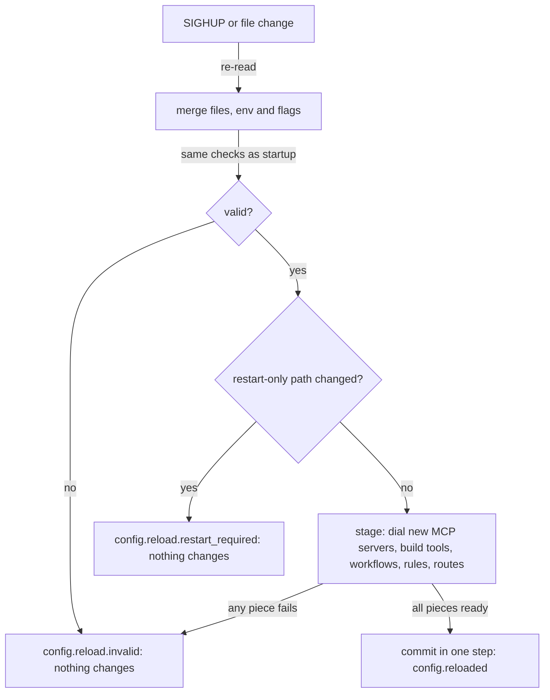

# Operate a running daemon

This guide covers the day-to-day control of a long-lived agentd: draining it
for a rolling update, pausing and resuming work, cancelling a run, changing
a setting, reading live state, reloading configuration and handling disk
pressure. Each task comes with a complete request you can copy. It is for
operators and for the tooling they drive; deploying the daemon in the first
place is covered in [Deploy](deployment.md).

## The control channel

Everything here except reload by signal and the discovery asks travels over
the instance's A2A listener (`a2a.listen`). The listener is in the release
binaries and image. An instance without one can still be drained with
`SIGTERM` and reloaded with `SIGHUP`, but takes no commands.

A command is an ordinary A2A `SendMessage` whose message carries a data part
of the form `{"agentd": {"op": "<name>", …arguments}}`. agentd treats it as a
command only when the request activates the
[command extension](https://agentd.dev/a2a/ext/command) twice: the
`A2A-Extensions` header names its URI, and `message.extensions` lists it.
A request without the header is refused with `EXTENSION_NOT_ACTIVATED`, and
one without the mark with `EXTENSION_NOT_MARKED`, so no client sends a
command by accident.

This daemon configuration serves the listener with a bearer token for the
operator:

```yaml
# /etc/agentd/ops.yaml
agent:
  name: reconciler
  instruction: Reconcile the desired state of the fleet inventory.
intelligence:
  endpoints: https://api.openai.com/v1/chat/completions
  token: "{{secret:OPENAI_API_KEY}}"
  models:
    smart: { model: gpt-5.1 }
    fast: { model: gpt-5-mini }
  roles: { turn: smart }
mcp:
  servers:
    - { name: inventory, endpoint: "https://mcp-inventory.internal/mcp" }
a2a:
  listen: https://0.0.0.0:8443
  url: https://agent.internal:8443
  tls:
    cert: /etc/agentd/tls/server.crt
    key: /etc/agentd/tls/server.key
  bearer: "{{secret:A2A_OPERATOR_TOKEN}}"
  events: { enabled: true }
lifecycle:
  run_until: drained
  drain_timeout: 25s
  watch_config: true
observability:
  metrics_addr: ":9090"
  audit: { sink: [log, store] }
```

A request bearing `a2a.bearer` is the operator. Mutual TLS, principal rules
and signed-in sessions are the other ways in; [Harden a deployment](harden.md)
and [The A2A channel](a2a.md) cover them. The admin operations below are
the operator's alone: no grant gives them to another role, so a peer agent
can never drain or pause the instance it talks to.

The requests below assume two variables in your shell:

```bash
export DAEMON_URL=https://agent.internal:8443/
export A2A_OPERATOR_TOKEN=replace-with-the-operator-token
```

> **Note.** On a development machine, a listener on a loopback address with
> no credential configured treats every local process that presents nothing
> as the operator. Drop the `Authorization` header and use
> `http://127.0.0.1:<port>/`. Declaring any credential or principal rule
> ends that.

Every command is audited as `a2a.SendMessage:<op>` when an audit sink is on.

## Drain for a rolling update

`admin.drain` begins the same graceful shutdown `SIGTERM` does. agentd stops
admitting work, turns `/readyz` to 503, cancels its child processes,
checkpoints, and exits **0**. Runs that are waiting stay in the durable store
and resume when the instance starts again; a step whose turn is cut off
mid-call fails with its run.

```bash
curl -sS "$DAEMON_URL" -H "Authorization: Bearer $A2A_OPERATOR_TOKEN" -H 'content-type: application/json' -H 'A2A-Version: 1.0' -H 'A2A-Extensions: https://agentd.dev/a2a/ext/command' -d '{"jsonrpc":"2.0","id":1,"method":"SendMessage","params":{"message":{"role":"ROLE_USER","messageId":"drain-1","extensions":["https://agentd.dev/a2a/ext/command"],"parts":[{"data":{"agentd":{"op":"admin.drain","reason":"rolling update"}}}]}}}'
```

The answer is a completed task whose `<task id>.result` artifact carries the
acknowledgement:

```json
{"ok":true,"reason":"rolling update","state":"draining"}
```

What to know:

- The call returns at once; it does not wait for the exit.
- A second `admin.drain`, or the first `SIGTERM` after it, changes nothing.
  A second `SIGTERM` or `SIGINT` forces the shutdown and kills the children.
- `lifecycle.drain_timeout` (default 25 s) bounds the drain. Past it, agentd
  kills the children that remain; if any survives 3 more seconds, it logs
  `drain.abandon` and exits anyway. Keep the orchestrator's grace period
  above that total;
  [Deploy](deployment.md#keep-the-drain-inside-the-grace-period) shows the
  arithmetic.
- Workflows with an `event` start on `lifecycle.shutdown` fire as the drain
  begins, and the drain waits for them.
- To let running steps finish first, send `admin.pause`, poll `status`
  until its `children` list is empty, then send `admin.drain`. A paused
  instance starts no new step or turn, so nothing is in flight when the drain
  begins.
- The log shows `drain.start`, then `drain.done`, then `proc.exit` with
  code 0.

## Pause and resume

`admin.pause` holds work without leaving. Without a `run`, it holds the whole
instance: no conversation turn dispatches and no workflow step schedules.
Intake continues, so the listener answers, the inbox fills and tasks are
accepted; the work waits until `admin.resume`. Use it to debug a live
instance, or to hold it still while you swap the model service underneath.

```bash
curl -sS "$DAEMON_URL" -H "Authorization: Bearer $A2A_OPERATOR_TOKEN" -H 'content-type: application/json' -H 'A2A-Version: 1.0' -H 'A2A-Extensions: https://agentd.dev/a2a/ext/command' -d '{"jsonrpc":"2.0","id":2,"method":"SendMessage","params":{"message":{"role":"ROLE_USER","messageId":"pause-1","extensions":["https://agentd.dev/a2a/ext/command"],"parts":[{"data":{"agentd":{"op":"admin.pause","reason":"debugging"}}}]}}}'
```

```json
{"ok":true,"reason":"debugging","state":"paused"}
```

Resume it:

```bash
curl -sS "$DAEMON_URL" -H "Authorization: Bearer $A2A_OPERATOR_TOKEN" -H 'content-type: application/json' -H 'A2A-Version: 1.0' -H 'A2A-Extensions: https://agentd.dev/a2a/ext/command' -d '{"jsonrpc":"2.0","id":3,"method":"SendMessage","params":{"message":{"role":"ROLE_USER","messageId":"resume-1","extensions":["https://agentd.dev/a2a/ext/command"],"parts":[{"data":{"agentd":{"op":"admin.resume"}}}]}}}'
```

```json
{"ok":true,"state":"running"}
```

With a `run` argument, both act on that one run and every other run keeps
moving:

| Request arguments | Answer | Refused when |
|---|---|---|
| `{"op":"admin.pause","run":"<run id>"}` | `{"ok":true,"paused":"<run id>"}` | the run is already terminal (`-32602`); no such run (`-32001`) |
| `{"op":"admin.resume","run":"<run id>"}` | `{"ok":true,"resumed":"<run id>"}` | the run is not paused (`-32602`); no such run (`-32001`) |

A pause is not a drain. Readiness does not change, the instance stays in
the fleet, and an instance-wide pause keeps an idle instance from exiting.
The pause shows as `paused: true` in `status`, as `agent_paused 1` on
`/metrics`, and as `agent.paused` / `agent.resumed` (or `run.paused` /
`run.resumed`) in the log. Run ids appear in `status` and in the `run` field
of `run.start`.

## Cancel one run

`admin.cancel` cancels one workflow run by id and walks its live steps down.
The instance keeps running.

```bash
curl -sS "$DAEMON_URL" -H "Authorization: Bearer $A2A_OPERATOR_TOKEN" -H 'content-type: application/json' -H 'A2A-Version: 1.0' -H 'A2A-Extensions: https://agentd.dev/a2a/ext/command' -d '{"jsonrpc":"2.0","id":4,"method":"SendMessage","params":{"message":{"role":"ROLE_USER","messageId":"cancel-1","extensions":["https://agentd.dev/a2a/ext/command"],"parts":[{"data":{"agentd":{"op":"admin.cancel","run":"reconcile-01M4P42Z6MAKCJSMS0GEMM61CM","reason":"superseded"}}}]}}}'
```

```json
{"ok":true,"cancelled":"reconcile-01M4P42Z6MAKCJSMS0GEMM61CM"}
```

`run` is required: without it the request is refused before anything runs,
with `-32602` and reason `INVALID_COMMAND_ARGS`. A run id that does not exist
is acknowledged the same way, so confirm the cancellation with `status` or
the run's `run.done` line. To cancel a *task*, one
conversation turn or one delegated unit of work, use the standard A2A
`CancelTask` method, which any principal may call on its own tasks.

`admin.drain`, `admin.pause` and `admin.cancel` take an optional `reason`
(default `operator request`) that goes into the log and the audit record.
An argument an op does not declare is refused, never ignored.

## Change a setting at runtime

`admin.set` changes one of exactly two settings in the running instance,
without touching the file:

| Path | Values | Use |
|---|---|---|
| `agent.approval` | `ask`, `auto`, `accept` | How closely to ask before acting, decided during a session |
| `a2a.introspection.enabled` | `true`, `false` | Open the content and internals reads (transcripts, run detail, the log ring) while you debug |

```bash
curl -sS "$DAEMON_URL" -H "Authorization: Bearer $A2A_OPERATOR_TOKEN" -H 'content-type: application/json' -H 'A2A-Version: 1.0' -H 'A2A-Extensions: https://agentd.dev/a2a/ext/command' -d '{"jsonrpc":"2.0","id":5,"method":"SendMessage","params":{"message":{"role":"ROLE_USER","messageId":"set-1","extensions":["https://agentd.dev/a2a/ext/command"],"parts":[{"data":{"agentd":{"op":"admin.set","path":"a2a.introspection.enabled","value":true}}}]}}}'
```

```json
{"path":"a2a.introspection.enabled","value":true}
```

The value lasts until the next reload puts the file's value back. Any other
path is refused with the list of settable paths; everything else is the
configuration file and a reload. Turn introspection back off when you are
done: it exposes conversation content to operators.

## Read live state

Reads use the same listener and the same request shape. A read answers with
a message rather than a task, so polling leaves nothing behind in any task
list.

```bash
curl -sS "$DAEMON_URL" -H "Authorization: Bearer $A2A_OPERATOR_TOKEN" -H 'content-type: application/json' -H 'A2A-Version: 1.0' -H 'A2A-Extensions: https://agentd.dev/a2a/ext/command' -d '{"jsonrpc":"2.0","id":6,"method":"SendMessage","params":{"message":{"role":"ROLE_USER","messageId":"status-1","extensions":["https://agentd.dev/a2a/ext/command"],"parts":[{"data":{"agentd":{"op":"status"}}}]}}}'
```

`status` answers with the instance view: `instance`, `version`, `run_id`,
`uptime_ms`, `draining`, `paused`, `job_shape`, the `store` (kind, degraded,
generation), the armed `workflows`, live `runs`, `conversations`,
`subagents`, OS `children`, `timers`, `inbox_pending`,
`conversation_bindings`, the token `budget`, the `tools` count, `skills`,
lifetime `counters`, the `instruction` (source, version, size; never the
text), the active `model`, operator-published `values`, and recent
`activity`. Each principal sees the parts it may.

| Read | Request | Who may |
|---|---|---|
| Instance status | `{"op":"status"}` | any named principal |
| Effective configuration | `{"op":"config"}` | operator |
| One task, all tasks, task updates | `GetTask`, `ListTasks`, `SubscribeToTask` | the task's owner; the operator sees all |
| Identity | `GET /.well-known/agent-card.json` | anyone |
| What this caller may run | `GetExtendedAgentCard` | an authenticated caller |
| The live event feed | `agentd.events/SubscribeToEvents` | any named principal, with `a2a.events.enabled` |
| Transcripts, run and subagent detail | `conversation.get`, `run.get`, `subagent.get` | the owner or the operator, with `a2a.introspection.enabled` |
| The log ring | `{"op":"debug.events"}` | operator, with `a2a.introspection.enabled` |

`config` returns the merged configuration with `{{secret:…}}` references as
written, never the resolved values. Use it to confirm what a reload changed.

`debug.events` tails the last log lines without a collector. It takes
`after` (the last `seq` you saw), `limit` (default 200, at most 500), `level`
and `prefix`, and answers with `events`, `oldest_seq`, `newest_seq` and
`dropped`:

```bash
curl -sS "$DAEMON_URL" -H "Authorization: Bearer $A2A_OPERATOR_TOKEN" -H 'content-type: application/json' -H 'A2A-Version: 1.0' -H 'A2A-Extensions: https://agentd.dev/a2a/ext/command' -d '{"jsonrpc":"2.0","id":7,"method":"SendMessage","params":{"message":{"role":"ROLE_USER","messageId":"tail-1","extensions":["https://agentd.dev/a2a/ext/command"],"parts":[{"data":{"agentd":{"op":"debug.events","level":"warn","limit":50}}}]}}}'
```

The ring holds `observability.events_ring` lines (default 1024) and exists
only while introspection is on. It is lossy by design: a slow reader loses old
lines and sees how many in `dropped`. While introspection is off, the
introspection reads answer `-32004` with reason `INTROSPECTION_DISABLED`. The
[A2A API reference](a2a-reference.md) and [A2A extensions](a2a-extensions.md)
give every method and the feed's event kinds.

## Reload configuration

A reload applies a changed configuration file without a restart and without
dropping in-flight work. Two triggers run the same routine:

- **`SIGHUP`**, in a build with `hot-reload` (the release builds have it):
  `kill -HUP <pid>`, or `systemctl reload` for a unit with
  `ExecReload=/bin/kill -HUP $MAINPID`.
- **`lifecycle.watch_config: true`** (`--watch-config`), in a build with
  `config-watch`: agentd watches each configuration file's directory and
  reloads when the file changes, including the atomic swap a Kubernetes
  ConfigMap volume makes. It needs a configuration file; watching nothing is
  exit 2.

Only the files are read again. The environment and the flags are fixed for
the life of the process, so a flag still overrides the new file.

A reload is validated first and applied whole or not at all:



Staging builds every new piece beside the running one. A refused reload
closes the connections it dialed and leaves the running configuration,
instruction, servers, tool registry, workflows, principal rules and webhook
routes exactly as they were.

### What reloads

| Area | Reloads in place |
|---|---|
| Models | `intelligence.endpoints`, `token`, `token_file`, `model`, `models`, `providers`, `roles`, `routes`, `dialect`, `headers`, `auth`, `timeout`, `structured_output`, `swap_policy`, `budget` |
| Agent | `agent.instruction` (all but `trust`), `prompt`, `description`, `preflight`, `wake_on`, `tools`, `max_parallel_turns`, `on_workflow_finished`, `conversation_budget`, `approval`, `ask_human_fallback`, `ask_human_unowned`, `gate_channels` |
| Tools | `mcp.servers`, `mcp.default_timeout`, `services`, `tools`, `knowledge`, `search`, `skills` |
| Work | `workflows`, `streams`, `vars`, `limits`, `lifecycle.idle_grace`, `lifecycle.until_signal`, `goal`, `subagents`, `context`, `memory`, `identity` |
| A2A | `a2a.principals`, `cors`, `introspection`, `push`, `peers`; `webhooks.default_auth` and the webhook routes |
| Store and telemetry | `store.retention`, `checkpoint`, `durability`, `on_error`, `timeout`; `observability.log_level`, `log_content`, `audit`, `runtime_events`, `status_values` |

How the live parts take a change:

- **Models.** The next turn uses the new values; every turn worker starts
  from the live settings. A turn already in flight follows
  `intelligence.swap_policy`: `finish-on-old` (the default) finishes on the
  old model, `restart-turn` runs it again on the new one. Running subagents
  receive the change too (`intel.swap.sent`).
- **MCP servers.** Added and changed servers are dialed into a new
  connection set; unchanged servers keep their connection; servers the new
  file leaves out disconnect when the reload commits. A rotated credential
  counts as a change. A call already in flight on a server that leaves
  finishes on its connection.
- **Workflows.** Definitions reload and re-arm. Live runs keep the definition
  they started with, pinned by its hash.
- **Principals, CORS, webhook routes.** Rebuilt in the live listener, so a
  demotion or a rotated secret applies to the next request.

### What needs a restart

A reload whose result differs under any of these paths is refused, naming
them. Roll a restart instead:

`agent.name`, `agent.document_capabilities`, `agent.instruction.trust`,
`store.kind`, `store.prefix`, `store.mcp`, `store.http`, `store.file`,
`store.max_value_bytes`, `lifecycle.run_until`, `lifecycle.drain_timeout`,
`lifecycle.run_id`, `lifecycle.exit_code_map`, `lifecycle.watch_config`,
`a2a.listen`, `a2a.tls`, `a2a.bearer`, `a2a.url`, `a2a.device_grant`,
`a2a.events`, `webhooks.listen`, `webhooks.tls`, `webhooks.url`,
`observability.otel`, `observability.metrics_addr`,
`observability.health_file`, `observability.events_ring`,
`observability.traceparent`, `security`.

These name sockets and identities, not rules. The address a listener binds,
its TLS identity, the store an instance's keys live in, and the trust a
document is granted are decided at startup, while the rules on top of them
reload.

### Confirm a reload

| Outcome | Log | Metric |
|---|---|---|
| Applied | `config.reloaded` with `trigger` (`sighup` or `watch`) and `changed` | `agent_config_reload_total{result="applied"}`; `agent_config_generation` goes up by one |
| Invalid | `config.reload.invalid` with `error` | `agent_config_reload_total{result="other"}` |
| Needs a restart | `config.reload.restart_required` with `paths` | `agent_config_reload_total{result="other"}` |

`changed` lists what moved, from this set: `intelligence`,
`intelligence.routes`, `intelligence.budget`, `agent.instruction`,
`agent.instruction.refresh`, `agent`, `agent.approval`, `mcp`, `mcp.events`,
`tools`, `skills`, `workflows`, `limits/lifecycle/observability/memory/context`,
`a2a.principals`, `a2a.introspection.enabled`, `a2a.cors.origins`,
`webhooks`; or `["nothing"]`. With an audit sink on, every outcome is also
an audit record with action `config.reload`. A real sequence, editing a
limit, then a restart-only name, then a broken value (envelope fields left
out):

```json
{"changed":["limits/lifecycle/observability/memory/context"],"event":"config.reloaded","level":"info","trigger":"watch"}
{"event":"config.reload.restart_required","level":"warn","paths":["agent.name"],"trigger":"watch"}
{"error":"agentd: workflow \"tick\" step \"s\": every must be a duration (e.g. \"1h\")","event":"config.reload.invalid","level":"warn","trigger":"watch"}
```

Check a candidate before you ship it with the same validation:
`agentd --validate-config --config <file>` exits 2 on anything a reload
would refuse as invalid.

### Rotate the listener's certificate

No reload is needed to rotate TLS material. The listener reads
`a2a.tls.cert`, `a2a.tls.key` and `a2a.tls.client_ca` from their paths and
checks them again, at most once a second, as connections arrive.
Replace the files in place (a cert-manager renewal of a mounted Secret does
this) and the next handshake uses the new identity, with no restart and no
dropped listener. A half-written or invalid file is ignored and the current
identity keeps serving. Whether clients must present a certificate is fixed
at startup; only the contents rotate.

## Discover what an instance serves

A controller should read what an instance can do rather than assume it.
These asks need no listener, no network and no model:

```bash
agentd --capabilities --config /etc/agentd/ops.yaml
agentd --validate-config --config /etc/agentd/ops.yaml
agentd --effective-config --config /etc/agentd/ops.yaml
agentd --extensions
agentd --config-schema
```

`--capabilities` prints what this binary and configuration serve (lists
shortened here):

```json
{
  "a2a": {
    "auth": { "bearer": true, "device": false, "implicit_operator": false, "mtls": false, "required": true },
    "command_ops": ["status", "config", "workflow.run", "workflow.status", "…"],
    "cors_origins": 0,
    "events": true,
    "extensions": [
      "https://agentd.dev/a2a/ext/command",
      "https://agentd.dev/a2a/ext/events",
      "https://agentd.dev/a2a/ext/task-annotations"
    ],
    "introspection": false,
    "methods": ["SendMessage", "SendStreamingMessage", "GetTask", "…"],
    "url": "https://agent.internal:8443"
  },
  "agent": { "instruction": true, "name": "reconciler", "preflight": "auto" },
  "document": null,
  "intelligence": { "endpoints": 1, "model": "gpt-5.1", "providers": [] },
  "internal_tools": ["instruction.read", "instruction.subscribe", "subagent.run", "…"],
  "knowledge": { "server": null },
  "lifecycle": { "daemon": true, "run_until": "drained" },
  "mcp_servers": ["inventory"],
  "search": { "server": null },
  "skills": { "sources": 0 },
  "store": "file",
  "store_file": { "defaulted": true, "path": "/root/.local/state/agentd/state" },
  "tools": { "disabled": [], "overrides": [] },
  "version": "1.19.0",
  "webhooks": null,
  "workflows": []
}
```

The fields a controller branches on:

- **`a2a`** is `null` without a listener. Its `methods`, `command_ops` and
  `extensions` are exactly what the listener serves; drive nothing else.
- **`lifecycle.daemon`** is `true` for an instance that outlives a run. A
  `false` means it belongs in a Job, not a Deployment.
- **`store`** is the durability backing: `file`, `mcp`, `http`, `memory` or
  `none`. `store_file` says where a file store lives and whether the path was
  defaulted.

The manifest carries no secret and no endpoint URL: `intelligence` gives a
model name and an endpoint count. [CLI, environment and exit codes](cli.md#asks)
lists every ask.

## Handle resource pressure

The failure this guards against is a full disk: the file store writes until
the disk is full, and a failed checkpoint stops the agent. agentd watches the
free space on the file store's filesystem (and the cgroup's `memory.high`,
when one is armed) about every 2 seconds and moves between three levels. It
logs each change of level once.

| Level | When | What changes | Log |
|---|---|---|---|
| ok | otherwise | everything is admitted | `pressure.cleared` |
| warn | free space below twice `store.file.min_free` | work declared `priority: low` sheds; everything else is admitted | `pressure.warn` |
| shed | free space below `store.file.min_free` (default 256 MB), or memory pressure | admission stops; in-flight work drains | `pressure.shed` |

"Admission stops" means the same thing at every door:

- **Start nodes**: a `loop`, `schedule`, `subscribe` or `signal` firing is
  skipped and logged as `start.shed`. A `stream` or `correlate` consumer
  holds its place, logs `start.shed` once, and reads on when the level
  clears.
- **Webhooks**: answered `429 Too Many Requests` with `Retry-After: 30`,
  after authentication and before anything is written.
- **Conversation turns**: stay queued, and dispatch resumes when the level
  clears.
- **Subagent spawns and `workflow.run`**: refused, with the cause in the
  error.

Nothing running is interrupted. Tune the threshold with `store.file.min_free`
(a size such as `512MB`; `"0"` turns the disk check off). A `memory`, `mcp`
or `http` store turns the disk check off, because its durability does not
live on this disk. Watch `agent_pressure_level` (0, 1, 2) and
`agent_disk_free_bytes` on `/metrics`, and alert before the shed level does
the work for you.

## Next steps

- [Deploy](deployment.md): drain timing and ConfigMap reloads on Kubernetes.
- [Monitor in production](observability.md): probes, metrics and alerts.
- [A2A API reference](a2a-reference.md): every method and command op.
- [Scale out](scaling.md): drain as the safe way to scale in.
