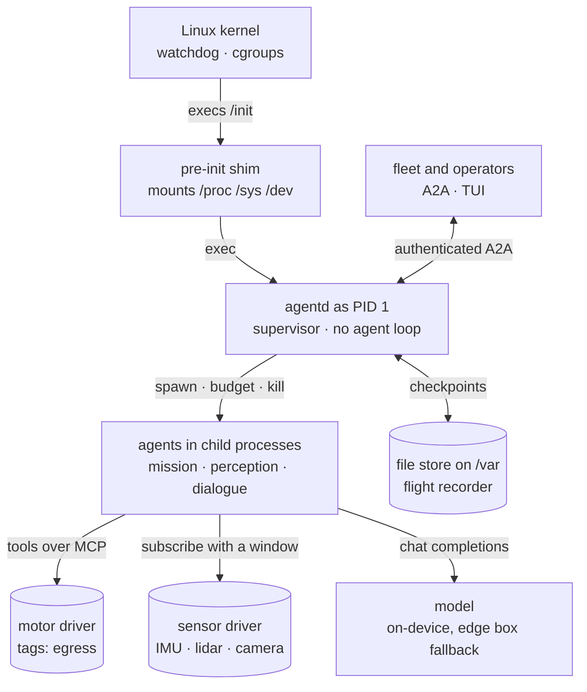

# Edge and appliances: agentd as PID 1

This case study takes one idea seriously: a custom Linux image — a robot
controller, an appliance, a kiosk, an edge box — whose init process is the
agent runtime. It is for architects of devices that run one supervised job
forever. The first half describes what agentd does as it ships, which you can
verify; the second half, marked as such, is design exploration.

## The idea

A running Linux system has exactly one process the kernel starts itself:
PID 1, the init process. Everything else on the machine descends from it,
every orphan becomes its child, and when it exits the kernel panics. Init is
the one program that must supervise, reap, restart and shut down, forever.

That is the agentd supervisor's job description, minus three mounts and a
`reboot(2)`. Picture a machine with no systemd, no service manager and no
shell: the kernel boots, agentd starts, and the machine's whole userland is one
supervised, budgeted, durable agent tree. For an intelligent machine, the first
process is the thing that thinks.

## Why it fits: init's duties are the supervisor's

Init has five duties. agentd performs four of them as its day job.

| Init duty | What agentd already does |
|---|---|
| Reap orphans | One thread owns `waitpid(-1, WNOHANG)` for the whole process, and the supervisor sets `PR_SET_CHILD_SUBREAPER`. A reparented orphan is reaped and its status discarded, so zombies never pile up. |
| Supervise and restart | A restart governor with backoff and a circuit breaker, dead and stuck detectors, and a kill ladder: cancel, `SIGTERM` to the process group, then `SIGKILL`. Every child dies with its parent. |
| Handle signals | Real handlers from the first instruction: `SIGTERM` drains (finish in-flight work, refuse new work, exit), `SIGHUP` reloads the configuration, `SIGCHLD` wakes the reaper. |
| Own system state | Workflows are a dependency graph over durable state. Per-child resource limits, niceness by priority and cgroups are resource control; pressure shedding under low memory or disk is graceful degradation. |
| Bring up the world | **Not done, deliberately.** Mounting `/proc`, `/sys` and `/dev`, setting the hostname and raising loopback is a twenty-line shim that runs first (see [Boot](#boot-from-power-button-to-first-turn)). |

Two properties make the fit unusually clean:

- **The binary is a static musl executable.** No dynamic linker, no libc on
  disk, no `/usr`. The shipped container already runs it `FROM scratch` as a
  non-root user, and as the container's PID 1. An initramfs holding only
  `/agentd`, a configuration and CA roots is a complete bootable userland;
  [Engineering choices](why-rust.md#the-numbers) has the binary's size.
- **The supervisor runs no agent loop.** The process that holds PID 1 — the
  one that must not crash, must not block and must not be talked into
  anything — holds the state and the credentials, and no conversation reaches
  it. Its only model calls are the opt-in goal check and approval judge, each
  one structured question with no tools. The agent loops run in killable
  child processes with budgets. A manipulated model on this machine can be
  killed by its parent, and it cannot instruct the parent. That is the right
  trust topology for a machine that can move.

### What PID 1 changes

- **Nothing can kill you, and you cannot crash.** `SIGKILL` and `SIGSTOP` do
  not apply to PID 1, and a crash is a kernel panic. The restart governor that
  supervises everyone else does not supervise agentd itself. The mitigations
  are the kernel's: a hardware watchdog, and `panic=<seconds>` over a
  known-good A/B root filesystem, so a dead supervisor becomes a reboot into
  the previous image rather than a frozen robot.
- **Exit means reboot.** When init exits the kernel panics, so agentd's exit
  codes — an API on a server — become reboot policy on an appliance: the shim
  catches the exit status and calls `reboot(2)` or powers off.
  `lifecycle.exit_code_map` can remap the partial and budget codes.
- **You inherit everyone.** Every daemon a driver spawns, and every orphan,
  reparents to agentd, and the reaper collects them. What agentd does not do,
  and should not do silently, is restart processes it never started. Anything
  that must be supervised should be declared: a workflow step, a subagent, or
  a driver the shim started before handing over.

## The shape: a robot's userland as one configuration

The frame for the rest of this page is a mobile manipulator: one board, one
configuration. Every capability is something the configuration wires on, which
is exactly the property you want on a machine with motors.



Read it as three trust rings. The kernel and PID 1 run no agent loop. The
agents reason, but are budgeted, resource-limited and killable. The drivers
touch hardware but expose only the tools they declare: an agent can call
`motor.move`; it cannot open `/dev/ttyCAN0`, because there is no file tool and
no shell. The Rule of Two applies with one word changed — on a robot,
**actuation is egress**. An agent holding untrusted input (a voice command, a
QR code in a camera frame), sensitive context and actuator access is the
configuration agentd refuses to start.

A sketch of that configuration — the drivers as MCP servers on loopback, the
model on the device with an edge box as fallback, and a reflex that needs no
model:

```yaml
agent:
  name: robot-07
  instruction: You run a warehouse robot. Safety workflows outrank every request.
intelligence:
  endpoints: [http://127.0.0.1:8081/v1/chat/completions, https://edge-box.local/v1/chat/completions]
  model: gpt-5-mini
mcp:
  servers:
    - {name: motor, endpoint: http://127.0.0.1:7001/mcp, tags: {"*": [egress]}}
    - {name: sensors, endpoint: http://127.0.0.1:7002/mcp, tags: {"*": [sensitive]}}
store:
  kind: file
  file: {path: /var/lib/agentd}
a2a:
  listen: unix:///run/agentd/robot.sock
security:
  workflows: {immutable: true}
workflows:
  - name: collision-watch
    priority: high
    steps:
      too_close:
        kind: subscribe
        server: sensors
        uri: sensors://lidar/front
        filter: "content.min_range_m < 0.5"
        window: {samples: 64}
      stop:
        kind: mcp.tool
        depends_on: [too_close]
        server: motor
        tool: stop
      done: {kind: finish, depends_on: [stop]}
```

Every element maps to a feature that ships:

- **Sensor streams.** A driver publishes an MCP resource; a `subscribe` start
  with `window: {samples: 64}` delivers the last 64 readings — the trend, not
  the instant — and `debounce_ms` collapses bursts.
- **Subsystem isolation.** Perception, planning and dialogue run as separate
  agents with per-child operating-system limits: a subagent's `limits: {memory,
  cpu}` become `RLIMIT_AS` and `RLIMIT_CPU` between fork and exec, and
  `priority: low` maps to niceness and is shed first under pressure.
- **Co-located composition.** Several agentd instances — one per subsystem or
  per compute module — talk A2A over unix sockets, where the kernel checks the
  peer's uid; no TCP, no TLS handshake per exchange.
- **Graceful degradation.** Under low disk headroom or cgroup memory pressure,
  new work is shed (low priority first) while in-flight work drains. On a
  robot that is the difference between "stops accepting small talk, keeps
  balancing" and "killed by the OOM killer mid-step".
- **Standing orders that cannot drift.** `security.workflows.immutable: true`
  makes the loaded workflows read-only at runtime, to the model and to
  operators alike. The robot's safety behaviour is what was flashed, not what
  an agent talked itself into overnight.
- **The flight recorder.** The durable file store, plus the audit trail once
  `observability.audit` names a sink. After an incident you can replay what
  the machine was asked, which principal asked it, and what it did.

## What the deliberative layer is not

Being honest about the boundary makes the rest credible.

- **agentd is the cortex, not the spinal cord.** Motor control loops, balance,
  current limiting and the emergency stop — anything with a deadline in
  microseconds to milliseconds — belong in firmware or a real-time
  microcontroller below the Linux board, as on every serious robot today. The
  supervisor is a blocking, event-driven loop whose idle wait is capped at
  200 ms. It is fast for a deliberative layer and it is not, and will not
  claim to be, hard real-time. The motor driver should expose goals ("drive to
  the dock"), not torque values.
- **ROS 2 is a colleague, not a competitor.** If the platform already runs
  ROS, agentd sits above it as the mission layer, with one small MCP server
  bridging topics and actions into tools and resources. ROS moves the joints;
  agentd decides, supervises, remembers and answers to the fleet.
- **A model needs somewhere to run.** On the device (llama.cpp or a vendor NPU
  runtime that speaks the OpenAI-compatible wire), on an edge box on the local
  network, or in the cloud; an ordered endpoint list fails over between them,
  and budgets keep an offline robot from burning its allowance on retries. A
  robot with no reachable model still runs: workflows made of data steps and
  tool calls, like the collision watch above, need no model at all.

## Exploration: boot and beyond

> **Note.** Everything from here on is design exploration. Nothing below ships
> as a feature, and the `--init` mode it proposes does not exist.

### Boot: from power button to first turn

A minimal image is an initramfs or squashfs root holding:

```text
/init                     the shim, about 20 lines
/agentd                   the static binary
/etc/agentd/robot.yaml    the machine's whole userland, declared
/etc/agentd/workflows/    standing orders, immutable at runtime
/etc/ssl/certs/           CA roots, if any endpoint leaves the machine
/drivers/*                the MCP driver servers, static binaries too
/var                      writable: the file store, logs (tmpfs or a partition)
```

The kernel needs `DEVTMPFS`, cgroups v2, `UNIX`, `INET` (loopback, even
offline), the board's watchdog driver and a panic timeout. Building the
drivers in, with no modules, is simplest. Two gotchas cost real debugging time
on embedded boards:

- **Time.** TLS certificate validation needs a plausible clock. A board with no
  real-time clock boots in 1970, and every HTTPS dial fails until NTP runs.
  Give the shim a clock step, run offline-first, or pin trust in a way that
  does not depend on wall-clock validity.
- **Entropy.** Early-boot TLS on a quiet board can block on the random number
  generator. A hardware RNG, or a kernel that trusts the CPU's, removes the
  problem; decide it at kernel configuration time, not in the field.

PID 1 must mount the API filesystems before anything else works. Keep what runs
before agentd small enough to review at a glance:

```sh
#!/bin/sh
# /init: runs as PID 1, then hands the pid to agentd.
mount -t proc proc /proc
mount -t sysfs sysfs /sys
mount -t devtmpfs dev /dev
mount -t cgroup2 cgroup2 /sys/fs/cgroup
hostname robot-07
ip link set lo up
/drivers/motor-ctl --listen 127.0.0.1:7001 &
/drivers/sensors --listen 127.0.0.1:7002 &
exec /agentd -c /etc/agentd/robot.yaml --env /etc/agentd/fleet.env
```

`exec` is the important word: agentd becomes PID 1 instead of its child, so
the reaper, the signal handlers and the drain semantics are init's. The drivers
started before the `exec` are inherited children — reaped if they die, and,
because they are also declared MCP servers, their death is visible: the
connection drops and the telemetry says which capability has left the
machine. If you would rather not ship a shell at all, the shim is a few dozen
lines of statically linked Rust.

### A proposed `--init` mode

Everything above works with agentd as it ships. The ergonomic gap is that the
shim owns mounts and reboot while agentd owns everything else. A small
`--init` mode — mount the API filesystems if absent, translate the final exit
code through `reboot(2)` (reboot on failure codes, power off on clean
completion), and optionally pet `/dev/watchdog` from the existing health tick —
would collapse the shim to `exec /agentd --init`. It would deliberately not be
a service manager: anything that needs supervision should already be a
workflow step, a subagent or a declared MCP server.

### What an init-native agent could unlock

Ideas worth prototyping; none is a promise.

1. **Reflex and deliberation as priority tiers.** `priority: high` for the
   collision watch, `low` for conversation. Under pressure the robot stops
   making small talk before it stops watching where it is going: degradation
   order as configuration.
2. **The watchdog as a judgment of behaviour.** Petting `/dev/watchdog` from
   the health tick means "the supervisor is alive". A stricter robot pets only
   when the safety workflow's last runs succeeded, turning the hardware
   watchdog into a dead-man switch for behaviour, not only the process.
3. **A/B roots and fresh generations as OTA.** Flash B and reboot into it. The
   file store already distinguishes "same brain, new body" (a
   `store.config_changed` warning) from "start over" (`--fresh`). A failed
   boot panics into the watchdog, which reboots A. Fleet OTA becomes an A2A
   command a fleet agent sends.
4. **One subagent per limb.** Each manipulator's planner as a warm subagent
   with memory and CPU limits sized to it, killed the moment its budget or
   deadline trips. The kill ladder as a safety feature: no planner death spiral
   can hold a joint.
5. **Interlocks as principals.** The emergency-stop chain publishes an MCP
   resource, and safety workflows subscribe to it. The A2A principal model
   gives the teach pendant the `operator` role and the cloud dashboard the
   `user` role: it can start conversations and see what it started, and no
   operator control answers to it. A `security.policies` rule matching
   `principal: "user:*"` and `tags: [egress]` can deny it every actuator tool
   outright. Roles are enforced at the listener, not by politeness.
6. **The kiosk and appliance case.** Nothing here is robot-specific. A
   point-of-sale box, a lab instrument or a set-top device — any machine whose
   whole job is "run this one supervised thing forever" — gets the same deal: a
   userland with no shell to compromise, one auditable configuration, and an
   agent as the only interface.
7. **Field debugging from a laptop.** The terminal UI attaches over the A2A
   listener, so `agentd-tui --endpoint https://robot-07:8443 --login` on a
   laptop at the maintenance port, approved by an operator, is the whole
   story — or the dialogue agent is the debug interface, with the caller's
   role gating what it may do.
8. **Simulation parity.** The same configuration boots as PID 1 on the robot
   and as an ordinary process against simulated drivers in CI. Because the
   userland is the configuration, "test what you ship" is a one-line diff:
   the drivers' endpoints.

## Where to start

Prototype without touching a bootloader. Run the configuration above as an
ordinary process against mock driver servers: the subscribe window,
priorities, resource limits, unix-socket A2A and immutable workflows behave
the same. Then move it into a container, where the shipped image already runs
agentd as the container's PID 1. The initramfs is the last step, not the
first, and by then it is a packaging exercise.

agentd's premise is that an agent is something you run with the same
discipline as any other long-lived process. PID 1 takes that premise to its
end: the machine does not have an agent; from its first userland instruction,
it is one.

## Next steps

- [Supervision and containment](harness.md) — the reaper, the kill ladder, the
  restart governor and budgets.
- [Security model](security.md) — the Rule of Two; read "actuation is egress"
  against it.
- [Deploy](deployment.md) — the server-side siblings of these patterns.
- [Operate a running daemon](operations.md) — the controls a fleet drives each
  unit through.
