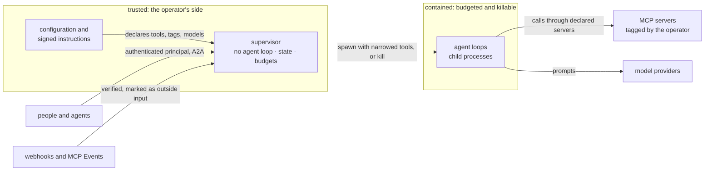

# Security at a glance

agentd wires a language model to real credentials and real side effects, and
treats that as the problem to solve rather than a detail. This page is for
CISOs and security reviewers deciding whether to adopt it: the containment
model in plain terms, where the trust boundaries are, what is enforced, and
what is left to the environment around agentd. The [Security model](security.md)
has the full account, and [Harden a deployment](harden.md) turns it into
configuration.

## The threat model

agentd assumes the worst about the model and everything it reads.

- **The model is untrusted input that holds credentials.** After a successful
  prompt injection, the agent loop emits the attacker's tool calls with the
  operator's authority.
- **Everything an MCP server returns is untrusted** — tool results, and also
  tool names, descriptions and schemas. Server metadata reaches the model as
  the tool catalogue, but it never makes a security decision.
- **Prompt injection is not patchable.** There is no classifier and no "is this
  an injection?" model call. The defences are structural: they bound what a
  compromised loop can reach, not what it intends.

agentd trusts its own binary, the operating system and the operator's
configuration. Nothing the model or a server says can register a server,
change an endpoint or name a binary to run.

## The trust boundaries



The supervisor holds the state and the credentials and runs no agent loop, so
no conversation can steer it. Its two opt-in judges — the goal check and
automatic approvals — each put one structured question to a model, with no
tools, and can only answer that question. The agent loops run in child
processes that the supervisor budgets and can kill. What comes in from
outside — a caller, a webhook body, an upstream event — enters through an
authenticated door and is remembered as outside input wherever it flows.

## No ambient authority

agentd ships no file, shell or HTTP tool library. Every capability an agent
has is a tool on an MCP server the operator declared, so the blast radius of a
run is the list of servers in the configuration. That list narrows and never
widens: a workflow step or a child agent can be limited to a subset of servers
and tools, and a child cannot grant itself more.

Local command execution is off twice over. The guarded `exec` runner is absent
from every shipped binary; a build from source must include it, and the
configuration must enable it. Even then it runs argv without a shell, from an
allow-list of commands, inside a confined working directory, with a timeout,
an output cap and a minimal environment.

## Killable reasoning and hard budgets

Every turn runs in a child process with its own process group. The supervisor
enforces step, token and wall-clock budgets per run, per conversation, per
instance and per caller, and ends a child that overruns or stops making
progress: a cancel, then `SIGTERM` to the process group, then `SIGKILL`. If
the supervisor itself dies, the kernel takes its children with it. An optional
cgroup per child process caps memory and process count.

## The Rule of Two

Each MCP server is tagged by the operator with the risks it carries:

| Tag | Meaning |
|---|---|
| `untrusted_input` | returns content from an uncontrolled source: web pages, inbound mail, ticket text |
| `sensitive` | reaches private data or privileged systems |
| `egress` | can move data out or change the outside world |

An agent may hold at most two of the three. A configuration that gives one
agent all three — the "lethal trifecta" that turns an injected instruction
into exfiltration — does not start, and a server with no tags counts as
`untrusted_input`: what it answers taints the work that reads it, until the
operator tags it, `trusted` for a server that carries no leg. The check runs
again when an agent spawns a child, and over every workflow that text from a
webhook, an A2A caller or an upstream event can reach. Overriding it takes
an explicit `security.allow_trifecta`, which a hot reload cannot change.

## Untrusted input stays where it was read

Three mechanisms keep outside text away from a context that could act on it:

- **Process isolation with a distilled return.** A child that reads untrusted
  input returns a bounded summary, never its transcript. The raw bytes die
  with the child.
- **Streams carry their taint.** A stream carries the tags of what feeds it:
  a webhook or an A2A caller marks it as outside input, and an MCP Events
  binding gives it its server's tags (`untrusted_input` when the server has
  none). Every run that reads a tainted stream, and every run such a run
  starts, is checked against the Rule of Two with every server it can reach.
- **Read-back is withheld.** When a context holding both `sensitive` and
  `egress` reads back the result of a run that carries outside input, it gets
  the run's status and a marker saying why, not the text.

## Egress control

A `services:` catalog binds each external endpoint to authoritative tags and a
tool ceiling. Under `security.egress: closed` the catalog becomes an
allow-list: an MCP server, model provider, A2A peer, `http` step target or
other outbound URL that matches no entry is refused at load, or at execution
when it is templated. URLs a model or a workflow can influence pass through an
SSRF guard that refuses private, loopback and cloud-metadata addresses and
dials only the address it checked. A workflow's `http` step follows no
redirects.

```yaml
agent:
  instruction: You answer questions about customer accounts.
intelligence:
  endpoints: https://api.openai.com/v1/chat/completions
  model: gpt-5.1
  token: "{{secret:OPENAI_API_KEY}}"
services:
  openai: {kind: intelligence, endpoint: https://api.openai.com/v1/chat/completions}
  crm:
    kind: mcp
    endpoint: https://mcp-crm.example.com/mcp
    tags: {"*": [sensitive]}
    allow: ["get_*", "search_*", "update_note"]
  mail:
    kind: mcp
    endpoint: https://mcp-mail.example.com/mcp
    tags: {"*": [egress]}
mcp:
  servers:
    - {name: crm, service: crm}
    - {name: mail, service: mail}
a2a:
  listen: http://127.0.0.1:8420
  bearer: "{{secret:A2A_BEARER}}"
security:
  egress: closed
  policies:
    - match: {tags: [egress]}
      action: ask
      question: "The agent wants to call {{tool}} with {{args}}. Allow it?"
      on_timeout: deny
```

Every outbound endpoint here is catalogued, the CRM's destructive verbs are
absent rather than discouraged, and every call to an `egress` tool waits for a
person's approval.

## Approvals and policies

`security.policies` is an ordered list of verdicts on individual tool calls —
`allow`, `deny`, `ask` or `shadow` — matched by tool name, tags, caller,
principal or a CEL expression over the arguments. It applies to every caller:
root turns, workflow steps and child processes alike. An `ask` holds the call
and asks a person; an `ask` nobody can answer is denied by default.

Human gates are durable for workflow runs, and a gate can name who must
answer. An operator may let a model judge answer routine asks on their behalf
(`agent.approval: auto`), on the model `intelligence.roles.approve` names. No
judge ever answers an ask whose run, child or peer conversation carries outside
input, an addressed gate is never judged, and a policy gate never goes to the
judge. Automatic answers are marked as such in the task, the
log and the audit trail.

## Who can reach in

The A2A listener is the one door into a running agentd.

- A listener bound off the local machine must authenticate callers — a bearer
  token or mTLS client certificates — and plaintext is loopback-only; the load
  refuses anything else.
- Every caller resolves to a principal with a role (`operator`, `user`,
  `agent`) before its request body is read. Operator controls answer to the
  operator role alone, and a `user` or `agent` sees and acts on only what it
  started.
- People sign in with an OAuth device grant that an operator approves under a
  name; no shared secret is copied into a browser or a terminal.
- A browser request must come from an allow-listed origin and always
  authenticates.

> **Warning.** On a listener bound to loopback with no credential configured,
> every local process that presents nothing is the operator — every local
> user, not only you. Configure a credential, or use a unix socket, on any host
> you do not fully own.

## Secrets as references

Secrets appear in configuration only as `{{secret:NAME}}` (an environment
variable) or `{{secret-file:PATH}}` (a mounted file, re-read at use, so a
rotation needs no restart). An inline credential at a known secret path, in a
credential-shaped header, or in an `auth:` block is refused at load. Secret
values print as `***` and never reach a log line. Logs record sizes, not
contents, unless `observability.log_content` is turned on.

## Where the instruction came from

The instruction is the agent's standing policy, so agentd can verify three
independent facts about it: who wrote it (an author signature checked against
a pinned publisher), who delivered it (a registry's signed delivery
attestation), and who pushed it (a cosign signature on an OCI artifact).
Pinning an OCI reference by digest removes the mutable-tag question entirely.
Documents can be encrypted to the agent's key (age or JWE). A document's
signature can narrow what it is allowed to configure, never widen it, and a
document may set only an allow-listed part of the configuration.

## The audit trail

Every event is a JSON line on stderr carrying the run and trace ids. With
`observability.audit` configured, agentd also records who did what — every
A2A call and command, config reloads, restores and kills — to the log, to an
append-only record in the store, or to a stream a workflow can ship off the
box. Command executions, judge decisions, withheld read-backs and refused
callers each have their own event.

## What agentd does not protect against

- **It is not a sandbox.** No seccomp, namespaces or chroot. Run it inside a
  container or VM with its own filesystem scope and resource limits.
- **It does not enforce network policy.** Which hosts the process can reach is
  a firewall or NetworkPolicy concern; the egress allow-list governs what
  agentd dials on purpose, not what a compromised MCP server reaches.
- **It does not detect injection.** Containment limits the damage; it is not a
  guarantee.
- **It does not tag per tool.** Tags apply to a whole MCP server; to split risk,
  split servers.
- **It does not detect a server changing its tool descriptions** after the
  first connection.
- **It does not audit an override of the Rule of Two.** Setting
  `security.allow_trifecta` proceeds without an audit event; review it in the
  configuration diff.

## Reporting a vulnerability

Report a security problem privately, not in a public issue.
[SECURITY.md](../SECURITY.md) says how, and what is in scope.

## Next steps

- [Security model](security.md) — every control, where it is enforced, and
  its limits.
- [Harden a deployment](harden.md) — the checklist as validated
  configuration.
- [Supervision and containment](harness.md) — the process tree, budgets and
  the kill ladder.
- [Instruction documents](directives.md) — what a document may declare, and
  how it is verified.
