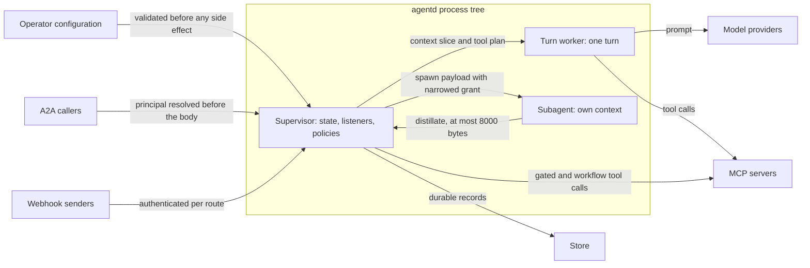
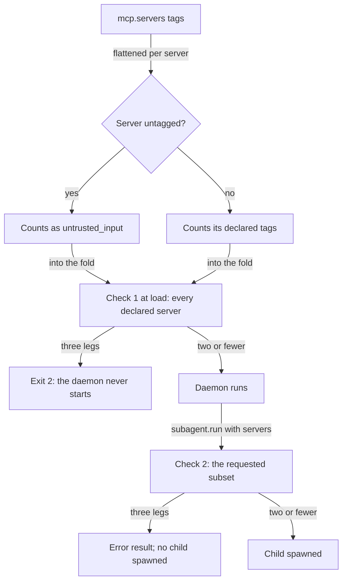
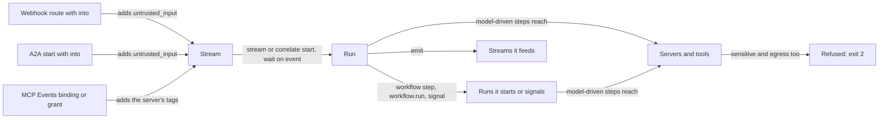
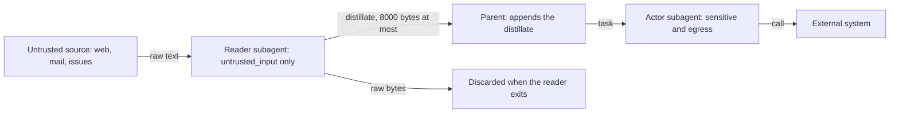

# Security model

agentd wires a language model to real credentials and real side effects, so
everything the model reads may be adversarial and everything it can call is
authority it holds. This page explains what agentd enforces, where each rule
runs, and what agentd does not defend against, for security reviewers and
operators who need the reasoning behind the controls. To apply it, follow
[Harden a deployment](harden.md).

## The threat model

agentd assumes three things about the parties it works with.

**The model is untrusted input holding credentials.** Under a successful
prompt injection, the agent loop emits tool calls an attacker chose, with the
operator's authority. Treat an agentd process as potentially compromised and
size the sandbox around it accordingly.

**Everything an MCP server returns is untrusted.** That covers tool results
and also what the protocol presents as metadata: a tool's name, description,
input schema and annotations. A malicious server can put an injection in a
description. agentd hands that metadata to the model as the tool catalogue and
never lets it make a security decision: capability tags come from operator
configuration only, and `readOnlyHint` and `destructiveHint` are hints, never
gates.

**Prompt injection is not patchable.** A guardrail that works 95% of the time
is a failure in security terms. The defences here are structural: they bound
what a compromised loop *can reach*, not what it *intends*. agentd ships no
injection classifier and asks no model whether a text is safe.

agentd trusts its own binary, the operating system and the operator's
configuration. What arrives over the network cannot change that
configuration, with one bounded exception: the operator-only `admin.set`
command reaches exactly two paths, `agent.approval` (how closely a person is
asked) and `a2a.introspection.enabled`. Every other path is refused with the
list of what is settable, nothing is written to disk, and the next reload puts
the file's value back. The model can never register an MCP server, edit an
endpoint or name a binary to run.

## Trust boundaries

agentd splits the work across processes so that the process holding the
operator's control is not the one running the agent's reasoning. The
supervisor owns state, configuration, credentials, policies and every
listener, and runs no agent loop. Each of the agent's turns runs in a turn
worker process, and each subagent in its own process with its own context.



Apart from the operator's configuration, everything that crosses into the
tree is untrusted content: model output, tool results, A2A messages and
webhook bodies. The controls on the rest of this page decide what that content
can reach once it is inside.

## Capability scoping

An agent's authority is the set of tools its operator declared. agentd has 58
internal tools (memory, artifacts, plans, subagents, workflows, asks and
similar), listed by `agentd --capabilities`. Every *task* capability, such as
reading a repository, sending mail or querying a database, comes from an MCP
server the operator declared. Declaring a server is a trust decision
equivalent to adding a dependency you call at your own privilege.

Narrowing is set membership, not a policy language. It applies at two places:

- A workflow `agent` step's `tools:` list filters the tool plan by pattern
  (`*`, an exact name, or `prefix*`) before the worker sees the definitions.
  Its `servers:` list is a cap: the step is offered the MCP tools of those
  servers alone.
- `subagent.run`'s `tools:` argument confines the child. The supervisor mints
  it into the spawn payload as a grant, and the child filters both its
  catalogue and its dispatch routing against it, so an excluded tool is
  unreachable, not merely unadvertised. A caller-supplied `context` entry
  cannot forge or widen the grant. Its `servers:` argument builds the payload
  from those server specs only, so the child cannot dial the rest.

> **Limit.** An unknown name in `subagent.run`'s `servers:` is dropped
> silently. A typo yields a less capable child and no diagnostic.

`agent.tools.internal`, `agent.tools.mcp` and `agent.tools.code` filter what
the model *sees*. They are a catalogue filter, not the authorization check.
Internal tools carry default grants by caller kind (root, workflow,
subagent); the tiers are in the [reference section](#internal-tool-tiers).

Callers from outside arrive over A2A as principals. A turn that a `user` or
`agent` principal drives is held to that principal: tools that act on the
whole instance are refused, and tools that name a run or a subagent act only
on the principal's own. A principal's `grants` bound the command operations
it may call; they do not bound what the model does in a conversation the
principal starts. A natural-language message from a `user` drives a turn with
the root tool plan, so to restrict which tools that turn may call for a given
caller, write a [policy](#policies-a-verdict-on-each-call) that matches the
principal.

## Tool tags and the Rule of Two

The trust budget is three tags the operator declares on each MCP server:

| Tag | The tool… |
|---|---|
| `untrusted_input` | returns content from an uncontrolled source: web pages, inbound mail, issue text |
| `sensitive` | reaches private data or privileged systems: a secret store, an internal database, a production control plane |
| `egress` | can move data out or change external state: an HTTP POST, sending mail, opening a pull request |

The *lethal trifecta* is all three in one agent: something that reads text an
attacker wrote, can reach secrets, and can send data out. The **Rule of Two**
is agentd's response: any two legs may sit together, all three may not. The
budget is an OR across tools, never a count, so twenty `egress` tools are
still one leg, and `sensitive` + `egress` together is allowed as long as
nothing in the same grant reads untrusted input.

Tags come from configuration only, and an unknown tag is a configuration
error. Nothing the model or a server says feeds the check. Three properties of
tags matter when you assign them:

- **Tags are per server, not per tool.** The `tags:` map is keyed by glob, but
  the keys are discarded and the union of every list applies to every tool of
  the server. `{"send_*": [egress], "read_*": [untrusted_input]}` makes both
  tools `untrusted_input` and `egress`. The only real split is one MCP server
  per tag profile.
- **An untagged server counts as `untrusted_input`**, the conservative
  default.
- **`tools.narrow.<tool>.tags` adds tags to one tool**, and can never remove
  one. Those per-tool tags reach the [policy](#policies-a-verdict-on-each-call)
  matcher, not the load-time Rule-of-Two check.

### Where the check runs

The check runs at two points over servers, both governed by the one
`security.allow_trifecta` switch, and at a third over what reaches a run
through a stream ([below](#outside-input-that-arrives-through-streams)).



Check 1 runs inside configuration validation, the one authority that both
startup and `agentd --validate-config` use, so the two never disagree. A
refusal is exit 2, before any side effect:

```text
lethal-trifecta refused: the root grant wires untrusted_input + sensitive + egress into one agent; narrow the tags or set security.allow_trifecta (audited)
```

Check 2 runs when `subagent.run` is called, over the tags of the servers the
child would get. It returns an error result the parent's model must adapt to.

Because check 1 folds over every declared server, it is a whole-instance
budget. An instance that declares an untrusted-input reader, a secrets server
and an egress server does not start, even if you intend to hand each leg to a
different subagent. Run that shape as separate agentd instances per risk
profile, or set `security.allow_trifecta: true`, which relaxes every trifecta
check at once. The `security` section is restart-only, so a hot reload can
never widen the override.

Two sources other than `mcp.servers` matter. A binary built with the `exec`
feature and running with `security.exec.enabled` contributes `sensitive` and
`egress` to the same fold. Tools an embedder registers in code sit outside the
accounting entirely: they carry no tags, so an embedded tool that does egress
or reads secrets is invisible to the check.

> **Limit.** Using `security.allow_trifecta` emits no event. The refusal text
> says "audited", but an allowed trifecta proceeds silently and the only trace
> is the configuration value.

## The service catalog and closed egress

Tags being configuration leaves one hole: the author of a config, or of a
subagent template, could point a server at the billing system and not write
`sensitive`. The check would then reason soundly from a false premise. The
`services:` catalog closes it. An entry binds an endpoint to authoritative
tags, and any MCP declaration whose endpoint matches the entry gets those tags
unioned in before the check runs, whether it references the entry or restates
the endpoint inline. Under-tagging a catalogued endpoint is impossible rather
than undetected. An entry also carries a tool ceiling (`allow`, `exclude`)
that a consumer can narrow and never widen, and the one shared credential its
consumers use.

`security.egress: closed` turns the catalog from an authority into an
allow-list. Every outbound dial agentd makes from configuration must then
match an entry of the right `kind`, matched on scheme, host and a path prefix
that ends on a segment boundary:

| Surface | Entry kind | Checked |
|---|---|---|
| MCP servers, a subagent template's servers | `mcp` | at load, and again before each dial |
| model endpoints, every `intelligence.providers` entry | `intelligence` | at load |
| A2A peers | `peer` | at load |
| HTTP store, workflow `url:` references | `http` | at load |
| the `http` step | `http` | literal URLs at load; every URL again at the dial, where a matching entry's `methods` list is a ceiling |
| stream `forward` webhook targets | `http` | at the forward; a refusal logs `stream.forward.refused` |
| A2A push targets a caller registers | `http` | at registration |
| `agent.instruction` from `url:` or `oci:` | `http` | before the fetch |

An instance child inherits the closed setting. The built-in `mock:` model
endpoint opens no socket and is exempt. There is deliberately no in-config
exception list: the way to allow an endpoint is to catalog it, which is the
reviewable event it should be.

What closed egress does not bind:

- `observability.otel.endpoint`. Telemetry export is operator plumbing, and
  validation warns that closed egress does not cover it.
- Credential plumbing: OAuth token and discovery endpoints, the AWS metadata
  and STS endpoints, the AAuth Agent Provider and Person Server.
- Anything a compromised MCP server, or a command the `exec` runner starts,
  reaches on its own. Network policy at the host or cluster stays
  complementary; the catalog is what makes those rules derivable.

## Outside input that arrives through streams

The two checks above judge servers. Neither sees text that reaches a run
through a stream: a webhook route with `into:` appends whatever its caller
posted, an A2A `a2a` start with `into:` appends a peer's message, and the
workflow consuming the stream hands that text to an agent. A config whose
servers are all tagged, one of them `sensitive` + `egress`, passes check 1 and
could then feed a webhook body to the agent holding both. So agentd taints
streams and judges the runs that read them.



**Producers taint a stream.** A webhook `into:` and an A2A `into:` add
`untrusted_input`: a valid signature says who sent the text, not that it is
safe to obey. A subagent template's `mirror_streams` adds `untrusted_input`,
because the child's producers run in another process. An MCP Events binding
or grant adds its server's tags, and `untrusted_input` when the server is
untagged, since whoever can write into the watched upstream writes into the
stream. An `emit` from a run that carries taint puts it on its target.

**Runs carry what they read.** A run started from a tainted stream, or
waiting on one, carries its tags. So does every run it starts: a `workflow`
step, a workflow tool one of its agents calls, `workflow.run`, and
`workflow.signal` (a signal reaches every workflow with a `signal` start or a
`wait {on: signal}`).

**The check.** Each such workflow is judged with its tags folded together with
everything its model-driven steps can reach: an `agent` step's `servers:` (or
every server without the list), a `subagent` step's template servers, any
tool that hands text on (`subagent.run`, `subagent.send`, `message.send`,
`workflow.run`, `workflow.signal`) and what that tool can reach, and `exec`.
Every model-driven step of a run the outside text reaches is judged together,
so a reader and an actor in one run, or an actor in a run the reader starts,
are refused alike. The refusal names the workflow, the stream, what feeds it
and the servers that brought the other two legs:

```text
workflow "triage": lethal-trifecta refused — it consumes stream "inbox" (fed by webhook `into:` at workflow "intake" step "hook"); it is run by workflow "triage" step "reply" (through workflow.run), and its model-driven steps reach mcp server "mail" [sensitive, egress]: untrusted input + sensitive + egress in one run. …
```

A run that has to act on what it read does so with no model-driven step
holding both other legs: read with a step that has no tools (`extract` is
built for this), and act with a deterministic step (`mcp.tool`, `http`), whose
target is fixed in the definition.
[Harden a deployment](harden.md#keep-outside-input-away-from-the-actors) has
a worked example.

The check runs at `--validate-config` for inline definitions and those in
local files and folders, and at startup and on every reload for the whole set
once `url:` and `uri:` definitions resolve. A reload that moves anything the
check reads re-judges every definition, the agent's stored ones included; a
refused reload keeps the running configuration. A definition the agent writes
is held to the same line: `workflow.create` and `workflow.update` refuse one
that would complete the trifecta. A `wait` whose `on` is templated is refused
at load, since rendered at dispatch it could listen on something the check
never saw.

A route's own run is the operator's call. A `webhook` or `a2a` start that
fires a run directly, and a `wait {on: webhook}`, hand a caller's text to a run
the operator opened on purpose; that run is not judged on its own reach. What
such a run emits onto a stream is judged like `into:`.

What the check does not follow:

- **Deterministic steps.** `mcp.tool`, `http`, `a2a.send` and `a2a.delegate`
  are not counted, because no model picks their target. Their *arguments* are
  templated and can carry what a model that read the outside text produced.
  Give that model an `output_schema` so what reaches the arguments is
  constrained.
- **Shared state.** Text a model writes to memory or an artifact is not traced
  to whoever reads it.

The telemetry taps (`observability.runtime_events` and an audit `stream`
sink) are fed by every run, and their consumers are judged as any stream's
consumers are. A workflow tool carries the taint of the run it starts, and
the tools that read a result back carry the taint of every run, so a policy
that matches `untrusted_input` sees them too.

The check is coarse and static on purpose: per stream, not per value, and per
server. It is a grant-level check, not data-flow tracking.

## Results read back are withheld

Taint flows forward into what a run starts. It also flows back, when a context
reads a run's or a child's result. A context that holds both `sensitive` and
`egress` and reads back a result carrying outside input would complete the
trifecta, so the runtime answers it with the run's status and replaces the
text with a marker that says why. It logs `readback.withheld`.

```text
output withheld: this run carries outside input (it consumes stream "inbox" (fed by webhook `into:` at workflow "intake" step "hook")); this conversation holds sensitive and egress tools
```

The output, result and error text are replaced, along with the opening of a
child's instruction and a run's step outputs and variables. Status, ids and
timings stay. Every path a result can be read back through is covered; the
[reference section](#read-back-paths) lists them.

**What a run carries is recorded, and only ever added to.** Each run and each
child keeps a durable record of the outside input that reached it: from its
definition's taint, from the run, child or peer that started or signalled it,
from an A2A peer's own request, and from a stream event's record. A read is
judged by that record together with the current definitions, which can only
add. Deleting or replacing a definition, a restart, and a peer that has gone
quiet all leave a result as withheld as it was; a run with no record left is
taken to carry text from an origin no reader holds. A result is withheld only
for text the reader was not already handed, so a route's own run reading back
a child it started reads nothing new.

**Holding a leg less, a context reads the text whole, and then carries it.**
Its own result is withheld in turn from a reader holding both legs, and what
it starts or feeds is judged as a run that read a tainted stream would be. So
no read-back is refused at load. An operator reading a run over A2A is no
model's context and reads it whole. `security.allow_trifecta` lifts the
withholding with every other trifecta check.

## The injection firewall

The defence that does the most work is process isolation plus a distilled
return. A subagent runs in its own process with its own context, and the
parent appends only the child's result, never its transcript. A string result
over 8000 bytes is cut back to a UTF-8 boundary.



Poisoned text lives only in the reader's context and is gone when that
process exits. The reader holds no sensitive tool, so it has no secret to
encode into its summary. This is a trusted-planner, untrusted-data split
realized as process isolation. The tree is flat by construction: a subagent is
handed no orchestration tools, so it cannot spawn children of its own.

## Policies: a verdict on each call

Grants answer *may this caller reach this tool at all*, and they are name
patterns. They cannot say "delete nothing outside `/tmp`" or "a person signs
off before any egress-tagged call". `security.policies` is that layer: an
ordered list of rules matched against the call itself. The first match wins,
and no match is allow.

A rule matches on any combination of the tool name (a glob), the tool's tags,
the caller kind (`root`, `workflow`, `subagent`), the principal id (a glob,
for calls made on a principal's behalf) and a CEL expression over the
arguments. Conditions are ANDed, so adding one always narrows a rule. The
verdict is `allow`, `deny`, `ask` or `shadow`.

Policies run at one chokepoint every call passes, after the arguments are
validated against the tool's schema, so a guard judges arguments that already
conform. `tools.overrides` says **where** a call goes; a policy says
**whether**.

**An `ask` holds the call.** It parks the call and puts a question on a task,
which turns `input-required`. `approve` runs the held call, its grant and
arguments checked again, and the asker gets the call's real result. `deny`
returns an error naming the rule. A timeout runs the call only when the rule's
`on_timeout` is `allow`, and refuses it otherwise; `deny` is the default. A
workflow step's gate is recorded durably with its question, its addressee and
the held call, so a restart rebuilds it unweakened.

**An `ask` is addressed.** It goes to the rule's `to:`, or to the operators
when the rule names nobody. It never goes to the caller whose call is being
judged, which would let the party the policy checks approve itself.

**Every caller is covered.** A policy that held for root turns and not for
subagents would be worse than none. A turn worker dials its own MCP tools, so
any tool a rule might match is left out of its routing and served by the
supervisor instead. A subagent connects to servers itself, so the supervisor
names its gated tools in the spawn payload and the child routes those back up.
The parent evaluates the policy again when the request arrives, so a child
that ignored the list is still refused.

Three refusals are deliberate:

- **`shadow` never fabricates a result.** It says the call was held and no
  result exists. A schema-conforming fake would be reasoned over as real.
- **An `ask` nobody can answer takes its `on_timeout`**, which defaults to
  deny. Nobody can be asked when no A2A listener serves, or when the call
  belongs to work no caller owns (a schedule, a webhook, a subagent) and
  `agent.ask_human_unowned` is not `gate`. The question is logged as
  `tool.policy.unanswerable`.
- **An argument guard that cannot be evaluated never becomes "no match".** A
  guard that does not compile is exit 2 at load, a build without the `cel`
  feature included. One that fails at call time refuses the call.

Policies live in the restart-only `security` section.

## Approvals and the judge

`agent.approval` decides what happens to the asks the *agent* makes with
`ask_human`. With `ask`, the default, a person decides. With `auto`, a model
judge answers on the operator's behalf, conservatively, and the answer is
marked as the judge's. With `accept`, the ask's recommended answer is taken,
and an ask with no recommendation goes to the judge. `ask_human_fallback:
auto` also hands an unanswerable ask to the judge.

The judge runs on the model `intelligence.roles.approve` names. That role is
operator-only: a served document cannot pick the judge of its own gates. On a
decision model, a closed ask (an enum or boolean answer) is answered only
above the role's `confidence`.

Three rules bound the judge:

- **A gate that names its decider is never judged.** An `ask_human` with
  `to:`, and every policy `ask`, go to a person whatever `agent.approval`
  says.
- **No judge answers over outside input.** When the run, subagent or peer
  conversation asking carries outside input, the ask fails with that reason
  and agentd logs `human.judge.withheld`. A judge's answer is no more trusted
  than what it reads.
- **`admin.set` can change `agent.approval` at runtime**, and only the
  operator can call it. The next reload puts the file's value back.

**An addressee must be able to see the task.** A task is visible only to its
owner and to operators, so a `to:` may name the task's owner (by leaving `to:`
out) or an operator, narrowed by labels. A `to:` naming any other principal
is refused at load, wherever it appears. An instruction document's
`@human/<name>` gate goes to that human's `principal`, or to the operators;
the human's `channel` is announced to clients and never widens who may answer.
Work no caller owns gates on the listener only with `agent.ask_human_unowned:
gate`. [Human in the loop](human-in-the-loop.md) covers the asking side.

## The A2A boundary

The A2A listener is the one door into a running agentd.
[The A2A channel](a2a.md) explains what it serves; this section is the model
it enforces and the threat each piece answers.

### Who is calling

Every request resolves to a **principal** (an id, a role and grants) from its
headers and its connection, before any of its body is read. The evidence is
consulted in a fixed order, and each kind decides only for itself: a
unix-socket peer of the daemon's own uid is the operator; a presented bearer
decides next, and one that matches nothing is `401`, never a fallback to what
else the request carried; then a verified client certificate; then an `any`
rule; then the implicit operator. Bearer secrets are compared in constant
time. Session tokens, device codes and launch codes are 256 random bits, held
only as their SHA-256 digest, in memory.

**Principal ids are what work is owned by.** A `user` or `agent` is
`<role>:<id>` when its rule declares `id`, and otherwise `<role>:cn=<CN>` or
`<role>:san=<first SAN>` from its certificate. The `=` is in neither the
declared-id nor the device-name character set, so a certificate whose CN
equals a declared id can never inherit that principal's work.

A rule that matches a certificate's subject or SAN needs `a2a.tls.client_ca`:
without it no certificate is verified, and the load refuses the rule. An
`any` rule needs no CA.

### The implicit operator

On a TCP listener bound to loopback, with no `a2a.bearer`, no principals, no
`client_ca` and no device grant, a local request that presents nothing and
carries no `Origin` is the operator. Being on the machine is the
authorization there, and the load says so with a warning. Where it stops:

- **Every local account is the operator**, not only yours: plain `curl` from
  any uid on the host. On a multi-user host use a unix listener, where the
  kernel checks the uid, or set a credential.
- **It needs the bind, not merely the peer.** On a wildcard or other bind, a
  connection from `127.0.0.1` grants nothing: a same-host reverse proxy relays
  every remote caller from there.
- **A browser is never the implicit operator.** A request carrying `Origin`,
  any value, `Origin: null` included, is refused `401` with a body saying
  browser requests must authenticate. Any page on any site can make the
  operator's browser POST to `127.0.0.1`.
- **An `any` rule can never carry the operator role.** The load refuses it.

> **Warning.** A same-host reverse proxy or sidecar that relays to a
> no-credential loopback listener and strips `Origin` makes every request it
> relays the operator. Do not front such a listener with a proxy. Bind a
> routable address with credentials, or configure a credential on the
> loopback listener.

Through the implicit operator, anything that reaches the port without a
browser, including a co-tenant process or an SSRF from another service in the
same network namespace, is a full operator. That includes flipping
`agent.approval` to `accept` with `admin.set`, after which the agent's own
unaddressed asks answer themselves. Addressed gates and policy asks survive
that flip. Configure a credential on any host you do not fully own.

### Rules and posture move together

The principal rules and the posture they imply (whether the implicit operator
applies, which schemes the card declares) are one value. A reload that changes
`a2a.principals` rebuilds and swaps it whole, so a request is never judged by
one set of rules under another set's posture. A reload that adds the first
rule to a no-credential loopback daemon ends the implicit operator at once. A
reload whose rebuild fails keeps the rules and the posture in force.
Narrowing or deleting a rule narrows work already in flight. `a2a.bearer`,
`a2a.listen`, `a2a.tls` and `a2a.device_grant` are restart-only.

### The operator floor

Every named role may call every core A2A method, on its own tasks; `anonymous`
may call nothing. Beyond that a role reaches command operations, and the op
table, published as the [command extension](https://agentd.dev/a2a/ext/command)
specification, is the one the listener enforces. Its floor: an operator
operation (`admin.*`, `auth.*`, `config`, `debug.events` and the reserved ops)
answers to the operator role alone, before any grant is read. A `user` with
`grants: ["*"]` reaches none of them, and a rule that grants an operator-only
op to another role is refused at load.

### Ownership

What a non-operator starts is its own, compared by principal id, never by the
credential or session that presented it:

- **Tasks** are visible to their owner and to operators. Anyone else's task is
  `-32001` "task not found", the same answer as a task that does not exist, so
  ids cannot be probed.
- **Runs, subagents and conversations** reached over A2A act only for their
  owner. An object nobody owns is the operator's.
- **The model path matches the listener.** When a turn runs for a
  non-operator, the model's own `workflow.cancel`, `workflow.signal` and
  `subagent.*` tools meet the same ownership checks. A caller cannot reach
  through the model what it cannot reach through the listener.
- **`contextId` is the caller's own name.** It is bound, per principal, to a
  fresh runtime key, so two callers who pick the same id hold two
  conversations, and neither can read or charge the other's.
- **Signals are scoped to their sender.** A non-operator's signal wakes only
  runs it owns, starts only workflows it may run, and never ends an
  instance's `lifecycle.until_signal` wait.

> **Limit.** `store.retention.tasks.keep_last` counts every principal's
> finished tasks together, so on a shared listener one caller's tasks can
> push out another's. A task that settled less than 30 seconds ago and has not
> been read is kept past the bound, so a blocking `SendMessage` always gets
> its answer. On a multi-tenant listener bound retention with `ttl`.

An instance-tier subagent reports to its parent over a `parent` peer. When the
parent's listener is TCP and requires a credential (it is not in the
implicit-operator posture), and the peer entry would carry no authorization
header, the spawn is refused before anything is created and logged
`instance.spawn.refused`, with the remedy: make `a2a.bearer` a secret
reference, or use a unix listener. The alternative is a child that runs its
work and then has every report refused.

### Browsers

**CORS admits exact origins.** A request carrying `Origin`, to `POST /` or to
any `/oauth2/*` endpoint, is served only when that origin is listed in
`a2a.cors.origins`, compared as scheme, host and port. `Origin: null` never
matches, `*` is refused at load, and a refused origin is `403` before the body
is read. The one origin admitted unlisted is the UI that `agentd ui` launched,
for that process only. **Admission is not trust**: an admitted page still
authenticates.

**The Agent Card is public.** It answers every origin and holds nothing a
stranger may not read.

**Web credentials live in the tab.** The web UI keeps its session token in
`sessionStorage`, bound to the endpoint it was issued for, and the terminal UI
keeps its token in memory. The `agentd-ui` server holds no credential.

### Failed credentials: the source limiter

A presented credential that fails (a bearer or session token that names
nobody, a certificate no rule gives a role) counts against its **source**: an
IPv4 address, or an IPv6 /64. A source may fail 20 times, forgiven one every
3 seconds. **The limiter throttles guesses, not callers:**

- **Only failures count.** An origin refusal is never counted (any web page
  could otherwise lock the local console out), nor is a request that presents
  nothing.
- **Past the limit, a source's bearers are refused `429` before they are
  checked.** A limiter that still checked each guess would only turn a wrong
  guess's `401` into a `429` while a right one went through.
- **A live session token is still checked and served.** A session token is 256
  bits agentd minted, so answering "valid, or `429`" gives a guesser nothing,
  and a trickle of junk bearers from `127.0.0.1` cannot keep the operator's
  console out.

The residual: a client presenting a *configured* bearer that shares a source
with a failing one (behind one NAT, on one host, or behind one reverse proxy)
is refused until the source drains. Refusals a stranger can provoke for free
are logged once per source and reason per minute, with a count of what the
window left out.

### The device grant

With `a2a.device_grant.enabled`, the listener origin is an OAuth 2.0
authorization server for the RFC 8628 device flow, and a person signs a
terminal or browser in without any credential of the daemon's being copied
into it. Approving needs an operator credential, and the load refuses the
grant without one, beside `client_ca`, and on a unix listener.

**Brute force.** The device code a client polls with and the session token it
gets are each 256 random bits. The user code names a request to the approver
and is never presented by the client, so guessing one buys nothing. Token
polls are bounded per source, and a guessed session token is a bearer the
source limiter throttles.

**Remote phishing** (an attacker starts a sign-in and talks an operator into
approving its code) is the device flow's known weakness, and approval is built
to make it hard:

- approving is an operator command (`auth.device.approve`), never a page a
  link can take someone to;
- `auth.device.pending` shows each waiting request's peer address,
  `client_id`, scope and age, so an operator approves only a code they watched
  a client they recognise display;
- a session is a `user` unless the operator approves `scope: operator` and
  `a2a.device_grant.scopes` lists it; an approver may narrow a request, never
  widen it, and `agent` is never grantable;
- a mistaken approval is ended by its session id, and revoking never deletes
  what the principal owns.

**Per-source limits.** A source may ask for 5 codes, then one every 12
seconds, and hold 4 waiting; one network holds at most 16 and the whole table
64. Behind a reverse proxy every caller is one source and shares those
budgets.

**Revocation reaches open work.** A revoked or expired session's streams end
and its blocking waits answer `401` within a tenth of a second.

**Session tokens have their own prefix.** They start with `agentd_at_`, and a
bearer with that prefix is checked against the sessions and nothing else, so
a configured `a2a.bearer` or `bearer_ref` secret that starts with it, or that
equals another configured secret, is refused when the listener builds its
rules. `a2a.device_grant.rate` bounds requests per signed-in name; operators
are exempt.

**Named identities.** An approval names the person (`user:<name>`), and the
operator vouches for the name. Sessions sharing a name are one principal by
design, so approving a new person under a name already approved hands them
its history; the approval answer says `existing: true` in that case. Names
that spell other parties (`operator`, `anonymous`, `unknown`,
`launcher`, `runtime`, `system`) are refused. The durable store keeps a
registry of every declared rule id and approved name, so a device name and a
`user` rule id never share a principal across restarts and rule removals, for
as long as the store persists. There are no refresh tokens, and a restart
revokes every session.

### The launch grant

`agentd tui` and `agentd ui` run the daemon and one display client as one
command, and sign the client in without handing it any credential the daemon
was configured with.

- **What the launcher never passes**: not `a2a.bearer` and not a resolved
  config secret, by argv, environment, file or HTTP. The client's environment
  is the launcher's minus every variable the config loader reads, every
  referenced `{{secret:NAME}}`, and `AGENTD_BEARER`.
- **The code** is minted in the daemon's own process; no operation, route or
  configuration key mints one. It is 256 random bits, single-use, valid 60
  seconds, bound to its client and to the launched UI's origin (or to the
  absence of `Origin` for the terminal UI), and redeemable only from a
  loopback peer. A presentation from an origin the listener does not admit is
  `403` and spends nothing; every other wrong presentation burns the code with
  the same `400`, so a stolen code can at most be spent.
- **Delivery**: to the terminal UI over an inherited pipe; to the web UI in a
  `0600` file in a fresh `0700` directory, opened with the desktop's opener,
  which receives the file path and never the URL. The code travels only in
  the URL fragment, which a browser never sends over HTTP, and the page strips
  it before any request. A later browser tab is approved by the person typing
  a short code at the launcher's terminal.
- **The session is the operator's**, because the person who ran the launcher
  started this daemon from their own configuration. A web session lives 8
  hours at most, a terminal session as long as the launcher.

Any local process can ask for a browser sign-in from the launched UI's
origin, and at 16 waiting requests the oldest is retired, so a local flood can
make the real tab ask again. It cannot get a request approved: approval is the
person at the launcher's terminal typing the code the tab shows.

Residual risks, stated plainly: same-uid processes are equivalent to the user
and could read the launch file or the pipe inside the 60-second window; the
environment scrub covers resolved config secrets, not credentials other code
reads (the implicit `AWS_*` chain); and a same-host proxy in front of a
loopback listener makes remote requests look local, which the launcher cannot
see.

### The remote posture

Anywhere a listener is reachable off the machine, the posture is **TLS plus
the device grant, approved by an operator credential**: an `https://` bind
with a certificate, `a2a.bearer` held by whoever approves, and every person
signed in under a name they are accountable for. The load enforces the edges:
a non-loopback bind needs `a2a.bearer` or `a2a.tls.client_ca`, plaintext is
loopback-only, and a wildcard bind needs `a2a.url`. `client_ca` instead makes
a client certificate mandatory for every caller, bearer-only and browser
clients included, which is why the device grant refuses to load beside it.

## The exec runner

agentd runs no local command by default. The `exec` tool exists as a
contract, but a local runner exists only when the binary is built with the
`exec` feature **and** `security.exec.enabled` is true. The release binaries
and the published image do not include the feature. Otherwise `exec` is a
mapping-only contract: map it onto an MCP server with `tools.overrides` and
the command runs in that server's sandbox instead.

Watch the tags when you do. The built-in runner contributes `sensitive` and
`egress` to the Rule-of-Two fold. Mapped onto a server, `exec` takes that
server's tags, and an untagged server files it as `untrusted_input`.

The runner's guards, each re-checked from live settings on every call, are
[listed below](#exec-guards): argv without a shell, an exact allow-list on
`argv[0]` where an empty list runs nothing, a mandatory working directory
that a requested `cwd` must resolve inside, a timeout a request can shorten
but never extend, an output cap, and an environment rebuilt from a named list.
Every run logs `exec.run` with the command, argument count, directory,
timeout and caller, never the output.

> **Warning.** The guard is *argv, not shell*. Allow-listing `bash`, `sh` or
> any interpreter reinstates the whole injection surface. A misconfiguration
> (no `allow`, no `workdir`) surfaces as an error result at the first call,
> not at startup.

## Secrets

A secret appears in configuration only as a reference:

- `{{secret:NAME}}` reads the environment variable `NAME`, or the value
  entered at startup under `--prompt-missing`;
- `{{secret-file:PATH}}` reads a mounted file, and strips exactly one
  trailing newline (or CRLF), because kubelet projects a Secret verbatim and
  editors append one.

Both resolve at the instant of use, so a rotated file is picked up without a
restart. A reference that does not resolve is exit 2 at load, naming the
reference and never a value. An unknown `{{…}}` token is an error, not a
pass-through, so a typo cannot put braces on the wire. The type that holds a
secret prints `***` when formatted, so a credential cannot reach a log line or
a panic message that way, and `--effective-config` prints `<redacted>` for
every credential. A subagent's durable record keeps only a model reference,
never a token, and the connection is resolved again from live settings when
the subagent is restored.

Validation refuses an inline credential in three shapes:

- **Paths that must be references in a config file**: `intelligence.token`,
  each `intelligence.providers.<name>.token`, `a2a.bearer`,
  `security.aauth.enroll_token` and each MCP server's `oauth.client_secret`.
  Set from the environment or a flag, these may be inline.
- **Every `auth:` block's `token`, `value` and `client_secret`**, on a model
  connection, a provider, an MCP server, a service entry or an A2A peer.
- **Header keys that look like credentials** (`authorization`, `api-key`,
  `x-api-key`, `token`, `password`, `secret`, or a name ending in `-token`,
  `_token`, `-key` or `_key`) with an inline value, across model connection
  and provider headers, MCP server and service headers, A2A peer headers, the
  HTTP store's headers and workflow reference headers.

> **Limit.** The header check reads the key name, not the value: a bearer
> pasted into `headers.X-Session` passes. Webhook route secrets
> (`auth.bearer`, `auth.header.equals`, `auth.hmac.secret`) and a principal's
> `match.bearer_ref` are not checked at all. Write every credential as a
> reference; outside the shapes above nothing catches an inline value.

Outbound credential providers (OAuth, AWS SigV4, SPIFFE) are in
[Outbound credentials](authentication.md).

## Transport and process isolation

MCP and model endpoints are HTTPS-only; plaintext `http://` is allowed for
loopback hosts alone, and anything else is exit 2 before any side effect.
`security.tls_ca` adds a CA to the bundled trust roots for every outbound TLS
dial, in the daemon and its children. A non-loopback A2A or webhook listener
must authenticate and serve TLS.

Apart from the `exec` runner, and the display client and desktop opener that
`agentd tui` and `agentd ui` start, every process agentd launches is a re-exec
of its own binary. A child's work arrives as a serialized control frame on its
stdin: data for a model loop, never argv for a shell. Each child gets its own
process group so the kill ladder can reach the subtree, an optional cgroup
leaf, and a parent-death signal so a supervisor death takes it down. Every
descriptor beyond stdio is close-on-exec in a child, so no process the daemon
spawns inherits the operator's terminal or a listener socket.
[Supervision and containment](harness.md) covers the process tree.

## Inbound webhooks

A `webhook` route authenticates per route, by HMAC-SHA256 over the raw body,
a header match or a bearer, compared in constant time. A non-loopback
`webhooks.listen` refuses to start while any route is unauthenticated. Once a
request is in, more rules hold:

- **Replay markers are agentd's, not the agent's.** A delivery's idempotency
  key is recorded under a `_`-prefixed key in the instance's memory, and the
  `memory.*` tools refuse every `_`-prefixed key, so a model steered by an
  injected payload can neither forge a marker nor delete one. A marker is
  written only after the delivery is kept, and answers replays for seven days.
  Under `store.on_error: degrade` a failed store write is reported as made, so
  "kept" is only as true as the store.
- **A webhook wait outlives a restart without its secret at rest.** Its
  durable record keeps the route's `auth` as written, as references, and boot
  resolves them again.
- **`/hooks/_` is reserved** for callbacks agentd arms itself. A configured
  route under the prefix could take a suspended run's callback, so one is
  refused when the workflow is parsed.
- **MCP Events deliveries verify the server.** Each request to a binding's
  route is checked against the Standard Webhooks signature before its body is
  parsed: all headers, a timestamp within 5 minutes, HMAC-SHA256 under a
  secret minted per subscription and held in memory only. The server's
  verification challenge is echoed only under a signature that verifies, so
  the listener is no oracle for someone subscribing a URL that is not theirs.
  A body over 256 KiB is refused on its declared length.
- **A served document opens a route only under the `interface` grant.** A
  `webhook` start or a `wait {on: webhook}` in a document's workflows opens a
  route on the operator's listener, so it needs `interface` in
  `agent.document_capabilities`, in every spelling, including definitions the
  document references. `workflow.create` and `workflow.update` refuse a
  definition that opens a route under the same rule. The grant is
  restart-only. The same workflow in the operator's own configuration needs no
  grant. [Instruction documents](directives.md) explains the grant model.

## SSRF defences

The SSRF guard covers the outbound surfaces where a URL can come from
something other than the operator's own endpoint list:

- the workflow `http` step, the one place a URL can be model- or
  graph-derived;
- stream `forward` webhook targets;
- workflow definitions fetched from a `url:`;
- A2A push targets a caller registers, vetted at registration and again at
  delivery, because DNS can change in between;
- the AAuth Person Server exchange, where the URL the Person Server *returns*
  is vetted.

Model, MCP, configured A2A peer and OAuth traffic is not classified, because
those endpoints come from operator configuration. A model that can influence
any of those URLs is outside the guard.

**The guard and the dial are one step.** A check that resolves a name, likes
the answer and then dials the name is decorative: the connect resolves again,
and an attacker holding the DNS answers public to the check and
`169.254.169.254` to the connect. agentd resolves once, classifies every
address it got back, refuses if **any** is non-global, and connects to an
address it vetted, checking it again immediately before the connect. TLS and
the `Host` header stay on the hostname, so certificate validation is
unaffected. IPv4-mapped and IPv4-compatible IPv6 forms are classified as the
IPv4 address they carry. Header names and values containing CR or LF are
refused before any byte is written. The blocked ranges are in the
[reference section](#ssrf-blocked-ranges).

**`allow_private` is an off switch, not a "permit RFC 1918" switch.** It
removes the classifier for that surface: per `http` step, per `forward`
target, per workflow reference, and `a2a.push.allow_private` for push
targets. Review it in a diff the way you review a credential.

**No redirects.** The HTTP client follows none, so a redirect comes back as a
plain response and the redirect pivot does not exist for the `http` step. Two
document fetches, both from an operator-named reference at load, follow
redirects: the `url:` instruction source, up to three hops, each held to
HTTPS (plain `http://` only to a loopback host, never after `https://`) and to
`security.egress`; and the OCI blob fetch, which follows a registry's CDN.

## Where the instruction came from

The instruction is the agent's standing policy: whoever controls it controls
what the agent does. agentd can check three independent things about it, and
they answer different questions.

- **Who wrote it: `agent.instruction.trust`.** An author signature travels
  inside the document, as a front-matter `signature:` line. With a publisher
  pinned, agentd verifies it after decryption and before anything interprets
  the bytes, the one point every source converges on. An unsigned document is
  refused, as is one signed by another publisher or naming a document id no
  pin covers. A folder is verified per file. The signature covers the
  document's end matter (owners, approvals, review dates), so editing it
  breaks the signature.
- **Who delivered it: a pinned `reader`.** A registry can resolve a document
  for one reader and sign that delivery. With `reader` set, agentd verifies
  the delivery attestation on every registry read: the audience, the expiry,
  the delivered digest, and the chain from the resolution manifest to the
  author signature.
- **Who pushed it: `oci: {ref, cosign_key}`.** For an OCI artifact, agentd
  verifies the cosign signature beside it against the configured key and
  checks that the signed payload names this manifest digest.

None substitutes for another. A registry compromise can serve a genuinely
authored document from the wrong place; a stolen push credential can publish
an artifact nobody authored. For an OCI source, pinning the reference by
digest (`@sha256:…`) removes the mutable-tag question and costs less than any
of the three checks.

**Signatures cap, never widen.** What a document may activate is the
operator's grant (`agent.document_capabilities`), intersected with the pin's
`max_capabilities` and with what the author attested, and with what the
delivery attested when a reader is pinned. A folder is capped by the narrowest
of its files.

A build without the `sign` feature cannot check a signature, so a configured
pin is a startup refusal there rather than a silent pass. The release binaries
include `sign`. Under `security.egress: closed`, the `url:` and `oci:` fetch
must match a catalog entry before agentd dials it.
[Write and ship instruction documents](instruction-documents.md) shows how to
sign, pin and encrypt documents.

## Companies

With the `companies` feature agentd acts at Companies for one person under
the Personal Agent Protocol draft
([RFC 0047](../rfcs/0047-acting-at-companies-for-a-person.md)). What holds:

- **Custody.** The client key, the DPoP keys and every Session and Bearer
  token live in the supervisor. No turn worker, subagent or instance child is
  handed a Company server to dial; their calls to a Company's tools come
  back to the supervisor.
- **Account Tokens are kept sealed.** The Account Token a sign-in gives
  agentd is stored only sealed with AES-256-GCM under
  `security.companies.seal_key`, which load requires of any `sign_in`, bound
  to the `client_id`, the issuer and the User, under an id the store cannot
  map to a Company. The supervisor reads it for each request that uses it and
  holds it for that request alone; it is sent only to the Company's token and
  revocation endpoints, in the form body, never in a URL, a log line, a
  model's context or a child's payload. A rotated one is kept before the
  response that carried it is used, under the Session's lock, which a
  sign-in or a sign-out takes too: a renewal in flight never writes an old
  account's token over a new sign-in's, nor leaves a rotated one good after
  a sign-out. Only `invalid_grant` forgets it — an `invalid_token` or
  `sign_in_required` renews with it — and signing out revokes it. One that
  grants none of the entry's `scopes`, or held where the entry no longer
  lists `sign_in`, is not used: requests there are signed out.
- **Only the User signs in.** A sign-in is the User's own: the gate is
  addressed to them, and agentd never opens the Company's page or drives a
  browser to it. Device Sign-In's `verification_uri` must be an HTTPS URL
  with a plain host on the entry's hosts, in printable ASCII, or no gate
  opens — a Company cannot send the User to another Company's page with a
  code it started there. A plain host has no userinfo and no `\`, which a
  browser reads as `/`: `https://other.example\@a.example/` is at
  `other.example` there, so no URL whose host two readers could disagree on
  is dialled or shown. The refusal names the field and the host, never the
  link, whose query may carry the code.
  Direct Sign-In's `state` is single-use and bound to the sign-in, and a
  callback whose `iss` is not the Company's issuer byte for byte is refused,
  its code never exchanged. The device code, the PKCE verifier and the
  `state` are in supervisor memory only.
- **Company content is untrusted input.** A company entry's tags default to
  `untrusted_input` and `egress`, and fold into check 1 like any server's:
  an instance that declares a Company and a `sensitive` server does not
  start without `security.allow_trifecta`. Split them across two instances
  linked over A2A instead.
- **One Company never acts for another.** A Company call's answer adds the
  Company's origin, `company:<issuer>`, to the record of the conversation,
  run or subagent it reaches — the outside-input record, handed on to what
  that work starts, spawns, signals, steers or messages, and to whatever
  reads its result back. A Company's error counts as its answer does. A call
  to another Company from work holding one waits for the User
  ([Company gates](human-in-the-loop.md#company-gates)), before any policy is
  consulted.
- **No correlators** under `privacy: strict`, the default: a Company is sent
  its own keyed idempotency key and its own trace, no instance, run,
  context, principal or label, no `clientInfo.title`, no AAuth signature,
  and no trace context on the handshake or the tool list.
- **No call sent twice blind.** A `tools/call` that failed after it was sent
  — no answer, a `5xx`, a result agentd could not read — answers `outcome
  unknown` and is not repeated, by a step's `retry:` or by a restart that
  finds its step still running; the handshake, tool lists and token requests
  are repeated at most three times. How far a call got is the transport's
  word, not the error's text, which the Company writes. A `Retry-After` on a
  `429` or `503` holds every request to the Company until it is over.
- **Declared browsers stay off Companies' sites.** A call on a server
  `security.companies.browsers` names is refused when any string argument
  names a Company's host as a browser would read it, or a host that is not
  ASCII.
- **A reset is a new User.** `company.user_id.reset` revokes and forgets the
  Account Token, and drops the Session and the Company's MCP connections with
  the User ID, so nothing the Company tied to the old User — a token, an MCP
  session — reaches it again.

What does not:

- The origin record does not follow content into memory or artifacts:
  Company content written there and read later reaches another Company
  unasked.
- Under the default tags nothing stops a Company's answer leaving through a
  non-Company `egress` tool (mail, a webhook): a Company channel is not
  `sensitive`, so the Rule of Two does not see that flow. Add `sensitive` to
  the entry for a Company whose data is.
- A browser that follows a link onto a Company's site, or one not declared
  in `browsers`, is not caught. A browser call to a host that is not ASCII
  (an IDNA name not in its `xn--` form) is refused whatever it names.
- A step's call cut off by a crash is ended, not replayed, only when the
  step made it; a subagent's call to a Company is not on its step's record,
  and a step that spawned the subagent replays as any other.
- The `client_id` of a self-hosted single-user agent identifies its person
  to every Company, whatever the User IDs say, and every Company sees the
  same network address.
- A thief who holds the store, the seal key and the client key is this
  agent to every Company the User signed in at. Keep the three apart.
- A sign-out whose revocation fails forgets the Account Token here, and it
  stays good at the Company until it expires (`company.signed_out` says so).

## What agentd does not protect against

Stated plainly, so you size the surrounding environment correctly.

- **No in-binary sandboxing.** No seccomp, no namespaces, no chroot. The OS
  hardening is process groups, an optional cgroup leaf and the parent-death
  signal. Confinement, filesystem scope and aggregate resource limits are the
  deployment's job.
- **No network enforcement.** `security.egress: closed` governs the dials
  agentd makes from configuration. Which hosts the process, an MCP server or
  an `exec` command may reach is a firewall or NetworkPolicy concern.
- **No content-based injection detection.** The defence is containment, and
  containment is not a guarantee.
- **No data-flow tracking.** Taint is per stream and per server. Memory and
  artifacts are not traced, and deterministic step arguments are not counted.
- **No per-tool tags in `mcp.servers[].tags`.** Server tags apply per server.
  `tools.narrow` adds per-tool tags for policies only.
- **No detection of a server that changes its tools.** The catalogue is read
  at connect and at each reload. A `tools/list_changed` notification is logged
  as `mcp.tools_changed` and changes nothing until an operator reloads; a
  description changed under the same name is not flagged.
- **No event when the trifecta override is used.**
- **No artifact redaction.** Artifacts carry a `sensitive` flag, but
  `artifact.get` returns the content regardless.
- **No defence against the host's own users on a no-credential loopback
  listener.** Every local uid is the implicit operator there, and a same-uid
  process is the user in every sense.
- **No per-caller bound on task retention.** Use `ttl` on a shared listener.
- **No role model beyond principal roles, grants and policies.**

## Reference

### Internal tool tiers

Default grants of the internal tools by caller kind. MCP and code-registered
tools have no grant: root and workflow callers may call them, and a subagent
may unless its spawn carried a `tools:` grant, which then holds for every tool
class.

| Tier | Callers | Tools |
|---|---|---|
| all | root, workflows, subagents | `memory.*`, `artifact.*`, `plan.*`, `skills.*`, `knowledge.*`, `search.*`, `ask_human`, `think`, `decide`, `sleep`, `await`, `context.compact`, `instruction.read`, `message.send`, `exec`, `workflow.list`, `workflow.status`, `workflow.signal`, `company.status`, `company.sign_in`, `company.sign_out` |
| root and workflows | root, workflows | `subagent.*`, `code.run`, `events.*`, `workflow.run`, `workflow.cancel`, `workflow.wait` |
| root only | root | `instruction.subscribe`, `workflow.create`, `workflow.update`, `workflow.delete`, `workflow.pause`, `workflow.resume` |

`finish` is granted to root and subagents, not to workflows, which end with
the `finish` step. `status` is granted to every caller. What an A2A `user` or
`agent` principal may do is set by the command extension's op table, its
grants and the ownership rules, not by this table.

### Read-back paths

Every way a result can be read back, each answered with the marker when the
reader holds `sensitive` and `egress` and the result carries outside input it
was not already handed:

- a synchronous workflow tool's reply, and `workflow.run` with `wait: true`;
- `workflow.wait`, the `workflow.wait` step and `wait {on: run}`;
- `workflow.status` (runs, step outputs and variables) and `status`;
- a `workflow` step that is not `detached`, and a `join`;
- `subagent.status`, `subagent.await`, `wait {on: subagent}`, and
  `subagent.list`, which carries the opening of each child's instruction;
- `plan.update` with `bind: {run}` or `bind: {subagent}`, whose note carries
  the bound output into every later turn;
- the notes a finished run (`agent.on_workflow_finished`) and a child's
  result (`subagent_result` in `agent.wake_on`) leave in the root transcript;
- the note an `emit` step without a `stream:` writes into the root transcript.

### Exec guards

| Guard | Behaviour | Why |
|---|---|---|
| argv, never a shell | the command is executed directly with its arguments | no metacharacters, globs, `$(…)` or pipes |
| allow-list | exact equality on `argv[0]`; an empty list denies everything | `enabled: true` alone runs nothing |
| working directory | mandatory; a requested `cwd` is canonicalized and must resolve inside it | defeats `..` traversal and symlink escape |
| timeout | the lesser of the requested and configured values, default 30 s; the child is killed and reaped | a request can shorten the ceiling, never extend it |
| output cap | default 1 MiB of stdout and stderr; the excess is drained and discarded | bounded capture, no deadlock on a full pipe |
| minimal environment | cleared, then rebuilt from `security.exec.env` | the agent's environment and its secrets are never inherited |
| off the reactor | runs on its own thread; stdin fed from another | a child that writes before reading cannot stall the daemon |
| audit | `exec.run {cmd, argc, cwd, timeout_ms, caller}` | the confinement is logged, never the output |

The result is `{stdout, stderr, exit_code, timed_out}`. One coupling remains:
spawning holds the process reaper's lock until the child's `execve` returns,
so a binary on a hung network mount can stall the daemon as long.

### SSRF blocked ranges

Refused as non-global, unless `allow_private` is set:

| Family | Ranges |
|---|---|
| IPv4 | `0.0.0.0/8`, `127.0.0.0/8`, `10.0.0.0/8`, `172.16.0.0/12`, `192.168.0.0/16`, `169.254.0.0/16` (cloud metadata), `100.64.0.0/10` (CGNAT), `224.0.0.0/4` (multicast), `240.0.0.0/4` (reserved), the broadcast address |
| IPv6 | `::`, `::1`, `fe80::/10`, `fc00::/7`, `ff00::/8`, `2001:db8::/32`, and `::ffff:a.b.c.d` / `::a.b.c.d` classified as their IPv4 address |

### Instruction provenance refusal codes

A refusal of an author signature or a delivery attestation carries its
Instruction Specification Appendix B code in the `agentd-instruction` crate's
refusal type: `signature-typ-mismatch`, `audience-mismatch`,
`digest-mismatch`, `manifest-dropped-missing`, `unpinned-publisher`,
`delivery-ceiling-exceeded`, `wire-floor` or `ungranted-family`. A condition
Appendix B has no row for, such as a JWS that does not parse or verify or an
expired signature, carries `attestation`. The log line is the refusal's
message.

### A2A limits

| Limit | Value |
|---|---|
| failed-credential budget per source | 20, one forgiven every 3 s; 4096 sources tracked |
| source | an IPv4 address or an IPv6 /64 |
| denial log | one `a2a.denied` line per source and reason per minute; 20 lines plus one a second overall |
| device codes per source | 5, then one every 12 s; 4 waiting |
| waiting device codes | 16 per network (IPv6 /48, or the IPv4 address), 64 in all |
| token polls per source | 30, then one a second |
| device user code | 8 letters from a 20-consonant alphabet |
| device approval name | `^[a-z0-9][a-z0-9._-]{0,63}$` |
| launch code | 256 bits, single-use, 60 s |
| waiting launch requests | 16; the oldest is retired past it |
| launch failures per source | 20, one forgiven every 3 s |
| session, device and launch secrets | 256 random bits, held as SHA-256 |

### Descriptor hygiene

Every descriptor the launcher creates (the pipe, the UI's socket, the saved
terminal, the daemon log) is close-on-exec, and the one a client is meant to
have reaches fd 3 only in that client. Every process of the agentd binary
marks close-on-exec, at start and before it opens anything, each descriptor
it inherited beyond stdio. Every child the daemon spawns (an `exec` command, a
subagent, an instance) has every descriptor from 3 up marked close-on-exec
between fork and exec, whether agentd runs as its own binary or embedded in
another program.

The marking is one `close_range` call on Linux 5.11 and later. Where a kernel
or a seccomp profile refuses it, and off Linux, a process marks what
`/proc/self/fd` (`/dev/fd`) lists, and without `/proc` (agentd as PID 1 in a
bare container) it tries each number below its descriptor limit, capped at
65536. With neither `close_range` nor `/proc` and a limit above the cap,
higher numbers stay unmarked, and one `process.inherited_fds_unmarked`
warning on stderr says so.

## Next steps

- [Harden a deployment](harden.md): the checklist, as configuration that
  validates.
- [Outbound credentials](authentication.md): how agentd authenticates to
  models, MCP servers and peers.
- [The A2A channel](a2a.md): principals, ownership and sign-in on the wire.
- [Supervision and containment](harness.md): the process tree these controls
  run in.
