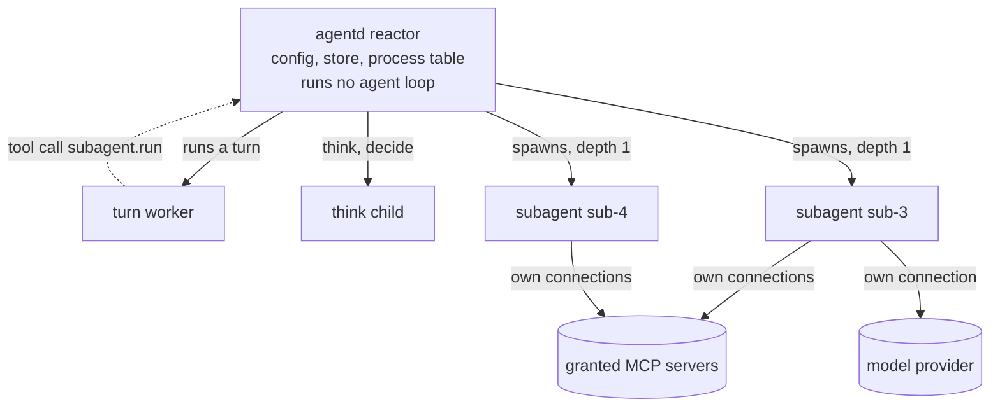
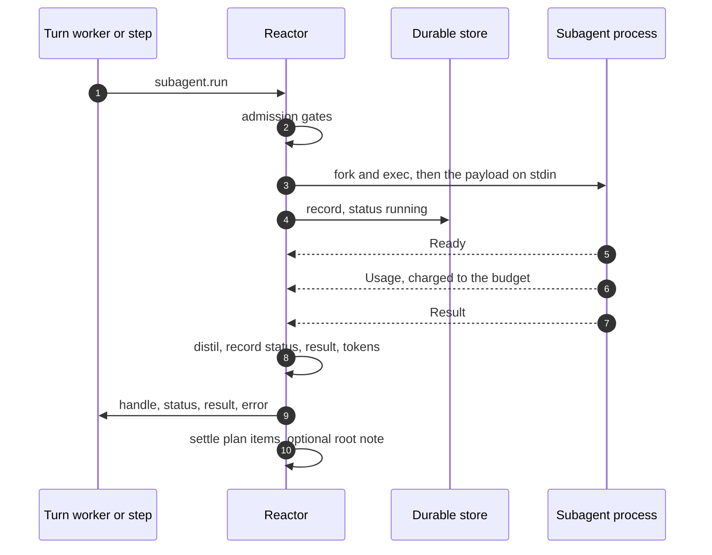
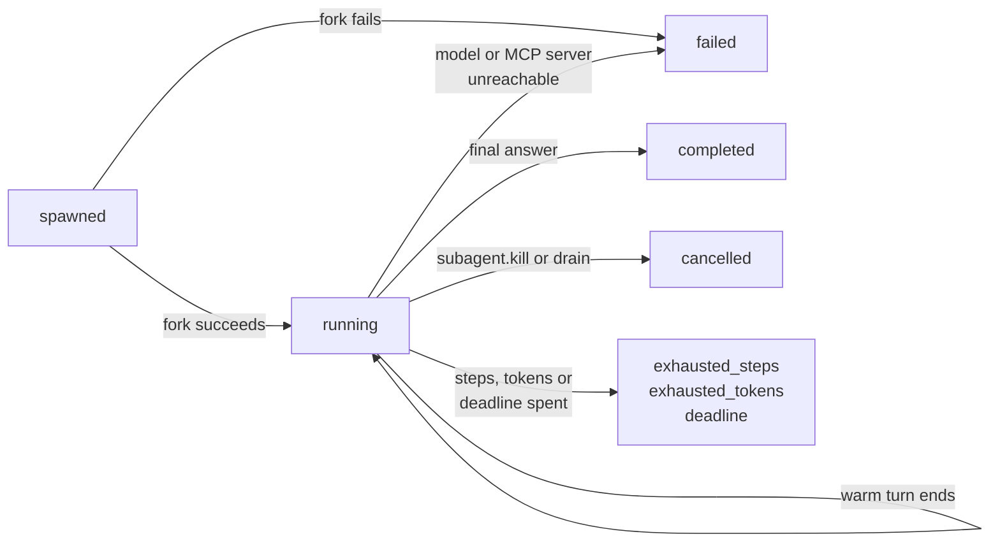
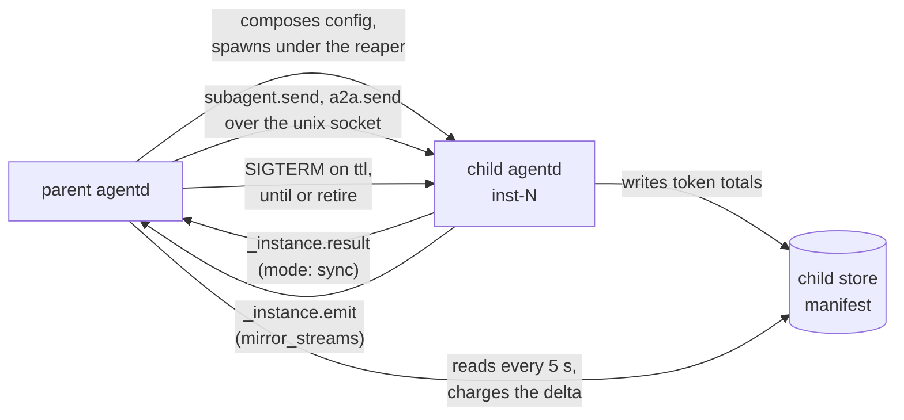

# Subagents and delegation

A subagent is a separate agentd process that the agent starts to do one
bounded piece of work and return a short answer. This page explains why
delegation in agentd is a process tree, what crosses the boundary between
parent and child, how a child lives, ends and restarts, and how the instance
tier runs a whole child daemon. It is for reviewers who need the model and
for builders who want to know what they are configuring; the task guide is
[Delegate to subagents](delegate-subagents.md).

## Why delegation is a process

The context window is the scarcest resource an agent has. "Which of these
300 files call the auth helper without a timeout?" has an answer, but
finding it in the agent's own window means paying for 300 file reads the
agent never needs again, and carrying them for the rest of the run.

A subagent buys the answer without the receipts. It reads the 300 files into
its own window and hands back a distilled value: at most 8,000 bytes for a
string result, and 400 characters for the note the agent's conversation may
receive. The search happened; its transcript stays in the child. Two more
properties come with the process boundary.

**An injection firewall.** No protocol path carries a child's transcript up
to the parent, and nothing hands the parent's transcript down: the child
starts from what the caller chose to pass. Before a child exists, its
narrowed set of MCP servers is checked against the lethal trifecta (untrusted
input, sensitive data and egress in one agent), and a child's result is
withheld from a reader that holds both sensitive and egress tools when the
child may carry outside input. [Security model](security.md) explains both
checks.

**A bounded blast radius.** A subagent has its own process group, memory, MCP
connections and step, token and deadline budget, optional kernel limits, and,
where cgroups are configured, its own cgroup leaf. Killing its process group
is instant and total. A wedged child costs you a child, not the daemon.

The price is that delegation is lossy by construction, and a child is one
bounded agent loop, not a durable pipeline. When the parent needs the raw
material, or the work is a sequence with retries and waits, a subagent is
the wrong tool; the guide's [when not to delegate](delegate-subagents.md)
section lists the cases.

## One flat generation of children

agentd ships as one binary. To make a child it re-executes itself with
`AGENTD_SUBAGENT=1` set, and the new process runs the subagent entry point
instead of the daemon. The supervisor, called the reactor, owns the
configuration, the credentials, the durable store and the process table, and
runs no agent loop. Every agent loop runs in a child: a turn worker for a
conversation's turn, a think child for preflight, compaction, `think` and
`decide`, or a subagent. The supervisor's only model calls are the goal check
and the approval judge, made on threads of its own with no tools.

The tree is flat. Every child is a direct child of the reactor, keyed by a
node id in one table, so there is no supervision hierarchy to walk.

So when a turn worker calls `subagent.run`, it asks the reactor for a
sibling, not a descendant: the caller does not own the child process. Each of
these children sets `PR_SET_PDEATHSIG(SIGKILL)` as its first act, and one
whose parent died during the fork notices (its parent is no longer the pid
that spawned it) and exits, so a dead daemon takes its children with it. A
child's stdout is a binary control channel to the reactor, and its stderr is
inherited into the daemon's log.

## What the child is handed

The spawn payload is the whole trust boundary. It travels as the first
control frame on the child's stdin, never in argv (readable by anyone through
`/proc`) and never in the environment.

| The child gets | How it is decided |
|---|---|
| Its instruction | The caller's `instruction`, or a template's text with its parameters folded in |
| A seed transcript | Only the `context` messages the caller passed; empty by default |
| MCP servers | The `servers` the caller named, from the parent's configured set; every parent server when `servers` is omitted |
| A tool grant | The `tools` patterns, minted by the supervisor and enforced by the child over its catalogue and its dispatch |
| An output contract | `output_contract` prose, or `output_schema` folded into that prose as text |
| A model | The template's `model`, else `subagents.defaults.model`, else the agent's turn model, resolved to a connection with a live credential |
| Budgets | Steps, tokens and a deadline, plus optional memory and CPU limits and a priority |

The tool grant can only narrow. A caller cannot forge or widen it through
`context`, because the supervisor's mint replaces any grant already in the
seed, and a grant the child cannot parse narrows to nothing rather than to
everything. An excluded tool is unreachable, not merely unadvertised.

What the child does not get matters as much:

- **No agentd built-in tools.** The child's catalogue is the tools of its
  granted MCP servers, any code-registered tools of an embedding build, and
  `resource.read` when those servers expose resources. It has no
  `subagent.*`, `workflow.*`, `memory.*` or `a2a.*` tools, so it cannot
  delegate onward.
- **No A2A peers and no agent identity.** Both are empty on spawn, so a child
  cannot reach another agent and does not sign requests under the AAuth
  identity.
- **No stored credential.** The durable record keeps the model reference, not
  the resolved connection; a restore resolves the model again.

The child connects to its servers itself, and offers exactly the MCP tools
the agent's registry offers a subagent on them, under the registry's names:
the supervisor sends the list with the spawn. A server's `allow` and
`exclude` (a referenced service's ceiling included), its `ns`, a profile
server's contract names and `tools.disabled` reach the child that way, and a
spawn's `tools` grant, a policy rule and the calls routed back to the
supervisor all name the same tool.

Two calls still come back to the supervisor. With `security.policies` set,
the supervisor names every tool of the child's servers that a policy rule
could touch, and the child sends those calls up instead of making them, so
the rule (and any approval it asks for) applies to the child too. An MCP
server's elicitation request reaches the operator the same way.

A child acts for whoever spawned it: its records carry the spawning
principal, and a tool call that names a handle (`subagent.status`,
`subagent.kill` and the rest) acts only for that handle's owner. Another
principal's handle reads as unknown.

## One chokepoint for every spawn

Every `subagent.run`, from the agent's turn or from a workflow step, lands in
one function in the reactor and passes ordered gates before any process
exists: a non-empty instruction, a valid mode, live breadth, lifetime total,
delegation depth, the spawn rate, resource pressure, the trifecta check over
the narrowed servers, and well-formed memory, CPU and priority values (a
`priority: low` spawn is shed one pressure level early). Each refusal is a
tool result the model reads and can adapt to, or a failed step in a
workflow, never a crash.
[Supervision and containment](harness.md) describes the gates and the
pressure signals.

Depth is minted, never claimed. The reactor reads the requester's depth from
its stored record and gives the child that depth plus one, so a child cannot
claim to be shallower than it is. In practice depth stops at 1: a child is
offered no `subagent.*` tool, and the `limits.subagents.depth` cap is the
backstop behind that.

Only after the gates does the reactor mint a handle (`sub-<n>`), stage a
`subagent/<handle>` record, and fork. A successful fork marks the record
`running` and persists it at once, so a restart finds a child to re-spawn. A
crash inside the fork window leaves no record, and the half-born child
collapses on its own.

## Four modes

| Mode | The child runs | The caller gets |
|---|---|---|
| `sync` | One bounded agent loop, up to its step budget, then exits | The result when it lands; the call parks without blocking the reactor |
| `async` | The same single loop | A handle at once; `subagent.await` or a workflow `wait` collects |
| `detached` | The same single loop | A handle at once; nobody waits, and a restart does not revive it |
| `warm` | Stays alive and runs one turn per message | A handle at once; `subagent.send` steers it |

A warm subagent prepares its session once, runs its instruction as the first
turn, then runs one turn per message sent with `subagent.send`. Messages
queue inside the child, so a message sent mid-turn is not lost. Each turn
gets a fresh step, token and deadline budget, so one expensive reaction
cannot starve the session. A warm session also rides out a model outage with
the all-endpoints-down backoff, where a one-shot child fails at once
instead.

## How a result comes back

The reactor distils before it stores. A string longer than 8,000 bytes is
cut at a character boundary and marked `… [truncated]`; a string that parses
as JSON is re-parsed, so the caller receives an object rather than a quoted
blob. An object or array is not capped: it passes untouched into the record,
the store and the caller's result. A child that ran out of budget still
returns the last text it wrote.

Where the result lands depends on who asked. A tool caller gets
`{handle, status, result, error}`, and so does a workflow step as its output.
A plan item bound to the handle advances on its own, in every conversation.
The agent's root conversation receives a note
(`subagent <handle> <status>: …`, at most 400 characters) only when
`agent.wake_on` includes `subagent_result`, which the default does not, and a
warm child notes each finished turn the same way. A note, like every
read-back, is withheld from a reader that holds both sensitive and egress
tools when the child may carry outside input.

## Lifecycle

A flat child's record moves through a small set of statuses. All but
`spawned` and `running` are terminal, the set every waiter tests against:
`completed`,
`failed`, `cancelled`, `refused`, `killed`, `crashed`, `retired`,
`exhausted_steps`, `exhausted_tokens`, `deadline`, `stalled` and
`loop_detected`.

Every status a child ends with is final, its budget's included. A child
that dies without reporting (killed by a signal, out of memory, torn down
by the supervisor as stuck or past its deadline) ends `failed` with the
reason "exited without a result". The child's deadline bounds a model call
in flight, so it ends `deadline` when the deadline passes.

**Liveness is probed, not assumed.** The reactor pings each child, and the
child's control thread answers separately from its agent loop. A child that
reports events is healthy; one that is silent but answers pings is busy (a
20-minute model call reads as busy and is left alone); one that does neither
(120 seconds without events, 10 without a pong) is stuck and is torn down.
Every child also has a hard deadline: its own deadline plus 60 seconds, armed
once at spawn.

**`subagent.kill` is graceful.** It marks the record `cancelled` at once and
sends a cancel frame, which the child's loop reads before its next step. A
child inside a long call keeps running, and spending, until that call
returns or liveness declares it unhealthy, at which point the reactor kills
its process group. Shutdown is where the escalation ladder lives: every
child is cancelled together, then sent SIGTERM at 5 seconds and SIGKILL at 7,
inside `lifecycle.drain_timeout`. [Supervision and containment](harness.md)
covers liveness and the ladder in full.

## Restart is not resume

At startup the reactor reads every `subagent/<handle>` record and re-spawns
each one that is not terminal, except `detached` children, which were
deliberately abandoned. The re-spawn bumps the record's `attempt`, and the
child's model is resolved again against the live configuration, because the
stored payload holds no credential. A reload resolves running children's
models again too, and each applies the new connection at its next turn
boundary under `intelligence.swap_policy`.

Two things do not survive a restart:

- **The conversation.** A restored warm child replays its original
  instruction and seed; no transcript is persisted.
- **In-memory waiters.** A `sync` call from a turn is gone with the process;
  the result reaches the parent through plan bindings and the root note
  only. A workflow `subagent` step or `wait {on: subagent}` is a durable step
  record, and it does resume.

Design delegated work to be idempotent across a restart: a re-spawned child
does its work again from the start.

> **Limit.** Handle numbers restart at 1 in every process, while restored
> records keep their handles, so a new spawn can take the handle of a
> restored record and overwrite it. Treat handles as valid for one process
> lifetime.

A record with `durable: false` (on the call, the template,
`subagents.defaults`, or deployment-wide through
`store.durability.work: ephemeral`) lives in memory only: it is never
persisted and never restored, which suits throwaway workers.

## Templates and the instance tier

A template turns "what a worker here looks like" into an operator-declared,
reviewable definition. The model may instantiate a template but never author
one, and `subagents.allow_freeform: false` makes templates the only way to
spawn. The model fills only the template's declared parameters: each value is
checked against its declared type, enum and `required` flag, then folded into
the definition as data. A value is never parsed for directives, and a spawn
whose values would add machinery, an author note or end matter to the text is
refused.

A template's tier follows from its text, so it cannot be declared wrongly:

- **Flat.** An instruction with no machinery spawns the flat worker this page
  has described, through the same chokepoint and caps. The template defines
  the grant (`servers`, `tools`); its limits, mode, priority and output
  contract apply where the call site sets none of its own.
- **Instance.** An instruction that defines machinery, such as a
  `:::!workflow`, `:::!mcp`, `:::!stream`, `:::!config` or `:::!tools`
  block, spawns an instance-tier child: a full agentd daemon with its own
  workflows, streams, waits, timers and store.

An instance child is the same binary started with a configuration file the
parent composes. The parent writes the template's machinery, the delivered
prose with its parameters, its own intelligence section (without its budget,
its routes or any inline token, and with the template's `model` and
`budget`), its service catalogue, egress posture and TLS trust, a store under
its own state directory, and an A2A listener on a unix socket. Model
credentials reach the child through the environment, never the file. The
child is wired back to the parent as a peer named `parent`, and the parent
can address the child by its handle (`inst-<n>`) at once.

Four mechanisms ride that wiring:

- **A result.** With `mode: sync` and `result: {workflow: <name>}`, the spawn
  parks until the named workflow first completes in the child, then resolves
  with that run's output. agentd composes a small reporter workflow, built
  from ordinary nodes, that sends the operator-only `_instance.result`
  command home. The child keeps running afterwards.
- **Mirrored streams.** `mirror_streams` forwards every event of a child's
  stream into the parent's stream of the same name, with source
  `instance:<handle>`, so the parent's consumers see a fleet's events without
  knowing which child wrote them.
- **Budget metering.** A durable child's token use is charged against the
  parent's budget: the parent reads the child's lifetime total from its
  manifest every five seconds and charges the difference. A `durable: false`
  child has no manifest, so its use is not metered.
- **Retirement.** `ttl` elapsing, the `until` signal arriving in the child,
  `subagent.retire`, or the parent's own shutdown all take one path: the
  child receives SIGTERM (a parent's death reaches it the same way), stops
  admitting work, drains its runs, checkpoints and exits. The parent kills
  it only if it is still running five seconds after the parent's drain
  timeout. The record closes as `retired`, and the child's directory stays
  on disk as the audit trail. A child that exits on its own closes as
  `completed`, `failed` or `crashed`.

Across a parent restart, live instance children are started again from their
composed configuration. Their state is durable and the handle is their
identity, so a child picks up where it stopped. A non-durable child runs on a
memory store and is not restarted.

The template's machinery faces the same boundary as any served document: a
fragment that writes operator-only configuration is refused, and so are a
child's own `a2a`, `intelligence`, `store` and `lifecycle` sections (the
parent composes those), MCP Events bindings and grants, and webhook starts or
waits (a child has no webhook listener). Its MCP servers are checked against
the parent's service catalogue and egress posture, and must not compose the
trifecta. These checks run when the parent loads. The child validates the
composed file again at spawn, and that is where the template's workflow steps
are checked. [Instruction documents](directives.md) explains the boundary.

## What delegation does not do

- **Delegate onward.** A child has no `subagent.*` tools and no A2A peers.
- **Detect a spinning loop.** A child's loop has no repeated-call or
  no-progress detector; its step and token budgets are the bound.
- **Bound `subagent.await`.** The tool's `timeout` argument is not applied;
  the child's liveness and hard deadline are the real bound. A workflow
  `subagent` step or `wait {on: subagent}` honours its `timeout`.
- **Validate an `output_schema`.** For a subagent the schema is prose in the
  brief. Check the shape yourself.
- **Re-read the spawn rate.** `limits.subagents.rate` is read at the first
  spawn of the process; a reload does not change it.
- **Pass skills.** A spawn's `skills` list is accepted and not used, and a
  template's `:::!skill` block is left out of the text the child reads. Put
  what the child needs in its instruction or `context`.
- **Count subagents in metrics.** `agent_subagents_spawned_total` and
  `agent_subagents_exited_total` count every child process, turn and think
  workers included. Count subagents from the `subagent.*` log events or
  `subagent.list`.

## Next steps

- [Delegate to subagents](delegate-subagents.md): spawn, narrow, limit and
  collect, with complete configurations.
- [Supervision and containment](harness.md): the process tree, liveness, the
  kill ladder and admission in depth.
- [Security model](security.md): the trifecta, read-back withholding and
  policies.
- [Workflows: how runs work](workflows.md): when the work is a pipeline
  rather than one bounded loop.
