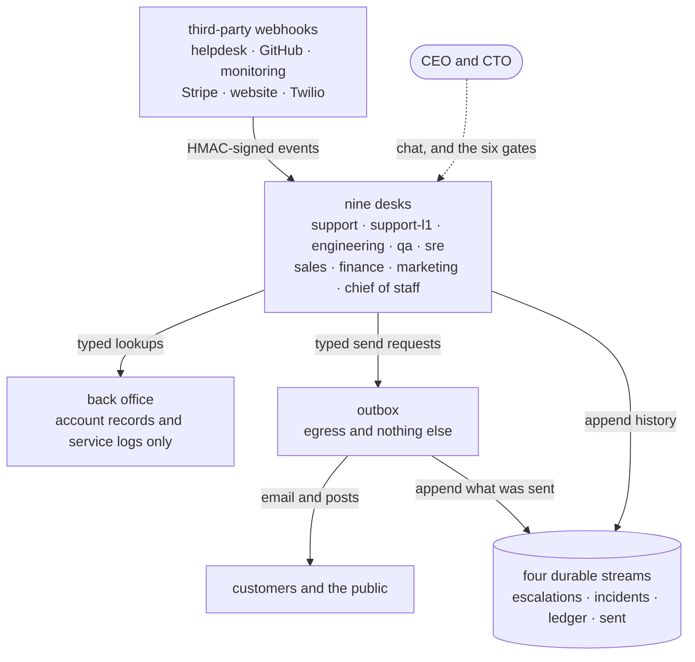

# The two-person company

This case study works one use case all the way through: an eleven-agent
software company whose only employees are the CEO and the CTO. It explains why
the company is shaped the way it is, what each design decision buys, and what
a technical leader should take from it. The complete configuration lives in
[`examples/startup/`](../examples/startup/README.md); this page is the
reasoning behind it.

| At a glance | |
|---|---|
| Agents | 11 agentd instances, one role each |
| Humans | 2, who hold every decision that spends money, ships to production or abandons revenue |
| Approval gates | 6: refunds, production ships, discounts past 20%, write-offs, stuck incidents, the weekly content calendar |
| Durable streams | 4: support escalations, incidents, the money ledger, everything the company sent |
| Ways out | 1: every email and post leaves through the outbox |

## The claim, stated carefully

A small SaaS business generates a surprising amount of work that is neither
strategy nor invention: triaging tickets, chasing failed payments, verifying
fixes on staging, posting the changelog, qualifying inbound leads, updating
the status page at 3am, writing Monday's standup. None of it is optional, none
of it is why the founders started the company, and nearly all of it has the
same shape: **an event arrives, judgment is applied, an action follows, and
someone must be able to prove later what happened**.

That shape is automatable today — not with one heroic "do everything" agent,
but with a *company* of narrow ones, each with a written job description, a
bounded set of tools, a budget, an audit trail and a boss. The example runs
eleven agentd instances: support (tickets), a front-line SMS and voice desk, a
back office, engineering, QA, SRE, sales, finance, marketing, an outbox and a
chief of staff. It keeps exactly two humans.

This page does **not** claim the judgment is free. Every agent runs on a model
doing real reasoning, and the question worth studying is not "can a model
answer a ticket" — it can — but what surrounds the model so that ten thousand
tickets, dunning cycles and incidents later the company is still coherent,
still auditable and still safe. That is an architecture problem, and it is the
interesting part.

## The org chart



Each box is a separate process with its own configuration, tools and budget.
The desks call each other with typed A2A commands; the chief of staff fans out
to all of them for a live brief.

## Why eleven small agents beat one large one

The obvious design is a single agent with every tool the company owns. It
fails three ways at once.

**It fails as security.** An agent that reads customer-authored text (tickets,
lead forms, phone transcripts), holds sensitive stores (the books, the account
records, the codebase) *and* can send email is a prompt-injection kill chain
assembled and loaded: a hostile ticket instructs the model, the model reads
the sensitive store, the mail tool exfiltrates it. agentd refuses to start that
combination. Its [Rule of Two](security.md) rejects any instance whose MCP
servers together hold `untrusted_input`, `sensitive` and `egress`. This is the
most load-bearing fact in the example, because it means **the org chart is not
a metaphor — it is the security architecture**. Two of the eleven instances
exist because the check refused the alternative:

- The **back office** holds the account records and the service logs and
  nothing else: no webhooks, no mail, no customer text. The desks that talk to
  customers query it through two typed A2A commands and get back minimal
  structured facts, never raw records. The residual risk — what it returns does
  flow onward to customers — is written down next to its mitigation (its
  contract answers the question asked, nothing more) instead of being
  discovered in an incident review.
- The **outbox** is the company's one mouth. Every email, every LinkedIn, X or
  Instagram post, every dunning notice leaves through this one instance, which
  holds egress and nothing else. That buys three things no policy document
  can: the trifecta stays split by construction rather than by promise; there
  is one durable, replayable ledger of everything the company ever said (the
  outbox's `sent` stream); and the company's voice has one plug to pull.

**It fails as operations.** One agent is one failure domain, one token budget
and one context window absorbing every concern at once. Eleven instances
restart independently, are budgeted independently — engineering gets 4 million
tokens a day and the outbox 300 thousand, and that line item *is* the payroll —
and can be paused, redeployed or downgraded one desk at a time.

**It fails as management.** A job description you can review is an
`agent.instruction`; a tool grant you can audit is a list of MCP servers. When
each instance is one role, the diff that changes what "sales" is allowed to do
is three lines in one file, reviewed like any code change. When everything is
one agent, every change is a change to everything.

## The nervous system: events in, judgment, action out

Every desk runs the same loop, with a different mechanism at each edge.

**Events arrive as webhooks.** The helpdesk posts new tickets, GitHub Actions
posts CI verdicts, the monitoring stack posts alerts firing *and* resolving,
Stripe posts payment outcomes, the website posts leads, Twilio posts SMS and
call transcripts. Every route is HMAC-authenticated, so "is this really
Stripe?" is answered by cryptography, not by the model. Structured payloads
are checked with a `validate` step — a JSON Schema gate that costs no tokens —
and only prose goes through model-based extraction. ([Author
workflows](author-workflows.md))

**Long-running processes park on signals.** This is what makes month-long
business processes cheap: a run does its work, then suspends — durably — until
the world answers. An incident run parks on `resolved/<alert_id>` until the
all-clear webhook wakes it. A sales deal parks up to four days on
`reply/<lead_id>`, nudges once, and parks seven more. A parked run costs
nothing and survives every restart, and the deadline is an expected branch,
not an error: `on_timeout:` routes the incident to "page the CTO" and the cold
lead to "close the file honestly". The relay from webhook to signal is one
field on the webhook start: `signal: "resolved/{{ body.alert_id }}"`.
([Workflows: how runs work](workflows.md))

**Desks call each other with typed commands.** Support files a bug with
engineering as `command: eng.bug, args: {ticket, severity, summary}` — a
DataPart the receiving workflow matches deterministically, checked against the
command's declared schema at the listener. A malformed report is refused at
once with the field named, not discovered three steps into a run. The same
call made as prose would reach the peer's *model* and depend on its reading.
The example keeps prose for the calls that deserve it — the chief of staff's
standup question is a judgment ask, not a procedure call — and that
distinction is worth internalising: it is the difference between your
company's API and your company's conversations. ([Connect agents over
A2A](connect-agents.md), [A2A extensions](a2a-extensions.md))

**History lands on streams.** Four durable event streams carry the company's
institutional memory: every support escalation, every closed incident (which
the postmortem workflow consumes exactly once, across restarts and
redeploys), every money event (the monthly close reads the `ledger` stream as
its journal), and every outbound message. A consumer added later can replay
what the stream still retains, so "add a postmortem process" is a
configuration change that applies to every incident already on the stream.
([Workflow node reference](node-registry.md))

## What stays human, and how it stays sane

Six decisions are gated on a person: refunds, production ships, discounts past
20%, revenue write-offs, stuck incidents and the weekly content calendar. Each
uses the same pattern: a `human` step parks the run — durably, for days if
needed — until the CEO or the CTO answers in a chat window, and the answer is
checked against a schema, so a gate that asks for `approve | decline` cannot
proceed on "maybe later". ([Human in the loop](human-in-the-loop.md))

> **Note.** A gate in a run that a webhook or a schedule started belongs to no
> caller. It becomes an answerable task on the desk's A2A listener only when
> the desk sets `agent.ask_human_unowned: gate`, as every desk holding one of
> the six gates does. Without it the gate takes `agent.ask_human_fallback`,
> and with `wait` it parks until its timeout with nobody able to answer it.

Two design choices make this workable with two humans:

- **Approvals batch at the right granularity.** The CEO approves marketing's
  *week* — one gate for seven pieces of content — not every keystroke. The
  CTO's ship gate fires only after CI passed *and* QA verified on staging. The
  humans see decisions, not drafts.
- **Gates never wait in silence.** The moment any gate opens, a `human.asked`
  event fires inside the instance, and a three-step workflow turns it into an
  email through the outbox. Nobody has to watch a terminal for the company to
  route its decisions to its decision-makers.

Each agent is also a colleague you can talk to: every instance serves the chat
interface, and the chief of staff's `cos.brief` command fans out to every desk
and answers "what is happening right now?" with live evidence. The morning
standup and the Friday retro are the same mechanism on a schedule — the retro
framed as *proposals* the CEO may apply by editing a configuration, because
nothing about the company changes except through reviewed configuration.

## Voice, without pretending

The front-line desk answers SMS and phone calls, and the honest architecture
matters: agentd does not process audio. A small bridge service terminates
Twilio Media Streams and holds an OpenAI realtime voice session; agentd is the
brain behind it. Mid-call, when the voice model needs a fact it does not have
— "what plan am I on?", "why did my check fail at 3am?" — the bridge fires an
A2A command; the desk queries the back office and returns one speakable
sentence. After hangup the transcript arrives as a webhook, and a wrap-up
workflow decides: resolved, or escalated to the ticket desk with the
transcript attached. The voice model handles the milliseconds; the durable
runtime handles the minutes and the follow-through.

## Cost, and a model for each job

Every desk in the example runs one model for everything and carries a daily
token budget with `on_exhausted: refuse`, so a runaway desk stops spending
rather than spending more. That is the right starting point, and it leaves
money on the table: much of each desk's work is small decisions — which
queue a ticket belongs in, whether a lead is qualified, whether a message needs
a careful answer — that do not need a frontier model.

`intelligence.roles` gives each job its own model. A desk can keep its turns
on a strong model, compact long conversations on a small one, and send its
classification, routing and step guards to a decision model, which answers
typed questions with a confidence instead of writing text:

```yaml
# fragment: under intelligence:
endpoints: https://api.openai.com/v1/chat/completions
token: "{{secret:OPENAI_API_KEY}}"
providers:
  openrouter:
    endpoints: https://openrouter.ai/api/alpha/decisions
    dialect: decisions
    token: "{{secret:OPENROUTER_API_KEY}}"
models:
  smart: {model: gpt-5.1}
  fast: {model: gpt-5-mini}
  jev: {kind: decision, provider: openrouter, model: typesafe/jev-1.13, escalate: smart}
roles:
  turn: smart
  preflight: jev
  decide: {model: jev, confidence: 0.8}
  compaction: fast
budget:
  windows: [{per: day, tokens: 2000000}]
  on_exhausted: refuse
```

An answer below the 0.8 confidence threshold is asked again of the `smart`
model rather than acted on, so a cheaper model never quietly makes a call it
was unsure of. Two things to keep in mind when you do this:

- **Budgets count tokens, not money.** A token on a small model costs less but
  counts the same against the window, so revisit each desk's window after you
  move roles. The model of every turn is on the `turn.model` log line; a rate
  card applied downstream gives you the bill. ([Control spend with
  budgets](budgets.md))
- **Leave `roles.approve` unbound.** It names the model that answers asks on
  the operator's behalf when `agent.approval` is `auto`. This company's gates
  are the founders' by design, so no judge should be in that path.

[Choose models for each job](models-and-roles-guide.md) walks through the
choices.

## What you need to run this

The example is concrete about its dependencies, because automation pitches
usually are not:

- **Model access.** Any OpenAI-compatible API, Anthropic or Bedrock, and
  optionally a decision model. ([Connect model providers](connect-models.md))
- **An MCP server for each integration.** The helpdesk, GitHub, the CRM,
  billing, email, a social cross-poster, web search, Twilio, your logs. These
  are the hands; agentd ships no tools of its own, so every capability is a
  declared, tagged, auditable dependency. Each integration is declared once in
  a shared service catalog with its endpoint, credential and authoritative
  tags. Where a server offers more verbs than a role needs, the catalog narrows
  it: `allow: [get_*, list_*, query_*, restart_service, scale_pool,
  rollback_deploy]` on the SRE's infrastructure server, so the destructive
  verbs are absent, not discouraged. ([Connect MCP servers](connect-mcp.md))
- **A place to run.** Eleven small processes on one box is fine; state is files
  on disk. The example's README carries the full secrets-and-scopes inventory,
  and each configuration's header documents the MCP tool contract its
  workflows rely on.
- **A rehearsal path.** The whole company dry-runs offline on the mock model
  endpoint that the release binaries carry
  (`AGENTD_INTELLIGENCE=mock:final`), with no key and no network. Signed
  `curl` requests stand in for the webhook sources, which is also how you
  rehearse a change.

## How to adopt this without betting the company

Nobody should deploy eleven agents on a Tuesday. The example breaks into
stages that each pay for themselves:

1. **Start with one closed loop where the event, the action and the audit trail
   are all machine-legible.** Dunning is the canonical first hire: a Stripe
   webhook in, two polite emails with durable five- and seven-day sleeps
   between them, and a human write-off gate at the end. Low judgment, high
   tedium, an immediate audit trail.
2. **Add the outbox before the second agent that talks to anyone.** The choke
   point is cheap on day one and impossible to retrofit culturally once five
   agents each hold their own mail credentials.
3. **Let the Rule of Two design your org.** When an agent needs a tool
   combination agentd refuses, the refusal is telling you where a role
   boundary belongs. Split the role, and wire the halves with typed commands.
4. **Move judgment to gates before you move it to models.** Wherever you are
   unsure whether the agent should decide, make it a `human` gate first. You
   can widen autonomy later by deleting a gate — a much better Tuesday than
   adding one after an incident.
5. **Only then scale out the conversational roles** — support, sales,
   marketing — where model judgment is the product and the guardrails
   (injection discipline in every instruction, budgets, the egress split) are
   already in place.

## The honest limits

The example encodes its own caveats, and they belong in any executive summary.
The agents' judgment is bounded by their instructions and their models: a
support desk will misread a novel situation a person would catch, which is why
escalation paths exist and why every instruction says what to do when unsure.
The MCP endpoints in the example are illustrative; standing up real ones is
genuine integration work. Token budgets are real money and want the review
payroll gets. And two humans remain the constitutional layer for a reason:
every gate is a place where the founders decided the cost of a wrong automated
decision exceeds the cost of an interruption. That inventory — which decisions
are gates — is the most important document the example produces, and it is
written in YAML you can diff.

## Next steps

- [`examples/startup/`](../examples/startup/README.md) — the eleven
  configurations, each validated against the binary, annotated inline.
- [Use cases](use-cases.md) — each mechanism here as a shape of its own.
- [Security model](security.md) — the Rule of Two, tags and the service
  catalog.
- [The hiring example](../examples/hiring/README.md) — the same split at two
  instances instead of eleven, with mTLS between them.
