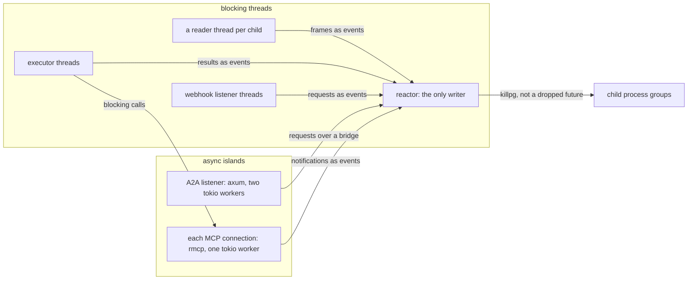

# Engineering choices

agentd is a supervisor that holds credentials, spawns a process for every
unit of reasoning and stays up for weeks while mostly idle. Those properties
chose the language, the dependency policy and the concurrency model before
any argument about taste. This page explains each choice, where it costs
something, and carries the measured footprint numbers with what they were
measured on. It is for evaluators and reviewers judging the code they would
be trusting, and for contributors.

## What the runtime has to do

Four requirements decide the rest:

- **It must not leak.** A process that wakes five times a second and lives
  for weeks turns a small leak per iteration into an out-of-memory kill.
- **It must start fast.** The binary is re-executed for every turn worker
  and subagent, so start-up is paid per unit of work, not once per
  deployment.
- **It must be auditable.** The supervisor holds API keys and brokers
  whatever a model asks for; every crate linked into it is inside that trust
  boundary.
- **It must be able to stop a model.** A wedged turn is a child process with
  an open socket to a provider, and the only thing that reliably ends it is
  `killpg` on its process group.

Go would meet the first three about as well: one static binary, fast
start-up, a scheduler comfortable at these thread counts. Rust adds that
`std` plus `libc` is enough to write HTTP/1.1, cron, DER parsing and an
inotify watch by hand without giving up memory safety, and a release
profile (`opt-level = "z"`, LTO, one codegen unit, `panic = "abort"`) that
trades CPU for size on a workload that is I/O-bound anyway. This is not a
claim that Rust makes agentd fast.

## Two protocols agentd does not implement

MCP and A2A are small enough to write by hand, and a hand-written subset is
auditable in a way a dependency tree is not. agentd uses the official SDKs
anyway, for a reason that outweighs both.

A protocol implemented from your own reading of the specification fails in
one particular way: **silently, in the peer**. Your tests encode the same
reading as your code, so they agree with it. What disagrees is somebody
else's client, in production, and what it reports is nothing — a message
that never arrived, a task that never looked finished, in a response that is
valid JSON your own tests accept.

So MCP is [`rmcp`](https://github.com/modelcontextprotocol/rust-sdk), the
official Rust SDK, and A2A is the A2A project's own Rust SDK,
[`a2aproject/a2a-rs`](https://github.com/a2aproject/a2a-rs): its types
(`a2a-lf`), its ProtoJSON generated from the specification's protocol
buffers (`a2a-pb`) and its server (`a2a-server-lf`). Only official SDKs,
because a third party's reading is one more reading to be wrong. They own the
handshakes, the request and response types, capability negotiation,
streaming, error codes and version tables, and agentd tracks a specification
by upgrading a dependency rather than by re-reading a document.

What agentd owns is the part a protocol crate has no opinion about: **the
socket**. Both SDKs run over agentd's own HTTP transport, so everything that
hangs off a dial applies under them unchanged — an AAuth request signature,
an AWS SigV4 signature, an mTLS client identity, a refreshed OAuth token,
the SSRF guard. rmcp's HTTP client and the A2A server's request handler are
both traits, and that seam is the whole integration.

## Subset implementations

Everywhere else, the rule is: **write by hand what is small, frozen and only
partly needed.** HTTP/1.1 request framing does not change; a cron expression
is five fields. What agentd writes is a *subset*, and the subset is the
point — the JSON Schema validator carries no regex engine because the
schemas it checks do not need one.

| Written by hand | Where (lines at v1.18.0) | What it covers |
|---|---|---|
| HTTP/1.1 client and SSE reader | `net/src/http.rs` (690) | the requests agentd makes, generic over any `Read + Write` stream |
| X.509 field extraction | `net/src/x509.rs` (304) | subject and SAN from a verified client certificate |
| SSRF classifier | `net/src/ssrf.rs` (606) | private, loopback and link-local targets |
| YAML subset reader | `instruction/src/yaml.rs` (1,307) | mappings, sequences, flow collections, block scalars, YAML 1.2 core types; no anchors, tags or multi-document streams |
| JSON Schema subset | `agentd/src/jsonschema.rs` (803) | the 2020-12 keywords agentd's own schemas use |
| Cron | `agentd/src/triggers/timer.rs` (216) | five UTC fields as bitsets |
| Prometheus text | `agentd/src/obs/metrics.rs` | fixed-domain counters and gauges |
| OTLP export | `agentd/src/obs/otel.rs` | spans and logs over HTTP/JSON, no protobuf |
| NDJSON logging | `agentd/src/obs/log.rs` | one JSON object per line, level-filtered before allocation |
| Config-file watch | `agentd/src/config/watch.rs` | raw inotify on the file's directory |
| SHA-256, HMAC, SigV4, base64, ULID, token bucket | `sha.rs`, `auth/aws.rs` and small modules | tens to hundreds of lines each |

Two are worth more than a table row. **The metrics have structurally
bounded cardinality**: label-bearing series are fixed-domain arrays, so a
label carrying a run id or an agent path cannot exist by construction. And
**the config watch watches the parent directory, not the file**: a
Kubernetes ConfigMap update renames a symlink and never writes the file's
inode, so a watch on the file sees nothing. The watcher re-arms after each
event and sets the same latch `SIGHUP` sets, so there is one reload path.

Cryptography stays mostly off the list. TLS is `rustls` with the `ring`
provider, and request signing, document signatures and the ciphers behind
encrypted instructions reuse that same `ring`. `ring` compiles a little C
and assembly, so building agentd from source needs a C compiler. The
exceptions are small and specified: SHA-256 and HMAC for content hashes and
inbound webhook signatures, checked against the published test vectors, and,
for encrypted instructions, the X25519 ladder and scrypt's Salsa20/8 core,
written to their RFCs because `ring`'s API cannot import a static recipient
key.

**What the ledger does and does not buy.** It keeps agentd's *own* code off
large dependencies. It does not keep them out of the shipped graph: the
release binary still contains `tokio`, `hyper`, `tracing`, `url` and
`base64`, brought in by the official SDKs, and `regex` by the CEL
interpreter. That is the trade, stated as a trade: protocol implementations
that two independent readings agree on, paid for in crates nobody here has
read line by line.

## A blocking reactor with async islands

The supervisor's core is a **single-writer reactor**: one thread drains its
channels, fires timers, dispatches turns, checkpoints and then blocks on one
`recv_timeout`. Durable state changes there and nowhere else
([Architecture](architecture.md#the-single-writer-loop) lists the phases).
The async runtimes agentd carries sit at the protocol edges, because the
SDKs need them, and never on the path that decides what to kill.

The argument against an async core is about correctness. The thing that
needs cancelling when a turn goes wrong is a **child process**, and dropping
a future cannot end a process. A shared work-stealing pool also brings back
the failure this design exists to avoid: one stuck task starving the rest.

The property that makes the blocking design safe is **abandon, don't
interrupt**. The reactor reaches every pipe through a channel it waits on
with a timeout, and it unblocks a parked reader only by making the producer
go away — closing its pipe, killing its group — never by interrupting the
read. Pipes carry no read timeout, because a second, racing notion of
"stuck" is the last thing you want.

Blocking I/O buys the mundane: stack traces that mean something, a debugger
that shows a call stack instead of an executor frame, no function colouring.
It gives up as much. Threads per connection do not scale to thousands of
connections; one instance is sized for tens of children and threads, and
you scale by running more instances. A slow DNS lookup holds a thread for
its duration. And the loop polls at a 200 ms ceiling when idle rather than
sleeping in `epoll`, although a deadline that is due sooner wakes it sooner.

## What memory safety buys, and what it does not

Writing parsers by hand is the risky half of this design, so be precise
about the risk Rust removes. It removes one class of bug: a length error in
the DER walk or the chunked-body decoder is a wrong answer or a panic, not a
heap overflow. Under `panic = "abort"` that panic kills the supervisor
loudly and the kernel collapses its children behind it, rather than letting
it limp on with corrupt state. The consequence is plain: every `unwrap` on
the supervisor's path is an availability decision, which is why its locks
recover from poisoning instead of aborting on it.

It removes nothing else. Memory safety does not make a subset parser
correct, stop prompt injection, authenticate a peer or bound what a model
asks a tool to do — [Security model](security.md) covers the machinery
that does. A memory-safe SSRF is still an SSRF, which is why the egress
classifier is applied explicitly where a caller can steer a URL. The parsers
carry their bounds by hand: a response the HTTP client reads, and a request
body the webhook listener reads, cap at 8 MiB, and caller-supplied headers
and request targets are checked for line breaks at the framing layer,
closing header injection in one place.

## The numbers

Every figure here names what it was measured on, because a number without
provenance documents software nobody is running. Every figure is from
v1.18.0, measured in October 2026.

| Measure | Value | Measured on |
|---|---|---|
| Release binary, x86_64 | 12,099,328 bytes (11.5 MiB), static-PIE, stripped | `agentd-v1.18.0-x86_64-unknown-linux-musl` |
| Release binary, aarch64 | 8,821,880 bytes (8.4 MiB), static, stripped | `agentd-v1.18.0-aarch64-unknown-linux-musl` |
| Download, x86_64 / aarch64 | 5,116,114 / 4,685,265 bytes (`.tar.gz`) | the v1.18.0 release assets |
| Container image | `FROM scratch` plus the binary | the repository's `Dockerfile` |
| Idle daemon | 1 thread, 9.3 MiB resident, 1 CPU tick (10 ms) in 6 s | v1.18.0 x86_64 release binary, one `schedule` workflow, `file` store, no MCP server or listener |
| Start-up | about 7 ms for `agentd --version`, against 0.5 ms for `/bin/true` | v1.18.0 x86_64 release binary, 16-core x86_64 host, averaged over 200 runs |
| Crates resolved | 82 with no default features, 89 by default, 163 for the release feature set | v1.18.0, `cargo tree -p agentd-cli -e normal --prefix none` over the committed `Cargo.lock` |
| Source | about 170,000 lines in `crates/*/src`, 141,000 of them in the engine | v1.18.0, `wc -l`, inline test modules included |

How to read them:

- **The release binary is all there is.** It is a statically linked musl
  artifact that runs on `scratch`: no shell, no libc, no package manager in
  the image. CI checks that property of what users receive, rather than the
  width of the build-time graph.
- **The crate counts** are unique package names, each counted once however
  many versions or paths reach it; `-e normal` drops build and dev
  dependencies because neither is linked into the binary. Subtract the five
  workspace crates for the external count (77, 84, 158). The jump from 89 to
  163 is the A2A stack and the CEL interpreter: the release set's other
  features add no crate at all, and the three that need cryptography
  (`aauth`, `sign`, `oci`) reuse the `ring` that `rustls` already brings.
- **Start-up is paid per turn.** Seven milliseconds of process start-up is
  negligible next to a model call, and it is why agentd is the wrong tool
  for units of work a few milliseconds long.

The build needs a C compiler for `ring` and nothing more, and one transitive
default is enough to add a second, larger C and assembly library: a crate
that asks for `rustls` with default features selects the `aws-lc-rs`
provider, and Cargo unifies features across the whole graph. CI fails the
build if `aws-lc` appears anywhere in the tree. `deny.toml` bans wildcard
versions and yanked crates and holds a permissive-only licence allow-list
for the release graph.

## Where the choice hurts

- **Compile times.** LTO, one codegen unit and `opt-level = "z"` are right
  for a shipped appliance and wrong for a fast edit loop. CI compounds it: 18
  feature combinations, clippy and tests for two crates each, because
  `--all-features` hides a feature that is broken on its own.
- **You own the hand-written code forever.** The YAML reader is a subset;
  the cron parser is five-field UTC only and finds the next firing by
  stepping a minute at a time for up to four years. Each is a specification
  revision you handle yourself and a bug nobody else reports.
- **`unsafe` is quarantined, not absent.** There is none in `agentd-net`,
  `agentd-mcp` or `agentd-instruction`. In the engine, 72 `unsafe` blocks in
  21 files at v1.18.0, test modules included: libc calls for signals,
  spawning, reaping, killing, cgroups, file locks, `statvfs` and terminal
  handling, plus environment changes in tests, which edition 2024 made
  unsafe. The CLI's launcher uses libc for file descriptors and signals.
- **The learning curve is real.** Edition 2024, a `rust-version` floor of
  1.96, a transport generic over `Read + Write`, raw signal handling: working
  here takes comfort with async-signal-safety rules, not only the borrow
  checker.

The dependency policy has an exit. Each protocol's wire types sit behind
`serde` in one module — `wire/intel.rs` for models, `mcp::wire` for MCP — so
the codec could be replaced mechanically if compile weight ever had to go.

## Next steps

- [Architecture](architecture.md) — the reactor, the process tree and the
  edges these choices produce.
- [Build features and crates](features.md) — what each cargo feature adds
  and which ship in the release binaries.
- [Supervision and containment](harness.md) — the kill ladder and the
  kernel's part in it.
- [Security model](security.md) — what memory safety does not cover.
