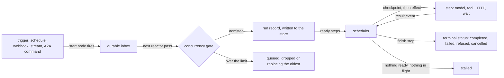
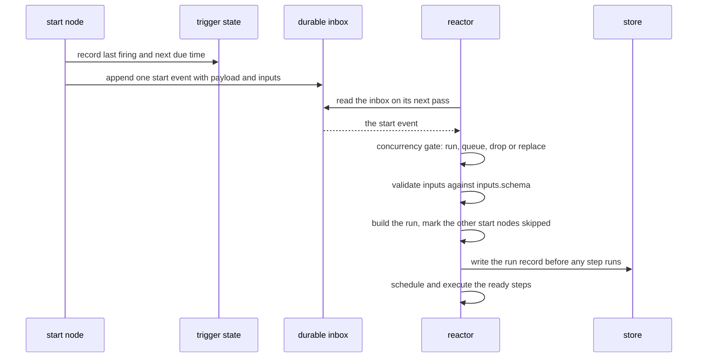
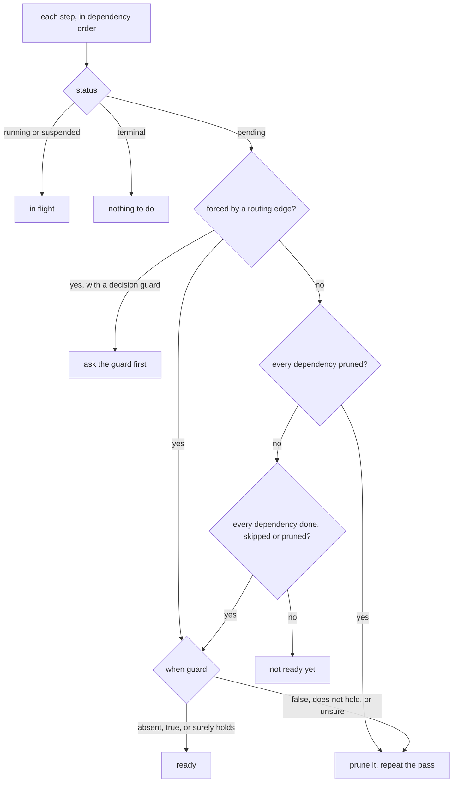
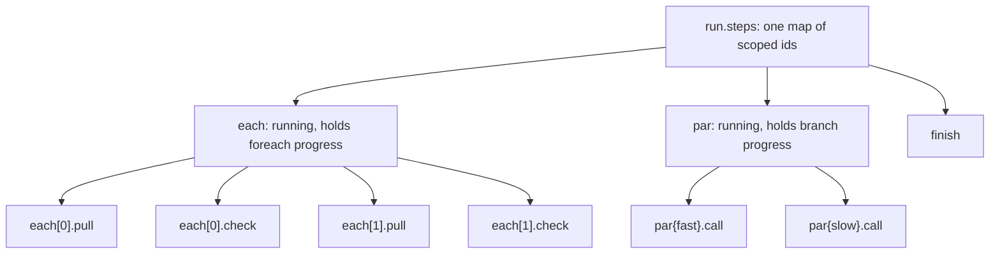
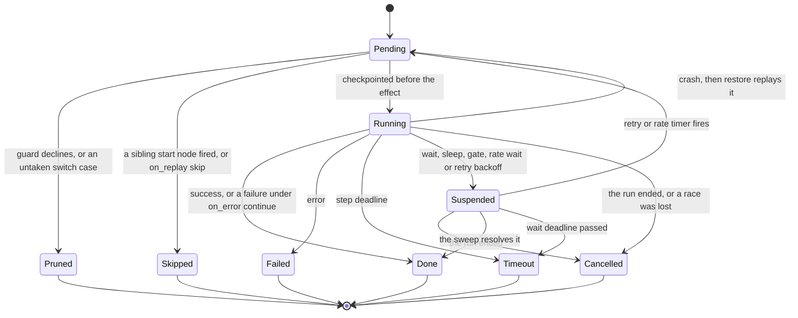
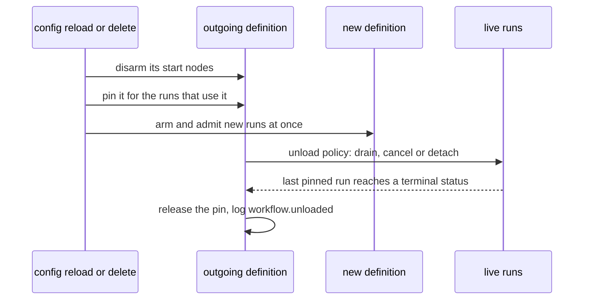

# Workflows: how runs work

A workflow is a named graph of steps whose whole execution state lives in
one durable record, written before each step's side effect. This page
explains how a run starts, how agentd decides which step runs next, what
survives a crash, and how a definition is replaced while runs are in flight.
It is for builders who want to predict a workflow's behaviour, and for
reviewers and operators who need to know what the runtime promises.

## When a graph beats a conversation

An agent turn is a conversation: one context, one thread of reasoning, and
nothing on disk between tool calls. That is the right shape for a bounded
task. It is the wrong shape when the work runs for hours, fans out over four
hundred records, has to survive a restart, or must stop and wait for a
person.

Reach for a workflow when at least one of these is true:

- **The work must survive a crash.** A run is checkpointed before every
  effect. A conversation is not.
- **Steps are independent.** Two steps that do not depend on each other run
  concurrently, with no orchestration code from you.
- **The shape repeats.** Fan out over a list with bounded parallelism, loop
  until a judge approves, race two sources: declared, and resumable.
- **Something must wait.** A run can suspend on a signal, a child run, an
  inbound webhook, a stream event or a human answer, and costs nothing while
  it waits.
- **You need boundaries.** Timeouts, retries, budgets, caches and output
  schemas apply per step, not to one opaque turn.

Stay with a plain agent turn when the task is open-ended and the model
should choose the sequence. A workflow fixes the sequence when you write it.
A step that turns out to need a decision nobody anticipated cannot invent
one. The trade is rigidity for resumability, and a workflow can still hand
a step to the model: an `agent` step is a full tool-using turn inside one
node of the graph.

## The parts of a workflow

A workflow document has a name, a set of **steps**, and optional
declarations around them: an input schema, an output schema, concurrency,
limits and declared state. Each step has a `kind` and an id, and names the
steps it depends on. The graph must be acyclic, every step must be reachable
from a start, and at least one step must be a `finish`.

Steps come in two roles:

- A **start node** is a trigger: a schedule, a webhook, a stream event, an
  A2A command, a signal, an MCP resource change. It never runs inside a
  run. It decides when a run begins and what the run's inputs are.
- Every other step does work inside a run: calls a model, a tool or an
  HTTP endpoint, shapes data, waits, fans out, or ends the run.

A **run** is one execution of the graph. It carries the inputs it started
with, each step's status and output, the run's variables, and the
definition hash it is pinned to. Steps read each other's outputs through
templates such as `{{ steps.fetch.output.json }}`.

The [node reference](node-registry.md) lists all 74 kinds. The
[workflow language reference](workflow-language.md) covers templates, the
document keys, statuses and limits.

## From trigger to finish

A run is driven by one loop in the supervisor process, the **reactor**. It
owns every run's record, so there is a single writer and no locking. Work
that blocks, such as a model call, an HTTP request or a tool call, runs on a
thread or in a child process and reports back to the reactor as an event.

The inbox and the run record are both in the durable store. That is what
lets a run resume after the process is killed: on restart the reactor reads
every non-terminal run back and carries on from its last checkpoint.

## How a run starts

A start node never creates a run directly. When it fires, it renders its
optional `inputs` mapping, updates its own durable trigger state (the last
firing, the next due time, a stream offset), and appends one event to the
durable inbox. The reactor turns that event into a run on a later pass.
Every gate in between is one you can reason about.

Three consequences follow from this shape:

- The firing start node's own output is the trigger payload. A webhook
  start's body is `{{ steps.hook.output.body }}`.
- A workflow may have several start nodes. A run fires exactly one and marks
  the others `skipped`, which counts as satisfied, so a step that depends on
  any of them still runs.
- Inputs that fail the workflow's `inputs.schema` are not an error a step
  can catch. The event is logged as `run.inputs.invalid`, consumed, and no
  run is created.

Concurrency is checked when the event is turned into a run, not when the
trigger fires. Each workflow admits 4 live runs by default and the instance
8 in total; `on_overflow` decides whether the next one queues (the
default), is dropped, or replaces the oldest live run.

## How the scheduler picks the next step

The scheduler is a pure function over the definition, the run and its data.
It walks the steps in dependency order and repeats until nothing changes, so
a step pruned in one pass releases its dependents in the same pass. The
result is one of: a set of ready steps, "waiting" (something is in flight),
or "stalled" (nothing is ready and nothing is in flight).

Four rules explain most of what you will see.

**Pruned is not skipped.** A step whose `when` guard is false, or a
`switch` case nobody chose, is `pruned`. A pruned step is never waited on,
but it does not satisfy anything either: a step whose every dependency is
pruned is pruned too, and the whole dead branch falls away. A step with at
least one live dependency still runs. That is how an uneven join works:
`done` depending on both arms of a `switch` runs after whichever arm ran.

**A failure stops the run.** A failed step with the default
`on_error: fail` fails the run at once. `on_error: continue` marks the step
done with its error recorded, so its dependents run.
`on_error: "goto:<step>"` is a routing edge.

**A routing edge runs its target past its dependencies, never past its
guard.** Three things are routing edges: a `switch` case,
`on_error: "goto:<step>"`, and a wait's `on_timeout`. Each forces its
target to run even though the target's dependencies are not done; that is
the only way to send a run backwards or sideways in an otherwise acyclic
graph. The target's own `when` guard is still evaluated, and a decision
guard is asked first. A recovery step whose guard declines leaves the
failure standing, and the run fails.

**A decision guard is a step.** A `when` written as a decision,
`{noul: "<statement>"}`, becomes a `decide` step of its own, `<id>.when`,
which the guarded step depends on. The guarded step runs only when the
statement holds with a probability of at least 0.5 and the answer is sure.
Otherwise it is pruned exactly as a false CEL guard prunes it. The guard is
budgeted, logged and durable like any step; see
[Models, providers and roles](intelligence.md) for how a decision model
answers it.

When nothing is ready and nothing is in flight, the run ends. If a step
failed upstream, the run ends `failed` and the error names that step: `no
ready step and no finish reached — step "x" failed first: …`. Otherwise it
ends `stalled`. The most common cause of a stall is a `finish` that sits
behind a branch that was pruned or never routed to.

## Nested bodies

`foreach`, `batch`, `iterate` and `subgraph` take a body of steps, and
`parallel` and `race` take named branches. A body is not a separate engine.
Its step instances are entries in the same flat run record, under scoped ids
that encode where they sit.

A scoped id is what you see in the logs and what cancellation matches on.
Inside a body there is no start node and no `finish`, dependencies name
siblings, and the body is checked for cycles on its own. A body's result is
its **sinks**, the steps nothing else in the body depends on. Bodies nest at
most four levels deep.

A body runs its own smaller scheduler, with one difference from the top
level: a false `when` guard inside a body marks the step `skipped`, not
`pruned`, so the steps behind it still run. A `switch` inside a body prunes
its untaken cases as at the top level, and a body's routing edges behave as
the top level's do.

## Waiting costs nothing

A step that cannot finish yet, such as a wait, a sleep, a human gate or a
retry backoff, writes a durable wait record into its state, goes
`suspended`, and is checkpointed. A sweep on each reactor pass resolves the
records whose condition is met or whose deadline has passed. Nothing about a
wait lives only in memory, so a run can wait a month for a signal across any
number of restarts.

A wait's `on_timeout` turns a deadline into an expected branch rather than a
failure: "the alert fired and did not clear in ten minutes" becomes a step
that runs, not a failed run. The timeout target is reached only by that
edge, so give it a path to a `finish` of its own.

## Durability and replay

Every effectful step moves to a durable `running` state and is checkpointed
before its side effect leaves the process. Pure data steps such as `assign`,
`map` and `switch` have no effect to guard, so they ride the checkpoint of
the reactor pass instead; after a crash they replay deterministically from
the last checkpoint.

When a run ends, by a `finish`, a failure or a cancellation, every step that
has not reached a terminal status is marked `cancelled`, pending ones
included.

That ordering is the whole guarantee, and it has a cost. A crash between the
checkpoint and the effect completing means restore finds the step `running`,
resets it and runs it again. Delivery is **at least once**, not exactly
once: the effect may have landed before the crash ate the acknowledgement.

What makes a replay safe is the **idempotency key**. Every step that reaches
a remote system has a key derived from the run and the step, the first 32
hex characters of `sha256(run_id.step_id)`. It is the same on every retry
and every replay of that step, unique per run, and opaque on the wire. An
`mcp.tool` step always sends it in the call's `_meta`, an `http` step sends
it in a header or query parameter when told to, and an A2A send can pin its
message id with it. An application key, such as an order id, can replace
it, and is stronger: it also collapses two different runs that attempt the
same real-world operation. A remote that does not deduplicate sees the
operation at least once, key or not.

For effects that must never repeat unattended, a step's `on_replay` decides
what restore does with it: `retry` (the default) runs it again, `skip` marks
it skipped and moves on, and `fail` fails it.

Suspended steps keep their wait records and are swept again after a
restart. Inbox events that were not yet consumed are re-queued, so a trigger
that fired shortly before a crash still starts its run.

**Durable is the default, not the only class.** A workflow with
`durable: false` keeps its runs in memory only: no run record, no
checkpoints, and a restart forgets the run. That removes the dominant
per-step cost for recomputable work such as enrichment or scoring. Waits on
people, signals or long timers do not belong there. Setting
`store.durability.work: ephemeral` makes memory-only the default for a
whole instance. The inbox, tasks, memory keys and credentials stay durable
regardless.

## Pinning and retirement

A run is pinned to the definition it started under, by a SHA-256 hash of
the canonical document. Any semantic edit, a single prompt string included,
is a new identity. The pinned definition is written to the store once per
version, so a run survives a restart even when the workflow was changed or
removed in the meantime (`workflow.pin_restored`). If a restored run finds
neither its pin nor a definition with the same hash, it is refused
(`run.refused`) rather than continued against a different graph, which
could silently skip or repeat steps.

Three things remove a definition: a configuration reload that drops or
changes it, `workflow.delete`, and an instruction document edit for a
workflow the document declares. All three leave through one path.

The workflow's `unload` policy decides what happens to its live runs:
`drain` (the default) lets them finish, bounded by an optional timeout after
which the rest are cancelled; `cancel` cancels them at once; `detach` keeps
the pin and forgets them. MCP resource subscriptions the definition held are
released unless another armed workflow still wants the same resource.

## Keys: a queue or a lock

A run has an id but, by default, no name for the thing it is about. That is
why "never two runs for the same customer at once" needs a **key**: a
template rendered from the trigger payload, such as the account id.

Under the default `concurrency.scope: workflow`, `max_runs: 1` serialises
every run of the workflow behind one another: a queue. Under `scope: key`,
the limit counts runs about the same key, so each account is serialised
against itself while different accounts run in parallel: a per-entity lock.

Two cases are refused rather than guessed, because both would silently
collapse unrelated work into one bucket. `scope: key` without a `key`
template is a load error. A firing whose key fails to render counts against
the workflow scope instead of a shared "unkeyed" bucket. The rendered key is
durable and appears on the `run.start` log line.

## Workflows as tools

A workflow already has a description, an input schema, an output schema and
a hash, which is a tool contract. A `tool:` block registers it as a tool the
agent's turns, other workflows or subagents can call. The call can take
thirty minutes, survive a restart, and contain retries, a circuit breaker
and a human gate, while the caller sees one tool.

Two rules keep this safe. Only the configuration can register a workflow
tool: a definition the agent writes at runtime with `workflow.create` or
`workflow.update` cannot carry a `tool:` block, so a turn cannot mint itself
a new tool. And a workflow tool's security tags are derived, never declared:
it inherits the tags of every tool its steps reach, plus `egress` for steps
that reach outside by construction (`http`, `a2a.send`, `a2a.delegate`),
plus the taint of any outside input its runs can carry. The tags are derived
again whenever the workflow set changes, and each change is logged
(`registry.workflow_tools`). See [Security model](security.md) for how tags
gate what a caller may hold.

## What workflows do not do

- **No exactly-once effects.** Delivery is at least once. Use idempotency
  keys, `on_replay`, or a deduplicating remote.
- **No replay of history into a wait.** A `wait` on a stream is anchored
  where the stream stood when the wait armed. A join that must see earlier
  events belongs to a `stream` or `correlate` start, which keep durable
  offsets.
- **Signals are edge-triggered.** A signal wakes waits that are already
  suspended. One sent before the waiter parks is missed; nothing buffers it.
- **No editing a run in flight.** A changed definition applies to new runs;
  live runs finish under the hash they started with.
- **No invented steps.** The graph is fixed when you write it. Put an
  `agent` step where the model should decide what to do.

## Next steps

- [Your first workflow](first-workflow.md): build and run one end to end.
- [Author workflows](author-workflows.md): triggers, fan-out, resilient
  calls, waits and guards, with complete samples.
- [Workflow node reference](node-registry.md): every kind, field by field.
- [Human in the loop](human-in-the-loop.md): gates, approvals and who may
  answer them.
