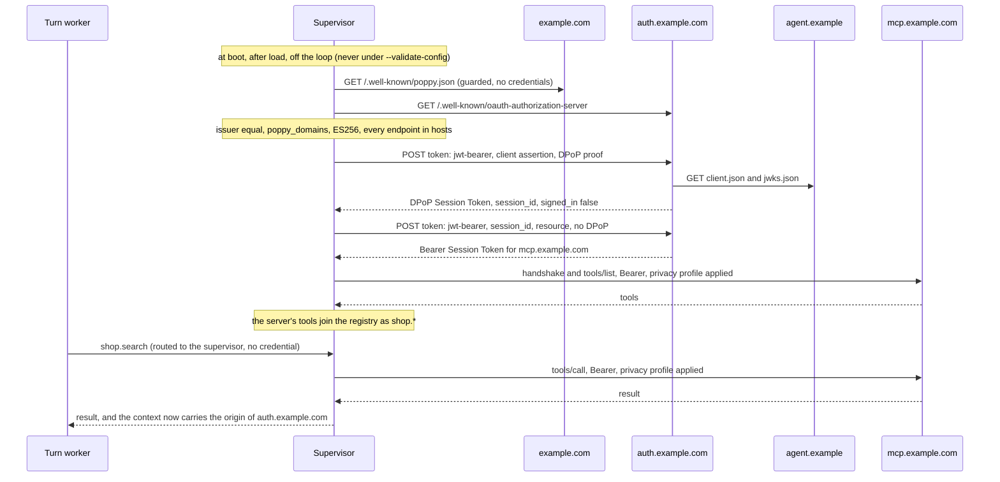
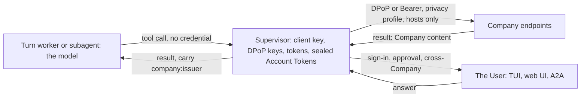

# RFC 0047: Acting at companies for a person — agentd as a Personal Agent under the Personal Agent Protocol draft 0.1

**Status:** Accepted to build 2026-10-17 (the user: "Build now"); decisions 2–12 are recommended defaults accepted with it and open to revision (§13). P0–P4 implemented 2026-10-18, behind the non-release `companies` feature (§9; the guide is docs/act-at-companies.md). P5 is optional: on 2026-10-18 the user took two of its tracks ("Yeah I am good with your recomendations!", on P5a and P5b recommended and the rest not, each with its reason — §9 P5): P5a — one tool per OpenAPI operation — is implemented 2026-10-18, P5b — several accounts per User at one Company — is implemented 2026-10-19, and the others are not built.
**Author:** Andrii Tsok (drafted with Claude)
**Date:** 2026-10-17
**Extends:** RFC 0031 (endpoint authentication): a `private_key_jwt` client, DPoP-bound tokens, RFC 7009 revocation and RFC 8707 resource indicators. RFC 0037 (service catalog and egress): a new entry kind, `company`, whose endpoints come from a remote document and are bounded by an operator host list.
**Depends on:** RFC 0029 (principals and ownership), RFC 0032 and RFC 0043 (human gates, the A2A listener and its posture), RFC 0035 (streams), RFC 0036 (subagent templates), RFC 0042 (what a served document may configure), RFC 0045 (the background poll-thread pattern).
**Amends:** nothing. **Overlaps RFC 0044** (Proposed): this RFC's P0 builds the OAuth groundwork 0044's P0 lists — `private_key_jwt`, the RFC 8414 issuer check, RFC 9207, refresh write-back, RFC 7009, `403` with `WWW-Authenticate` — once, and 0044 builds on it (§12). This RFC does not edit 0044.
**Standards basis:** the Personal Agent Protocol draft 0.1 at repository commit `95fcbf2` (`95fcbf22c5991a0090061aed3dbeb68c0ea575e0`, 2026-10-16): the specification, the Operations extension v1 and, as non-normative advice, the guides. Under it: RFC 6749, 6750, 7009, 7519, 7523 (with draft-ietf-oauth-rfc7523bis for `aud`), 7636, 7638, 8414, 8628, 8707, 9207, 9449, 9728; the OAuth Client ID Metadata Document draft; MCP 2025-06-18 or later.

Sources (read 2026-10-17; the live pages matched the repository at `95fcbf2`, which was still `main`'s HEAD):

- **[INTRO]** *Introduction* (goals and principles): https://personalagentprotocol.org/docs/introduction.md
- **[SPEC]** *Personal Agent Protocol specification (draft)*: https://personalagentprotocol.org/docs/spec.md
- **[OPS]** *Operations extension*, version 1: https://personalagentprotocol.org/docs/extensions/operations.md
- **[GUIDES]** *Guides* (each item a SHOULD; not required for compliance): https://personalagentprotocol.org/docs/guides.md
- **[PATH]** *Path to 1.0*: https://personalagentprotocol.org/docs/path-to-1.md
- **[EXT]** *Extensions*: https://personalagentprotocol.org/docs/extensions.md
- **[REPO]** github.com/personal-agent-protocol/personal-agent-protocol at `95fcbf2`: `kit/company/schemas/*.schema.json` (19 schemas), `kit/company/validate/` (the Company validator, whose `agent.ts` and `jose.ts` are the nearest thing to a reference Personal Agent client), and issues #2–#14.
- **[LICENSE]** https://personalagentprotocol.org/license — Apache-2.0 for the specification and documentation, including examples; "The license doesn't cover the names Personal Agent Protocol and Poppy, the logo, or the design of this site."

A citation such as "§4.3" is to [SPEC], "Ops §5.1" to [OPS], and "Guides #agent-dpop" to the [GUIDES] anchor of that name. Each statement below is marked as one of three things: **a requirement of the draft** (with its section), **agentd's choice**, or **unresolved**. agentd paths are relative to `crates/agentd/src` unless noted. Code references are to `main` at `285c38c6`.

---

## 1. Summary

The Personal Agent Protocol defines "how a Personal Agent, acting for one User, works with a Company on that User's behalf" (§1). A Company publishes `/.well-known/poppy.json` and OAuth metadata. The Personal Agent identifies itself with an HTTPS `client_id` and a published key set, gives the User a pseudonymous ID per Company, and holds a **Session**: signed out at first, signed in once the User signs in themselves. Every request carries a DPoP-bound Session Token (Bearer for MCP). Over that Session the agent uses the Company's MCP servers, OpenAPI APIs and its own agent (a conversation protocol of type `poppy`), and, with the Operations extension, confirms an action only after the User approved its exact terms.

agentd fits the **Personal Agent** role and no other. It is already an outbound OAuth client that produces every credential in code the model cannot read, it assumes the model is hostile, and it has addressed human gates that no judge may answer. This RFC makes agentd a Personal Agent:

1. **Companies are operator-declared** service catalog entries (`services.<name>.kind: company`). agentd verifies each one's documents as §3 and §3.2 require, and dials only endpoints inside the entry's host list, through the SSRF guard (§5.5.1).
2. **One identity, one User.** The instance has one client identity (`security.companies.client`: a `client_id` URL, an ES256 key, a JWKS) and acts for one configured User principal (`security.companies.user`, default `operator`). It mints a random User ID per (User, Company issuer) and keeps it durably (§5.5.2, §5.5.3).
3. **Only the supervisor holds secrets.** The client key, the DPoP keys, Session and Bearer tokens and the sealed Account Tokens live in the supervisor. Every Company call — a Company MCP tool, a `company.*` tool, a conversation read — is served by the supervisor, never dialled by a turn worker or a subagent (§5.6).
4. **The User decides.** Sign-in, approving an operation, joining a Direct Conversation, and calling one Company while holding another's content each open a gate addressed to the User, with code-fixed text. No judge or model answers it, and an operator answers it only when the operator is the User (§5.7).
5. **Company content is data.** Company channels carry `untrusted_input` and `egress` by default; every context that reads Company content carries that Company's origin, add-only; and a call to Company B from a context carrying Company A's content asks the User first (§6).
6. **Privacy by default.** Company requests carry none of agentd's own correlators (instance, run, context, principal, labels, client title, AAuth), and trace context is re-rooted per Company. A self-hosted single-user agent's `client_id` still identifies the person to every Company; this RFC says so rather than hiding it (§5.10).

It ships in six phases (§9): P0 shared OAuth groundwork and the test oracle; P1 signed-out MCP; P2 sign-in with the User; P3 conversations and OpenAPI; P4 the Operations extension and Direct Conversations; P5 optional tracks. Everything sits behind a cargo feature, `companies`, that is not in the release feature set, pinned to the draft at `95fcbf2`.

## 2. Motivation and scope

### 2.1 Why

A person's agent today either signs in as the person, with their password, or is blocked ("Today it is all or nothing", [INTRO]). The introduction asks for "more points between those two extremes": an agent that always identifies itself, a Company that recognises the returning User only by a per-Company pseudonym until the User signs in, scopes the User approves, and per-action confirmation for actions with a business effect. agentd's security model — credentials the model never sees, configuration-only trust tags, the Rule of Two, human gates that survive restarts — is the part of that picture a Personal Agent has to get right, and it is already built.

### 2.2 Roles in and out of scope

| Role (§2) | In scope | Why |
|---|---|---|
| Personal Agent | **yes** | agentd is an outbound client with supervised credentials and human gates. |
| Company | no | agentd is not an authorization server for customer accounts, a consent page, a browser-session cookie issuer, or a scope enforcer across a website. Its own OAuth surface (`a2a/oauth.rs`) is a device grant for its own listener. |
| Company Agent | no | The draft defines one conversation protocol, `poppy` (§7.1), and no A2A type, so agentd's A2A listener cannot be listed. A Company-side adapter that terminates the protocol and calls agentd over A2A is a possible later track (§9, P5); it needs RFC 0044 P3's inbound principals. |

### 2.3 Non-goals

- **Discovery of Companies from model-proposed domains.** A Company is configuration (decision 4).
- **Mediated Sign-In** (§4.7). agentd refuses it at load. Gate answers today persist in durable task history and reach the asking turn, so a password typed into a gate would reach the store and the model (decision 5; P5 lists the sealed-answer gate it would need).
- **Web browsing** (§5). agentd has no browser and does not join one to a Session in this RFC. It stops a declared browser tool from visiting a Company's hosts (§5.5.9).
- **Several Users per instance.** One User per instance in the first cut (decision 3); per-principal Users are P5.
- **Several accounts per User at one Company.** One Account Token per (User, Company) in the first cut; a second account is P5 — taken on as P5b (§9).

## 3. The draft, as it bears on agentd

The draft is short and specific. What a Personal Agent must do, by area:

| Area | What the draft asks of the Personal Agent |
|---|---|
| Discovery (§3, §3.1, §3.2) | Fetch `https://{domain}/.well-known/poppy.json`, following only HTTPS redirects. Refuse an unsupported major `protocol_version`. Fetch the issuer's RFC 8414 metadata and "MUST check that its `issuer` exactly matches `auth.issuer` and that `poppy_domains` includes `organization.domain`, ignoring case." Sign DPoP proofs with an algorithm from `dpop_signing_alg_values_supported`, which "MUST include `ES256`". |
| Identity (§4.1) | A `client_id` that "MUST be an HTTPS URL that returns its metadata document"; `jwks_uri` and `redirect_uris` on the same domain; `private_key_jwt` client assertions whose `aud` "MUST be the Company's `auth.issuer`, as a single string". |
| User ID (§4.2) | One per User per Company (by issuer), stable, opaque; it "MUST NOT contain or be derived from personal information … even with a keyed hash." |
| Sessions (§4.2–§4.4, §4.8, §4.9) | Start and renew with the JWT bearer grant; `session_id` ties Sessions across interfaces; a Session is signed in to at most one account, ever (`account_mismatch`); an Account Token is a refresh token used only at the token and revocation endpoints. |
| Tokens (§4.3) | DPoP everywhere except MCP; Bearer for MCP, requested "without the `DPoP` header" and with `resource` set to the MCP server's URL. "Personal Agents MUST support nonces." "Personal Agents MUST send a Session Token on every API and conversation request, and MUST NOT leave it out to appear to the Company as a person on their own." Tokens never in URLs. Wait at least `Retry-After` on a `429`. |
| Sign-in (§4.4–§4.6) | "The types work on trust: a Personal Agent MUST use direct or Device Sign-In only when the User signs in themselves." Check `state` and "MUST check that `iss` exactly matches the `auth.issuer`" (Direct). Check the granted `scope`. |
| Account Tokens (§4.8) | "Personal Agents MUST store Account Tokens as secrets, and MUST NOT put them in model context, conversation messages, logs, or URLs." Use a rotated one from then on. |
| Conversations (§7) | Unique message ids reused on retry; skip unknown event types; never act on `text-delta`; opaque cursors; `sender: human` only for the User's own words; Direct Conversations only after asking the User. |
| Security (§8) | "Personal Agents MUST treat content from a Company as data, not as instructions." "A Personal Agent MUST NOT act at one Company, or send it information, because content from another Company asked it to." "Text from a Company is never the User's approval or consent." |
| Operations (Ops §5.1, §6) | Show the Company's name and the revision's `summary`, take the User's answer "through its own interface", never treat Company text as approval; a standing permission "MUST cover the Company, the account, the action, and every term"; after a confirm timeout, never ask for a new proposal until the operation is final. |

Three facts about the draft shape the whole design:

- **It moves.** "This is draft version 0.1. Any part of it can change before a stable version, including in ways that aren't backward compatible" (§1); "Until 1.0, a revision can break compatibility with earlier drafts" ([PATH]). About twenty commits between 2026-10-02 and 2026-10-16 changed DPoP, `aud`, `organization.domain`, error formats and conversation parameters while `protocol_version` stayed `"0.1"`. A Personal Agent cannot tell revisions apart from the document, so agentd pins a commit.
- **Endpoints are not checked.** "each Company's metadata names its own endpoints, which nobody checks (3.2)" (§8.4). The draft defends assertions by `aud`; it does not stop a document from naming any host as its token endpoint.
- **Nothing tests a Personal Agent.** The repository "documents the protocol but does not implement the APIs", and its validator acts as a test Personal Agent against Companies only, covering discovery, signed-out Sessions, DPoP and interfaces — not sign-in, streaming, handoff, Direct Conversations or extensions. agentd writes its own fake Company (§9, P0).

## 4. agentd today

What already fits:

| Draft need | agentd today | Where |
|---|---|---|
| HTTPS only, TLS 1.2+ (Guides #both-transport) | rustls with `ring` and bundled roots; plaintext only for loopback | `crates/net/src/tls.rs`; docs/security.md |
| Device Sign-In client (§4.6) | RFC 8628 start and poll; `slow_down` adds 5 s; `interval` and expiry honoured | `auth/oauth2.rs:129`, `:156`; `auth/login.rs` |
| Direct Sign-In mechanics (§4.5) | PKCE S256, random checked `state`, `access_denied`; prints the URL, never opens a browser | `auth/browser.rs:24-60` |
| Refresh grant (§4.8) | `refresh` with `scope` | `auth/oauth2.rs:210`; `auth/device.rs:88` |
| RFC 9728 for MCP (§6) | challenge probe and same-origin well-known fallback | `auth/challenge.rs:29`, `:152`, `:163` |
| Never send without the credential (§4.3) | A `RequestSigner` that cannot produce its credential fails the request unsent (`fa63a997`) | `crates/mcp/src/http.rs:265-284` |
| MCP Streamable HTTP | official `rmcp` client over agentd's socket; 2026-07-28 `server/discover`, falling back to `initialize` | `crates/mcp/src/rmcp_client.rs` |
| Secrets out of model context (§8.2) | secret references resolved at use; `Kind::Cred` never indexed, logged or read by status; the supervisor holds credentials; children get identity material on a private pipe (`285c38c6`) | `auth/cache.rs`; `aauth/mod.rs`; docs/security.md |
| ES256 without a new crate | `ring` is linked; P-256 verification is in use; an Ed25519 load-or-create 0600 key pattern exists | `oci.rs:363`; `aauth/key.rs:52`; `sha.rs`; `b64.rs` |
| 128-bit `jti`, message ids | kernel CSPRNG, no fallback | `sec/random.rs` |
| Guarded fetches (Guides #both-fetching) | resolve once, classify every address, dial only a vetted one | `crates/net/src/ssrf.rs:268`, `:312`, `:357` |
| SSE (§7.6) | bounded reader keeping `event`, `data`, `id`; comments ignored | `crates/net/src/http.rs:404`, `:465`, `:475` |
| The User's answer through the agent's own interface (§8.1, Ops §5.1) | addressed gates, never auto-answered, durable, answered from the TUI, web UI or A2A | docs/human-in-the-loop.md; docs/security.md |
| Per-call rules | `security.policies`: tool, tags, caller, principal, CEL over arguments; `allow`/`deny`/`ask`/`shadow` | `sec/policy.rs:25` |
| Company content as data (§8.1) | configuration-only tags; untagged counts as `untrusted_input`; the Rule of Two at load and spawn; add-only outside-input records; withheld read-backs; the 8000-byte distillate | docs/security.md; `config/taint.rs`; `runtime/withhold.rs` |
| A place to declare a Company | the service catalog: authoritative tags, tool ceilings, `rate`, `egress: closed` | `config/settings/mod.rs:2203`; `mcp/mod.rs:181` |
| Supervisor-served tools | internal, workflow and policy-gated MCP tools go back to the supervisor; subagents route `gated_tools` up | `runtime/turns.rs:193-258`; `runtime/subagents.rs:380` |
| Serving public documents | the A2A router mounts OAuth routes only while they issue | `a2a/serve/mod.rs:348` |
| Failure surfacing | `auth.unavailable` / `auth.recovered` per target, once per process tree | `auth/report.rs` |

What is missing: no `poppy.json` client; RFC 8414 discovery appends the well-known suffix after the issuer's path instead of inserting it and never compares `issuer` (`auth/oauth2.rs:111`); no `private_key_jwt`, no ES256 signing, no DPoP, no RFC 8707 `resource`, no RFC 7009 client; a rotated refresh token is not written back (docs/authentication.md); the MCP transport consults its signer only on `401`, `202` or AAuth headers and drops `WWW-Authenticate` (`crates/mcp/src/http.rs:690-712`), so a `403 insufficient_scope` never reaches it; no client reads `Retry-After`; every MCP request carries `agent/instance`, `agent/run_id`, `agent/ctx` and `traceparent`, and `clientInfo.title` carries the instance label (`mcp/mod.rs:183-189`; docs/mcp-reference.md); no session spans interfaces; the credential cache is keyed per target, not per principal (`auth/cache.rs:59`); the JSON Schema validator checks `pattern` only for literal shapes and `$ref` only within one document (`jsonschema.rs:1-14`), and the draft's schemas use both regex patterns and cross-file references.

## 5. Design

### 5.1 Invariants

1. **A Company is configuration.** agentd works only with Companies the operator declared. It reads endpoints from the Company's documents and dials them only when they match the entry's `hosts`, through the SSRF guard, whatever `security.egress` says (§5.5.1). *agentd's choice; it closes the §8.4 gap for agentd.*
2. **Secrets stay in the supervisor.** No turn worker, subagent, model or log ever holds a Session Token, Bearer token, Account Token, device code, private key, assertion or DPoP proof. *§4.8 and §8.2 require this for Account Tokens and recommend it for the rest; agentd applies it to all.*
3. **Never anonymous.** Every API and conversation request carries a Session Token (§4.3, a requirement). A Session that cannot be started or renewed fails the request unsent (`fa63a997`'s rule). Continuing **signed out** after `invalid_grant` is the draft's defined behaviour (§4.8), not anonymity: the request still carries a Session Token for the same User ID.
4. **Only the User decides.** A gate this RFC opens is addressed to the configured User, its text is fixed by code, and Company text appears in it only as quoted data. No judge, model, Company message or operator answers it — an operator only when the operator is the User. *§8.1 and Ops §5.1 require the User's decision; the operator rule is decision 9.*
5. **Company content is data, and it is tracked.** Every context that reads a Company's content carries that Company's origin, add-only, and a call to another Company from it asks the User (§8.1, a requirement; the mechanism is agentd's).
6. **Fail closed and typed.** Every refusal names its reason and its Company. Nothing falls back to another credential, another Company's Session or a cached success.
7. **Pinned.** agentd implements the draft at `95fcbf2`. A newer revision is a deliberate re-pin with a drift test, never a silent change.

### 5.2 Naming

The licence does not cover the names "Personal Agent Protocol" and "Poppy" (decision 10), and the maintainer has asked people not to call the protocol "PAP". agentd's own surface uses neutral names. The documentation names the protocol factually, as it names A2A or MCP.

| Surface | Name |
|---|---|
| cargo feature | `companies` |
| module | `crates/agentd/src/companies/` |
| configuration | `services.<name>.kind: company`; `security.companies.*` |
| internal tools | `company.*` (`company.status`, `company.sign_in`, `company.converse`, `company.operation.confirm`, …) |
| operator ops | `company.sign_in`, `company.sign_out`, `company.status`, `company.user_id.reset` |
| CLI | `agentd --print-company-client <dir>`; login targets `company:<name>` |
| events, metrics | `company.*`; `agent_company_*` |
| taint origin | `company:<issuer>` |
| stream | `company.<name>` |
| conformance family | `companies` |

The protocol's wire constants contain its name — `/.well-known/poppy.json`, `poppy_domains`, the scopes `poppy:read` and `poppy:write`, the JWT type `poppy-browser+jwt`, the conversation type `poppy`. agentd must send and read them as written. They live in one module, `companies/wire.rs`, so an upstream rename is a one-file change. Vendored files (§9, P0) keep their upstream names and text verbatim, with attribution; that is a copy, not a use of the names as agentd's identifiers.

### 5.3 Configuration

A complete P4-era example. Each key arrives in the phase that gives it an effect (§9); nothing is accepted before it does something.

```yaml
# fragment: the parts this RFC adds
a2a:
  listen: https://0.0.0.0:8443
  url: https://agent.example            # the client_id origin, so agentd can serve its identity
  tls: {cert: /run/tls/cert.pem, key: /run/tls/key.pem}
  bearer: "{{secret-file:/run/secrets/agentd-a2a-bearer}}"   # a public bind needs a credential (RFC 0043)
store:
  kind: file                            # a User ID must survive restarts; none and memory are refused
security:
  egress: closed
  companies:
    user: user:dana                     # the one User this instance acts for; default operator
    client:
      id: https://agent.example/companies/client.json
      name: Dana's agent
      logo_uri: https://agent.example/logo.png
      key_file: /var/lib/agentd/company-client-key   # ES256, created 0600 when absent
      published_key_files: []           # public halves in the JWKS, never signed with (rotation)
      serve: true                       # serve client.json, jwks.json and the callback on the A2A listener
      extensions: [operations]          # P4
    seal_key: "{{secret-file:/run/secrets/agentd-company-seal}}"   # seals Account Tokens and User ID records
    context: {locale: en-US, time_zone: America/Los_Angeles}        # P3; shared only when set
    browsers: [web]                     # P1; browser servers kept off every Company's hosts
    standing:                           # P4; restart-only, operator-declared
      - company: shop
        via: {tool: "shop.exchange_*"}
        terms: [order_id, item_id, replacement_sku, price_difference]   # every term key it covers
        when: "CEL: terms.price_difference.currency == 'USD' && double(terms.price_difference.amount) <= 20.0"
        expires: 2026-12-31T00:00:00Z
        uses: 3
services:
  shop:
    kind: company
    endpoint: https://example.com       # the domain whose /.well-known/poppy.json is read
    hosts: ["example.com", "*.example.com"]
    interfaces: [mcp, agent, openapi]
    sign_in: [device, direct]           # P2; mediated is refused
    scopes: ["poppy:read", "poppy:write"]   # the most agentd ever requests
    allow: ["search_*", "order_*", "exchange_*"]
    api_allow: ["GET /orders/{order_id}", "POST /orders/{order_id}/exchanges"]   # P3
    api_names: {"https://api.example.com/openapi.json": orders}   # P5a; without it, `shop_api`
    rate: "60/1m"
    # tags default to {"*": [untrusted_input, egress]}; privacy defaults to strict
```

`security.companies` — every path restart · op, feature `companies`:

| Path | Type | Default | Phase | What it does |
|---|---|---|---|---|
| `security.companies.user` | `operator` or a principal id (`<role>:<id>`) | `operator` | P1 | The User this instance acts for at every Company. `operator` is a role, not one principal: with it, every operator principal counts as the User (the unix-socket peer, the operator bearer, each operator principal rule), because every operator is addressed as `operator` (docs/human-in-the-loop.md). That is one person only when one person holds the operator credentials, so agentd refuses `user: operator` at load when `a2a.principals` holds more than one rule of role `operator`, and asks for one principal id. |
| `security.companies.client.id` | HTTPS URL | required | P1 | The `client_id`: the URL of the client metadata document (§4.1). |
| `.client.name`, `.client.logo_uri` | string, HTTPS URL | required, — | P1 | `client_name` and `logo_uri`, shown on Companies' consent pages. |
| `.client.jwks_uri` | HTTPS URL | `<id origin>/companies/jwks.json` | P1 | Must be on the `client_id`'s host. |
| `.client.redirect_uri` | HTTPS URL | `<id origin>/companies/callback` | P2 | Direct Sign-In's return. Must be on the `client_id`'s host. Listed in `redirect_uris` only when some Company lists `direct`; otherwise `redirect_uris` is published as `[]`, because the kit's `client-metadata.schema.json` requires the member. |
| `.client.key_file` | path | `/var/lib/agentd/company-client-key` | P1 | The ES256 signing key (PKCS#8), created `0600` when absent. |
| `.client.published_key_files` | list of paths | `[]` | P1 | Keys whose public halves are in the JWKS but are never signed with: the next key before a rotation, the previous key after it (§5.5.2). |
| `.client.serve` | bool | `false` | P1 | Serve the metadata document, the JWKS and the callback on the A2A listener. Needs `a2a` and `a2a.url`'s origin equal to the `client_id`'s. |
| `.client.extensions` | list of `operations` | `[]` | P4 | Extensions listed in the client metadata (§3.3). |
| `security.companies.seal_key` | secret reference | — | P1 | 32 random bytes. Seals Account Tokens (P2) and, when set, the User ID records (§5.5.3). Required once any Company lists `sign_in`, and with any company entry when `store.kind` is a remote store (`mcp`, `http`). A literal in a file is exit 2. |
| `security.companies.context` | `{locale, time_zone, share_availability}` | nothing shared | P3 | What `context` carries in conversation messages (§7.4). |
| `security.companies.browsers` | list of MCP server names | `[]` | P1 | Browser servers refused any call whose URL argument targets a Company's `hosts` (§5.5.9). |
| `security.companies.standing[]` | list | `[]` | P4 | Standing permissions (§5.8). Each needs `company`, `via`, `terms` (the term keys it covers), `when` (CEL; needs `cel`) and `expires`; `uses` is optional. |
| `security.companies.limits` | `{in_flight, conversations}` | `{in_flight: 4, conversations: 16}` | P1, P3 | Concurrent Company calls per Company on supervisor threads; open conversation readers per instance. |

`services.<name>` with `kind: company` — operator-only (RFC 0042 already keeps `services` out of documents):

| Field | Type | Default | Phase | What it does |
|---|---|---|---|---|
| `endpoint` | `https://<host>` | required | P1 | The domain whose `/.well-known/poppy.json` is read. A path is refused. |
| `hosts` | list of host globs | the configured host, the document's `organization.domain`, their subdomains, and the issuer's host | P1 | Every endpoint the Company's documents name must match (§5.5.1). |
| `allow_private` | bool | `false` | P1 | Admit loopback, private and link-local addresses, for an on-premises Company or the fake Company in tests. |
| `interfaces` | list of `mcp \| agent \| openapi` | `[mcp]` | P1 (`mcp`), P3 | Which of the listed interfaces agentd uses. |
| `mcp_names` | map of an MCP `apis[].url` to a server name | — | P1 | Names the synthesized MCP servers when the Company lists more than one (§5.5.6). With exactly one, it is named after the entry and this map is not needed. |
| `sign_in` | list of `device \| direct` | `[]` | P2 | Sign-in types agentd may start. `mediated` is refused at load, naming why. `direct` needs a served callback. |
| `scopes` | list | `[]` | P2 | The ceiling of scopes agentd requests. A request is `needed ∩ scopes ∩ <type>.scopes`. |
| `tags` | map | `{"*": [untrusted_input, egress]}` | P1 | Authoritative trust tags for every channel to this Company (§6.3). |
| `allow`, `exclude` | globs | all, `[]` | P1 | The MCP tool ceiling, as for any entry. |
| `api_allow` | list of `METHOD /path-template` | none | P3 | The OpenAPI ceiling; an operation outside it is refused. Each operation it lists that the description declares is also a tool of its own (P5a, §9). |
| `api_names` | map of an OpenAPI `apis[].url` to a server name | — | P5a | Names the server the operation tools of each OpenAPI API are named under. Without it, the server is named after the entry, or `<entry>_api` when the entry's own MCP server has that name; that needs the Company to list one OpenAPI API. |
| `rate`, `timeout` | rate, duration | — | P1 | Pacing and per-call timeout, as for any entry. |
| `privacy` | `strict \| standard` | `strict` | P1 | `standard` sends agentd's usual correlators; it logs `company.privacy.standard` at load. |
| `context` | as `security.companies.context` | inherits | P3 | Per-Company override. |

A company entry refuses `auth`, `headers`, `methods` and `breaker`: the protocol defines its credential. *Reload class (agentd's choice for the first cut):* a reload that adds, removes or changes a `kind: company` entry is refused with `config.reload.restart_required`, because the entry keys the Session table, the User IDs and the synthesized servers. Every new path joins `every_config_path_is_classified` (`config/settings/mod.rs:10958`) as restart and operator-only, and stays outside the document-writable set (`:10884`). `security.companies.seal_key` joins the credential-bearing paths.

Load-time refusals: the feature missing; `store.kind` `none` or `memory` with any company entry (a User ID must be stable, §4.2); a remote `store.kind` (`mcp`, `http`) with any company entry and no `seal_key`; a `client.id` that is not HTTPS; a `jwks_uri` or `redirect_uri` on another host; `serve: true` with an `a2a.url` origin other than the `client_id`'s; `sign_in: [direct]` with no served callback; `sign_in` without `seal_key`; `user: operator` with more than one operator principal rule; `standing` without `cel`, or an entry without `terms`; an `endpoint` with a path; two `mcp_names` values that are equal or collide with another server's name; and, with P5a, two servers of entries that would share a name, an `api_names` without `openapi` or an operation in `api_allow`, an operation `api_allow` lists twice, two `api_allow` entries that make one tool name, and a tag key, a policy's `match.tool`, a workflow's `tool` step or a standing permission's `via.tool` naming an operation tool the entry does not make.

The CLI:

- `agentd --print-company-client <dir>` writes `client.json` and `jwks.json` for static hosting, creating the key if absent. It dials nothing. Exit 0, or 2.
- `agentd --login company:<name>` and `--logout company:<name>` are thin clients of the running daemon: they send the operator op `company.sign_in` or `company.sign_out` over the unix A2A listener (peer uid checked, as RFC 0044 P1 does for its enrolment), print what the daemon returns, and wait. They are refused unless `security.companies.user` is `operator`: the unix-socket peer is the operator (docs/a2a.md), and a User who is one operator principal sends the same op from their own A2A client as that principal (the TUI and the web UI have no company sign-in command), while any User can ask the agent, whose `company.sign_in` tool opens the same gate. With no daemon running they say so; the protocol work always happens in the daemon.

### 5.4 Components

| File | Phase | What it is |
|---|---|---|
| `auth/http.rs` | P0 | The one credentialed HTTP helper shared with RFC 0044 (its T22): HTTPS only, SSRF-guarded, no redirects, response headers returned, `Retry-After` parsed (seconds or HTTP-date). |
| `auth/client_assertion.rs` | P0 | ES256 `private_key_jwt` on `ring` (`ECDSA_P256_SHA256_FIXED_SIGNING`): load-or-create a PKCS#8 key `0600`; sign a JWT with `kid`. Shared with RFC 0044. |
| `auth/jwk.rs` | P0 | P-256 public JWK export and the RFC 7638 thumbprint. |
| `auth/seal.rs` | P0 | AES-256-GCM seal and open with associated data, on `ring::aead`; the same primitive RFC 0044's grant store specifies. |
| `auth/revoke.rs` | P0 | RFC 7009 revocation. |
| `companies/wire.rs` | P0 | Every protocol constant, path, parameter and error code. |
| `companies/mock.rs` | P0 | The fake Company, under the mock gate, `oauth` and `tls` (below; §9, P0). |
| `companies/discover.rs` | P1 | Fetch and verify `poppy.json` and RFC 8414 metadata; the verified-Company cache. |
| `companies/identity.rs` | P1 | The client metadata document and JWKS: printed, served, and self-checked. |
| `companies/user_id.rs` | P1 | Mint and keep User IDs. |
| `companies/dpop.rs` | P1 | DPoP keys, proofs and the per-origin nonce cache. |
| `companies/http.rs` | P1 | Company requests over `auth/http.rs`: signs at the last moment, applies the privacy profile and the host rule, never follows a redirect on a credentialed request. |
| `companies/token.rs` | P1 | Every grant (§4.2–§4.8), the typed token response and the typed error table. |
| `companies/session.rs` | P1 | The supervisor's Session table (§5.6). |
| `companies/mcp.rs` | P1 | Synthesized MCP servers and `CompanyBearerSigner`. |
| `companies/carry.rs` | P1 | The per-context Company origin record and the cross-Company rule. |
| `companies/signin.rs` | P2 | Device and Direct Sign-In through User gates, and signing out. |
| `companies/account.rs` | P2 | Account Token custody: one sealed record per (User, issuer). |
| `companies/cli.rs` | P2 | `--login` / `--logout company:<name>`, thin clients of the daemon. |
| `companies/conversation.rs` | P3 | The `poppy` conversation client and its reader threads. |
| `companies/api.rs` | P3 | OpenAPI 3.0/3.1 (JSON) calls with DPoP. |
| `companies/request.rs` | P3 | A request carrying the DPoP Session Token: the §6 challenges and the retry rule of §5.9, shared by conversations and APIs. |
| `companies/ledger.rs` | P3 | What agentd keeps per (User, issuer): conversations and their cursors, message ids and `Idempotency-Key`s, sealed like the User ID record. |
| `companies/operations.rs` | P4 | Operations: detection, records, approval, confirm, tracking. |
| `companies/direct.rs` | P4 | Direct Conversation consent and the verbatim relay. |

`companies/` is compiled only with the feature `companies = ["oauth", "tls"]`, where P0 makes `oauth = ["dep:ring"]` as RFC 0044 P0 specifies (`ring` is already in the graph through rustls; no new crate). The two P0 files, `companies/wire.rs` and `companies/mock.rs`, compile without `companies`, under `#[cfg(all(feature = "oauth", feature = "tls", any(debug_assertions, feature = "internal-mocks")))]`: the mock gate the mock MCP servers use, plus `oauth`, because the fake Company verifies ES256 assertions and DPoP proofs with `ring`'s P-256 verifier and `internal-mocks = ["mock-models"]` does not bring `ring` (`crates/agentd/Cargo.toml`), plus `tls`, because the fake serves HTTPS and fetches the agent's documents over it, as every URL the draft admits is HTTPS. It needs no Personal Agent code. `internal-mocks` itself is not changed: a build without `oauth` or `tls` has no fake Company, and every per-feature solo row still compiles. Serving the identity, the Direct callback and every gate also need `a2a`.

### 5.5 The request path



#### 5.5.1 Discovery and verification

A synthesized MCP server's tools reach the registry and the tool plan only after discovery, a Session and `tools/list`, so the model cannot call one before then; discovery cannot wait for the first call. After load — never under `--validate-config`, which dials nothing and checks only the entry's shape — the supervisor discovers and verifies every declared Company off the loop, on an executor thread, and connects each of its MCP servers the way `runtime/join.rs` connects a configured server: the handshake, then its tool list, then its tools join the registry. A Company that does not answer, or does not verify, is tried again with join.rs's backoff (1 s doubling to 60 s), and its tools join when it does. So **every boot opens a Session at every declared Company whose `interfaces` include `mcp`**: the stored `session_id` renewed, signed in when an Account Token is held (§5.6), or a new signed-out Session. A Company used only through `agent` or `openapi` is verified at boot too, but opens its Session at the first `company.*` call that needs one; those tools exist whether or not the Company has answered, so they are the only ones that can wait.

1. `GET https://<endpoint host>/.well-known/poppy.json` through the guarded fetch: HTTPS on every hop (§3, a requirement), at most 3 redirects, 100 KiB, 5 s, no `Authorization` and no cookies (Guides #both-fetching; the limits are agentd's choice). Duplicate JSON member names are refused (Guides #both-transport).
2. Refuse a `protocol_version` whose major is not `0`; accept newer minors and ignore unknown fields (§3.1, a requirement).
3. Require `organization.domain` to equal the final host after redirects, ASCII case-folded (§3.1).
4. Fetch the RFC 8414 metadata at `https://<issuer host>/.well-known/oauth-authorization-server<issuer path>` (the suffix inserted, RFC 8414 §3.1). Require `issuer` byte-equal to `auth.issuer` and `poppy_domains` to contain `organization.domain`, ignoring case (§3.2, a requirement).
5. Require `ES256` in `dpop_signing_alg_values_supported` (§3.2), `token_endpoint` and `revocation_endpoint`, `authorization_endpoint` when `auth.direct` is present and `device_authorization_endpoint` when `auth.device` is (§3.2). A Company that publishes the algorithms only under a prefixed key, as issue #12 describes, is refused naming the key (§11, item 7).
6. **The host rule** (agentd's choice). Every URL the two documents name — `auth.issuer`, the four OAuth endpoints, `auth.mediated.endpoint` if present, every `apis[].url`, every `agent.protocols[].endpoint`, `web.browser_session_endpoint`, and every extension endpoint — must match the entry's `hosts`, and its host must be a plain one: a name or address and an optional port, with no userinfo and no `\`, which a browser reads as `/` (`https://other.example\@a.example/` is at `other.example` in a browser), so no URL whose host two readers could disagree on is dialled or shown. One that does not refuses the Company with `company.endpoint.refused {company, field, host}`. This holds under `egress: open` too: closed egress exempts OAuth credential plumbing today (docs/security.md), and the §8.4 gap is exactly about where credentials go. Under `egress: closed` the company entry is the catalog entry for every one of these dials. The default `hosts` admits the issuer's host because step 4 has already tied that issuer to this domain: an issuer whose `poppy_domains` does not list the domain never gets this far.
7. Every dial goes through `net::ssrf` (resolve once, classify, dial the vetted address) and refuses loopback, private and link-local addresses unless `allow_private` is set.
8. Cache both documents in supervisor memory for their `Cache-Control` max-age clamped to [60 s, 1 day], five minutes when they give none (Guides #both-fetching gives the bounds; the default is agentd's). Refetch at the first use after expiry. A failed refetch keeps the last verified documents until one day after they were verified (`company.discovery.stale`), then the Company is unavailable. An `auth.issuer` that changes on a refetch suspends the Company until a restart (`company.issuer_changed`, warn): a domain changing its issuer is either a migration the operator should see or a takeover. A refetch that adds, removes or changes an MCP entry of `apis[]` changes nothing until a restart (`company.apis_changed {company, added, removed}`, warn): the synthesized servers, their names and tools, the `allow` lists and the standing permissions' `via` globs that point at them stay as they were verified, and only the restart's discovery adopts the new list. Every other field of a refetched document is verified as in steps 1–7 and used from then on.

`company.verified {company, domain, issuer, interfaces, max_age}` or `company.refused {company, reason}` records the outcome once per change; `auth.unavailable` with target `company:<name>` fires while a Company cannot be verified.

#### 5.5.2 Identity

The client metadata document (§4.1) is built from `security.companies.client`:

```json
{
  "client_id": "https://agent.example/companies/client.json",
  "client_name": "Dana's agent",
  "logo_uri": "https://agent.example/logo.png",
  "jwks_uri": "https://agent.example/companies/jwks.json",
  "redirect_uris": ["https://agent.example/companies/callback"],
  "token_endpoint_auth_method": "private_key_jwt",
  "extensions": { "operations": { "version": "1" } }
}
```

`redirect_uris` is always present: `[]` when no Company lists `direct`, because the kit's `client-metadata.schema.json` requires it and a Company running the kit's validator would refuse a document without it. A P1 test validates every document `--print-company-client` writes and `serve` serves against the vendored schema.

- **The key.** One ES256 key in `key_file`, a PKCS#8 file created `0600` when absent with `ring`'s `EcdsaKeyPair::generate_pkcs8`, mirroring `aauth::AgentKey::load_or_create`. `kid` is the key's RFC 7638 thumbprint. The JWKS lists the current key and every `published_key_files` key, public halves only (§4.1, a requirement). Only the supervisor reads the file; no child is handed it (unlike the AAuth key, which children receive on a pipe since `285c38c6`).
- **Publishing.** Either `--print-company-client <dir>` for static hosting, or `serve: true`, which mounts three public `GET` routes on the A2A listener at the paths of `client.id`, `jwks_uri` and `redirect_uri`, the way the device-grant routes are mounted only while they issue (`a2a/serve/mod.rs:348`). The documents are served with `Cache-Control: max-age=300`; the callback with `no-store` and `Content-Security-Policy: frame-ancestors 'none'`. Serving makes the A2A listener reachable from every Company, under RFC 0043's remote posture; static hosting keeps the listener private and gives up Direct Sign-In.
- **The self-check** (agentd's choice). Before its first Session at boot (with `serve: true`, once the A2A listener is up), the supervisor fetches its own `client_id` document and JWKS through the guarded fetch and requires the document to equal what it would print and the current `kid` to be published. Otherwise every Company is unavailable with `company.identity.unpublished`. A Company would refuse the assertion anyway (`invalid_client`); this names the cause.
- **Assertions.** Client assertions (§4.1) and Session assertions (§4.2) share one shape: header `{alg: ES256, typ: JWT, kid}`; claims `iss` = `client_id`, `aud` = the verified `auth.issuer` as a single string, `iat`, `exp` = `iat` + 60, `jti` = 16 random bytes; the client assertion's `sub` = `client_id`, the Session assertion's `sub` = the User ID. `aud` = issuer is a requirement (§4.1, §4.2); `iss` = `sub` = `client_id` for the client assertion follows RFC 7523 and the kit validator's `agent.ts`; the 60-second lifetime is agentd's choice (the draft says "short-lived", Guides #both-signing says reject long lifetimes). Every retry signs fresh assertions (Guides #both-retries).
- **Rotation** (Guides #both-key-rotation), each step a restart because every path is restart-only: (1) add the new key's path to `published_key_files` (created `0600` when absent, as `key_file` is) and restart, which publishes it without signing with it; (2) wait for Companies' caches (at least the served max-age); (3) swap: the new path becomes `key_file` and the old one moves to `published_key_files`, and restart; (4) once every assertion signed with the old key has expired (60 s), remove it from `published_key_files` and restart. With static hosting, re-run `--print-company-client` and upload the JWKS after steps 1 and 4. Account Tokens are tied to the `client_id`, not a key, so rotation does not sign anyone out. A lost key is a new identity to every Company allow-list; the docs say to back it up.

#### 5.5.3 The User ID

`companies/user_id.rs` mints `usr_` + base64url(16 random bytes) the first time a (User principal, issuer) pair needs one, and stores it durably as `Kind::Cred`. The value is random, so it is not derived from personal information (§4.2, a requirement; Guides #agent-user-ids' first method). It is keyed by issuer, so several domains that name one issuer share one User ID (§3.2). The same record holds the `session_id` and a random per-(User, issuer) secret used by the privacy profile (§5.10).

The record is one of the assets §6.1 names: the User IDs and which Companies they belong to. With `seal_key` set, the record is sealed (AES-256-GCM, associated data `("company-user", client_id, issuer, principal, record version)`) and its id is HMAC-SHA256 of `issuer + "|" + principal` under a key derived from `seal_key`, so a store that holds it cannot read the User ID or tell which issuer it is for. Without `seal_key` the id is `sha256("company-user|" + issuer + "|" + principal)` and the record is plain `Kind::Cred`; that is allowed only with a local store (`file`), because `seal_key` is required with any company entry on a remote one (§5.3). The id is a lookup key and is never sent. Setting `seal_key` for the first time seals the existing plain records at boot. A `seal_key` that opens none of the sealed records makes every Company unavailable (`company.seal_key.mismatch`, error) rather than minting new User IDs, because a new User ID is a new User at every Company; the operator restores the key, or runs `company.user_id.reset` for each Company to start over as a new User.

The operator op `company.user_id.reset {company}` revokes the Account Token if any, then forgets the User ID, the secret and the `session_id`: the Company sees a new User. It answers open issue #11's request that the User be able to rotate or reset the ID, at the cost the issue names — the Company loses cart and conversation continuity.

#### 5.5.4 Sessions and tokens

`companies/token.rs` implements every grant on the token endpoint, each with the client assertion and a DPoP proof unless noted:

| Purpose | Grant | Extra parameters | Draft |
|---|---|---|---|
| Start a Session | `urn:ietf:params:oauth:grant-type:jwt-bearer` | `assertion` | §4.2 |
| Renew a signed-out Session | the same | `session_id` | §4.2 |
| Direct Sign-In code exchange | `authorization_code` | `code`, `redirect_uri`, `code_verifier`, `session_id` | §4.5 |
| Device poll | `urn:ietf:params:oauth:grant-type:device_code` | `device_code`, `session_id` | §4.6 |
| Signed-in token, new or existing Session | `refresh_token` | `refresh_token`, `session_id`?, narrower `scope`? | §4.8 |
| Bearer for MCP | the Session's renew grant **without** a DPoP header | `session_id`, `resource` = the MCP `url` | §4.3 |
| A token for a `resource`-tagged entry | the renew grant | `resource` | §4.3 |

The response is typed: `access_token`, `token_type`, `expires_in > 0`, `scope` parsed into a set, `session_id` and `signed_in` required, `refresh_token` and `refresh_token_expires_in` optional. A response missing a required field is an error. Bodies are never logged; an error line carries the code only, the `oauth_error` discipline (`auth/oauth2.rs:256`). The error table is the draft's (§4.2, §4.3, §4.6, §6): `invalid_client`, `invalid_grant`, `invalid_session`, `account_mismatch`, `invalid_dpop_proof`, `use_dpop_nonce`, `extension_required` with `extension`, `rate_limited`, `invalid_scope`, `authorization_pending`, `slow_down`, `access_denied`, `expired_token`.

Session Tokens are opaque: agentd never parses one (§4.2, a requirement). When agentd gets a new Session Token for a Session it uses it from then on (§4.3, a requirement).

#### 5.5.5 DPoP

- **Keys.** One P-256 key pair per (User, issuer), generated in supervisor memory per process and never written anywhere (decision 6). §4.3 allows a new key per Session; a restart's new key re-mints the Session Token with a proof from it, as Guides #agent-dpop describes for switching keys. Account Tokens survive this because a refresh token issued to a confidential client is not bound to the DPoP key (RFC 9449 §5), and the draft authenticates its use by the client assertion (§4.8). A Company that binds it anyway would answer `invalid_grant` after a restart; agentd would continue signed out and the User would sign in again. That is an interoperability risk, recorded as Q4.
- **Proofs.** A new proof for every request, signed at the last moment in `companies/http.rs` where the final method and URL are known: header `{typ: dpop+jwt, alg: ES256, jwk: {kty: EC, crv: P-256, x, y}}`; claims `jti` (16 random bytes), `htm` (uppercase), `htu` (scheme, authority and path, without query or fragment), `iat`, `ath`, `nonce` when the origin has one (§4.3, requirements). `ath` = base64url(SHA-256(the Session Token)) is computed only over a DPoP Session Token sent in `Authorization`; a proof to the token endpoint never has one, even when the request carries an Account Token in its body ("Proofs sent to the token endpoint don't have one", §4.3).
- **Nonces.** "Personal Agents MUST support nonces" (§4.3). A nonce is kept per origin, learned from a `400 use_dpop_nonce` at the token endpoint, a `401` with `WWW-Authenticate: DPoP error="use_dpop_nonce"` elsewhere, or any `DPoP-Nonce` response header. A `use_dpop_nonce` is retried exactly once, with a new proof and, at the token endpoint, fresh assertions (Guides #agent-dpop).
- **Where.** On every API, conversation, operations, Mediated (not used) and token-endpoint request, except the token request for an MCP Bearer token, which §4.3 sends "without the `DPoP` header" (§5.5.4); and never on an MCP request, which carries Bearer. Also on the device authorization request and the revocation request, whose examples (§4.6, §4.9) carry no `DPoP` header while §4.3 says the agent "signs a new proof for every request, including token requests". agentd follows §4.3's sentence; a server that does not expect DPoP there ignores it under RFC 9449. *Unresolved in the draft*; it is upstream feedback (§15) and Q9.
- **Never** on a redirect: a credentialed request follows no redirect, never carries `Authorization` to another host, and never puts a token in a URL (§4.3, a requirement; Guides #agent-dpop).
- **Clocks.** Proofs and assertions live about a minute. agentd compares each Company response's `Date` header with its clock and logs `company.clock_skew {company, skew_s}` once when they differ by more than 30 s (agentd's choice; it has no time-sync check of its own).

#### 5.5.6 The MCP interface

For each `apis[]` entry of type `mcp` (§6) on a Company whose `interfaces` include `mcp`, the supervisor synthesizes an MCP server, with the entry's tags, `allow`, `exclude` and `rate`, `aauth: false`, and no `auth`. Its name is stable, never an index into the document: the entry's name when the Company lists one MCP API, and otherwise the name `mcp_names` gives its `url`. A Company listing several MCP APIs without `mcp_names` covering each is unavailable with `company.refused {reason: "mcp_names"}`, naming the URLs; an MCP API `mcp_names` names that the document does not list is reported the same way. `company.verified` lists the names. A refetch that changes the MCP entries waits for a restart (§5.5.1, step 8).

A synthesized server always sets `ns` to its own name, so every Company tool registers as `<server>.<tool>` and can never take a bare name. Without that, `registry/mod.rs:359-371` would register a tool under its bare advertised name and qualify it only when the bare name is already taken, which depends on registration order: a Company could advertise `send_email` and be the tool the model calls by that name, and the standing permission `via: {tool: "shop.exchange_*"}` would match nothing. A qualified name that still collides with an existing tool is ignored with a warning, as for any server (`registry/mod.rs:374-376`). An unrecognised API type is skipped (§6, a SHOULD). Each Company tool description is prefixed with a fixed note naming the Company and saying the text is the Company's (agentd's choice: descriptions reach the model and are Company content, §8.1).

Its signer is `CompanyBearerSigner`, a `RequestSigner` that asks the Session table for the Bearer token bound to that server's URL. The P0 change to `crates/mcp/src/http.rs` lets it see the response: `AuthResponse` gains `www_authenticate`, `dpop_nonce` and `retry_after`, and `on_response` is consulted on `401` and `403` too. Then:

| Server says | agentd does |
|---|---|
| `401 invalid_token` | renew the Bearer token (with the Account Token for a signed-in Session), re-sign, retry once (§6); an `invalid_grant` on that renewal is a disconnect (§5.7) and the retry goes signed out |
| `403 sign_in_required` | with an Account Token held: the `refresh_token` grant with `session_id` and `resource` and without `DPoP` (§4.3's example), which signs the current Session in and returns a new Bearer token, then one retry (§6: "The Personal Agent uses its Account Token (4.8), or signs in (4.4) if it has none, and retries"). A retry that fails with `insufficient_scope` is the row below. With no Account Token, or once an `invalid_grant` on that refresh has deleted it (§5.7, Disconnect): a typed tool error, `<company> needs a signed-in Session`, and the model may call `company.sign_in` |
| `403 insufficient_scope, scope="…"` | a typed tool error naming the scopes (§6) |
| `403 extension_required` | the server is unusable for this instance; `company.interface.refused` (§6: "only to refuse the Personal Agent entirely") |
| `429` / `503` with `Retry-After` | the Company's not-before instant (§5.9) |

The MCP server must list `auth.issuer` in its RFC 9728 `authorization_servers` (§6, a Company requirement). agentd checks it before sending the first token (agentd's choice), with the RFC 9728 path insertion P0 adds to `auth/challenge.rs`. A Company down at boot joins later through the existing re-dial (`runtime/join.rs`). The draft pins MCP "2025-06-18 or later"; agentd tries 2026-07-28's `server/discover` first and falls back to `initialize`, and the fake Company includes a 2025-06-18-only server so that fallback is tested (§11, item 17). Issue #6 may move MCP to DPoP; the signer uses the same proof code, so that is a switch, not a rewrite.

#### 5.5.7 Conversations (P3)

A hand-written client for type `poppy` (§7), because no official SDK exists in any language; the project uses an official SDK where one exists and otherwise implements against the specification. Its tools, all supervisor-served:

| Tool | Request | Notes |
|---|---|---|
| `company.converse {company, conversation?, text?, data?, wait?}` | `POST {endpoint}` or `POST {endpoint}/{id}/messages`, with `?wait` and the saved cursor | Message id `msg_` + 16 random bytes, written durably before the POST and reused on retry (§7.3). `sender` is always `agent`; `role` is never sent (§7.4). `wait` at most 30 (Guides #agent-conversations). |
| `company.read {company, conversation, wait?}` | `GET {endpoint}/{id}/events?cursor&wait` | Returns the events since the model's last read, in order. |
| `company.handoff {company, conversation}` | `POST …/handoff` with `{}` | §7.9 |
| `company.close {company, conversation}` | `POST …/close` with `{}` | §7.12 |

Two reads follow a conversation, each from a cursor of its own that it saves: the model's (`company.read`, and `company.converse` with `wait`) and the reader's, so neither takes events from the other; what the supervisor does with an `authorization` or `user_requested` event, it does once, whichever read sees it first. A reader thread per open conversation, bounded by `security.companies.limits.conversations` and reaped on close, follows the RFC 0045 poll-thread pattern: it long-polls with `wait=30` or streams SSE (`Accept: text/event-stream`), reconnects with `Last-Event-ID` (§7.6), skips unknown event types (§7.5, a requirement) and event ids already handled, never passes a `text-delta` to the model or a stream (§7.6, a requirement), never compares cursors (§7.5, a requirement), and persists the cursor durably after handling each read. `cursor_expired` re-reads from the beginning and tells the User that part of the conversation is missing (§7.5, a SHOULD). Message, state, authorization and user_requested events are appended to the stream `company.<name>` carrying the Company's origin, so a workflow can `wait {on: event}`.

- An **`authorization` event** (§7.11): the supervisor uses the held Account Token if its granted scope covers the event's; otherwise the event reaches the model as a typed fact, and the model may call `company.sign_in`. The Company's event never opens a sign-in gate by itself (agentd's choice: a Company should not be able to prompt the User at will). The same conversation continues with the new token (§7.11).
- A **`user_requested` event** (§7.10): in P3 the supervisor answers in the conversation that the User is not available for a direct conversation, as §7.10 allows ("If they decline or aren't available, it says so"). P4 asks the User (§5.8.2).
- **`context`**: only the fields `security.companies.context` sets, in the draft's formats (§7.4, a requirement); `user_available` only with `share_availability: true`, derived from whether the User has an attached client (agentd's choice: availability is a presence signal).
- Errors are typed (§7.13): `conversation_not_found`, `conversation_closed`, `direct_conversation_open`, `message_id_conflict`, `invalid_cursor`, `cursor_expired`, `invalid_request`, `rate_limited`.
- An events read must carry `events`; the rest is taken as given — `has_more` false when absent, the cursor the last event's id, or the request's, when `cursor` is absent — and `conversation_id` is not required (§11, item 8).

A conversation belongs to the `client_id` and User ID, then to the account (§7.2), and outlives Sessions (§7.11). Its id and cursor are kept per (User, issuer), so after `invalid_session` it continues in the new Session.

#### 5.5.8 OpenAPI (P3)

`company.api {company, api?, method, path, query?, json?, expect?}` calls one operation of a listed OpenAPI 3.0 or 3.1 description (§6); `path` is under the API's server URL, or the whole URL, and a status outside `expect` (default 2xx) is the tool's error. The supervisor fetches the description as it fetches the discovery documents, with no credential (JSON only at first; size-capped; `$ref` depth-bounded), requires `method` and `path` to match an operation in it and in `api_allow`, validates parameters and body with `crate::jsonschema`, signs with DPoP, adds an `Idempotency-Key` (a UUIDv4 persisted per call, reused on retry; Guides #both-retries) on every write, retries a write automatically only when its operation declares an `Idempotency-Key` header parameter (Guides #both-retries: "on API writes that accept one"; §5.9), maps `WWW-Authenticate` errors as §5.5.6 does, and returns `{status, json}`. `company.api.describe {company, api?, operation?}` returns operation summaries and schemas as Company content. The `http` workflow step gains `auth: {kind: company, company: <name>}` so a workflow can call a Company API deterministically, under the same rules. Each operation `api_allow` lists is also a registry tool of its own, named by the operator (P5a, §9).

#### 5.5.9 Web pages

agentd does not browse. Where a verified `poppy.json` lists `web.browser_session_endpoint`, the draft says the agent "MUST join its browser to a Session before browsing" (§5); agentd cannot join one in this RFC, so it keeps declared browsers away: a call on a server named in `security.companies.browsers` is refused when any string argument parses as an absolute URL whose host matches a Company's `hosts` (`company.browser.refused`). It inspects every string argument rather than a named one, because browser MCP servers name their URL argument differently. It applies to every Company, with or without the endpoint, which also keeps a browser off Companies' sign-in pages (§4.4). *Limit:* a browser that follows links onto a Company's site, or a browser server not named in `browsers`, is not caught.

### 5.6 The session model across a process tree

agentd runs models in child processes: turn workers, flat subagents, instance-tier children. The draft's secrets must stay out of all of them (§8.2). So the supervisor is the only Personal Agent process; children only ask it.



**Custody** (decision 6):

| Secret | Where it lives | Lifetime |
|---|---|---|
| client signing key | `key_file`, `0600`, read by the supervisor only | until rotated |
| DPoP private keys | supervisor memory | the process |
| Session Tokens (DPoP), per Session and `resource` | supervisor memory | `expires_in` |
| Bearer tokens, per MCP URL | supervisor memory | `expires_in`; dropped on any sign-in change |
| Account Token | durable store, `Kind::Cred`, AES-256-GCM under `seal_key`, associated data `("company-account-token", client_id, issuer, principal, record version)`; plaintext only in supervisor memory during a request | until revoked, expired or replaced |
| User ID, `session_id` and the per-Company secret (one record, §5.5.3) | durable store, `Kind::Cred`; sealed under `seal_key` when it is set, which a remote store requires; plain only in a local `file` store without `seal_key` | the User ID and secret until `company.user_id.reset`; the `session_id` until the Company ends the Session |
| device code, PKCE verifier, `state` | supervisor memory | one sign-in |

A remote store (`mcp`, `http`) sees only ciphertext for the Account Token and the User ID record, and record ids it cannot map to issuers; the seal key's custody is the control (§6). Guides #agent-tokens' "Give tools a reference to the token, not the token" is what supervisor-serving does.

**The Session table** (`companies/session.rs`) is keyed by (User principal, issuer) and holds: `session_id`; `signed_in`; the granted `scope`; whether it was ever signed in (account-bound, §4.4); the DPoP Session Token and its expiry; Bearer tokens per MCP URL; tokens per `resource`. One Session per (User, Company) is shared by every task (§4.4 allows several tasks to share one). Renewal is on demand, single-flight per Session: a request that finds its token within the last fifth of its lifetime, or expired, renews first; idle Sessions are not renewed in the background (agentd's choice, Guides #both-rate-limits: "check for changes no more often than the task needs"). An open conversation's reader is a user of its Session. A signed-out Session renews with the JWT bearer grant and `session_id`; a signed-in one with its Account Token and `session_id` (§4.2, §4.8). `invalid_session` starts a new Session and retries once (§4.2): with an Account Token held, by the `refresh_token` grant without `session_id`, which "starts a new Session that is already signed in" (§4.8); with none, signed out by the JWT bearer grant without `session_id`. Starting it signed out while an Account Token is held would turn the next account call into a `sign_in_required` the User did not cause.

**Routing.** Every tool of a synthesized Company server and every `company.*` tool is registered supervisor-only, and no child is ever given a Company server to dial. Today a child dials, itself, every MCP server whose spec it is handed, so supervisor-only takes three changes, all P1:

- **No spawn spec.** `spawn_spec` (`runtime/mod.rs:2475`) returns nothing for a synthesized Company server, so neither a turn worker's `mcp_servers` (`runtime/turns.rs:1227-1232`) nor a subagent's (`runtime/subagents.rs:440`, `servers.iter().filter_map(|s| self.spawn_spec(s))`) can carry one, whatever servers the step or the spawn names.
- **The turn plan.** `tool_plan` (`runtime/turns.rs:187-258`) puts a Company tool in the round-trip list (`internal`), never in the worker's route map, whatever the policies say.
- **The subagent payload.** Today `gated_tools` is computed only when `security.policies` is non-empty, and keeps only tools whose server is in the child's `servers` (`runtime/subagents.rs:380-399`); the same `servers` become the child's `mcp_routes` and `mcp_servers`. So a subagent granted a Company server would either be handed its spec and dial the Company from its own process, or not reach the Company's tools at all. The change: a Company server the spawn grants stays out of `mcp_routes` and `mcp_servers`, and each of its tools the grant admits is added to `gated_tools` whether or not `security.policies` is empty, so the child's call comes back to the supervisor. A subagent lists its MCP tools from its own connections, and it has none to a Company, so the payload also carries those tools' definitions (with the Company prefix, §5.5.6), and the child's self-handler offers them to its model (`NoSelfTools::tools`, `subagent/control.rs`, returns none today); a turn worker already gets its definitions in `TurnSpec.tools`. The `company.*` tools are internal tools and come back the same way.

A P1 exit criterion checks the result directly: no spawn payload of any child — turn worker, subagent or instance child — carries a Company server spec or a Company route.

The supervisor serves a Company call on an executor thread, at most `limits.in_flight` per Company, so a slow Company cannot take every supervisor thread. Grants still narrow: a subagent granted none of a Company's tools reaches none.

**Who may use a Company** (decision 3): Company tools are offered only in work the configured User owns, or in unowned work (schedules, webhooks, streams) when the User is `operator` or an operator principal. Elsewhere they are absent from the plan, and a direct call is refused with `company tools act for user:dana; this work is owned by user:sam`.

**Restart.** Durable: User IDs, `session_id`s, sealed Account Tokens, conversation ids and cursors, operation records, standing-permission reservations. Lost: DPoP keys, Session and Bearer tokens, pending sign-ins. At boot for a Company with an MCP interface (§5.5.1), at the next use otherwise, the Session is renewed with a new DPoP key; a sign-in pending at the restart ends `interrupted` and its gate says so; open conversations resume from their cursors; `in_progress` operations resume from durable timers.

**Instance-tier children.** An RFC 0036 instance child is its own supervisor with its own store. If it held Company channels itself it would mint different User IDs and hold tokens in another process. So in this RFC an instance child is not given Company channels; serving them to a child from the parent supervisor is Shape C (§6.3), an open question (Q1).

### 5.7 Sign-in, consent and gates

Every gate this RFC opens is an addressed gate (docs/human-in-the-loop.md): durable, and never auto-answered whatever `agent.approval` or `agent.ask_human_fallback` say. Its addressee is **the configured User**, which is a new addressee form, not one of today's. Today an addressee must be able to see the task, so a `to` naming another principal's id is refused at load and by `workflow.create`, and every operator is addressed as `operator` (docs/human-in-the-loop.md, "The rules that keep an addressee meaningful"). The new form exists only in code: no workflow, document or tool argument can write it, and it is valid because Company work is always owned by the configured User, or is unowned work whose User is `operator` or an operator principal (§5.6), and operators see every task — so the addressee can always see the task. With `user: operator` it is the operator role, with the load-time limit of §5.3. Two rules are added for Company gates (decision 9, applied to every Company gate):

- **Code-fixed text.** The question is a template in code. Company-supplied strings — `organization.name`, a custom scope's description, an operation's `summary` and `terms`, a `user_requested` reason — appear quoted, length-capped, with control characters removed, and framed as "from <domain>'s published document" or "the Company says". `organization.domain`, the verified host, is shown beside the name, because the name is the Company's own choice (the guides make the same point for consent pages, Guides #company-consent).
- **No operator override.** An answer from anyone but the User is refused and the gate stays open — including an operator, unless the operator is the configured User. This departs from the general rule that an operator may answer any gate as `operator_override`: a Company gate's answer is presented to the Company as the User's (`approved_by: user`, a signed-in account, a `human` message), and an operator's answer would make that statement false. The operator can still change `security.companies.user`; that is a restart, and audited.

Without `a2a` or a listener, the User cannot be reached, so every such gate fails and the action is not taken. In unowned work (a schedule, a webhook), where only an operator User may use a Company (§5.6), a gate needs `agent.ask_human_unowned: gate`; otherwise it fails.

**Device Sign-In** (P2, §4.6). `company.sign_in {company, scopes, new_account?}`:

1. Use a held Account Token if its granted scope covers `scopes` (§4.4, a SHOULD), with the `refresh_token` grant and `session_id`.
2. Otherwise compute the request: every scope needed now plus every scope the current Account Token holds (§4.4: "requests all the scopes it needs"), intersected with the entry's `scopes` and `auth.device.scopes`. An empty result is refused with the reason.
3. `POST device_authorization_endpoint` with `scope` and the client assertion. The response's `verification_uri` and `verification_uri_complete` must be HTTPS URLs with a plain host that matches the entry's `hosts`; otherwise the sign-in is refused before any gate opens (`company.endpoint.refused {company, field: "verification_uri", host}`), naming the field and the host but never the URL, whose query may carry the `user_code`. `expires_in` is held to 30 minutes and `interval` to `expires_in`: both are the Company's numbers, added to a clock. The host rule of §5.5.1 covers only URLs the two discovery documents name, and these arrive in a response: without the check, a hostile Company could send the User to another Company's verification page with a `user_code` the attacker started there, behind agentd's code-fixed gate (agentd's choice; the draft does not constrain the URL).
4. Open the gate: *"Sign in to Example Company (example.com) for: view your account information, make changes. Open https://auth.example.com/device?user_code=WDJB-MJHT and check that the page shows WDJB-MJHT."* The `device_code` stays in the supervisor (§4.6). The scope phrases are agentd's for `poppy:read`/`poppy:write` and the Company's quoted `custom_scopes` text otherwise.
5. Poll every `interval` with `device_code`, `session_id`, the client assertion and DPoP; add 5 s on `slow_down`; stop on `access_denied` or `expired_token` (§4.6). The gate closes when the poll ends or the User answers `cancel`.
6. On success, store the Account Token sealed, adopt the signed-in Session Token, drop the Bearer tokens, compare the granted `scope` with the requested and report both (§4.4: the Personal Agent "checks `scope` before continuing"), and revoke the previous Account Token if this one replaced it (§4.4, a SHOULD).

The tool call is pending while the gate is open, as `ask_human` is, and returns `{signed_in, scope}`, or `cancelled`, `denied`, `expired`, `account_mismatch` or `interrupted`. The model never sees the code, the link's parameters or a token: it sees "waiting for the User to sign in". An open conversation stays open meanwhile (§7.11).

**Direct Sign-In** (P2, §4.5), offered when the Company lists `direct` and agentd serves the callback. The supervisor builds the authorization URL (S256 PKCE, a random single-use `state` bound to the Company and `session_id`, reusing `auth/browser.rs`'s encoding) and shows it in the gate as a link. `state` and the PKCE verifier come from `sec/random.rs`, which has no fallback; `auth/browser.rs`'s own `rand_b64url` falls back to a clock-and-pid mix when `/dev/urandom` cannot be opened, and P0 replaces it with `sec/random.rs`. agentd never opens a browser and never automates one (§4.4; Guides #agent-direct-device). The callback route posts `{code, state, iss}` (or `error`) onto the supervisor's loop; it checks `state`, requires `iss` byte-equal to the Company's `auth.issuer` (§4.5, a requirement; the RFC 9207 check P0 adds), and exchanges the code with `redirect_uri`, `code_verifier`, `session_id`, the client assertion and DPoP. The page the User lands on says only that they can close it.

**Account mismatch** (§4.4). A sign-in that returns `account_mismatch` issues no tokens. The tool returns `account_mismatch` and the gate tells the User they signed in to a different account than before. `company.sign_in {new_account: true}` starts a new Session and, on success, revokes the previous Account Token: the first cut keeps one account per (User, Company).

**Signing out** (§4.9). `company.sign_out {company}` and `agentd --logout company:<name>` revoke the Account Token at `revocation_endpoint` (RFC 7009, `token_type_hint=refresh_token`, client assertion) and then delete it; the Session continues signed out. **Disconnect** from the Company's account settings shows first as `invalid_token` or `sign_in_required` (§4.9), but neither confirms it: `invalid_token` is also an expired Session Token (§6: "The Personal Agent gets a new one"), and `sign_in_required` also a stale signed-out token. So on `invalid_token` agentd renews, with the Account Token for a signed-in Session; on `sign_in_required` it refreshes into the current Session with the Account Token (§5.5.6). Only an `invalid_grant` for the Account Token on that renewal or refresh confirms the disconnect (§4.8, §4.9; Guides #agent-tokens): then the Account Token is deleted (`company.account_token.dropped`) and work continues signed out. agentd holds no stored credentials, so it never "signs in again" behind a disconnect (§4.7's concern does not arise).

**Mediated Sign-In** is refused at load (decision 5).

### 5.8 Operations and Direct Conversations (P4)

#### 5.8.1 Operations

**Advertise and recognise.** With `client.extensions: [operations]`, the client metadata lists `{"operations": {"version": "1"}}` (Ops §2). Until then agentd lists nothing, and a Company must not return operations to it (Ops §2, a Company requirement). Once listed, the supervisor recognises an operation in an MCP result's `structuredContent.operation` (Ops §4.2), an OpenAPI `202 {operation}` (Ops §4.1) and a message's `operation` (Ops §4.3), and records it durably: Company, Session, revision, `summary`, `terms`, `expires_at`, `user_approval_required`, `state`, the channel that proposed it (the tool, or the API method and path, or "conversation"), and the proposing request itself: the registry tool name and its canonical JSON arguments, or the method, path and canonical JSON body, as a SHA-256 digest (agentd's choice; a conversation message has no such request).

**Confirm.** `company.operation.confirm {company, operation_id}` — the model passes no revision and no `approved_by`:

1. Re-read the operation at the operations endpoint (`GET {endpoint}/{operation_id}`); never use the model's copy. It must be `proposed` and unexpired.
2. If a standing permission matches (below), use it. Otherwise open the approval gate: the Company's name and domain, the account ("your account at example.com"), the revision's `summary` verbatim (Guides #operations-agents: don't paraphrase), the key `terms` as flattened values beside it (Ops §5.1, a SHOULD), the revision number, what changed from the previous revision if any, and the answers `approve` / `decline`. Ops §5.1's three requirements — show the Company's name and the summary, take the answer through agentd's own interface, never treat Company text as approval — are the gate's design. `decline` cancels the operation (Ops §7: "The Personal Agent cancels an operation to decline a proposal"; agentd's choice to do so at once).
3. `approved_by: user` only if the configured User answered `approve`.
4. Take the operation's lock (a durable compare-and-set record), then `POST {endpoint}/{operation_id}/confirm` with `{revision, approved_by}`.
5. `terms_changed` (409): show the new revision's changes and ask again (Ops §5.1: an approval covers one revision). `user_approval_required` (403): ask the User. `in_progress` with `Retry-After`: a durable timer re-reads after it (Ops §6). A timeout: retry the confirm or read, same operation id; while the operation is not final, agentd does not ask for a new proposal of the same action (Ops §6, a requirement). Terms arrive only in the Company's response, after a call, so agentd cannot recognise a new proposal by its terms before sending it. Two checks stand in: a call whose request digest equals a non-final operation's proposing request is refused unsent, `operation <id> is still in progress`; and an operation that arrives anyway — through another channel or other arguments — whose Company, Session and `terms` equal those of a non-final operation agentd saw before it is never confirmed while that one is open, with the same refusal. *Limit:* the same action proposed with different arguments and different terms is not recognised; that is the missing action kind (§11, item 19).
6. A final state is presented as the Company's account: `result.summary`, labelled as Company text (Ops §6).

`company.operation.get` reads; `company.operation.cancel` cancels (Ops §7). If the User withdraws before the confirm, agentd does not confirm; if after, it cancels (Ops §7).

**Standing permissions** (decision 9): operator-declared in `security.companies.standing`, restart-only. Each covers one Company and one channel (`via: {tool: <glob>}` or `via: {api: "<METHOD> <path-template>"}`), the set of term keys it covers (`terms: [order_id, item_id, replacement_sku, price_difference]`), a CEL predicate `when` over `terms` (and `summary`), an `expires`, and optionally `uses`. Ops §5.1 requires that a standing permission "MUST cover the Company, the account, the action, and every term of the revision", and a predicate covers only the terms it reads, so the key set carries "every term": by listing a key the operator accepts any value `when` does not constrain. A permission applies only when: the operation's `user_approval_required` is false (Ops §5.1, a requirement); it was proposed through the named channel; the revision's `terms` is present and every top-level key in it is in the permission's `terms` (an extra key, or no `terms` at all, is no match, and the User is asked); `when` evaluates true with every term it reads present (a missing term is no match, and the User is asked — Guides #operations-agents); it has not expired; and a use is free. A limited use is reserved durably before the confirm and released if the Company rejects it (Guides #operations-agents). Two gaps in Ops v1 shape this (§11, items 19 and 20):

- **No action kind.** An operation has no machine-readable kind of action, so a permission binds to the channel that proposed it. An operation proposed in a conversation never matches a standing permission.
- **No account identifier.** The draft never tells the Personal Agent which account a Session is signed in to. With one Account Token per (User, Company), "the account" is the connected one. A `new_account` sign-in suspends that Company's standing permissions until a restart (`company.standing.suspended`), because the operator declared them for the account that was connected then. P5b (§9) names the accounts by agentd's own labels: a permission covers the labels its `accounts` lists, `default` without them, and a sign-in that may change the account under a label — `new_account`, or one after the label's account was given up, in a new Session — suspends those covering its label.

**Evidence.** Ops §8: "`approved_by` works on trust". The gate's question and answer, and the confirm with its revision and `approved_by`, are audit records with one `operation_id` — the Personal Agent's record of approval versus action (open issue #14).

#### 5.8.2 Direct Conversations

A `user_requested` event opens the User gate itself, at most one per conversation at a time (§7.10: "The Personal Agent asks the User"): *"Example Company (example.com) asks to talk with you directly. It says: «…». Write your first message to join, or decline."* The model may also ask with `company.direct {company, conversation}`. On a reply, the supervisor starts the Direct Conversation with `parent_conversation_id` and the User's words as the first message, `sender: human` set by code (§7.8, §7.10). While it is open, a relay binding forwards the User's later messages in that A2A context verbatim with `sender: human`, and posts the Company's replies to the User's task labelled as the Company's. Decline, timeout or no User: the supervisor says so in the parent conversation (§7.10). The model can never set `sender: human`; a summary, paraphrase or translation is `agent` (§7.8). The question is a task of its own, owned by the User, which becomes the relay; a Company's request is asked only where a gate in unowned work may open (`agent.ask_human_unowned: gate`, §5.7), and is said not available after 30 minutes unanswered (agentd's choice).

### 5.9 Failure and recovery

The rule is `fa63a997`'s: a credential that cannot be produced fails the request; it is never sent without one.

| Condition | Effect | Recovery |
|---|---|---|
| Discovery fetch fails, or a check fails | Company calls fail with `company <name> is unavailable: <reason>`; its MCP tools are not in the registry; `auth.unavailable` (target `company:<name>`) | retried off the loop with join.rs's backoff (§5.5.1); `auth.recovered` on success |
| Issuer changes on refetch | Company suspended, warn | restart |
| `invalid_client` (401) | Company calls fail: the Company does not accept this `client_id` (unregistered, blocked, or the key is not published) | operator: registration, the self-check (§5.5.2) |
| Token endpoint unreachable | the call is not sent | next use |
| `invalid_session` | new Session, retry once: signed in by the `refresh_token` grant without `session_id` when an Account Token is held, else signed out (§5.6) | — |
| `account_mismatch` | sign-in returns `account_mismatch`, no tokens | `new_account: true` |
| `invalid_grant` for the Account Token, on any renewal or refresh | delete it; continue signed out (§4.8); `company.account_token.dropped`; the only confirmation of a disconnect (§5.7) | the User signs in when a task needs it |
| rotated `refresh_token` | sealed and written back before the response is used (§4.8 MUST) | — |
| `use_dpop_nonce` | one retry with the nonce | — |
| `invalid_dpop_proof` | fail; `company.clock_skew` if the Company's clock disagrees | operator: time sync |
| `401 invalid_token` | renew (with the Account Token for a signed-in Session), retry once | — |
| `403 sign_in_required` | with an Account Token: refresh into the current Session and retry once (§6); with none, a typed tool error | `company.sign_in` |
| `403 insufficient_scope` | typed tool error naming the scopes | `company.sign_in` |
| `extension_required` | typed error naming the extension; an MCP server refusing the agent marks the interface unusable | — |
| `429`, `503` with `Retry-After` | a per-Company not-before instant shared by every task (Guides #both-rate-limits); calls before it fail at once with `rate limited by <company> until <time>`, unsent (§4.3: wait at least that long) | after the instant |
| `5xx`, transport errors, on a request safe to repeat | at most 3 attempts, exponential backoff with jitter, fresh proofs and assertions (Guides #both-retries). Safe to repeat: token, revocation and discovery requests (a refresh retried after a lost response may meet a Company that rotated the Account Token on the first; its `invalid_grant` is the draft's signed-out outcome, §4.8); `GET`s and event reads; the MCP handshake and lists; conversation `POST`s (the same message id, §7.3); API writes sent with an `Idempotency-Key` their operation declares; operations reads and confirms (the same operation id and revision, Ops §6); any request that failed before a byte of it was sent (connect or TLS failure) | — |
| `5xx`, transport errors, on any other write that may have been sent | not retried: a typed error, `outcome unknown: <company> may have performed <tool or operation>`. This covers every MCP `tools/call` — a Company does not honour agentd's `agent/idempotency_key`, and its tool annotations are Company content — and API writes without a declared `Idempotency-Key` | the model or the User reads the state and decides |
| `cursor_expired` | re-read from the start; the User is told part is missing | — |
| Restart | §5.6 | — |

### 5.10 Privacy

The draft's privacy promise is that "until the person signs in, the company knows them only by an ID that contains no personal information … it is different at every company" ([INTRO], Principles), so that "Companies can't match Users with each other" (§2). agentd sends stable identifiers to every destination today, which would link one User across Companies. The **strict profile**, on by default for every company entry (decision 7), applies to every Company request — MCP, HTTP and token endpoint alike — in `companies/http.rs` and through the MCP client's request-meta hook (`with_request_meta`, `mcp/mod.rs:189`):

| agentd sends today | Strict profile |
|---|---|
| `_meta` `agent/instance`, `agent/run_id`, `agent/ctx`, `agent/acting_for`, `agent/labels`, `agent/attempt`, `agent/run` | not sent |
| `_meta` `agent/idempotency_key` | HMAC-SHA256 of the key under the per-(User, Company) secret: retries still deduplicate, keys cannot be linked across Companies |
| `clientInfo.title` (the instance label) | not sent; `name: agentd` and the version stay |
| `traceparent`, `tracestate` of the unit of work, on calls | re-rooted: a new trace per (unit of work, Company), linked to the unit's trace only in agentd's own telemetry |
| `traceparent`, `tracestate` of the process, on a connection's own requests — the handshake, catalogue lists, subscriptions (docs/mcp-reference.md, "Request metadata"; `obs/trace.rs` holds one process trace) | not sent. The supervisor owns every Company connection, so the process trace would be the same id at every Company |
| AAuth signatures and agent token | never, on any Company request |
| cookies | none; Company requests keep no cookie jar |
| `User-Agent` | the constant `agentd` |

`privacy: standard` sends agentd's usual correlators, for a Company the operator also runs.

What the profile cannot hide, stated plainly:

- **The `client_id` identifies a self-hosted single-user agent.** Every Company sees the same `client_id` and the same keys. When one person runs agentd for themselves, the `client_id` is that person, at every Company, whatever the User IDs say. The draft's pseudonymity assumes a Personal Agent serving many Users. A `client_id` per Company with keys per Company would restore it, but the draft does not contemplate it and Companies may limit new `client_id`s (§4.1); it is Q3, not built.
- **The network address** agentd dials from is the same for every Company.
- **Restarts.** Every boot renews or opens a Session at every declared Company with an MCP interface (§5.5.1), so each such Company sees when the agent starts.
- **What the model writes.** §8.1: "A Personal Agent SHOULD send a Company only information relevant to the User's task." agentd cannot judge relevance in a model's message. It bounds what reaches a Company (`context` only as configured, the cross-Company rule of §6.2) and leaves the content of a message to the model and the User.
- **A multi-tenant issuer.** Open issue #3: a provider that serves several Companies from one issuer makes them one Company, and agentd, keying by issuer as §3.2 says, gives them one User ID.
- **Several accounts at one Company** (P5b, §9) are one User to it: every account's Session carries the same User ID, one per User per Company as §4.2 has it, so the Company can tell that the accounts are one person's. agentd's labels for them are never sent.

## 6. Security analysis

### 6.1 Assets

The client signing key (whoever holds it is this Personal Agent to every Company); Account Tokens (standing access to the User's accounts, useless without the client key, §4.8); Session and Bearer tokens (short-lived; DPoP-bound except Bearer); the User IDs and their mapping to Companies (the cross-Company linkage the protocol exists to prevent); the User's approval (spending authority under Operations); and the User's private data elsewhere in the agent.

### 6.2 Threats and mitigations

| # | Threat | Mitigation | Residual |
|---|---|---|---|
| T1 | **Hostile Company content** steers the model (prompt injection through messages, tool descriptions and results, API descriptions, operation summaries; §8.1) | Company channels tagged `untrusted_input` + `egress` by default; the model holds no secret to leak; sign-in, approval, Direct Conversations and cross-Company calls are User gates with code-fixed text; tool descriptions prefixed as Company text; the model cannot set `approved_by`, revision or `sender: human` | within one Company, the model can still be talked into calls the User's scopes allow. Scopes, policies and the Operations gate bound what that achieves. |
| T2 | **Company A's content makes the agent act at, or send data to, Company B** (§8.1 MUST NOT) | `companies/carry.rs`: every context, run and subagent that reads a Company result or message adds `company:<issuer>` to an add-only record, propagated as the existing outside-input record is (runs, children, read-backs). A call to Company B's tools from a context whose record holds any other Company asks the User: *"This work holds content from Example Company. Call Other Company's `book_flight` with: …?"* Addressed, never judged, not configurable away. | the record does not follow content into shared state (memory, artifacts), as the existing taint record does not (`config/taint.rs`); content written to memory and read later reaches Company B unasked. And under the default tags nothing stops a signed-in Company's account data leaving through a non-Company `egress` tool (mail, a webhook): Company channels are not `sensitive`, so the Rule of Two does not see that flow, and the carry rule asks only before another Company (§6.3, Q11). Docs say both. |
| T3 | **Metadata poisoning: endpoints off the Company's hosts** (§8.4: "which nobody checks"). A document names another Company's token endpoint to collect assertions, or an attacker host to collect Account Tokens | the host rule (§5.5.1 step 6) under every egress mode; the Account Token and assertions go only to the verified token and revocation endpoints, Session Tokens only to endpoints the verified `poppy.json` lists; `aud` = issuer limits replay (§8.4); SSRF guard on every dial | a domain's own document can still name any host inside its `hosts` — whoever controls the document speaks for the Company (§8.3). |
| T4 | **Issuer impersonation**: a domain claims another Company's issuer to receive its tokens | issuer byte-equality and `poppy_domains` (§3.2, a requirement) | — |
| T5 | **Mix-up** in Direct Sign-In: a response from another Company's flow is swapped in | `state` single-use and bound to Company and Session; `iss` must equal `auth.issuer` (§4.5, RFC 9207) | — |
| T6 | **Account Token theft** from the store or a backup | sealed AES-256-GCM, associated data binding it to `client_id`, issuer and principal; useless without the client key (§4.8) | a thief with the store, the seal key and the client key is this agent. |
| T7 | **Client key theft** | `0600`, supervisor-only, never in a child or a log; rotation with retired keys; the docs say back it up and how to rotate | none against root on the host. |
| T8 | **Session or Bearer token theft** | memory only; DPoP binding for Session Tokens (§4.3); a Bearer token works at one MCP server (§4.3) and is dropped on any sign-in change | a stolen Bearer token works at its MCP server until it expires. |
| T9 | **Replay** of assertions, proofs or writes | assertions live 60 s with 128-bit `jti`; a new proof for every request and retry; nonce support; message ids and `Idempotency-Key` reused on retry, and a write that may have been sent without one is never retried (§5.9); one lock per operation | §4.3 makes `jti` replay checks optional outside the token endpoint; idempotency carries writes there. |
| T10 | **Secrets reach the model, a child or a log** | supervisor custody (§5.6); bodies of token responses never logged; `Authorization`, `DPoP`, `Cookie` redacted before any logger (Guides #both-secrets); Company message text only under `log_content` | — |
| T11 | **The model or the Company fakes the User's approval** | the approval is an addressed gate answer from the User principal; Company text cannot answer a gate (only principals answer); `approved_by` is set by code | `approved_by` is on trust for the Company (Ops §8). |
| T12 | **An operator acts as the User** | operator answers refused on Company gates unless the operator is the User (§5.7) | the operator controls the configuration; changing the User is a restart and audited. |
| T13 | **Unjoined browsing** of a Company with a browser-session endpoint (§5 MUST) | the browser guard (§5.5.9) | link-following, undeclared browsers. |
| T14 | **SSRF** through a Company's documents | `net::ssrf` on every dial; `allow_private` off | — |
| T15 | **Oversized or hostile documents** | 100 KiB discovery cap; OpenAPI size and `$ref` depth caps, an operation's references resolved only when it is called and to a bounded size; duplicate member names refused | — |
| T16 | **A Company floods the User with prompts** | an `authorization` event never opens a sign-in gate by itself; one `user_requested` gate per conversation at a time | — |
| T17 | **Downgrade**: a Company drops `ES256` | refused (§3.2) | issue #12's Companies are refused too (§11). |
| T18 | **Confused deputy across a split** (RFC 0036 §8.3) | typed tool contracts; the Rule of Two per process; documented | as in RFC 0036. |

### 6.3 Tags, the Rule of Two and deployment shapes

A Company channel is `untrusted_input` (Company-authored text) and `egress` (it changes state at the Company). Its tags join the load-time fold like any server's (docs/security.md, "Where the check runs"), whether the Company is reached through synthesized MCP servers or `company.*` tools. The default does not include `sensitive`, although a signed-in Company returns the User's account data: that data is already the Company's, and sending it back to the same Company is not exfiltration. The flow to another Company is what T2's carry record governs. **The flow to any other destination is not governed under the default tags.** The Rule of Two sees only `sensitive` + `untrusted_input` + `egress` together, and a Company channel is not `sensitive`, so a context holding a signed-in Company's account data can pass it to a non-Company `egress` tool (mail, a webhook, an `http` step) with no check and no question. An operator who wants a Company's data treated as sensitive (a bank, a health insurer) adds `sensitive` to the entry, and the Rule of Two then needs a split shape. *agentd's choice*; whether to change the default, or to extend the carry rule so a context carrying Company content asks before any non-Company `egress` call, is Q11.

Check 1 is a whole-instance budget: an instance that declares a Company and a `sensitive` server does not start without `security.allow_trifecta`. Three shapes (decision 8):

- **Shape A — a Company-only instance.** Company channels plus tools that are not `sensitive`. The User tells the agent what it needs in the conversation. Works at P1.
- **Shape B — two instances.** The User's private data (mail, calendar, documents) in one agentd, the Companies in another, linked over A2A. The Company instance holds the identity, the User IDs and every token. What crosses is A2A messages, which are outside input on the receiving side. Works at P1, with nothing new; the docs give a worked example.
- **Shape C — an instance-tier child for Companies.** The User's private data in the parent, the Companies in an RFC 0036 template child, each gated on its own composed set (RFC 0036 §8.3). For one custodian of tokens and one User ID store, the parent's supervisor would serve the child's Company calls, and the parent's Check 1 would count a Company granted only to templates in the child's fold, not its own. Both are changes. *Unresolved*: Q1.

`security.allow_trifecta` is not a recommended shape.

### 6.4 What this design cannot solve

- The `client_id` linkage for a self-hosted single-user agent, and the network address (§5.10).
- A model steered within one Company's scopes (T1).
- Proof to a Company that the User approved: `approved_by` and the sign-in type work on trust (§4.4, Ops §8). agentd's audit trail is the Personal Agent's evidence, not the Company's.
- Company content carried through memory or artifacts (T2).
- A browser following links (T13).
- Issuers shared by several Companies (issue #3).
- The User ID record in a local `file` store without `seal_key`: plain `Kind::Cred`, so whoever reads the store file learns the User IDs and which issuers they are for (§5.5.3). A remote store requires `seal_key`.
- Account data leaving through a non-Company `egress` tool under the default tags (§6.3, Q11).

## 7. Observability

**Events** (log lines; the feed and the audit stream where noted):

| Event | Fields | Level |
|---|---|---|
| `company.verified`, `company.refused` | company, domain, issuer, interfaces / reason | info / warn |
| `company.discovery.stale`, `company.issuer_changed`, `company.apis_changed` | company, age / old, new / added, removed | warn |
| `company.endpoint.refused`, `company.interface.refused` | company, field, host / interface, error | warn |
| `company.identity.unpublished` | kid, url | error |
| `company.seal_key.mismatch` | records | error |
| `company.session.started`, `.renewed`, `.ended` | company, signed_in / reason | debug, info |
| `company.sign_in.requested`, `company.signed_in`, `company.sign_in.failed` | company, kind, scopes requested, scopes granted / reason | info; audit |
| `company.signed_out`, `company.account_token.rotated`, `company.account_token.dropped` | company, by / reason | info; audit |
| `company.rate_limited` | company, until | info |
| `company.clock_skew` | company, skew_s | warn |
| `company.cross_company.asked` | from (issuers), to, tool, answer | info; audit |
| `company.browser.refused` | server, host | warn |
| `company.operation.proposed`, `.approved`, `.confirmed`, `.final` | company, operation_id, revision, approved_by, state | info; audit |
| `company.standing.used`, `company.standing.suspended` | company, rule, uses_left | info; audit |
| `company.conversation.opened`, `.closed`, `.cursor_expired` | company | info |
| `company.privacy.standard` | company | warn, at load |
| `company.api.joined`, `company.api.changed` | company, server, api, tools / added, removed, changed | info |
| `company.api.not_offered`, `company.api.unavailable` | company, server, operation, reason / error | warn, once per change |
| `auth.unavailable`, `auth.recovered` | target `company:<name>`, reason | warn / info |

No event carries a token, a code, an assertion, a proof, a User ID or message text. `session_id` and conversation ids appear only at `debug`.

**Metrics** (Prometheus, the supervisor's): `agent_company_requests_total{company, interface, outcome}`, `agent_company_token_requests_total{company, grant, outcome}`, `agent_company_signed_in{company}`, `agent_company_rate_limited_until_seconds{company}`, `agent_company_gates_total{company, kind, answer}`, `agent_company_conversations_open{company}`, `agent_company_operations_total{company, state, approved_by}`. No label carries a User ID, a session or a conversation.

**Trace context.** Each Company call is a span in agentd's own trace of the unit of work, with a link to the re-rooted trace the Company sees (§5.10). Operators keep end-to-end correlation in their collector; Companies see a trace that starts at agentd and links to nothing else, and a connection's own requests carry none. Under `privacy: standard` the unit's own `traceparent` is sent, and the process trace on connection requests.

**Audit.** Sign-in, sign-out, User ID resets, cross-Company answers and every operation's approval and confirmation are audit records (docs/observability.md, "Keep an audit trail") carrying the principal, the Company and the outcome.

## 8. What else changes

| Area | Change |
|---|---|
| `auth/oauth2.rs`, `auth/challenge.rs`, `auth/browser.rs`, `auth/device.rs`, `auth/login.rs` | P0: RFC 8414 path insertion and order, byte-equal issuer; RFC 9728 path insertion; RFC 9207 `iss`; refresh write-back; `--logout` revokes; `Form` made `pub(crate)`; `auth/browser.rs`'s `rand_b64url` replaced by `sec/random.rs`. |
| `crates/mcp/src/http.rs` | P0: `AuthResponse.{www_authenticate, dpop_nonce, retry_after}`; `on_response` on `401` and `403`. A struct change makes `agentd-mcp` semver-major. |
| `crates/net` | P0: `Retry-After` parsing; response headers reach `auth/http.rs`. |
| `config/settings/mod.rs`, `config/settings/schema.rs` | P1+: `ServiceKind::Company` and its fields; `Security.companies`; validation (§5.3); classification. |
| `registry/`, `runtime/mod.rs`, `runtime/turns.rs`, `runtime/subagents.rs`, `subagent/` | P1: supervisor-only Company tools — no `spawn_spec` for a Company server, Company tools in a turn plan's round-trip list, and in a subagent's `gated_tools` (with their definitions in the payload) whatever the policies (§5.6); `ns` on synthesized servers; the User-ownership filter; the description prefix. |
| `mcp/mod.rs` | P1: synthesized servers; the privacy request-meta filter; no `clientInfo.title` under strict. |
| `runtime/withhold.rs`, `config/taint.rs`, `sec/policy.rs` | P1: the `company:<issuer>` origin and the cross-Company ask. |
| `a2a/serve/mod.rs` | P1, P2: the identity routes and the callback, mounted only when configured. |
| `runtime/human.rs` | P1: Company gates — the code-only addressee "the configured User", no operator override, code-fixed text (§5.7); the cross-Company gate is the first. P2: the supervisor closes a sign-in gate when its poll ends. |
| `state/` | P3, P4: a record kind for conversation cursors and operations, non-indexed. |
| `engine/`, `runtime/http_node.rs` | P3: `auth: {kind: company}` on the `http` step. |
| `jsonschema.rs` | P0: a resolver for references across vendored documents (test use). |
| `agentd-conformance` | P0+: the family `companies` (and the overlap with `mcp-auth-core`, §12). |
| docs | a guide, `docs/companies.md` ("Act at companies for a person"); `configuration.md` (`security.companies`, `services` kind `company`, reload classes, credential paths); `security.md` (Companies: custody, carry, hosts, shapes); `authentication.md`; `features.md` (`companies`, not in the release set); `cli.md`; `telemetry-reference.md`; `human-in-the-loop.md` (Company gates); worked examples under `examples/companies/` validated by the shipped-examples check. |
| `release.yml` | nothing: `companies` is not added to `FEATURES` (decision 1). A solo-feature CI row builds and tests it. |

## 9. Phases

Each phase is green under the full CI command set (`--workspace --all-features`, the per-feature solo matrix, the a2a-spec oracle), the shipped examples validate, and the RFC 0042 completeness test covers every new key. Every phase is one reviewed increment.

### P0 — Shared OAuth groundwork, the pin and the oracle (no Company-visible behaviour)

**Scope.**

- RFC 0044's shared pieces, built once (§12): RFC 8414 path insertion, RFC 8414 before OIDC, byte-equal `issuer` in `auth/oauth2.rs::discover`; RFC 9728 path insertion in `auth/challenge.rs`; RFC 9207 `iss` checked in `auth/browser.rs` when the response carries it or the metadata declares support, and its `state` and PKCE verifier drawn from `sec/random.rs` instead of `rand_b64url`, which falls back to a guessable clock-and-pid mix; refresh-token write-back and keep-on-absent in `auth/device.rs` and `auth/login.rs`; `auth/revoke.rs` and `--logout` revoking remotely when the AS lists a `revocation_endpoint`; `auth/http.rs`; `auth/client_assertion.rs`, `auth/jwk.rs`, `auth/seal.rs`; `AuthResponse.www_authenticate` and `403` handling in `crates/mcp`; client-side `Retry-After`; `oauth = ["dep:ring"]` and a solo `oauth` CI row.
- **The pin.** Vendor, verbatim at `95fcbf2`, the 19 kit schemas and the specification, Operations and guides pages (`.md`) under `crates/agentd/tests/companies/vendor/`, with the Apache-2.0 attribution in the crate's NOTICE and a `PIN` file naming the commit. The drift test compares them with an upstream checkout when one is present, like `the_vendored_corpus_matches_upstream_when_present` in `crates/instruction/tests/corpus.rs`, and a re-pin is a deliberate change.
- **Two forcing tests**, because `crate::jsonschema` does not enforce regex `pattern`s or cross-document `$ref`s (`jsonschema.rs:1-14`) and the schemas use both: `every_vendored_pattern_has_a_check` lists each `pattern` in the vendored schemas and requires a named hand-written check for it (the HTTPS URL prefix, the ID alphabet, the 43-character `ath`, …), so a re-pin that adds one fails until it is checked; and a test-side resolver loads `event.schema.json`, `message.schema.json` and `token-response.schema.json` where other schemas reference them.
- **The fake Company**, `companies/mock.rs` under the mock gate, `oauth` and `tls` (§5.4), a hidden `--internal-mock-company` re-exec mode following `mcp/mock_http.rs`: `poppy.json` and RFC 8414; the token endpoint with every grant, both assertions verified against the agent's fetched JWKS (`iss`, `sub`, `aud` = issuer as a string, lifetime, `jti` replay cache), DPoP validated as §4.3 lists (a token-endpoint replay cache, nonce issuance, `ath`, key binding); revocation; device authorization with a scripted approver; an MCP server accepting only Bearer tokens issued for its URL, with RFC 9728 metadata; and flawed variants (issuer mismatch, missing `poppy_domains`, no `ES256`, prefixed algorithm key, off-host endpoints, an off-host `verification_uri` in the device authorization response, a redirect to `http`, nonce required, rotation, `Retry-After`, a 2025-06-18-only MCP server). Its responses validate against the vendored schemas, so the fake cannot drift from the kit. Every check in the conformance family quotes the draft sentence it tests, and a test requires each quote to appear in the vendored pages — the kit validator's own discipline.

**Behaviour changes for existing deployments** (in the form of RFC 0044 §7.1, whose first-discovery row this is):

| Change | Effect |
|---|---|
| AS discovery tries RFC 8414 (path-inserted) before OIDC and requires a byte-equal `issuer` | an AS whose metadata `issuer` differs from its URL is refused until fixed or its endpoints are pinned |
| A rotated refresh token is written back; a refresh without one keeps the old | a restart no longer loses a rotated token |
| `--logout` revokes at the AS when it lists a `revocation_endpoint` | the token stops working at the AS, not only locally |
| `iss` is checked on browser logins when present or declared | a mix-up is refused |
| A browser login's `state` and PKCE verifier come from `sec/random.rs` | a host without `/dev/urandom` fails the login instead of sending a guessable `state` |
| The MCP transport consults the signer on `403` | `insufficient_scope` and `sign_in_required` surface as typed errors |

**Exit criteria.** Unit vectors: RFC 8414 and RFC 9728 URL construction for issuers with and without a path; `rand_b64url` is gone and every `state` and PKCE verifier comes from `sec/random.rs`; issuer mismatch refused; every `iss` row; rotation survives a restart; RFC 7009 sent on `--logout`; an ES256 assertion verifies with `ring`'s P-256 verifier and its `kid` equals the RFC 7638 thumbprint of a fixed key; `Retry-After` in seconds and as an HTTP-date; seal round trip, wrong associated data refused. The drift test and both forcing tests pass. The fake Company passes its own checks and fails each flawed variant's. The checks for the shared pieces open the conformance family `mcp-auth-core` that RFC 0044 P0 defines (§12). The existing OAuth and MCP suites are unchanged apart from the rows above.

### P1 — Signed out at a Company, over MCP

**Scope.** The feature `companies`. Configuration: `security.companies.{user, client.{id, name, logo_uri, jwks_uri, key_file, published_key_files, serve}, seal_key, browsers, limits.in_flight}` and `services.<name>.kind: company` with `endpoint`, `hosts`, `allow_private`, `interfaces: [mcp]`, `mcp_names`, `tags`, `allow`, `exclude`, `rate`, `timeout`, `privacy`; validation and classification; docs. `--print-company-client`; the served identity and the self-check. `discover.rs` with discovery and connection at boot through `runtime/join.rs`'s re-dial, `user_id.rs` (sealed when `seal_key` is set), `dpop.rs`, `companies/http.rs`, `token.rs` (start, renew, Bearer for MCP, `resource`), `session.rs`. Synthesized MCP servers with `ns` and stable names, and `CompanyBearerSigner`. Supervisor-only routing — the `spawn_spec`, turn-plan and subagent-payload changes of §5.6 — and the User-ownership filter. The strict privacy profile, connection-level requests included. Company gates in `runtime/human.rs` (the code-only addressee "the configured User", no operator override, code-fixed text; §5.7). Tags, `carry.rs` and the cross-Company gate. The retry rule of §5.9 (`outcome unknown`). The host rule and the browser guard. The per-Company not-before instant. `company.status`, operator ops `company.status` and `company.user_id.reset`. Events and metrics. Conformance family `companies`: discovery, identity, session, DPoP, MCP, privacy, custody.

**Exit criteria**, against the fake Company:

- each discovery check refuses its flawed variant with its named reason; `--validate-config` opens no socket; a boot with the fake Company down lists its tools once it comes up, without a restart; a refetch that changes `apis[]` logs `company.apis_changed` and changes no server or tool name;
- the fake accepts agentd's assertions only as specified and sees a fresh `jti` on every retry; every proof passes §4.3's checks; a `use_dpop_nonce` is retried once with the nonce;
- a Bearer token is requested with `resource` and no `DPoP` header and is presented only to its MCP server; `invalid_token` renews and retries once; `403 sign_in_required` with no Account Token is a typed tool error; `extension_required` marks the server unusable;
- a Company tool whose name equals another server's tool (`send_email`) registers only as `<server>.send_email`, and the other server's tool keeps its bare name in either registration order; two MCP APIs without `mcp_names` refuse the Company;
- a `tools/call` that times out after it was sent is not retried and returns `outcome unknown`; a `tools/list` that times out is retried;
- two tasks hitting a `429` send nothing before `Retry-After`;
- after a restart the same User ID and `session_id` are used, with a new DPoP key;
- **custody:** the issued token strings appear in no worker or subagent frame, no child's environment, no log line and no store file; no spawn payload of any child — turn worker, subagent or instance child — carries a Company server spec or a Company route; a subagent granted a Company server, with `security.policies` empty, reaches its tools only through the supervisor; with a remote store and `seal_key`, the store holds no User ID in plaintext;
- **privacy:** no Company request carries `agent/instance`, `agent/run_id`, `agent/ctx`, `agent/acting_for`, `agent/labels`, `clientInfo.title` or an AAuth header; one unit of work calling two Companies sends them different trace ids, and the handshake and `tools/list` requests of two Companies carry no trace context;
- an endpoint outside `hosts` and a private address are refused; a declared browser is refused a Company URL;
- a context that read Company A's result and calls Company B opens a User gate that `agent.approval: auto` does not answer and an operator who is not the User cannot answer; `user: operator` with two operator principal rules is refused at load;
- every document `--print-company-client` writes and `serve` serves validates against the vendored `client-metadata.schema.json`, `redirect_uris` included;
- every request agentd sends validates against the vendored schemas.

### P2 — Sign-in with the User

**Scope.** `sign_in`, `scopes`, `client.redirect_uri`; Account Tokens sealed under `seal_key`. `company.sign_in` (Device; Direct with the served callback), `company.sign_out`, the operator ops and `--login` / `--logout company:<name>`. Sealed Account Tokens; the `refresh_token` grant with `session_id`, narrowing and `resource`; rotation write-back; `invalid_grant` to signed out; `account_mismatch` and `new_account`; scope upgrade with revocation of the old token; `sign_in_required` and `invalid_session` handled with the held Account Token (§5.6, §5.5.6); disconnect confirmed only by `invalid_grant` (§5.7); the `verification_uri` host check. `mediated` refused at load with its reason. Sign-in gates on P1's Company gates, closed by the supervisor when the poll ends.

**Exit criteria.** Device: the gate is addressed to the User and code-fixed; a judge never answers it; the poll keeps `interval`, adds 5 s on `slow_down` and stops on `access_denied` and `expired_token`; a narrower grant is reported; the model's transcript holds no code, link parameter or token. Direct: `state` is single-use; a wrong `iss` is refused; `redirect_uri` matches exactly. The Account Token never appears in a log, a transcript, a URL or a store file in plaintext; a rotated token survives a restart; `invalid_grant` leads to signed out with an event; `company.sign_out` revokes (the fake records it) and the Session continues signed out; a sign-in pending at a restart ends `interrupted`; a scope upgrade revokes the old token. With an Account Token held: `sign_in_required` refreshes into the current Session and the call succeeds; `invalid_session` starts a new signed-in Session with no `session_id`; an `invalid_token` from an expired Session Token renews and keeps the Account Token; only `invalid_grant` deletes it. A device authorization response with an off-host `verification_uri` opens no gate and is refused naming the field.

### P3 — Conversations and OpenAPI

**Scope.** `interfaces: [agent, openapi]`, `api_allow`, `security.companies.context`, `limits.conversations`. `company.converse`, `.read`, `.handoff`, `.close`; reader threads; the `company.<name>` stream; `authorization` events; `user_requested` declined in the conversation; `company.api`, `company.api.describe`; `auth: {kind: company}` on the `http` step.

**Exit criteria.** A retried message with the same id gets the original response; different content gets `message_id_conflict`; unknown event types are skipped; `text-delta` never reaches the model or the stream; a dropped stream reconnects with `Last-Event-ID`; a restart resumes from the persisted cursor; `cursor_expired` re-reads and tells the User; an `authorization` event mid-conversation leads, after `company.sign_in`, to the same `conversation_id` continuing with the new token; every message agentd sends has `sender: agent`. OpenAPI: an operation outside the description or `api_allow` is refused; a body that fails its schema is refused unsent; `Idempotency-Key` is reused on retry; `WWW-Authenticate` errors map as for MCP.

### P4 — Operations and Direct Conversations

**Scope.** `client.extensions: [operations]`; detection and records; `company.operation.get`, `.confirm`, `.cancel`; the approval gate; `security.companies.standing` with `terms` key sets and reservations; the lock and the proposing-request digest; durable `in_progress` tracking; audit records; `company.direct`, the consent gate on `user_requested`, the relay.

**Exit criteria.** No confirm is sent without the User's `approve` or a matching standing permission; the model cannot pass `approved_by` or a revision; an operator who is not the User cannot approve; `terms_changed` asks again; `user_approval_required` never uses a standing permission; `in_progress` is re-read after `Retry-After` across a restart; after a confirm timeout the same id is retried, a repeat of the proposing request is refused unsent, and an operation with the same terms through another channel is not confirmed, until the operation is final; a revision with a term key outside a permission's `terms`, or with no `terms`, does not match it and asks the User; two tasks racing for a permission's last use confirm once; an operation proposed in a conversation never matches a standing permission; the audit stream holds the gate's answer and the confirm with one `operation_id` and revision. Direct: only the User's relayed words carry `sender: human`; a decline is said in the parent conversation.

### P5 — Optional tracks

Taken on only if the draft settles and the user wants them: Users per principal (keys are already (principal, issuer); shares RFC 0044's per-principal credential key); several accounts per User and Company; Shape C (Q1); browser join (§5) through a controlled browser context, with the assertion kept out of model context; a sealed-answer gate for Mediated Sign-In (never written to task history, transcript, logs or store); one registry tool per OpenAPI operation — taken on as P5a, below, and implemented 2026-10-18; the Company Agent role through a Company-side adapter with RFC 0044 P3's inbound principals and scope-aware policy matchers; re-pins to newer drafts; entering the release feature set (a separate decision).

Taken and left, 2026-10-18, by the user's choice of the recommendation: **P5a** (one tool per operation, below; implemented 2026-10-18) and **P5b** (several accounts per User at one Company: the draft signs a Session in to one account, §4.4, and a User may hold an Account Token for each; below, implemented 2026-10-19) are taken. Left, each for its reason: Users per principal and the Company Agent adapter need RFC 0044's per-principal credential key and its P3 inbound principals, and RFC 0044 is Proposed; Shape C waits for use (Q1); browser join needs a controlled browser, which agentd does not have; Mediated Sign-In would have agentd hold and send the User's password, where device and direct sign-in keep it at the Company; a re-pin has nothing to take, the draft being at `95fcbf2` still; and the release feature set waits for use against real Companies (Q7).

### P5a — one tool per operation

Taken on and implemented 2026-10-18. The draft's OpenAPI interface is reached through `company.api` (§5.5.8), one generic tool whose `method` and `path` the model fills in. P5a makes each operation the operator allows a tool of its own, so a model sees what it may call and with what, and a control can key on one operation by name. The decisions:

1. **What is a tool.** Every operation an entry's `api_allow` lists that the Company's verified OpenAPI description declares becomes a tool, offered once the description is read, as a Company MCP server's tools are offered once it joins (§5.5.1): a boot with the Company down offers them when it comes up, with no restart. A fetch that finds the description changed lists them again, and the tools that changed replace the old ones in the registry — the path a joining server's tools take — logged `company.api.changed`. So does a refetch of the discovery documents that finds the OpenAPI APIs the Company lists changed (read afresh at each verification, unlike its MCP APIs): the tools follow an API that moved, and an API no longer listed has its tools withdrawn, listed again on the join backoff until the Company lists it. A call a policy `ask` held carries the `company.api` call the gate asked about, durably, and is sent only while its arguments still make that call. An allowed operation the description does not declare gets no tool and is logged once (`company.api.not_offered`); an operation the description declares that `api_allow` does not list never gets one.
2. **Names are the operator's.** A tool's name is made from its `api_allow` entry by one fixed rule: the method and path template in lower case, each run of characters other than `a-z` and `0-9` one `_`, none at either end, at most 64 characters — `GET /orders/{order_id}` is `get_orders_order_id` — under a server given at load: one per OpenAPI API, named after the entry (`<entry>_api` when the entry's own MCP server takes that name), or as `services.<name>.api_names` (`{url: name}`) names it, as `mcp_names` names MCP APIs. Every server name is checked apart at load from MCP servers, other entries' servers and `code`. Because the names are known at load, configuration that names an operation tool — a tag key, a policy's `match.tool`, a workflow's `tool` step, a standing permission's `via.tool` — is validated at load, and a Company renaming an `operationId` changes nothing a control keys on. Two `api_allow` entries that make one name are a load error naming both, and so is one operation listed twice. The `operationId`, summary and description go into the tool's description, never its name.
3. **The input schema is the operation's**: its path and query parameters as top-level properties, each with its schema and required as declared, and `json` for the request body when it takes a JSON one, required as declared; when a parameter's name is another's, `json` or `expect`, that tool takes them nested as `path` and `query` objects. Header and cookie parameters are not offered, and an operation that requires one — but the `Idempotency-Key` agentd sends itself — has no tool. `expect` stays. Schemas are resolved within `REF_DEPTH` and `MAX_NODES` (§5.5.8); an operation whose schemas do not resolve within them, or whose input schema is more than 16 KiB serialized, has no tool and is logged. The schema is closed: an argument outside it is refused unsent. The description starts with the note a Company's MCP tools carry (§5.5.6), then the operation as `api_allow` lists it, then the Company's `operationId`, summary and description, each quoted, control characters removed and capped at 2000 characters, marked as the Company's own words.
4. **One implementation.** A call is the `company.api` call of its operation: made of the tool's arguments alone, as the listing that offered the tool read the operation (`api::Shape`) — the path parameters filled into its template, the query and `json` as given — and from there the request goes through the code `company.api` uses — the `api_allow` check, the segment checks, parameter and body validation, the DPoP-signed request with the Session Token, the `Idempotency-Key` on writes, the never-resent `outcome unknown` rule (§5.9), the `WWW-Authenticate` mapping, `Retry-After` pacing, the privacy profile, the carry gate (§6.2), operation detection on API responses (§5.8.1) and the audit and events. There is no second request builder. The call reaches its own operation or none: when the description matches its path to another operation — a path parameter's value that is a fixed segment of that one's path, `bulk` beside `POST /orders/bulk/exchanges` — it is refused unsent, since every control keyed on that operation's tool would be passed by.
5. **Tags, policies and every other control.** What holds `company.api` holds each operation tool, whose call is that tool's, so the tools open no way around configuration written before they existed: a `security.policies` rule judges an operation tool's call as its own and as `company.api`'s — under that name, with `company.api`'s arguments (`{company, api, method, path, query, json, expect}`) as the call fills them, and the tool's own tags — and the first rule that matches either decides, so an exception for an operation tool placed before a rule on `company.api` still applies; `tools.disabled` naming `company.api` disables them; `tools.narrow` on `company.api` adds its tags and note to each; and `agent.tools` offers one to the root conversation only where `agent.tools.internal` offers `company.api` and `agent.tools.mcp` offers the tool. Tags: a key of the entry's `tags` other than `*` that names an operation tool — its name, or a glob of it — gives it the tags of the keys that match it, `*` included; an operation tool no such key names carries every tag the entry lists, as `company.api` does, and with no `tags` the defaults (`untrusted_input`, `egress`). So a key only narrows the tools it names, and one written for another of the entry's servers takes nothing from them. The Rule of Two at load and spawn counts every tag the entry lists, as for its servers. The entry's MCP servers keep carrying every tag it lists, whatever the key.
6. **`company.api` and `company.api.describe` stay** as they are — workflows, the `http` step and `via.api` use them — and `describe` names the operation tool of each operation `api_allow` lists.
7. **Children** reach operation tools exactly as they reach a Company MCP server's tools (§5.6): routed to the supervisor in a turn plan, handed as definitions and gated names to a subagent granted the server, never as a spec or a route. The supervisor alone holds the credentials. An operation tool's proposal is recorded with the API channel, so a standing permission covers it with `via: {api: …}`.

**Scope.** `services.<name>.api_names`; the server of each OpenAPI API synthesized at load (`config::settings::companies::synthesize`, `CompanyServer::interface`); the naming rule and the load checks; `Supervisor::{operation_tools, call_operation}`, `api::{Shape, as_company_api, operation_input}`; the registry's per-key tags for operation tools and the controls on `company.api` that hold them (`Registry::contract_of`); a policy's judgement of a call as another tool's (`sec::policy::Call::also`); the join of an API server (`runtime::join`), its listing again on `Notice::DescriptionChanged`, the reload carrying its tools; the runtime's call of an operation tool through `company.api`'s path (`runtime::company_calls`); events `company.api.{joined, changed, not_offered, unavailable}`; the fake Company's `openapi` control (`rename`, `drop`, `summary`, `add`, `max_age`) and its record of each API request as it came.

**Exit criteria**, against the fake Company:

- each allowed operation the description declares is a tool named by the rule; an allowed one it does not declare has none and is logged once; one it declares that `api_allow` does not list has none;
- the names stay when the Company renames an `operationId`, and a fetch that finds the description changed lists the tools again, logged, with an operation it dropped no longer offered;
- a request through an operation tool is byte for byte the request `company.api` sends for the same operation — target, headers, body, the same `Idempotency-Key` for the same call — but for the DPoP proof's `jti` and `iat`;
- an argument outside the schema, a path parameter left out, a body that fails its schema, a path segment a server may resolve to another path, and a path parameter's value that makes the path another allowed operation's are each refused unsent;
- the description starts with the note, quotes the Company's words on one line, control characters removed, capped;
- a nesting schema when a parameter's name collides; no tool for an operation that requires a header or cookie, or whose input schema is over the cap;
- a tag keyed by an operation tool's name applies to that tool alone, and a policy on that tag takes effect on it and not on the others; an operation tool no key other than `*` names carries every tag the entry lists;
- a policy rule on `company.api` — by name, and with CEL by `company.api`'s arguments — refuses an operation tool's call unsent, and an `allow` for an operation tool placed before it still applies; `tools.disabled`, `tools.narrow` and `agent.tools` for `company.api` hold the operation tools;
- a boot with the Company down offers the tools once it is up, with no restart;
- a lost answer on a write whose operation declares no `Idempotency-Key` is `outcome unknown` and never resent; one that declares it is resent with the same key;
- a turn worker routes them to the supervisor, and a subagent granted the server is handed their definitions and no spec or route, its call coming up to the supervisor;
- load refuses a server name taken, an `api_names` that names nothing or no server, an operation listed twice, two entries that make one name, and a tag key, policy, workflow step or `via.tool` naming an operation tool the entry does not make.

### P5b — several accounts at one Company

Taken on and implemented 2026-10-19. P1–P4 keep one Account Token per (User, Company), and the one Session signs in to it (§5.6; §11, item 14). The draft has the User hold one for each account: "A User with two accounts at the same Company, such as a personal and a business account, has an Account Token for each and uses separate Sessions for them" (§4.4). P5b lets the User hold several. The decisions:

1. **An account is a label.** The User's side names each account when it signs in to it: `account`, `[a-z0-9_-]{1,32}`, `default` when none is named. The label is agentd's own word. It never reaches the Company — no request, header, URL, body, assertion or log line sent there carries it — and the Company's own account identifiers are never labels: the draft gives the Personal Agent none (§11, item 20).
2. **One Session per account.** Each account has its own Account Token — a sealed `Kind::Cred` record whose id is the HMAC of `issuer|principal|label` under the record-id key, and whose associated data names the label — and its own Session, with a DPoP key and Session Token of its own, whose `session_id` that record keeps. A Session is signed in to at most one account (§4.4). Work done while no account is held goes in one signed-out Session per Company, which no Account Token is ever used in, and whose `session_id` the User ID record keeps as before. Which labels are held is one more sealed record per (principal, issuer). The User ID stays one per User per Company (§4.2), so the Company can tell that the accounts are one person's (§5.10). At most eight accounts are held at one Company; a sign-in to a ninth label is refused before anything is sent.
3. **Which account a call uses.** `company.api`, the P5a operation tools, `company.converse` starting a conversation, `company.direct` and `company.operation.*` take an optional `account`: with one account held and none named, that one; with several and none named, refused unsent, naming the labels; naming one not held, refused unsent; with none held, the signed-out Session. An operation tool one of whose parameters is named `account` takes its parameters nested, as P5a nests them on `json` and `expect`, and `company.api`'s arguments a policy judges carry it. A conversation belongs to the account it began in, kept in the ledger — or, begun signed out, to the first account a call of the model's uses there (§7.2: "Once it uses the User's account, it belongs to that account instead") — and `company.read`, `.converse`, `.handoff`, `.close` and its reader use that account, refusing a call that names another; two calls that race to bind one begun signed out bind it to the first, and the other is refused unsent. A Direct Conversation goes in the account of the conversation it follows, or, while that belongs to none, the one named: an account it cannot go in is refused before the User is asked, so their words are never refused after they wrote them. An operation belongs to the account whose Session proposed it: `get`, `confirm` and `cancel` use that Session, and the approval gate names its label. The Company's MCP tools, whose schemas are the Company's and take no `account`, act with the Session of the account labelled `default` when it is held, else the only one held, else the signed-out Session — so with several held and none `default` they act signed out. That is a limit, stated in the guide: agentd adds no argument to a Company's MCP tool schemas.
4. **Sign-in per label.** `company.sign_in` signs in to the label it names, else the only one held, else `default`; with several held and none named it is refused. A label holding an Account Token whose scopes cover the request completes without a gate (§4.4); a label not held yet is signed in to in a new Session of its own; `new_account: true` replaces the label's account in a new Session, which takes the label only once the sign-in succeeds; and `account_mismatch` is the label's, changing nothing. A label is held to its account by its Session: while agentd holds the Session the label was signed in in — its token held, or lost to `invalid_grant` and the Session gone on signed out (§4.8) — a sign-in to it again goes there, where the Company signs in that account alone (§4.9: "Such a Session can be signed in again only to the same account"). The sign-in gate's code-fixed text names the label. A token that cannot be kept — the store refusing it, or the cap reached by another sign-in meanwhile — is revoked, so none is left good at the Company that agentd does not hold. Signing out of one label revokes and forgets its token alone; the last account held leaves its Session going on signed out, as the signed-out Session from then on (§4.9: "Usually those Sessions continue signed out, so a cart or an open conversation carries on"), and the Session of one signed out of while others are held is no longer used ("To end a Session without signing out, the Personal Agent stops using it"). `agentd --login` and `--logout` take the label after a `/`: `company:<name>/<label>`. The form rides in the one target argument the loader already reads after `--login`, so no top-level flag is added that every other invocation would have to refuse, and `/` is in neither an entry's name nor a label, so the target splits one way only. The command ops `company.sign_in` and `company.sign_out` take `account`, and `company.status` lists each Company's `accounts` by label with their scopes, expiry, sign-in kind and whether their Session is signed in — never a token.
5. **Standing permissions per account.** `security.companies.standing[]` gains `accounts: [label]`. One without it applies to the account labelled `default` alone, and to the signed-out Session, which is what it covered before P5b — so signing in to a second account never widens spending authority. A sign-in that goes in a new Session may be to another account than the label held, and the draft names none (§11, item 20), so one that succeeds suspends the permissions covering its label until a restart, which takes the account the label then holds as the one meant: a sign-in with `new_account`, or one under a label whose account was given up — signed out of, taken by a reset, or lost with its Session — whose Session agentd no longer holds. Which labels were given up is kept sealed in the held-labels record, the latest 64 — past them every label not held counts as given up — so a restart between the sign-out and the sign-in changes nothing. Restart-only and operator-only, like every `security.companies` path; the list joins a permission's id only when present, so a permission written before keeps its uses.
6. **Telemetry and custody.** Events about an account (`company.session.*`, `company.signed_in`, `company.sign_in.*`, `company.signed_out`, `company.account_token.*`, `company.conversation.opened`, `company.operation.{proposed, asked, approved, declined, confirmed, final, withdrawn, cancelled}`, `company.standing.{used, suspended}`), the gauge `agent_company_signed_in{company, account}` and the `company.sign_in`, `company.sign_out`, `company.operation` and `company.standing` audit records carry the label — agentd-side only. The cross-Company gate (§6.2) and every P0–P5a custody and privacy rule hold unchanged for each account.
7. **No migration.** Account Tokens kept under the P2 id scheme (`issuer|principal`) are not read; the User signs in again after the upgrade. The ledger's conversations and operations from before carry no account, and are read as begun, or proposed, signed out.

**Scope.** `companies::account` (`Accounts::{labels, load, keep, forget, given_up}` by label, the held-labels record with the labels given up, `MAX_ACCOUNTS`, `GONE_KEPT`, `is_label`); `companies::session` (`Session::account`, the `session_id` kept with the account's token, `Session::bound_session_id`); the Session table keyed by (issuer, label) and `Supervisor::{account_for, kept_account, mcp_account, accounts_at, take_accounts}`; `account` through `company.sign_in`, `company.sign_out`, the conversation, API, operation and direct tools, the operation tools' input schemas, the `http` step's `auth.account`, the command ops and `--login`/`--logout company:<name>/<label>`; the ledger's `Conversation::account` and `Operation::account`; `Standing::accounts` and `Rule::covers_account`; `company.status`'s `accounts`; the fake Company's `token_session` and `token_account` record of each request, and its `approver.account` control naming the account each sign-in signs in to.

**Exit criteria**, against the fake Company:

- two accounts are held at once, and each call is made in its own Session: a different `session_id`, DPoP key thumbprint and account at the fake;
- with several held, a call naming none, or one not held, is refused and nothing reaches the fake;
- a conversation goes on in the account it began in — its reader too — refuses a call naming another, and one begun signed out goes on in the first account it uses;
- an operation's confirm is sent in the Session that proposed it, its gate names the label, and a read, confirm or cancel naming another account is refused unsent;
- a standing permission without `accounts` confirms for `default` and never for a second account; one listing a label confirms for it alone;
- a label signed out of and signed in to again as another account is not covered until a restart, a restart in between included; one whose token was lost signs in again in its own Session, where another account is `account_mismatch`, and stays covered;
- two calls racing on a conversation begun signed out, naming different accounts, bind it to one and the other is refused unsent; `company.direct` with no account it can go in is refused before the User is asked;
- every record of an operation's approval and confirm names its account's label;
- signing out of one account revokes its token alone, and the other's calls answer;
- the labels appear in nothing the fake recorded, every request recorded whole;
- a sign-in to a ninth label is refused before anything is sent;
- after a restart, each account's Session is renewed with its own token and `session_id`;
- the Company's MCP tools act with `default`, or the only one held, and signed out with several and none `default`;
- per label: a held covering token opens no gate, `new_account` takes the label in a new Session revoking that label's old token alone, and `account_mismatch` changes nothing;
- `company.status` lists the accounts with their scopes and expiry and holds no token, and validates against its published shape.

## 10. Conformance against the pinned draft

Every requirement of the draft on a Personal Agent, and how agentd meets it. "Absent" means the feature that would carry the duty is refused, so the duty cannot be broken.

| Requirement | § | agentd | Phase |
|---|---|---|---|
| Follow discovery redirects, HTTPS only | §3 | guarded fetch, ≤ 3 hops | P1 |
| Do not use a document with an unsupported major version | §3.1 | refused | P1 |
| `organization.domain` is the serving host | §3.1 | checked | P1 |
| Issuer exact; `poppy_domains` contains the domain | §3.2 | checked | P1 |
| Sign DPoP with an advertised algorithm | §3.2 | ES256, required to be listed | P1 |
| Ignore unknown extensions and fields | §3.3 | lenient parsing | P1 |
| `client_id` an HTTPS URL returning its document; equal to the URL; `jwks_uri`, `redirect_uris` HTTPS on its domain; public keys only | §4.1 | validated at load; self-check | P1 |
| Client assertion `aud` = issuer, single string | §4.1 | yes | P1 |
| A User ID per User per Company, not derived from personal data | §4.2 | random, per issuer | P1 |
| Session assertion `aud` = issuer; `jti` ≥ 128 bits | §4.2 | yes | P1 |
| Do not depend on Session Token contents | §4.2 | opaque | P1 |
| Session Token with DPoP on APIs and conversations; Bearer only for MCP, with `resource` | §4.3 | yes | P1, P3 |
| Support nonces | §4.3 | yes | P1 |
| A Session Token on every API and conversation request; never omitted | §4.3 | fail closed | P1 |
| Use a new Session Token from then on | §4.3 | yes | P1 |
| No tokens in URLs | §4.3 | refused in `companies/http.rs` | P1 |
| Wait at least `Retry-After` on `429` | §4.3 | shared not-before | P1 |
| Direct or Device only when the User signs in themselves | §4.4 | gates; never a browser agentd drives; the browser guard | P2 |
| `scope` on every sign-in request (MUST); check the granted `scope` | §4.4 | yes | P2 |
| Direct: check `state`; `iss` exactly equal to `auth.issuer` | §4.5 | yes | P2 |
| Mediated: protect secrets, send only to the endpoint, discard or user store only | §4.7 | absent (refused) | — |
| Use a rotated Account Token from then on | §4.8 | written back first | P2 |
| Account Tokens stored as secrets, never in model context, messages, logs, URLs | §4.8, §8.2 | sealed, supervisor-only | P2 |
| Join the browser before browsing; only a controlled browser; assertion in the body; `return_to` on the domain | §5 | no browsing; browser guard; join absent | P1 |
| Skip unknown conversation types | §7.1 | yes | P3 |
| Do not depend on the other side's ID format | §7.2 | opaque | P3 |
| Message ids unique for the User | §7.3 | random, durable, reused on retry | P3 |
| At least one of `text`, `data`, `context`; context fields in the defined formats | §7.4 | yes | P3 |
| Skip unknown event types; never compare cursors | §7.5 | yes | P3 |
| Never act on `text-delta` | §7.6 | dropped before the model | P3 |
| `sender` honest | §7.8 | `agent`, or `human` only by the relay | P3, P4 |
| Direct Conversations: only after asking; the User's words as written; say so on decline | §7.10 | gate and relay | P4 |
| Company content is data; never act at one Company because another asked | §8.1 | tags, carry, cross-Company gate | P1 |
| Company text is never approval | §8.1, Ops §5.1 | only gate answers by the User count | P1, P4 |
| Approval for the revision; show name and summary; answer in agentd's own interface | Ops §5.1 | approval gate | P4 |
| Standing permission covers Company, account, action, every term; not under `user_approval_required` | Ops §5.1 | §5.8.1: every term by the permission's `terms` key set, the action by channel and the account by the connected one (the two gaps) — from P5b by the labels its `accounts` lists, `default` without them | P4, P5b |
| A Session signed in to at most one account; an Account Token and a Session for each of the User's accounts | §4.4 | one Session per account, named by agentd's label, which is never sent | P5b |
| No new proposal of the same action until final | Ops §6 | the lock: the proposing request refused, equal terms never confirmed; the same action with other arguments and terms is not recognised (§11, item 19) | P4 |

SHOULDs agentd follows: cache per HTTP headers (§3, §3.2, clamped); revoke the replaced Account Token (§4.4); check a held Account Token before a new sign-in (§4.4); keep every other secret out of model context (§8.2); tell the User on `cursor_expired` (§7.5); show key terms (Ops §5.1); skip unknown API types (§6). One it cannot enforce: "SHOULD send a Company only information relevant to the User's task" (§8.1) depends on what the model writes (§5.10). One it follows by tool description only: no JSON or markup in `text` (§7.4).

## 11. Spec concerns and how each is handled

1. **A moving draft with no version signal** (§1, [PATH]; `protocol_version` stayed `"0.1"` through about twenty commits). Pin `95fcbf2`, vendor the schemas and pages, drift-test them, keep the feature out of the release set, expect rework; a re-pin is a deliberate P5 change.
2. **Governance and names.** One author, a repository created 2026-10-14, no standards body; design partners listed, no partner implementation public; the names excluded from the licence. Neutral identifiers (§5.2); factual mentions in the docs.
3. **Weak verification.** No Personal Agent kit or validator; the Company validator skips sign-in, streaming, handoff, Direct Conversations and extensions. agentd's fake Company and quote-exact checks are written from agentd's reading, which can share agentd's misreadings — the failure the project avoids elsewhere by using official SDKs. Cross-checking wire shapes against the kit validator's `agent.ts` is optional and later (decision 11). Third-party suites are not dependencies.
4. **DPoP at the device and revocation endpoints** (§4.3 against the §4.6 and §4.9 examples). agentd sends a proof (§5.5.5). Upstream feedback; Q9.
5. **Repository conflicts.** `session-assertion.schema.json` says "aud is a single string, the Company's token_endpoint", against §4.2, §8.4, the guides and the validator. agentd follows the specification; the schema's text does not constrain the value, so validation is unaffected, and the `PIN` file records the conflict. The home page's metadata example omits `dpop_signing_alg_values_supported`, and calls Session Tokens "a signed JWT" against §4.2; agentd follows §3.2 and §4.2. Upstream feedback.
6. **Under-specified claims.** Client-assertion `iss`, `sub`, lifetime and `jti`; the Session assertion's "short-lived"; Session lifetime known only through `invalid_session`; Account Token expiry unknown without `refresh_token_expires_in`. agentd's choices are in §5.5.2; an absent expiry is treated as unknown and found by `invalid_grant`.
7. **Issue #12** (algorithm keys in shared metadata; a Company publishing prefixed keys). agentd is strict to §3.2's MUST and refuses such a Company naming the key. Q2.
8. **Issue #13** (the events read shape). agentd requires `events` — the MUST — and takes `cursor`, `has_more`, `status` and `responder` as given, which the kit schema requires and the open issue may change: an absent `has_more` is false, and an absent `cursor` is the last event's id, or the request's. It does not require `conversation_id`.
9. **Issue #6** (DPoP for MCP). The MCP signer can produce DPoP; Bearer until the draft changes.
10. **§8.4 endpoints unchecked.** The host rule, the SSRF guard, and Account Tokens only to verified endpoints (T3). Upstream feedback.
11. **Pseudonymity and a self-hosted agent; issues #11 and #3.** The privacy profile; `company.user_id.reset`; the `client_id` residual stated (§5.10).
12. **Trust-based controls** (sign-in type, `approved_by`; issue #14). agentd commits to never automating sign-in and keeps the audit record.
13. **Mediated Sign-In and one-time codes in chat.** The home-page walkthrough has the User type a code into the agent's chat, against §8.2 and the guides. Not supported; agentd never takes a code in chat.
14. **Permanent account binding.** One account per (User, Company); `account_mismatch` and `new_account`; several accounts are P5 — P5b holds one Session per account, each named by a label of agentd's (§9).
15. **No A2A conversation type.** The Company Agent role is out of scope.
16. **No push, no attachments** ([PATH] open topics). Bounded long-poll readers; durable timers for `in_progress`; attachments are not read.
17. **MCP "2025-06-18 or later"** with nothing on 2026-07-28. The `initialize` fallback is tested against a 2025-06-18-only fake.
18. **Smaller ambiguities.** `return_to` after an apex-to-`www` redirect matters only for browser join (P5); an empty read's `cursor` may be `null`; a fresh proof on every retry makes optional replay checks irrelevant to agentd.
19. **Operations has no action kind** (found writing this RFC). Standing permissions bind to the proposing channel (§5.8.1). Upstream feedback.
20. **No account identifier reaches the Personal Agent** (found writing this RFC; the token response has none, §4.4). Covering "the account" (Ops §5.1) means covering the connected account; a new account suspends standing permissions. Upstream feedback.
21. **Schemas beyond agentd's validator.** Regex `pattern`s and cross-document `$ref`s; the P0 forcing tests and resolver.

## 12. Relation to RFC 0044

RFC 0044 (Proposed) and this RFC need the same OAuth groundwork. It is built once, here, in P0, and RFC 0044 builds on it.

| Piece | RFC 0044 P0 lists it | Built by |
|---|---|---|
| `private_key_jwt` signer (`auth/client_assertion.rs`) | yes | 0047 P0 |
| RFC 8414 order, path insertion, byte-equal `issuer` | yes | 0047 P0 |
| RFC 9728 path insertion | yes | 0047 P0 |
| RFC 9207 `iss` | yes (its decision table) | 0047 P0 builds the check; 0044 keeps its full table and `nonce` |
| refresh write-back and keep-on-absent | yes | 0047 P0 |
| RFC 7009 on `--logout` | yes | 0047 P0 |
| `AuthResponse.www_authenticate`; `403` reaches the signer | yes | 0047 P0 |
| one shared auth HTTP helper (0044's T22) | yes | 0047 P0, without 0044's same-origin token-endpoint rule for MCP-discovered metadata, which stays with 0044 |
| `oauth = ["dep:ring"]` and a solo `oauth` row | yes | 0047 P0 |
| AES-256-GCM sealing with associated data | 0044 §5.11 (its grant store) | 0047 P0 builds the primitive; each RFC defines its own records |
| client-side `Retry-After` | no | 0047 P0 |
| RFC 8707 `resource` policy for generic MCP (`auto \| omit \| <uri>`), PKCE-method gate, `nonce`, `insufficient_scope` union step-up, `id_token` kept, credentials keyed by AS issuer, secretless `client_credentials`, attribution gaps, `sub` glob, AAuth Case C per principal, typed principals, child environment stripping | yes | RFC 0044 P0 |

The direction the other way: this RFC's P5 Users per principal take RFC 0044's per-principal credential key, and the Company Agent track takes RFC 0044 P3's inbound principals. Both RFCs keep the same rules — only the supervisor holds user tokens, refusals fail closed and typed, nothing is forwarded — and both use `private_key_jwt`, but with different keys and identities: this RFC's `client_id` is a URL any Company fetches, RFC 0044's is a client registered at an enterprise IdP or a resource's authorization server. One deployment may use both. Company metadata is bounded by the entry's `hosts` (§5.5.1), not by RFC 0044's same-origin rule, because the draft does not require a Company's endpoints to share the issuer's origin. When RFC 0044 is accepted, its P0 should name these pieces as done; this RFC does not edit it. The conformance family `mcp-auth-core` that RFC 0044 P0 defines is created by this P0 with the checks for the pieces it builds; RFC 0044 adds the rest.

## 13. Decisions

Decided 2026-10-17. The user decided 1 ("Build now"); 2–12 are the recommended defaults, accepted with it and open to revision.

1. **Build now**, behind the non-release cargo feature `companies` (not in `release.yml`'s `FEATURES`), pinned to the draft at `95fcbf2`, with the kit's JSON Schemas vendored under a drift test, as `crates/instruction` vendors the instruction specification. Entering the release set is a later decision.
2. **Role: Personal Agent only.** The Company and Company Agent roles are out of scope; a Company-side adapter to A2A is a possible later track.
3. **One User per instance** for the first cut: `security.companies.user`, default the operator. Users per principal are P5, with RFC 0044's per-principal credential key.
4. **Companies are declared by the operator** (the service catalog), never discovered from model-proposed domains. Every Company dial passes the SSRF guard; egress policy applies.
5. **The identity** (`client_id` URL, metadata document, JWKS) is hostable as static files printed by agentd, and servable by agentd's own listener when it is public HTTPS on the `client_id`'s domain. Device Sign-In first; Direct Sign-In when a public listener exists; Mediated Sign-In not supported — it needs a sealed-answer gate, because gate answers today persist in task history and reach the model.
6. **Secret custody:** Account Tokens sealed at rest; DPoP keys per process in memory; the ES256 client signing key in a `0600` key file; `ring` only, no new crate.
7. **Privacy profile on by default** for Company channels: agentd's correlators stripped (agent/instance, run_id, ctx, acting_for, labels, client title, AAuth) and trace context re-rooted per Company. A self-hosted single-user agent's `client_id` still identifies the person to every Company, and the docs say so.
8. **Company content is untrusted data:** Company channels default to `[untrusted_input, egress]`; the trifecta posture and deployment shapes of §6.3 (separate instances, or subagent templates, when the User's private data is also in play); a context carrying Company A's content asks the User before calling Company B. The subagent-template shape (Shape C) needs two changes and is Q1; P1–P4 deliver Shapes A and B.
9. **Operations approvals are only ever the User's:** an addressed human gate that no judge or model answers; an operator answers it only when the operator is the configured User; standing permissions are operator-declared in configuration only (restart-only). §5.7 applies the operator rule to every Company gate.
10. **Neutral names** in agentd's own surface (§5.2); the docs may name the protocol factually.
11. **Test oracle:** a Rust fake Company under `internal-mocks` (with `oauth`, for `ring`; §5.4); cross-checking against the kit's TypeScript validator is optional and later.
12. **Upstream feedback is drafted locally** for the user to file; agentd never opens issues or pull requests on external repositories (§15).

## 14. Open questions

- **Q1 — Shape C** (§6.3): should an instance-tier child get Company channels served by the parent's supervisor, with the parent's Check 1 counting a template-only Company in the child's fold? Recommendation: build Shapes A and B first (P1), then decide in P2 from use.
- **Q2 — Strict or tolerant on issue #12.** Recommendation: strict until the draft says otherwise.
- **Q3 — A `client_id` per Company** for a self-hosted agent's unlinkability. Recommendation: not now; the draft does not contemplate it, and Companies may limit new `client_id`s.
- **Q4 — Persist DPoP keys** (sealed) for Companies that bind refresh tokens to the DPoP key, although RFC 9449 §5 leaves a confidential client's unbound. Recommendation: in memory until a Company is seen doing it.
- **Q5 — Live-reloadable company entries.** Recommendation: restart-only until the Session table's reload semantics are designed.
- **Q6 — User-set standing permissions** through an A2A op rather than configuration. Recommendation: configuration only (decision 9) until there is a review of it as spending authority.
- **Q7 — The release feature set** (decision 1 leaves it for later). Recommendation: revisit after P2, once signed-in use has run against real Companies.
- **Q8 — `user_available`.** Recommendation: off unless `share_availability` is set.
- **Q9 — DPoP at device and revocation endpoints** if a Company rejects an unexpected header. Recommendation: follow §4.3, report upstream, add a per-Company switch only if a real Company needs it.
- **Q10 — The carry record through memory and artifacts** (T2). Recommendation: document the limit; revisit if agentd's outside-input record grows to cover shared state.
- **Q11 — Account data leaving through non-Company egress** (§6.3, T2). Under the default tags it is unchecked. The options: `sensitive` by default for signed-in Companies (every instance with a Company and any `egress` tool then needs a split shape), or a carry rule that asks the User before any non-Company `egress` call from a context carrying Company content. Recommendation: neither by default for now; the operator adds `sensitive` per entry, the docs state the gap, and the carry-rule option is decided in P2, once signed-in use shows how often it would ask.

## 15. Upstream feedback

Drafted locally, in the shape of the repository's feedback template (page, section, kind, feedback), for the user to file; agentd never opens issues or pull requests on external repositories. Candidates:

1. **DPoP at the device authorization and revocation endpoints** (§4.3 against §4.6, §4.9): required, ignored, or refused?
2. **`session-assertion.schema.json`'s stale `aud` description** (token endpoint, against §4.2 and §8.4 since commit `483c3ce`).
3. **Issue #13**: the events read's required members.
4. **§8.4 / issue #2**: endpoints not checked against anything; a Personal Agent-side host bound as a recommendation, or endpoints required on the issuer's origin or `poppy_domains`.
5. **Operations has no machine-readable action kind**, so a standing permission cannot name "the action" (Ops §5.1) except by channel.
6. **No account reference reaches the Personal Agent**, so a standing permission cannot name "the account" (Ops §5.1); an opaque per-client account id in the token response would.
7. **Pseudonymity for a self-hosted single-user agent** (§2 and §4.2 against a `client_id` that is one person), as a comment on issue #11.

## 16. References

- Personal Agent Protocol, Introduction, specification draft 0.1, Operations extension v1, Guides, Extensions, Path to 1.0 — at repository commit `95fcbf2`: https://personalagentprotocol.org/docs/introduction.md, …/spec.md, …/extensions/operations.md, …/guides.md, …/extensions.md, …/path-to-1.md; https://github.com/personal-agent-protocol/personal-agent-protocol
- RFC 6749 (OAuth 2.0), RFC 6750 (Bearer), RFC 7009 (revocation), RFC 7519 (JWT), RFC 7523 (JWT profile) and draft-ietf-oauth-rfc7523bis, RFC 7636 (PKCE), RFC 7638 (JWK thumbprint), RFC 8414 (AS metadata), RFC 8628 (device grant), RFC 8707 (resource indicators), RFC 9207 (`iss`), RFC 9449 (DPoP), RFC 9728 (protected resource metadata)
- OAuth Client ID Metadata Document: https://datatracker.ietf.org/doc/draft-ietf-oauth-client-id-metadata-document/
- Model Context Protocol 2025-06-18: https://modelcontextprotocol.io/specification/2025-06-18
- agentd: RFC 0029, RFC 0031, RFC 0032, RFC 0035, RFC 0036, RFC 0037, RFC 0042, RFC 0043, RFC 0044, RFC 0045; docs/security.md, docs/human-in-the-loop.md, docs/authentication.md, docs/configuration.md, docs/observability.md
